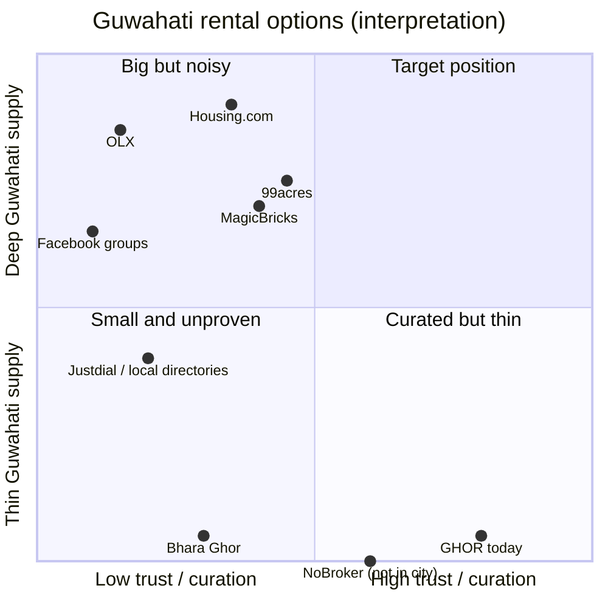

# GHOR — Competitive Research & Product Strategy

| | |
|---|---|
| **Companion to** | [`GHOR-PRODUCT-REQUIREMENTS.md`](GHOR-PRODUCT-REQUIREMENTS.md) (the PRD, which records *what exists*). This document covers *what to do next and why*. |
| **Research date** | 2026-09-29. All competitor observations are from that day unless a source says otherwise. |
| **GHOR baseline** | `dev` @ `a5cde89`. Web and API only; the mobile app was out of scope. |
| **Nature** | Research, strategy and a UX and performance audit. Nothing was implemented, and no application code was changed. |

## Evidence rules used in this document

- **[Observed]** means seen directly on the live competitor site (in a real browser at 390 px mobile width, or by fetching the page) on 2026-09-29. The source URL is given.
- **[Reported]** means a secondary source such as a news article, a company profile or a search summary. It is labelled as such.
- **[User feedback]** means anecdotal reviews or complaints (Trustpilot, forums). It is not verified product behaviour.
- **[GHOR measured]** means measured on GHOR's production build running locally (see §12 for the method).
- **UNKNOWN** means the information couldn't be verified. Some sites block automated access (MagicBricks and 99acres block simple fetching; they were opened in a real browser instead).
- The web search tool used is US-based, so it is not a reproduction of Google India rankings. Treat "who ranks for Guwahati queries" as indicative only.

---

## Contents

1. [Executive summary](#1-executive-summary)
2. [Current GHOR assessment](#2-current-ghor-assessment)
3. [Competitive landscape](#3-competitive-landscape)
4. [Competitor-by-competitor analysis](#4-competitor-by-competitor-analysis)
5. [Competitive feature matrix](#5-competitive-feature-matrix)
6. [User experience comparison](#6-user-experience-comparison)
7. [UI/UX comparison and audit of GHOR](#7-uiux-comparison--audit-of-ghor)
8. [Trust & safety comparison](#8-trust--safety-comparison)
9. [Discovery comparison](#9-discovery-comparison)
10. [Owner experience comparison](#10-owner-experience-comparison)
11. [SEO comparison](#11-seo-comparison)
12. [Performance comparison](#12-performance-comparison)
13. [Strengths, weaknesses, opportunities and threats](#13-16-swot)
14. [What GHOR should NOT copy](#17-what-ghor-should-not-copy)
15. [Why GHOR should exist: differentiation strategy](#18-why-ghor-should-exist--differentiation-strategy)
16. [Proposed discovery experience](#19-proposed-discovery-experience)
17. [Proposed trust system](#20-proposed-trust-system)
18. [Proposed owner experience](#21-proposed-owner-experience)
19. [Proposed SEO strategy](#22-proposed-seo-strategy)
20. [Performance strategy](#23-performance-strategy)
21. [Analytics strategy](#24-analytics-strategy)
22. [Prioritised feature opportunities](#25-prioritised-feature-opportunities)
23. [P0–P3 roadmap](#26-p0p3-roadmap)
24. [GHOR 2.0 vision](#27-ghor-20-product-vision)
25. [Six-month strategic roadmap](#28-6-month-strategic-roadmap)
26. [Open product decisions](#29-open-product-decisions)
27. [Final action plan: gap by gap](#30-final-action-plan--gap-by-gap)
28. [The answer: 10–15 highest-leverage changes](#the-answer-the-1015-highest-leverage-changes)
29. [Sources](#sources)

---

## 1. Executive summary

**The market reality in Guwahati (2026-09-29).** Supply exists, but trust does not.

- Housing.com shows **2,059** Guwahati rentals, of which **486 are owner-listed**. On a mobile visit, **the first five results were all agents**, listed directly under the page's claim of "✓100% Verified Properties". [Observed]
- OLX shows **1,679** Guwahati rental ads: **883 by owners, 749 by dealers**. [Observed]
- MagicBricks shows **608** flats and says 433+ are "No Brokerage". [Observed]
- 99acres shows **606+** flats and **a site-wide scam warning** telling users never to pay visit charges, gate-pass fees or refundable booking amounts. [Observed]
- Facebook has several active Guwahati rental groups, **one literally named "Guwahati Rent Without Agents"**. [Observed through search results]
- **NoBroker does not operate in Guwahati.** Its Guwahati page returns HTTP 410 and its city list is 11 metros. **Stanza Living does not operate in Guwahati.** [Observed]
- A small local clone of GHOR's exact idea already exists: **Bhara Ghor**, "Zero brokers… call the owner directly", covering Assam. It had **only 2 listings in all of Assam**, one already rented. [Observed]

**What this means**

1. **The idea is not the moat.** "No brokerage, talk to the owner" is already claimed by MagicBricks, 99acres, Housing, a Facebook group and Bhara Ghor. GHOR's advantage has to come from **operations and trust that are hard to fake**: human-reviewed listings, a genuinely owner-only marketplace, freshness, and local knowledge (localities, colleges, "bachelors allowed", PGs). It also has to come from **supply density** in the specific areas that students and young professionals search.
2. **GHOR's biggest self-inflicted barriers are strategic, not visual.**
   - **Sign-in is required before browsing.** This makes GHOR invisible to Google and to first-time visitors. Every competitor lets people browse freely and indexes thousands of locality pages.
   - **There is no working production sign-in at all** (SMS and web Google sign-in are not implemented; PRD §16 B1).
   - GHOR is **missing the filters every competitor offers** in Guwahati: tenant type (bachelors / boys / girls / family) and PG / shared room.
3. **GHOR's product quality is already ahead** of every Guwahati option we measured on polish, calm and page weight. It sends 186–243 KB of JavaScript per page against 0.6–1.3 MB for the portals. It has no ads and no dealer clutter. Two fixable performance issues remain: **listing-detail LCP of 4.2 s** on a throttled mobile connection, and **layout shift (CLS 0.117) on Browse**.
4. **The recommended positioning:** "**Guwahati's owner-only, human-checked room and flat finder for students and young professionals.**" Win the Jalukbari / Gauhati University, Six Mile–Ganeshguri–Dispur and Beltola–Hatigaon clusters first, with honest trust signals and freshness as the product's personality.

**The top 5 changes** (the full list is at the end):
1. Make production sign-in work (SMS provider; implement or remove the Google button).
2. **Public browsing and listing pages**, with sign-in required only to contact (this is `CLAUDE.md` §7.4's own documented fallback), plus SEO locality pages.
3. Local-fit filters: **tenant preference (bachelors / girls / boys / family)** and a **PG / shared** type.
4. **Freshness as a first-class trust signal** ("Available · confirmed N days ago", auto-expiry, one-tap renew).
5. Seed and use **institutions** ("near Gauhati University", "near Cotton University", "near IIT Guwahati") and locality normalisation.

---

## 2. Current GHOR assessment

This summary is verified against the code; the PRD has full detail. **I** = implemented, **P** = partial, **PL** = planned, **U** = unknown.

| Area | Status | Reality (verified in code or by measurement) |
|---|---|---|
| Proposition | I | Owner-direct rooms and flats in Guwahati; human-reviewed; free for seekers |
| Target users | I | Seekers, owners, admin. The owner role only affects navigation; any user can list. |
| Guwahati-first | I | City fixed to Guwahati everywhere; no city selector |
| Seeker journey | I | Sign-in first → Browse → detail → chat or call |
| Owner journey | I | 6-step wizard → draft → review → live / needs changes → rented |
| Moderation | I | Every listing reviewed; edits to live listings re-queue for review; **no rejection reason** |
| Lifecycle | I | draft / pending / approved / rejected / rented; no expiry or freshness |
| Search | I | Substring match on title, locality and description; locality suggestions; popular areas |
| Filters | I / P | Type (room/flat), rent, 6 amenities, institution (**0 institutions seeded**) |
| Sort | I | Newest, price ↑, price ↓ |
| Map | I | Leaflet + OSM; approximate pins; up to 500 per request |
| Listing detail | I | Mosaic and viewer, facts, amenities, approximate map, owner card, safety advice, reviews, similar homes |
| Chat | I | One thread per seeker per listing; live over a socket; unread counts; text only |
| Notifications | I | In-app only on web; push only on mobile; **no email or SMS** |
| Profiles | I | Own profile (name editable); public owner profile with response rate and time |
| Trust | I / P | Phone verified; "Verified by GHOR" = approved; reports with a threshold; reviews gated to people who messaged; ID and property verification are **fields only** |
| Photo rules | I | 3–20 photos; signed uploads to GHOR's own Cloudinary account; 1,600 px compression in the browser, 2,000 px server cap |
| Authentication | P | Phone code implemented, but **SMS isn't, so production sign-in is impossible**; the web Google button doesn't work |
| API | I | NestJS + Prisma; about 50 routes; role and ban checked on every request |
| Web architecture | I | Next.js 15; **19 of 22 pages render in the browser**; tokens kept on the server (httpOnly cookies); TanStack Query |
| Design system | I | Blue, Navy & Cream; Geist headings; motion only on marketing pages |
| Responsive | I | 1440 → 375 px verified; phone tab bar; sticky contact bar |
| Performance | I | [GHOR measured] see §12: JS 186–243 KB per page; detail LCP 4.2 s on slow 4G; CLS 0.117 on Browse |
| SEO | **Weak** | **Everything except the landing and legal pages requires sign-in**; no robots.txt, no sitemap, no canonical URLs, no structured data; the title and description promise "PGs" and still carry waitlist wording |
| Accessibility | P | Focus rings, dialogs, labels and keyboard support in the viewer; **no formal audit** |
| Analytics | P | 6 events; all-time counts; owner insights; **no search or filter events, no funnel ratios** |
| Hosting / tests | U / missing | No deployment configuration; no committed tests |

---

## 3. Competitive landscape

*Positions are the author's interpretation of the evidence in §4, not measurements.*

| Segment | Players in Guwahati | Relevance to GHOR |
|---|---|---|
| National portals | Housing.com, 99acres, MagicBricks, Square Yards, CommonFloor, QuikrHomes, RealEstateIndia, Nestoria / Mitula (aggregators) | High. They own Google results for "flats for rent in Guwahati" and have deep but broker-heavy supply. |
| Horizontal classifieds | OLX | High. The largest *owner* supply by count (883 owner ads); low trust and weak structure. |
| Informal | Facebook groups ("TO-LET & ROOM RENT AT GUWAHATI", "Guwahati Rent Without Agents"), WhatsApp forwards | Very high. This is where rooms for bachelors and students actually circulate. |
| Local directories and brokers | Justdial ("Rooms on rent in Assam Engineering College Road Jalukbari"), IndiaMart to-let agencies | Medium. Evidence that brokers operate as "to-let services". |
| Local startups | Bhara Ghor (Assam, owner-direct, map-first), NHomes (Startup Assam; managed apartments; reported 45 properties in 2018), apnarooms / pgroom (PG listings near colleges) | Medium. They validate demand; none has visible scale. |
| National no-broker leader | NoBroker | **Not present in Guwahati.** Relevant as a benchmark and a possible future entrant. |
| Co-living / student housing | Stanza Living (not in Guwahati), NestAway (acquired by Aurum PropTech in 2023, [Reported]), Flatmate apps, HooLiv (tier-2/3 student housing; [Reported] raised ₹24 cr in 2025) | Low today; a future PG/co-living adjacency |

---

## 4. Competitor-by-competitor analysis

### 4.1 Housing.com (REA Group / PropTiger)

**Source:** `housing.com/rent/flats-for-rent-in-guwahati-assam-P47ict1f3zqkkhvr5`, observed 2026-09-29 at 390 px.

| | Observations |
|---|---|
| **Supply** | "Showing 1–30 of **2059** properties". The page text says "2025+ Flats… 561+ Houses… **486+ owner flats**". [Observed] |
| **Cards** | Lister name (mostly agencies: "Angel Properties", "Capital Homes", "MAA KAMAKHYA PROPERTIES", "Home Link Realtors"), photo count ("1/9"), a "New" tag, some "Verified" tags, BHK and type, locality, rent with "see price breakup", area, furnishing, **"Highlights: Close to Apollo Hospitals / Close to Royal Global S…"**, "Updated 1d ago", and a "Contact" button. [Observed] |
| **Filters** | BHK, budget slider (0–40K), **Listed By**, furnishing, property type, **Verified**, **Featured Agents**, more filters. Sort: Relevance. [Observed] |
| **Trust** | The page claims "✓100% Verified Properties", but only some cards show "Verified" and **the top 5 results were agents**. [Observed] *Interpretation: the verification claim and the presentation contradict each other.* |
| **SEO** | Title "Flats for Rent in Guwahati \| 2025+ Rental Flats in Guwahati"; structured data **ItemList + Product + Apartment/House per listing, BreadcrumbList, FAQPage**; an "Last Updated: Sep 28, 2026" stamp. [Observed] |
| **Performance** | Mobile, uncached, unthrottled: 213 requests, `load` at about 4.9 s. [Observed; not throttled, so not directly comparable to §12] |
| **Monetization** | Featured agents and listings (visible "Featured Agents" filter). [Observed] Details of paid plans UNKNOWN. |

### 4.2 99acres (Info Edge)

**Source:** `99acres.com/flats-for-rent-in-jalukbari-guwahati-ffid`, observed 2026-09-29 at 390 px.

| | Observations |
|---|---|
| **Supply** | "**34 results** \| Flats for Rent in Jalukbari Guwahati". Guwahati overall shows 606+ flats (from search results). [Observed] |
| **Scam warning** | A site-wide banner: "**Never pay booking amount without visiting the property. SCAMMERS WILL ASK FOR: Property visit charges, Gate pass booking, Refundable booking amount**". [Observed] |
| **Filters** | Budget; bedrooms (**1 RK/1 BHK**…); property type (incl. "1 RK / Studio"); bathrooms; **Available for: Family / Single Women / Single Men / Tenants with Company Lease**; **Posted by: Owner / Builder / Dealer / Feature Dealer**; furnishing; amenities; available-from date; localities **with star ratings** (Jalukbari 4.0, Six Mile 4.1…); area; "Properties with photos"; "**Verified properties — Verified by 99acres verification team**". Quick chips: Owner, Verified, Furnished, With Photos, With Videos. [Observed] |
| **Cards** | Project name, "3 BHK Flat for rent in Jalukbari", **rent + "Deposit 2 months rent"**, area, baths, floor ("4th out of 7 Floors"), facing, description, **"Dealer · 1w ago"** or **"Owner · 5d ago"**, "View Number", "Contact". [Observed] |
| **Social proof** | "**2 people already contacted since last week**". [Observed] |
| **Gating** | "**Login to unlock 17 more**" after the first results. [Observed] The first result was a **Dealer** listing. |
| **SEO** | Title "34+ Flats for Rent in Jalukbari Guwahati…"; structured data **Apartment × 25, RentAction × 25, Place, BreadcrumbList**; a "Get to know more about Jalukbari Locality" link. [Observed] |
| **Performance** | Mobile, unthrottled: first byte about 0.85 s, 214 requests, **about 1.1 MB of JavaScript**. [Observed] |

### 4.3 MagicBricks (Times Internet)

**Source:** `magicbricks.com/flats-for-rent-in-guwahati-pppfr`, observed 2026-09-29.

| | Observations |
|---|---|
| **Supply** | "**608 results** \| Flats for Rent in Guwahati"; "433+ No Brokerage Flats, 117+ Fully Furnished… **7+ Single Room options**"; popular areas "Beltola, Kahilipara, Dharapur, Six Mile, VIP Road". [Observed] |
| **Cards** | "8+ Photos", "**Updated today**", "**Owner: Ranjita Medhi**", "2 BHK Flat for Rent in Athgaon", furnishing, bathroom, "**TENANT PREFERRED: Bachelors/Family**", "**AVAILABILITY: Immediately**", carpet area, floor, balcony, a long generated description ("There are no brokerage fees on this 2 BHK…"), rent, "Security Deposit", **"Contact Owner" + "Check Availability"** or "Ask Society Name". [Observed] |
| **Filters** | Top localities, budget, type, BHK, **Posted By**, more filters; tabs "Properties (608)" and "**Top Agents**"; sort "Relevance". [Observed] |
| **Other** | "Sign in to get a personalised feed!", Home Interiors, "MB Advice", "Post Property FREE", **Shortlist** (favorites). [Observed] |
| **User feedback** | Trustpilot reviews complain about **stale listings kept live after rental** and **listings the owner never posted**. [User feedback] |

### 4.4 OLX

**Source:** `olx.in/en-in/jalukbari_g5301657/for-rent-houses-apartments_c1723`, observed 2026-09-29.

| | Observations |
|---|---|
| **Supply** | "**1,679 ads near Jalukbari**" (Guwahati-wide); **Listed by: Owner (883), Dealer (749), Builder (5)**; "PG & Guest Houses (168)". [Observed] |
| **Locality demand signal** | Location facet counts: **Six Mile 112, Beltola 84, Zoo Tiniali 77, Dispur 74, Bhangagarh 64, Chandmari 52, Kahilipara 48, Bhetapara 46, Ulubari 42, Ganeshguri 39, Lokhra 39, Jalukbari 38, Hatigaon 32, Hengerabari 31**… [Observed] *Interpretation: this is the best public proxy for where Guwahati rental supply concentrates.* |
| **Filters** | BHK, bathrooms, budget, facing, type, car parking, price per sq ft, furnishing, listed by, super built-up area, **BACHELORS ALLOWED ("Bachelors allowed 1,400+ items / not allowed 200+")**. Sort: date published. [Observed] |
| **Cards** | A **FEATURED** tag, price, BHK, baths, sq ft, title ("2 BHK Flat for Rent in Jhalukbari, Guwahati - 16000"), locality. [Observed] |
| **Trust** | No verification; paid "Featured" placement; a wishlist. [Observed] |
| **Performance** | Mobile, unthrottled: **about 3.4 s to first byte**, about 1.3 MB of JavaScript. [Observed] |

### 4.5 NoBroker

**Sources:** `nobroker.in`, `nobroker.in/tenant/plans`, `nobroker.in/flats-for-rent-in-guwahati`.

| | Observations |
|---|---|
| **Coverage** | Cities: Bangalore, Mumbai, Chennai, Pune, Gurgaon, Hyderabad, Delhi, Noida, Greater Noida, Faridabad, Ghaziabad. **The Guwahati URL returns HTTP 410 Gone.** [Observed] |
| **Seeker monetization** | **Freedom ₹999 (up to 25 owner contacts), Relax ₹2,999 (50 contacts + relationship manager + alerts + agreement help), Assure ₹5,499 (money-back + movers)**. No free tier is described on the page. [Observed] |
| **Services** | Rental agreement, packers and movers, painting and cleaning, rent receipts, pay tuition fee, flatmates, PG/hostels. [Observed] |
| **User feedback** | Trustpilot complaints about paid owner plans: promised relationship managers who never appeared, poor communication, slow refunds. [User feedback] |
| **Relevance** | It is the category's reference model. The important insight: the "no broker" leader **charges seekers** and is **absent from Guwahati**. |

### 4.6 Facebook groups and WhatsApp (informal)

**Source:** search results for "Guwahati room rent Facebook group".

- Groups seen: **"TO-LET & ROOM RENT AT GUWAHATI"**, "TO-LET & ROOM RENT AT GUWAHATI ASSAM", "GUWAHATI TO-LET & ROOM RENT 🏡✅", "HOUSE RENT IN GUWAHATI", and **"Guwahati Rent Without Agents"**. [Observed]
- Post titles use the local language of search: "**Single room for rent in Guwahati**", "**Room for rent in Dispur, Guwahati, 7k monthly**", "Room for rent in Kharghuli… with attached…", "Single Room Available For Rent… **Guwahati club**". [Observed]
- *Interpretation:* single rooms at ₹5–10k, landmark-based locations ("Guwahati Club", "near GU"), "attached bathroom", and very fast posting are the norm. There's no structure, no search, no verification and no freshness, and group admins can't police brokers at scale.
- WhatsApp rental forwards are not publicly observable. **UNKNOWN**.

### 4.7 Local startups and directories

| Player | Observed | Assessment |
|---|---|---|
| **Bhara Ghor** (`bharaghor-e806a.web.app`) | "Zero Brokerage Room Finder… Open the map, explore nearby rooms, and **call the owner directly**"; "Currently active in 8 districts across Assam"; public search with no sign-in; types **Single Room / Flat / Paying Guest**; **tenant filter: Boys Only / Girls Only / Families Only**; amenities Wifi / 24/7 Water / Parking / **Food**; **sort "Proximity: Closest First"**; "Verified Only" toggle; claims "**100% Verified Listings**" / "Direct Owner Verification". **Inventory: "Showing 2 Rooms in Assam"**, one of them "Rented Out". Hash routes (`#/search`) that search engines can't index. [Observed] | Validates the exact proposition and shows a **thin-supply failure mode**. Its "100% verified" claim can't be substantiated from the site. The filters show what local users expect. |
| **Rental Sathi** | A pan-India listing site with Guwahati pages; cards show "Posted 2 months ago" and a **view count**; claims "100% pre-screened listings" while its disclaimer says users must verify everything themselves. [Observed] | A generic long-tail competitor. |
| **NHomes** | Startup Assam incubatee; managed service apartments without brokerage; "45 properties in Guwahati" as of an older write-up. [Reported] | A managed model; current status UNKNOWN. |
| **apnarooms / pgroom / Justdial** | PG and room listings near Cotton University and on AEC Road, Jalukbari. [Reported / partly observed; apnarooms returned 503] | Evidence of PG demand near colleges. |
| **GuwahatiToLet.com** | The domain doesn't resolve. [Observed] | Defunct, which is a reminder that local listing sites die when supply dries up. |

### 4.8 Stanza Living / NestAway / co-living

- **Stanza Living:** 16+ cities, none in the Northeast; "India's most trusted managed living provider… 50,000+ beds". [Observed] Not in Guwahati.
- **NestAway:** acquired by Aurum PropTech in 2023; a 2025 founder dispute. [Reported] Not an active Guwahati factor.
- **HooLiv:** tier-2/3 student housing; [Reported] raised ₹24 cr in October 2025. Watch it as a possible entrant into college towns.

### 4.9 Local market context

- **The Sentinel (Assam):** tenants report unchecked rent hikes and worsening services in Guwahati, e.g. water supply cut to two windows a day in **Six Mile**; the market is "largely unregulated". [Reported]
- **Students** come for IIT Guwahati, Gauhati University, Cotton University, Assam downtown University, Royal Global University and others. The **bachelor-friendly** question dominates: OLX has a dedicated filter with 1,400+ "bachelors allowed" ads. [Observed / Reported]

---

## 5. Competitive feature matrix

Legend: **Y** = yes, **N** = no, **P** = partial, **U** = unknown / not verified. GHOR entries come from the code; competitor entries are from observation on 2026-09-29.

| Capability | GHOR | Housing | 99acres | MagicBricks | OLX | NoBroker* | Bhara Ghor | FB groups |
|---|---|---|---|---|---|---|---|---|
| Serves Guwahati | Y | Y | Y | Y | Y | **N** | Y | Y |
| Owner-direct only | **Y** (by moderation) | N (agents dominate) | N (dealers) | P ("No Brokerage" subset) | N (749 dealers) | Y (in its cities) | Y (claimed) | N |
| Broker-free positioning | Y | P | P | P | N | Y | Y | P ("Without Agents" group) |
| Listing moderation before going live | **Y** (every listing) | U | U | U | U | U | U | P (group admins) |
| Listing verification | P (review only) | P ("Verified" tag) | P ("Verified by 99acres team") | U | N | U | P (claims "100% verified") | N |
| Photo minimum | **Y (3)** | N | N ("with photos" filter) | N | N | U | N | N |
| Owner identity verification | P (phone only) | U | U | U | N | U | U (claimed) | N |
| Property verification | N (field only) | U | P | U | N | U | U | N |
| Locality discovery | Y | Y | Y (+ ratings) | Y | Y (+ counts) | Y | Y | N |
| College / university discovery | **P** (built, no data) | P ("close to" highlights) | N | N | N | U | P (proximity) | N |
| Map discovery | Y | U (not observed on mobile) | U | U | N | Y | **Y (map-first)** | N |
| Search quality | P (substring) | Y | Y | Y | P | Y | P | N |
| Tenant-type filter (bachelor/girls/family) | **N** | U | **Y** | **Y** ("Tenant preferred") | **Y** ("Bachelors allowed") | U | **Y** | N |
| PG / shared room type | **N** | N (separate section) | Y (PG pages) | P ("Single Room") | Y (PG category) | Y | **Y** | P |
| Sorting | Y (3 options) | Y | Y | Y | Y | Y | Y (+ proximity) | N |
| Saved searches / alerts | N | U | U | U | U | Y (paid alerts) | N | N |
| Favorites / shortlist | N | U | U | **Y** ("Shortlist") | **Y** ("Wishlist") | U | N | N |
| Recently viewed | N | U | U | U | U | U | N | N |
| Recommendations | P (similar homes) | U | U | P ("personalised feed") | N | U | N | N |
| Freshness indicator | **N** | Y ("Updated 1d ago") | Y ("1w ago") | Y ("Updated today") | Y (date) | U | N | P (post date) |
| Duplicate detection | N | U | U | U | U | U | U | N |
| Fraud warnings | Y ("Before you visit") | U | **Y** (banner) | U | U | U | N | N |
| In-app chat | **Y** | U | P ("Contact" form) | P ("Contact Owner") | Y | Y | N (call only) | Y (Messenger) |
| Call owner | Y | U | Y ("View Number") | Y | Y | Y (paid contacts) | Y | Y |
| Notifications | P (in-app; push on mobile) | U | U | U | U | Y | N | Y (FB) |
| Owner dashboard | Y | U | U | U | P | Y | U | N |
| Listing analytics for owners | **Y** | U | U | U | P | P (paid) | U | N |
| Enquiry management | P (chat list) | U | U | U | P | Y | N | N |
| Reporting | Y | U | U | U | Y | U | U | P |
| Trust indicators on cards | Y (Verified = reviewed, phone-verified owner) | P | P | P ("Owner: name") | N | U | P | N |
| Deposit shown | Y | P ("price breakup") | **Y** (on card) | Y | N | U | N | P |
| Availability date shown | Y (if given) | U | Y (filter) | **Y** ("Immediately") | N | U | N | P |
| Browsing without sign-in | **N** | Y | P (first page; "login to unlock") | Y | Y | Y | **Y** | P (group membership) |
| SEO: indexable listings and locality pages | **N** | **Y** | **Y** | **Y** | **Y** | Y | N (hash routes) | P |
| Mobile web UX | Y (tested) | Y | Y | Y | Y | U | Y | Y (the app) |
| Accessibility | P | U | U | U | U | U | U | U |
| Page weight (JS) | **~190–245 KB** | ~620 KB (on a 404 page) | ~1.1 MB | U | ~1.3 MB | U | small (17 requests) | n/a |
| Ads / featured clutter | **N** | Y (featured agents) | Y (feature dealer) | Y (top agents) | Y (featured) | Y (services) | N | N |
| Seeker pays | **N** | N | N | U | N | **Y (₹999–5,499)** | N | N |
| Guwahati / local specialisation | **Y** | N | N | N | N | N | Y | Y |

\* NoBroker's features are shown for its operating cities; it doesn't serve Guwahati.

---

## 6. User experience comparison

| Stage | Category norm (observed) | GHOR today | Gap |
|---|---|---|---|
| First visit | Land straight on listings (Housing, OLX, MagicBricks, Bhara Ghor) | A marketing page, then **a mandatory sign-in** before seeing any listing | **Largest gap.** A visitor must trust GHOR before seeing any value. |
| Sign-up | Optional until contact; 99acres gates after the first page | Required up front; **no production SMS** | Blocker |
| Search vocabulary | "1 RK", "single room", "PG", "bachelors allowed", "girls only", "near GU" | Room / flat, 6 amenities, free text | Missing local vocabulary |
| Results | Dense cards with deposit, "Updated today", tenant preference and availability | Calm photo-first cards with rent, title, locality, amenities, trust line | GHOR is cleaner but misses freshness and tenant preference |
| Listing detail | Long, spec-heavy, generated descriptions | Structured, honest, photo-led, with safety advice | GHOR is better, but slower LCP |
| Contact | "View Number" / "Contact" (lead forms), often behind login or payment | Chat or call, free, one tap (after sign-in) | GHOR is better |
| After contact | Calls from multiple brokers (widely reported) | Owner-only chat thread with listing context | GHOR is better, provided owners reply (no email fallback) |

---

## 7. UI/UX comparison & audit of GHOR

### 7.1 Where GHOR is already strong

Based on the 2026-09-28 release-candidate walkthrough plus this review:
- A calm, photo-first visual language.
- A single, loud rent figure.
- No ad or dealer noise.
- Honest empty states.
- A good phone composition (tab bar, sticky contact bar, swipe gallery).
- A strong listing-detail information order.

Against the portals, where most mobile screens are dense spec grids, promotional banners and "Top Agents" rails, **GHOR looks more premium and more trustworthy**. Keep this.

### 7.2 Screen-by-screen critique

Each finding gives the problem, why it matters, the pattern that prompted it, and the recommendation. Performance and mobile impact are noted where relevant.

| Screen | Problem | Why it matters | Pattern observed | Recommendation | Perf / mobile |
|---|---|---|---|---|---|
| **Landing** | Positioned as pre-launch ("Join waitlist" is the main button); meta description says "Join the waitlist"; the title promises "PGs" | Once live, the main action should be "Find a room". The PG claim is currently untrue. | Competitors lead with search. | Two modes: pre-launch (waitlist) and live (a search box plus live locality counts). Fix the title and description. | No cost |
| **Sign-in** | The Google button is shown but doesn't work | A dead end damages trust on the very first action | none | Implement it or hide it (PRD §20) | none |
| **Browse** | Popular-areas tiles use large type and colour blocks, weighty for what is navigation; no freshness or tenant-preference cues; "0 homes in Guwahati" wording on searches | Cognitive load; missing the facts that decide a click | MagicBricks/99acres show freshness and tenant preference on the card | Compact locality chips with counts (like OLX's facet counts) rather than big tiles; add "Updated N days ago" and a tenant-preference line to cards | Reduces layout-shift risk |
| **Listing card** | Shows "New" when there are no reviews (easily read as "new listing"); the amenity line is useful | Ambiguous labels weaken trust | none | Show review information only when reviews exist; use a freshness label instead | none |
| **Filters** | Missing tenant type, PG/shared, furnishing and move-in date | These are *the* decision filters in Guwahati | OLX "Bachelors allowed", Bhara Ghor "Boys/Girls/Families", 99acres "Available for" | Add a tenant preference (listing field) and a type (room / shared / PG / flat) | Small |
| **Map** | Good; pins are approximate. On phones the map comes first and pushes the list down. | On phones the list is the primary task | Bhara Ghor is map-first, with a "Proximity" sort | Phones: list first with a floating "Map" button; add a "Closest to…" sort once institutions exist | Saves loading map tiles for list-only users |
| **Listing detail** | LCP 4.2 s on slow 4G ([GHOR measured]); no freshness; "Property verified" badge can never show | Slow hero, and a "new or stale?" doubt | Portals show "Updated today" | Render detail on the server, preload the hero image, show "Available · confirmed N days ago" | Big LCP win |
| **Owner profile** | Solid; the response stats are a differentiator | none | Portals rarely show responsiveness | Make "Usually replies within X" visible on cards and detail | none |
| **Create listing** | 6 steps; no tenant-preference or occupancy fields; no quality guidance beyond tips | Missing data that renters filter by; low photo quality risk | 99acres collects "available for" | Add tenant preference and occupancy; show a completeness indicator; photo-quality hints (blur and darkness checks later) | Small |
| **Edit listing** | Good; warns that edits go back to review | none | none | Show *what* will be re-reviewed | none |
| **My Listings** | One insights request per card; no freshness or renew action | Owners have no reason to come back | none | "Still available?" one-tap renew; batch the insights | Fewer requests |
| **Chat** | Good; text only; no "visit scheduled" structure | Visits are the conversion step | none | Quick action "Propose a visit time" (a structured message) | none |
| **Notifications** | One per message; web only in-app | Owners miss enquiries | none | Group by conversation; add an email digest | none |
| **Profile** | Fine; no way to become an owner or show your own trust status | Role confusion | none | "List a property" entry for seekers; a "Your trust signals" section | none |
| **Admin** | Functional; no rejection reason; no freshness or duplicate tools | Moderation quality doesn't scale | none | Rejection reason templates; a duplicate-photo hint; freshness queue | none |
| **States** | Good empty and loading states; Browse CLS 0.117 because Popular areas pushes the grid down | Visible jump on load | none | Reserve the rail's height or render it on the server | Fixes CLS |

**Design principles to keep:**
- Heavy motion stays on marketing surfaces (already implemented). **Do not** add glass effects, gradients or animation to product screens; none of the problems above are aesthetic.
- The opportunity is **information design**: the right facts (freshness, tenant preference, deposit, response time) in the right place.

---

## 8. Trust & safety comparison

| Mechanism | Competitor practice (observed) | GHOR | Assessment |
|---|---|---|---|
| "Verified" badge | Housing: "100% Verified Properties", yet agent-first results. 99acres: "Verified by 99acres verification team" (a filter). Bhara Ghor: "100% Verified Listings" (unsubstantiated). | "Verified by GHOR" means a person reviewed the listing, with a tooltip saying so | GHOR's badge is honest but **the word "Verified" invites misreading**. Consider "Reviewed by GHOR". |
| Owner vs agent | Posted-by filters; agents dominate | Owner-only by policy and moderation | **Differentiator** if enforced and visibly stated |
| Scam warnings | 99acres banner (visit charges, gate pass, booking amount) | "Before you visit" on detail | Comparable; add the specific scam patterns and a warning inside chat before any money talk |
| Freshness | "Updated today / 1w ago" everywhere; complaints about stale listings (MagicBricks) | **None** | **A gap and an opportunity:** make freshness verifiable |
| Duplicate detection | UNKNOWN for all | None | An opportunity (perceptual image hashing, phone-number reuse) |
| Seekers pay | NoBroker ₹999–5,499 | Free | Differentiator |
| Response behaviour | Rarely shown | Response rate and time on the owner profile | Differentiator; surface it more |

---

## 9. Discovery comparison

| Dimension | Best observed | GHOR | Recommendation |
|---|---|---|---|
| Locality taxonomy | OLX facet counts (60+ Guwahati localities with counts); 99acres locality ratings | Free-text localities; a curated suggestion list | Normalise localities (a canonical list plus aliases: "Jhalukbari" → Jalukbari, "Zoo Tiniali" → Zoo Road area) |
| Landmarks and colleges | Housing "Close to Royal Global S…" highlights; Bhara Ghor proximity sort | Institution tags built, **0 seeded** | **Seed 20–40 institutions**; "Near GU / Cotton / IITG / RGU / AEC / Assam downtown" chips; a distance sort |
| Tenant fit | OLX "Bachelors allowed", 99acres "Single Women/Men/Family", Bhara Ghor "Boys/Girls/Families", MagicBricks "Tenant preferred" | None | **Add it (P1)** |
| Unit type | 1 RK, single room, PG, flatmate | Room / flat | Add "shared room / PG" at least as a type flag |
| Freshness sort / filter | Implied by recency | Newest (by creation date) | "Recently confirmed available" |

---

## 10. Owner experience comparison

- **Portals** offer free posting plus paid visibility (featured agents and dealers). Owners compete with agents for attention, and Trustpilot complaints describe **paid plans that under-deliver** (NoBroker) and **stale or unauthorised listings** (MagicBricks). [User feedback]
- **Facebook** is fastest to post but gives no control, no analytics and a lot of noise.
- **GHOR** has a better-structured wizard, a real review step, insights (views, enquiries, response rate) and chat. Its weaknesses:
  - no rejection reason;
  - no renewal or freshness loop;
  - no email notifications;
  - owners who aren't signed up as owners can't find the entry point;
  - **3 photos is a real barrier** for someone renting out a single room (an interpretation, worth testing).
- **Abandonment points** (predicted, not measured): phone sign-in (blocked in production); photo step (3 minimum); waiting for review (no expected time or progress); no enquiries in week 1 (no guidance); rejection without a reason.

---

## 11. SEO comparison

| | Housing | 99acres | MagicBricks | OLX | GHOR |
|---|---|---|---|---|---|
| Indexable city page | Y | Y | Y | Y | **N** (sign-in required) |
| Locality pages ("…in Jalukbari") | Y | **Y** | Y | **Y** | N |
| Listing pages indexable | Y | Y | Y | Y | N |
| Structured data | ItemList, Product, Apartment, BreadcrumbList, **FAQPage** | Apartment, **RentAction**, Place, BreadcrumbList | U | WebPage, BreadcrumbList | **None** |
| Freshness in the title or page | "Last Updated: Sep 28, 2026" | counts in the title | counts in the title | counts in the title | none |
| robots.txt / sitemap | U | U | U | U | **Missing (404)** |

**Conclusion:** GHOR is **absent from organic search**, which is where most Guwahati rental journeys start (every "room / flat for rent in <locality> Guwahati" query we ran returned portals, OLX, Justdial and Facebook). This is the single largest acquisition gap, and it follows from the sign-in-first decision (`CLAUDE.md` §7.4, which already names the fallback).

---

## 12. Performance comparison

### 12.1 Method (GHOR)

- GHOR's production build (`next start`) and API ran locally, with temporary data (8 listings, real Cloudinary photos) that was deleted afterwards.
- Chrome at **390 × 844**, cold cache, **Slow-4G profile** (1.6 Mbps down, 750 kbps up, 150 ms latency) and **4× CPU throttling**, to approximate a mid-range Android phone.
- Metrics came from the browser's performance APIs: LCP, CLS, first byte, and resource sizes.
- **Caveat:** the API and web server ran on a development PC and talked to a remote database in Mumbai. Real latency will differ.

| Page | First byte | FCP | **LCP** | **CLS** | JS | Images | Font | Requests | API calls (slowest) |
|---|---|---|---|---|---|---|---|---|---|
| Landing (signed out) | 23 ms | 2.6 s | 2.6 s (hero image) | 0 | 189 KB | 42 KB | 68 KB | 21 | 0 |
| Sign-in | 6 ms | 0.7 s | 0.7 s | 0 | 133 KB | 31 KB | 68 KB | 20 | 0 |
| Browse | 7 ms | 1.0 s | 1.0 s (heading)* | **0.117** | 186 KB | 92 KB | 68 KB | 39 | 7 (2.3 s) |
| Listing detail | 19 ms | 0.75 s | **4.2 s (hero photo)** | 0 | 243 KB | 68 KB | 68 KB | 46 | 7 (2.3 s) |
| Chats | 6 ms | 0.8 s | 0.8 s | 0 | 186 KB | 1 KB | 68 KB | 32 | 3 (2.1 s) |
| Notifications | 8 ms | 0.6 s | 2.7 s | 0 | 186 KB | 0 | 68 KB | 30 | 3 (1.7 s) |
| Profile | 7 ms | 0.7 s | 2.9 s | 0 | 187 KB | 0 | 68 KB | 33 | 4 (2.7 s) |

\* The Browse LCP is the heading, because listing photos arrive after the API responds, so the *meaningful* content appears later (about 2.5–3 s).

**Other measurements [GHOR measured]:**
- **Interaction latency** under 4× CPU: filter chip 256 ms, property type 160 ms, opening Filters 192 ms. These fall in the INP "needs improvement" band (200–500 ms) on slow phones.
- **Browse CLS source:** the Popular-areas rail is inserted above the results skeleton when its data arrives, accounting for 0.115 of the 0.117.
- **Every signed-in page** makes 3 navigation API calls (`/auth/me`, `/notifications`, `/conversations`) before its own data.
- **Map:** +45 KB of JavaScript loaded on demand, plus 12 tiles.

### 12.2 Competitors (observed, mobile, **not throttled**, so indicative only)

| | First byte | JS | Requests |
|---|---|---|---|
| 99acres (Jalukbari) | ~0.85 s | ~1.1 MB | 214 |
| OLX (Jalukbari) | **~3.4 s** | ~1.3 MB | 140 |
| Housing.com (Guwahati) | ~0.1 s | U (~0.6 MB seen on a 404 page) | 213 |
| Bhara Ghor | ~0.9 s | U | 17 |

**Conclusion:** GHOR's page weight is roughly **5× lighter** than the portals', a real advantage on Assam mobile networks. Its weaknesses are **architectural latency**: data is fetched in the browser after load, so the hero image waits for a gateway-to-API-to-database round trip, plus the navigation calls on every page.

### 12.3 Performance priorities

| Priority | Issue | Evidence | Fix direction |
|---|---|---|---|
| **P0** | None severe. No page is broken or unusable on slow 4G. | §12.1 | none |
| **P1** | Listing-detail LCP 4.2 s | Measured | Render the detail page on the server (also needed for SEO); preload the hero image; use a small blur placeholder |
| **P1** | Browse CLS 0.117 | Measured source | Reserve space for Popular areas, or render discovery rails on the server |
| **P1** | Client-side data waterfalls on every page (19/22 pages render in the browser) | Code + measured | Server-render public pages (browse, detail, locality pages) and pass the initial data to the client |
| **P2** | 3 navigation API calls per page | Measured | Combine into one `/me/summary` call, or return the counts with `/auth/me` |
| **P2** | Filter tap latency 160–256 ms on 4× CPU | Measured | Show filter state changes immediately (transitions); avoid re-rendering the whole grid |
| **P2** | Geist font 68 KB on every uncached view | Measured | Subset to Latin and needed weights; check it is cached |
| **P2** | One insights request per My Listings card | Code | Batch endpoint |
| **P3** | Next.js image optimisation on the web server | Architecture | Use Cloudinary delivery transformations (`f_auto,q_auto,w_`) through a custom loader |
| **P3** | Public OSM tiles and Nominatim | Policy | A keyed provider before scale (a launch blocker, not a speed issue) |

---

## 13–16. SWOT

| **Strengths** | **Weaknesses** |
|---|---|
| Human review of every listing; owner-only by policy | No working production sign-in (SMS; web Google) |
| 3-photo minimum; honest badges; safety guidance | Sign-in before browsing means no SEO and first-visit friction |
| Free for seekers (NoBroker charges ₹999+) | No tenant-preference or PG/shared types, the key local filters |
| Chat with listing context; owner response statistics | No freshness system; no rejection reasons; no email fallback |
| Very light pages (≈190–245 KB JS); calm, premium UI | Zero supply today; institutions not seeded |
| Guwahati-specific focus and vocabulary potential | Client-side rendering hurts detail LCP; no tests or hosting yet |

| **Opportunities** | **Threats** |
|---|---|
| **NoBroker and Stanza are absent** from Guwahati | Portals already claim "no brokerage" and "verified"; users may not see a difference |
| Portals are agent-dominated (Housing's top results were agents) | OLX and Facebook own owner supply by volume and habit |
| The informal market is huge but unstructured | Bhara Ghor and others can copy the UI; cheap to launch |
| Student demand clusters around identifiable institutions | A large portal could add a Guwahati "owner-only" filter |
| Tenant pain (rent hikes, services) is covered by local press | Scammers target new platforms; a trust failure is fatal early |
| SEO gap: few useful "rooms near <college>" pages exist | SMS/DLT delays could push the launch past the Dec–Jan window |

---

## 17. What GHOR should NOT copy

| Pattern (where seen) | Why to avoid it |
|---|---|
| Charging seekers to contact owners (NoBroker plans) | It contradicts GHOR's core promise and taxes the conversion step |
| "Login to unlock more results" (99acres) | GHOR should gate *contact*, not *looking* |
| Agents and "Featured Dealers" mixed into owner results (Housing, 99acres, OLX) | It destroys the owner-direct promise |
| Blanket "100% Verified" claims (Housing, Bhara Ghor) | Claims that aren't backed by a process are what make users distrust portals |
| Machine-generated boilerplate descriptions (MagicBricks) | They add length, not information |
| Fake urgency ("2 people contacted since last week") unless it's real and useful | Borderline dark pattern; if used, it must be real data (GHOR has view events) |
| Ad-heavy layouts and cross-sold services on product screens | Slower pages and less trust |
| Hash-routed single-page apps (Bhara Ghor) | Invisible to search |
| The mobile-planned interstitial ad before contact (`CLAUDE.md`) | It taxes the most valuable action; no competitor in the observed set does it on web |

---

## 18. Why GHOR should exist: differentiation strategy

### 18.1 Honest assessment

**Today GHOR's differentiation is weak in the market and strong in the product.** A Guwahati renter has never heard of GHOR, can't find it on Google, and must sign in before seeing whether it has anything. The things that *are* better (curated owner-only supply, free contact, chat, honest trust, lightness) are only visible after that barrier, and only if there's supply.

### 18.2 The answers

1. **What problem are we uniquely solving?** Finding a **real, currently available room or flat from the actual owner**, especially for **students and young professionals ("bachelors")**, without paying a broker and without sifting through agent spam and stale posts.
2. **Primary user:** a student or early-career renter looking for a single room or small flat (₹4k–15k) near a college or workplace in Guwahati. This matches the product copy, the Facebook post patterns and the OLX "bachelors allowed" volume. *Recommendation: make this explicit.*
3. **Why trust GHOR?** Every listing is reviewed by a person; owners only (brokers are removed); at least 3 real photos; freshness confirmed by the owner; owner responsiveness visible; free contact; clear scam guidance. **Each of these must be a real mechanism** (§20).
4. **Why GHOR instead of Facebook or WhatsApp?** Structured search by locality, college, budget and tenant fit; photos; no agents; freshness; a private chat tied to the listing; and no need to join ten groups.
5. **Why GHOR instead of Housing, MagicBricks or 99acres?** Owner-only (their top results are agents); no ads or featured dealers; free (unlike NoBroker, which isn't here anyway); faster pages; local vocabulary and institutions.
6. **Why should owners list?** Better-qualified renters (signed in, phone-verified); no broker calls; free; a simple listing flow; insights; control over who they rent to. *Weak today:* no demand yet. Owners list where renters are, so **SEO and public browsing are prerequisites for supply**.
7. **Defensible advantage if our UI is copied?** (a) **Supply relationships** built in person with PG operators and landlords near colleges (`LAUNCH.md` §2); (b) **the trust operation**: moderation history, freshness data, owner response data and reports; (c) **local data**: a normalised locality and landmark graph and institution proximity; (d) **brand**: "the honest one" in a market full of agents.
8. **Local network effect:** seekers and owners concentrated in a few clusters. More fresh owner listings around GU and Jalukbari bring more student searches, which make owners there respond and renew, which strengthens freshness and trust, which draws more owners. Campus word of mouth (the `LAUNCH.md` ambassador plan) amplifies this.
9. **Hard for national marketplaces to reproduce:** (i) the *owner-only* rule, which contradicts their agent revenue; (ii) human review at the locality level; (iii) Guwahati-specific taxonomy and institution coverage; (iv) in-person verification capacity in one city.

### 18.3 Strengthening the differentiation (recommended)

- Say "**Owners only. Reviewed by a person. Free.**" everywhere, and **enforce it**: a broker policy with removal and bans on report.
- **Freshness guarantee:** listings not confirmed for 14 days leave search automatically (the rule is PROPOSED).
- **Bachelor- and student-friendly** as a first-class filter and landing-page theme.
- **Rooms near your college** as a signature discovery surface (institution pages).

---

## 19. Proposed discovery experience

The ideal journey, stage by stage. **Complexity:** L = low, M = medium, H = high.

| Stage | User goal | Current GHOR | Competitor pattern | Problem | Proposed improvement | Benefit | Complexity |
|---|---|---|---|---|---|---|---|
| Landing | "Is there anything for me here?" | Marketing page; waitlist; sign-in wall | Straight to listings, with counts | No proof of inventory | Live mode: a search box plus live counts by locality and college ("32 rooms near Gauhati University") | Instant relevance | M |
| Discovery | Browse without commitment | Sign-in required | Public browse | Friction; no SEO | **Public browse and detail; sign in to contact** | Top-of-funnel and SEO | M (auth routing + server rendering) |
| Search | Type what I know ("GU", "Six Mile", "near Cotton") | Substring search; locality suggestions | Autocomplete of localities, projects and landmarks | Aliases and colleges miss | Locality normalisation plus institution aliases in suggestions | Fewer zero results | M |
| Filters | Budget, room type, **who can live there** | Type, rent, amenities | Tenant preference, PG, furnishing, available-from | Local decision criteria missing | Tenant preference; shared/PG; furnishing; move-in date | Better matches | M |
| Results | Compare quickly | Photo cards | Freshness, deposit, tenant preference on cards | Missing freshness | Card line: "Bachelors OK · Updated 3d ago · Replies in ~1 h" | Faster decisions | L–M |
| Listing | Decide if it's real and right | Strong detail page | Long spec pages | 4.2 s LCP; no freshness | Server-rendered; freshness stamp; "what's included in rent" | Speed and trust | M |
| Trust evaluation | "Is this a scam or an agent?" | Reviewed badge, phone verified, safety tips | Scam banner; Verified filters | "Verified" is ambiguous | "Reviewed by GHOR" wording; owner-only statement; freshness; report | Clarity | L |
| Contact | Reach the owner | Chat or call (after sign-in) | Paid or gated contact | Sign-in is at the wrong moment | Sign in at the moment of contact, returning to the same listing and opening chat | Conversion | M |
| Chat | Arrange a visit | Text chat with quick replies | Calls | Visit scheduling is unstructured | A "Propose visit" quick action (date and time chips) that creates a structured message | More visits | M |
| Visit | Go safely | Safety tips | 99acres banner | none | Pre-visit checklist in the chat when a visit is proposed | Safety | L |
| Rented | Close the loop | Owner marks rented | none | No attribution | "Did you find a place?" prompt to seekers after N days; owner marks rented with an optional "via GHOR?" | Real success metric | L–M |

### 19.1 Discovery features ranked by user value × differentiation ÷ cost

Scores are 1–5 (cost: 5 = cheapest).

| Feature | Value | Diff. | Cost | Score | Recommendation |
|---|---|---|---|---|---|
| Public browse and detail (contact gated) | 5 | 3 | 3 | 45 | **Do (P0/P1)** |
| Tenant-preference filter | 5 | 2 | 4 | 40 | **Do (P1)** |
| Institution seeding + "near college" chips and pages | 5 | 4 | 4 | 80 | **Do (P1)** |
| Freshness signal + auto-expiry | 5 | 4 | 3 | 60 | **Do (P1)** |
| Locality normalisation and aliases | 4 | 3 | 3 | 36 | **Do (P1)** |
| PG / shared-room type | 4 | 2 | 3 | 24 | P2 (needs a product decision, PRD §20) |
| Favorites | 4 | 1 | 4 | 16 | P2 |
| Saved search + alerts | 4 | 2 | 2 | 16 | P2 |
| Distance sort to an institution | 3 | 3 | 3 | 27 | P2 (after seeding) |
| Recently viewed (device only) | 3 | 1 | 5 | 15 | P2 (planned) |
| Commute-based search | 3 | 3 | 1 | 9 | P3 |
| Recommendations | 2 | 1 | 2 | 4 | P3 |
| Gender preference | 4 | 2 | 3 | 24 | Treat as part of tenant preference ("girls only" is a common landlord condition); **needs a legal and product review** |

---

## 20. Proposed trust system

**Rule: every signal must map to a real mechanism. No mechanism, no badge.**

| Signal (shown to users) | Mechanism | Status |
|---|---|---|
| **Reviewed by GHOR** (rename from "Verified by GHOR") | Human moderation before going live | Exists; rename PROPOSED |
| **Phone-verified owner** | Phone code at sign-in | Exists |
| **Owner, not agent** | Owner declaration at listing time, plus the broker policy, reports and bans | Declaration and policy PROPOSED |
| **Available · confirmed N days ago** | Owner confirms availability; automatic reminders; auto-hide after the window | PROPOSED (a "Mark as rented" reminder is PLANNED) |
| **Usually replies within X** | Existing response-time computation | Exists (owner profile); surfacing PROPOSED |
| **Real photos** | 3+ photos; duplicate-photo check across listings (perceptual hash) | Minimum exists; the check is PROPOSED |
| **Property checked in person** | An agent or the founder visits; the admin sets `property_verified` | Field exists; flow PLANNED |
| **ID-verified owner** | Document review with a retention policy and compliance review | Fields exist; flow PLANNED |
| Scam guidance | "Never pay before visiting" on detail and **inside chat** when money words appear ("advance", "token", "booking", "UPI") | Detail exists; chat nudge PROPOSED |
| Exact-address privacy | Approximate map; address shared in chat | Exists |
| Reports | Categories, threshold, admin; **add "this is an agent"** as a category | Exists; category PROPOSED |
| Suspicious behaviour | Same phone on many listings in different localities; high report rate; mass copy-paste | PROPOSED (admin hints) |

---

## 21. Proposed owner experience

| Step | Abandonment risk | Proposal |
|---|---|---|
| Discover GHOR | Owners don't know GHOR exists | Owner landing page ("List your room free. Renters near <college> are searching"); flyers with QR codes at PGs (`LAUNCH.md`) |
| Sign up | SMS not implemented; role confusion | Production SMS; "List a property" available to any user (the API already allows it) |
| Create | 6 steps; missing fields | Keep 6 steps; add tenant preference and occupancy; prefill locality from the typed text; show "about 3 minutes" |
| Photos | 3-photo minimum; poor quality | Keep the minimum (a trust differentiator), plus a guided shot list ("room, bathroom, entrance") and brightness warnings |
| Submit / moderation | Uncertainty | "Usually reviewed within X hours" (from real data) plus notifications; **rejection reasons with templates** |
| Enquiries | Missing messages | **Email and SMS fallback**; notifications grouped per conversation |
| Chat | Repetitive questions | Owner quick replies ("Yes, available", "Visit timings", "Deposit is…") |
| Availability | Stale listings | A weekly "Still available?" one-tap confirmation (by email or in-app), auto-hide after 14 days, one-tap renew |
| Rented | Forgetting to mark it | Prompt after chat inactivity; "Mark as rented" from the notification |
| Insights | Low value | Keep views, enquiries and response rate; add "search appearances" later |

---

## 22. Proposed SEO strategy

**Prerequisite:** public listing and browse pages (the documented fallback in `CLAUDE.md` §7.4). Without it, SEO is limited to the landing page.

| Page type | URL (proposed) | Indexable? | Content | Risk control |
|---|---|---|---|---|
| City hub | `/rooms-in-guwahati`, `/flats-in-guwahati` | Yes | Live listings (server-rendered), counts, locality links, short honest guide | Only live, fresh listings |
| Locality | `/rooms-in-jalukbari`, `/flats-in-beltola` | **Only if ≥ N live listings** (e.g. 3) | Listings, the approximate area, typical rent (from real data), nearby colleges | `noindex` when thin; no empty template pages |
| Near institution | `/rooms-near-gauhati-university`, `/rooms-near-cotton-university`, `/rooms-near-iit-guwahati` | Yes, if there's supply within a radius | Listings sorted by distance, travel notes, safety tips | Curated list only (no automatic spam) |
| Listing | `/listing/[id]/[slug]` | Yes while live | Server-rendered detail; structured data: `Accommodation`/`Apartment` + `Offer` (price) + `BreadcrumbList` | **Rented or expired → noindex** (or 410 after a grace period); canonical to one URL |
| Owner profile | `/owner/[id]` | noindex | none | Privacy |
| Filter combinations | `?type=&amenities=` | **noindex, canonical to the base page** | none | Prevents duplicate content |

- **Technical:** `robots.txt` and `sitemap.xml` (generated from live listings and eligible locality and institution pages), per-page titles and descriptions, `lang="en"` (already set), Open Graph images for sharing, fast server-rendered HTML.
- **Content:** a small set of genuinely useful guides ("Renting near Gauhati University: areas, typical rents, what to check"), written from GHOR data. **No** programmatic pages for localities without supply.
- **Stale risk:** tie indexing to the freshness system; a listing that isn't confirmed drops out of the sitemap and gets noindex.

---

## 23. Performance strategy

**Standard (PROPOSED)** on Slow-4G with 4× CPU:
- LCP **≤ 2.5 s** on Browse and detail;
- CLS **≤ 0.05**;
- INP **≤ 200 ms**;
- ≤ 250 KB JavaScript per route;
- ≤ 2 blocking API round trips before meaningful content.

**Approach:**
1. Server-render public pages (browse, detail, locality pages) with initial data. This fixes SEO and LCP together.
2. Preload the detail hero image; use a blur placeholder; set explicit image sizes (already mostly done).
3. Reserve space for or server-render the discovery rails (fixes CLS).
4. One combined navigation summary call.
5. Keep GSAP on the landing page only (already true).
6. Add real-user monitoring later (web-vitals reported to the `events` table or an analytics tool).

---

## 24. Analytics strategy

### 24.1 Funnel

### 24.2 Events

**Exists** = recorded today (PRD §18).

| Event | Exists? | Notes |
|---|---|---|
| `landing_view` / `page_view` | No | Needs anonymous tracking once browse is public |
| `search_started` (query, source) | No | Key discovery metric |
| `filter_used` (filter, value) | No | Validates the tenant-preference and PG decisions |
| `listing_view` | **Yes** (server) | none |
| `photo_viewed` (index) | No | Photo-quality signal |
| `owner_profile_viewed` | No | none |
| `contact_tap` (chat/call) | **Yes** | none |
| `chat_started` | **Yes** | none |
| `message_sent` (role) | No (derivable from `messages`) | none |
| `visit_proposed` | No (feature doesn't exist) | none |
| `listing_shared` | **Yes** | none |
| `listing_reported` | No (derivable from `reports`) | none |
| `listing_saved` | No (favorites don't exist) | none |
| `signup` | **Yes** | none |
| `listing_created` | **Yes** | none |
| `listing_submitted` / `listing_approved` / `listing_rejected` / `listing_marked_rented` | **No** | **Add status-change events with timestamps.** Needed for approval time and supply funnels (the PRD notes there's no status history). |
| `availability_confirmed` | No | For freshness |
| `zero_results` (query) | No | Drives locality and alias work |

**North-star (PROPOSED):** *weekly successful owner contacts*, i.e. chats where the owner replies within 24 hours, per active locality cluster.

---

## 25. Prioritised feature opportunities

Scored by impact on **renters (R), owners (O), trust (T) and competitive position (C)** against effort.

| # | Opportunity | R | O | T | C | Effort | Priority |
|---|---|---|---|---|---|---|---|
| 1 | Production sign-in (SMS provider; fix or hide Google) | 5 | 5 | 3 | 5 | M | **P0** |
| 2 | Hosting, monitoring, a minimal automated test suite in CI | 3 | 3 | 3 | 3 | M | **P0** |
| 3 | Public browse and detail; contact gated | 5 | 4 | 2 | 5 | M | **P0/P1** |
| 4 | Seed institutions + "near college" chips and pages | 5 | 3 | 2 | 5 | L–M | **P1** |
| 5 | Tenant-preference field and filter | 5 | 4 | 2 | 4 | M | **P1** |
| 6 | Freshness: confirmation, stamp, auto-expiry | 5 | 3 | 5 | 5 | M | **P1** |
| 7 | Rejection reasons | 2 | 5 | 3 | 3 | L | **P1** |
| 8 | Email fallback for enquiries (then SMS) | 3 | 5 | 3 | 4 | M | **P1** |
| 9 | SEO foundation (server-rendered public pages, sitemap, robots, structured data, metadata) | 4 | 3 | 1 | 5 | M | **P1** |
| 10 | Detail LCP and Browse CLS fixes | 4 | 1 | 1 | 3 | L–M | **P1** |
| 11 | Locality normalisation and aliases | 4 | 3 | 1 | 3 | M | P1/P2 |
| 12 | Owner-only declaration, "agent" report category, broker policy | 3 | 3 | 5 | 4 | L | **P1** |
| 13 | Favorites | 4 | 1 | 0 | 2 | L–M | P2 |
| 14 | Saved searches and alerts (email) | 4 | 2 | 0 | 3 | M | P2 |
| 15 | PG / shared-room type | 4 | 4 | 1 | 3 | M | P2 (decision needed) |
| 16 | "Propose visit" in chat | 3 | 3 | 2 | 3 | M | P2 |
| 17 | Duplicate-photo detection | 1 | 1 | 4 | 3 | M | P2 |
| 18 | Status-change events and an analytics funnel | 1 | 2 | 1 | 2 | L | **P1** |
| 19 | Property in-person verification flow | 3 | 2 | 5 | 4 | H (operations) | P3 |
| 20 | ID verification | 2 | 1 | 4 | 3 | H (compliance) | P3 |

---

## 26. P0–P3 roadmap

| Feature | Problem | User | Why now | Expected impact | Complexity | Dependencies | Performance | Trust / safety | Success metric |
|---|---|---|---|---|---|---|---|---|---|
| **P0 — launch-critical** | | | | | | | | | |
| Production sign-in | Nobody can sign in in production | All | Blocks launch | Enables everything | M | SMS provider with DLT | none | OTP abuse limits already exist | Sign-in success rate above 90% |
| Hosting + monitoring + CI tests | No deployment, no regression safety | Team | Blocks launch | Reliability | M | Hosting choice | none | none | Uptime; CI runs tests |
| Legal placeholders | Required before a public launch | All | Blocks launch | Compliance | L | Founder details | none | Grievance officer named | Pages complete |
| **P1 — high-impact** | | | | | | | | | |
| Public browse + detail (contact gated) | Invisible to Google; friction | Seekers | Launch acquisition | More visitors, then more signups | M | Auth routing, server rendering | Improves LCP | Rate-limit public endpoints | Visitor → signup rate; organic sessions |
| Institutions + "near college" | The main student question can't be answered | Students | Supply is clustered | Relevance | L–M | Founder seeds the list | none | none | Share of searches using an institution |
| Tenant preference | The main local filter is missing | Seekers / owners | Every competitor has it | Fewer wasted contacts | M | Schema field (a real change) | none | Legal wording review | Contact → reply rate |
| Freshness system | Stale listings are the market's #1 complaint | All | Differentiator | Trust, fewer dead leads | M | Email / notifications | none | Core trust signal | Share of live listings confirmed within 14 days |
| Rejection reasons | Owners abandon after rejection | Owners | Cheap | Resubmission rate | L | Schema field | none | Clear moderation | Rejected → resubmitted rate |
| Email fallback | Owners miss enquiries | Owners | Reachability | Owner reply rate | M | Email provider (Resend is already used for the waitlist) | none | none | Median owner first-reply time |
| SEO foundation | No organic acquisition | Seekers | Rentals start on Google | Long-term acquisition | M | Public pages | Server rendering | noindex for stale listings | Indexed pages, organic clicks |
| LCP / CLS fixes | Slow hero, jumpy Browse | Seekers | Cheap with server rendering | Perceived speed | L–M | none | Direct | none | LCP ≤ 2.5 s, CLS ≤ 0.05 |
| Owner-only policy + agent report | Brokers will try to join | All | Launch trust | Owner-only integrity | L | Moderation practice | none | Core | Share of removed-agent listings |
| Status events | Can't measure approval time or funnel | Team | Cheap | Decisions based on data | L | none | none | none | Dashboard exists |
| **P2 — growth** | Favorites; saved searches and alerts; PG/shared type; propose-visit; duplicate-photo check; locality aliases; combined nav summary; batched insights | | | | | | | | |
| **P3 — future** | In-person property verification; ID verification; commute search; recommendations; featured listings (monetization); services; next city | | | | | | | | |

---

## 27. GHOR 2.0 product vision

This describes GHOR 6–12 months from now. It is PROPOSED.

| Dimension | Vision |
|---|---|
| **Positioning** | "Guwahati's honest room finder: owners only, checked by people, always fresh, free." |
| **Discovery** | Public, fast, local. Start from a college, a locality or a budget. Every card answers "Is it available? Who can live here? What does it really cost? Will the owner reply?" |
| **Trust model** | Layered, real signals: reviewed → phone-verified → fresh → responsive → (in-person checked) → (ID-verified). No badge without a mechanism. Brokers removed. Scam nudges where money is discussed. |
| **Owner experience** | List in about 3 minutes, get reviewed within hours with reasons if rejected, receive enquiries by chat, email and SMS, confirm availability in one tap, and see what works. |
| **Visual identity** | Keep Blue, Navy & Cream: calm, photo-first, information-rich rather than decorative. Motion only on marketing pages. |
| **Information architecture** | Public: Home (search) → Area or college pages → Listing → Owner. Signed in: Chats, Saved, Notifications, My Listings, Profile. Admin kept separate. |
| **Performance standard** | Pages server-rendered; LCP ≤ 2.5 s and INP ≤ 200 ms on Slow-4G with a mid-range phone; ≤ 250 KB JS per route. |
| **Mobile-web standard** | Thumb-zone actions, sticky contact, list-first map toggle, filters in a bottom sheet with counts, no horizontal scroll, 44 px targets. |
| **SEO** | A strong set of useful pages for "rooms / flats in <locality>" and "rooms near <college>", fresh and server-rendered, with structured data and no thin pages. |
| **Local strategy** | Win 3 clusters first: **Jalukbari–GU–AEC**, **Six Mile–Ganeshguri–Dispur–Zoo Road**, **Beltola–Hatigaon–Basistha**. Then expand across Guwahati, then Assam. |
| **Monetization (later)** | Supply-side only (featured placement for PG operators and professional owners, subscriptions, paid in-person verification) and services. **Never** charging seekers to contact owners. |
| **Defensibility** | Supply relationships, trust and freshness operations, local data, and brand. |

**North star:** *Every week, more Guwahati renters reach a real, available owner through GHOR, and those owners reply within a day.*

---

## 28. Six-month strategic roadmap

This is a proposal. Months are relative to the start of implementation.

| Month | Theme | Deliverables |
|---|---|---|
| 1 | **Launchable** | SMS provider live; Google decision; hosting and monitoring; CI tests; legal details; seed institutions (20–40) |
| 2 | **Open the door** | Public browse and detail with contact-gated sign-in; server-rendered detail and browse; sitemap, robots, metadata, structured data; LCP/CLS fixes |
| 3 | **Local fit** | Tenant-preference field and filter; locality normalisation and aliases; "near college" pages; rejection reasons; status events and funnel |
| 4 | **Freshness and reachability** | Availability confirmation and auto-expiry; email fallback; grouped notifications; owner-only declaration and agent reports |
| 5 | **Retention** | Favorites; saved searches and email alerts; "propose visit" in chat |
| 6 | **Scale trust** | Duplicate-photo detection; PG/shared type (if decided); pilot of in-person property checks in one cluster; review metrics and plan the next locality clusters |

Operations run in parallel: supply seeding per `LAUNCH.md` §2, with a target of 60–100 listings before public launch concentrated in the 3 clusters.

---

## 29. Open product decisions

These are added to PRD §20. **Not decided here.**

1. **Public browsing:** adopt the `CLAUDE.md` §7.4 fallback (browse freely, sign in to contact)?
2. **Tenant preference:** which values (Bachelors OK / Family only / Girls only / Boys only / Anyone)? How should legally sensitive wording be presented?
3. **PG / shared rooms:** a new type now, or later with PG-specific fields (meals, beds, curfew)?
4. **Freshness rule:** confirmation window (7 / 14 / 30 days) and what happens at expiry (hide or mark "unconfirmed").
5. **The "Verified" wording:** rename it to "Reviewed by GHOR"?
6. **Photo minimum:** keep 3 for single rooms, or use a lower minimum by type?
7. **Broker policy:** ban brokers outright, or allow verified agents in a separate lane later (a monetization tension)?
8. **Email and SMS provider** and quiet hours for notifications.
9. **Launch clusters:** confirm the three initial areas and the per-cluster supply targets.
10. **The planned mobile interstitial ad before contact:** keep it or drop it?

---

## 30. Final action plan: gap by gap

**Effort:** S = small, M = medium, L = large. **Impact:** H = high, M = medium, L = low.

| Priority | Area | Current GHOR | Competitor benchmark | Recommended GHOR | Why | Effort | Impact |
|---|---|---|---|---|---|---|---|
| P0 | Authentication | Phone code without SMS; broken Google button | Standard OTP or social login | SMS provider live; implement or hide Google | Nobody can sign in in production | M | H |
| P0 | Hosting / quality | No deployment config, no committed tests | none | Hosting, monitoring, CI tests | Launch reliability | M | H |
| P1 | Landing | Pre-launch waitlist page | Search-first with counts | Live mode: search plus locality and college counts | Show value immediately | S–M | H |
| P1 | Navigation / onboarding | Sign-in before anything | Public browse | Gate contact, not browsing | Friction; SEO | M | H |
| P1 | Search | Substring match | Alias-aware autocomplete | Locality normalisation, institution aliases | Fewer zero results | M | M |
| P1 | Filters | Type, rent, amenities | Tenant type, PG, availability | Tenant preference (+ PG later) | Key local decision criteria | M | H |
| P1 | Browse | Good; CLS 0.117 | Dense, noisy | Reserve rail space; compact locality chips with counts | Stability, clarity | S | M |
| P1 | Listing cards | Clean; "New" is ambiguous | Freshness, tenant preference | Add freshness and tenant preference; drop the ambiguous "New" | Decide faster | S | M |
| P1 | Listing detail | Strong; LCP 4.2 s | Heavy spec pages | Server-render, preload the hero, freshness stamp | Speed and trust | M | H |
| P2 | Map | Map-first on phones | Map-first (Bhara Ghor) | List-first plus a floating Map button; distance sort | Phone ergonomics | S | M |
| P2 | Owner profile | Response stats | Rare | Surface "replies in ~X" on cards and detail | Trust differentiator | S | M |
| P1 | Trust | Reviewed badge, phone, reports, tips | Blanket "verified" claims | Rename to "Reviewed"; owner-only declaration; agent reports; chat scam nudge | Honest, real signals | S–M | H |
| P1 | Listing creation | 6 steps, no tenant fields | Rich forms | Tenant preference and occupancy; completeness indicator | Better data | M | M |
| P2 | Listing editing | Good | none | Show what triggers re-review | Owner clarity | S | L |
| P2 | Photos | 3 minimum, compressed | Optional photos | Guided shot list; duplicate-photo check | Quality and authenticity | M | M |
| P1 | Moderation | Approve/reject without a reason | Opaque | Reason templates; freshness and duplicate queues | Owner retention | S–M | H |
| P2 | Chat | Good text chat | Calls and lead forms | "Propose visit"; owner quick replies | Conversion to visit | M | M |
| P1 | Notifications | In-app only on web | App push | Email fallback; group per conversation | Owner reachability | M | H |
| P2 | Favorites | None | MagicBricks Shortlist, OLX Wishlist | Favorites | Table stakes | S–M | M |
| P2 | Saved searches | None | NoBroker (paid alerts) | Saved search + email alert | Retention | M | M |
| P3 | Recommendations | Similar homes | "Personalised feed" | Keep similar homes; defer the rest | Low value without data | none | L |
| P1 | SEO | None (sign-in wall) | Thousands of locality pages with structured data | Public server-rendered pages, sitemap, structured data, noindex for thin or stale pages | Main acquisition channel | M | H |
| P1 | Performance | Light JS; client waterfalls | 0.6–1.3 MB JS | Server rendering, preload, CLS fix, combined nav call | Keep the lead | M | M |
| P2 | Accessibility | Good basics, no audit | U | Formal audit (contrast, screen reader) | Inclusivity; quality | S–M | M |
| P1 | Analytics | 6 events, counts only | U | Search, filter and status events; funnel dashboard | Data-driven decisions | S–M | H |
| P2 | Owner dashboard | Insights per card | Rare | Freshness actions, batched insights, response coaching | Retention | M | M |
| P2 | Admin | Queue, reports, users | U | Reasons, duplicate hints, freshness queue, time series | Moderation at scale | M | M |
| P1 | Mobile web | Good; tested at 375–390 px | App-first portals | List-first map, bottom-sheet filters with counts, 44 px targets | Most users are on phones | S | M |

---

## The answer: the 10–15 highest-leverage changes

**Question:** *"If GHOR has limited engineering resources, what are the 10–15 changes that would most meaningfully improve its ability to attract renters and owners, build trust, and compete?"*

Ordered for execution. Each cites its evidence.

1. **Make production sign-in real.** Connect a DLT-registered SMS provider, and implement web Google sign-in or remove the button.
   *Evidence:* code (PRD B1). *Why:* nothing else matters until people can sign in.
2. **Open browsing to everyone and gate only contact.** Public Browse, listing and locality pages; sign in at "Chat" or "Call", returning straight to the conversation.
   *Evidence:* every competitor is public, including Bhara Ghor; 99acres gates only after the first page; `CLAUDE.md` §7.4 already names this fallback.
   *Why:* first-visit value, word of mouth, and the prerequisite for SEO.
3. **Seed institutions and make "rooms near my college" a signature feature.** Chips, filters and pages for GU, Cotton, IITG, RGU, AEC, Assam downtown and others.
   *Evidence:* the feature is built but has 0 rows; student demand; Housing's "Close to…" highlights; Justdial's "AEC Road" pages.
   *Why:* local differentiation that is cheap to add.
4. **Add a tenant-preference field and filter** (Bachelors OK / Family / Girls only / Boys only / Anyone; final wording after legal review).
   *Evidence:* OLX "Bachelors allowed" (1,400+ ads), 99acres "Available for", MagicBricks "Tenant preferred", Bhara Ghor "Boys/Girls/Families".
   *Why:* the most important local decision criterion, and it's missing.
5. **Build freshness into the product.** Owner confirms availability, a "confirmed N days ago" stamp appears, the listing is auto-hidden when stale, and renewal is one tap.
   *Evidence:* every portal shows "Updated…"; stale-listing complaints about MagicBricks.
   *Why:* turns the market's biggest complaint into GHOR's signature trust signal.
6. **Owner-only enforcement you can see.** An "I am the owner" declaration, an "agent / broker" report category, a published broker policy, and "Owners only" in the UI.
   *Evidence:* Housing's top 5 results were agents; OLX has 749 dealer ads.
   *Why:* the one promise the national portals structurally can't make.
7. **Rename "Verified by GHOR" to "Reviewed by GHOR"** and keep every badge tied to a real mechanism. Surface "Usually replies within X".
   *Evidence:* blanket "verified" claims on Housing and Bhara Ghor; GHOR's badge means review.
   *Why:* honesty as positioning.
8. **Rejection reasons** (templates plus free text).
   *Evidence:* the PRD gap; owner abandonment risk.
   *Why:* cheap; directly protects supply.
9. **Email fallback for enquiries and grouped notifications.**
   *Evidence:* the `CLAUDE.md` §7.7 "mandatory" requirement, not implemented; the web has no push.
   *Why:* owner reply rate is the core of the conversion loop.
10. **SEO foundation:** server-rendered public pages, `sitemap.xml`, `robots.txt`, per-page metadata, structured data (Apartment/Offer/BreadcrumbList), and noindex for stale or thin pages.
    *Evidence:* competitors' structured data (Housing, 99acres); GHOR has none.
    *Why:* organic search is where Guwahati renters start.
11. **Fix detail LCP (4.2 s) and Browse CLS (0.117)**, mostly through the server rendering in #10, plus a hero preload and reserved rail space.
    *Evidence:* [GHOR measured].
    *Why:* keeps GHOR's speed advantage visible on slow networks.
12. **Locality normalisation and aliases** ("Jhalukbari", "Zoo Tiniali", "Six Mile"), with a canonical list derived from the observed OLX locality set.
    *Evidence:* OLX facet names; free-text fragmentation in the PRD.
    *Why:* search quality and clean SEO pages.
13. **Status-change and discovery events** (submitted, approved, rejected, rented, search, filter, zero results) and a simple funnel view.
    *Evidence:* PRD §18 gaps.
    *Why:* lets the team see what works after launch.
14. **Favorites** (then saved searches with email alerts).
    *Evidence:* MagicBricks "Shortlist", OLX "Wishlist".
    *Why:* table stakes for multi-day room hunting; brings renters back.
15. **A "Propose a visit" quick action plus a scam nudge in chat.**
    *Evidence:* 99acres' scam patterns (visit charges, gate pass, booking amount).
    *Why:* moves conversations to visits safely, the step before "rented".

**Explicitly not in the top 15:** animation, visual restyling, recommendation engines, commute search, payments, ID verification (high compliance cost), and multi-city work.

---

## Sources

All accessed 2026-09-29. **[O]** = observed directly, **[R]** = reported by a secondary source, **[UF]** = user feedback.

**National portals and classifieds**
- [O] Housing.com Guwahati rentals: https://housing.com/rent/flats-for-rent-in-guwahati-assam-P47ict1f3zqkkhvr5
- [O] 99acres Jalukbari rentals: https://www.99acres.com/flats-for-rent-in-jalukbari-guwahati-ffid
- [R] 99acres Guwahati rentals (via search results): https://www.99acres.com/flats-for-rent-in-guwahati-ffid
- [O] MagicBricks Guwahati rentals: https://www.magicbricks.com/flats-for-rent-in-guwahati-pppfr
- [O] OLX Jalukbari / Guwahati rentals: https://www.olx.in/en-in/jalukbari_g5301657/for-rent-houses-apartments_c1723
- [O] Square Yards Guwahati: https://www.squareyards.com/rent/property-for-rent-in-guwahati

**NoBroker**
- [O] Home page and city list: https://www.nobroker.in/
- [O] Tenant plans: https://www.nobroker.in/tenant/plans
- [O] Guwahati page (HTTP 410): https://www.nobroker.in/flats-for-rent-in-guwahati

**Local players**
- [O] Bhara Ghor: https://bharaghor-e806a.web.app/ (and `#/search`)
- [O] Rental Sathi: https://www.rentalsathi.com/flats-for-rent_guwahati-r20
- [R] NHomes (Startup Assam): https://startup.assam.gov.in/?p=3496 and http://startup.assam.gov.in/?incubatee=n-homes
- [R] Assam Tribune, "To-Let services in Guwahati": https://assamtribune.com/article/to-let-services-in-guwahati-check-rental-services-here-1436628
- [R] Justdial, rooms on AEC Road, Jalukbari: https://www.justdial.com/Guwahati/Rooms-On-Rent-in-Assam-Engineering-College-Road-Jalukbari/nct-10943923
- [R] PG near Cotton University: https://apnarooms.com/pg-near-cotton-university-for-girls/ (returned 503) · https://www.99acres.com/pg-in-guwahati-ffid

**Informal market**
- [O via search] Facebook groups:
  - https://www.facebook.com/groups/ghyrwa/ ("Guwahati Rent Without Agents")
  - https://www.facebook.com/groups/2109004379274740/
  - https://www.facebook.com/groups/288878046841177/
  - https://www.facebook.com/groups/4212295472231540/

**Co-living and student housing**
- [O] Stanza Living: https://www.stanzaliving.com/
- [R] NestAway (Aurum PropTech acquisition): https://tracxn.com/d/companies/nestaway/__uxhtsHMLvvS9opduUWzYOlkB0AA6QJv7cAdDok7Ji5I · https://pitchbook.com/profiles/company/110014-03
- [R] HooLiv funding: https://ceosofbharat.com/this-indian-startup-just-raised-rs-24-crore-to-revolutionize-student-housing-and-its-not-even-based-in-a-metro-city/

**Market context**
- [R] The Sentinel, Guwahati tenant unrest: https://www.sentinelassam.com/cities/guwahati-city/surging-rents-and-poor-services-spark-tenant-unrest-in-guwahati

**User feedback**
- [UF] Trustpilot, MagicBricks: https://au.trustpilot.com/review/magicbricks.com
- [UF] Trustpilot, NoBroker: https://ch.trustpilot.com/review/nobroker.com
- [UF] Trustpilot, 99acres: https://se.trustpilot.com/review/99acres.com
- [R] Deccan Herald, agent fraud using portal listings: https://www.deccanherald.com/india/karnataka/bengaluru/real-estate-agent-cheats-students-with-fake-lease-papers-723299.html

**Not verified (marked UNKNOWN in the matrix):** Housing.com, MagicBricks and 99acres chat, notifications, alerts and owner dashboards (they require accounts); WhatsApp rental behaviour; competitors' moderation and duplicate detection; Housing.com's JavaScript weight on a listing page; the current state of apnarooms.com and GuwahatiToLet.com.
