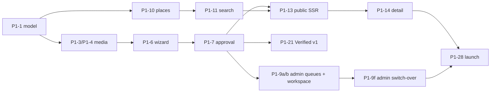

# GHOR — Implementation Roadmap

| | |
|---|---|
| **Specification** | [`GHOR-MASTER-PRODUCT-BLUEPRINT.md`](GHOR-MASTER-PRODUCT-BLUEPRINT.md) (MPB). Section references (§) point there. |
| **Decisions** | [`GHOR-DECISION-REGISTER.md`](GHOR-DECISION-REGISTER.md) (D-xx); open questions in MPB §52 (Q-xx) |
| **Baseline** | `dev` @ `a5cde89` |
| **Status** | Plan only. Nothing has been implemented. |

## Scales

| Scale | Values |
|---|---|
| **Priority** | P0 = blocks launch · P1 = required for the marketplace foundation · P2 = growth · P3 = scale |
| **Complexity** | S = ≤ 2 days · M = 3–7 days · L = 1–3 weeks · XL = more than 3 weeks. For one experienced developer with AI assistance; estimates, not commitments |

## Phase gates

A phase ends only when its exit criteria pass.

| Gate | Exit criteria |
|---|---|
| **G0** — end of Phase 0 | Production sign-in works; staging and production hosted with backups and monitoring; tests run in CI; legal pages complete; no dead UI; roles and audit in place |
| **G1** — end of Phase 1 | Every MPB §55 acceptance criterion that applies to Phase 1 passes; launch requirements (MPB §36) met, **including ≥ 60 listings with full media in 3 clusters**; **all ADM-01 to ADM-15 pass and moderation runs exclusively in `apps/admin`** (legacy `apps/web/admin` read-only) |
| **G2** — end of Phase 2 | Payments live and reconciled; paid visibility within the caps; DigiLocker (or equivalent) live; saved-search alerts; mobile parity; legacy `apps/web/admin` removed after the parity period |
| **G3** — ongoing | Scale criteria per city |

---

## Phase 0 — Production readiness

| ID | Feature | Priority | Dependencies | Complexity | Acceptance criteria | Risks | Testing |
|---|---|---|---|---|---|---|---|
| P0-1 | Real SMS OTP via a DLT-registered provider (MSG91-class) | P0 | DLT entity, header and template registration (3–7 days); provider account | M | ≥ 95% of codes delivered within 30 s in a 50-attempt test across Jio, Airtel, Vi and BSNL; no code ever logged in production; per-IP send cap | DLT delays (MPB R-08); template mismatch | Integration test with a provider sandbox; manual carrier test |
| P0-2 | Remove or hide the web "Continue with Google" button (D-36) | P0 | none | S | No non-functional auth UI anywhere | none | E2E: sign-in page contains only working methods |
| P0-3 | Hosting: web (Next.js-capable host + CDN), API (long-running Node host with WebSockets), staging + production, domains, TLS, environment management | P0 | Hosting choice (founder) | M | Staging auto-deploys from `dev`; production is promoted manually; rollback ≤ 5 min | Cost; misconfiguration | Smoke tests on deploy |
| P0-4 | Database: managed Postgres for production (fresh), daily backups, a restore drill, migrations in CI | P0 | P0-3 | S | A restore drill succeeds; migrations applied automatically on deploy | Data loss | Restore test |
| P0-5 | Commit the existing test suites (regression, security, photos, authorisation) + Playwright smoke tests; run in CI | P0 | P0-4 (disposable database in CI) | M | CI is green on all suites; required for merge | Flaky tests | n/a (this *is* testing) |
| P0-6 | Legal: privacy policy, terms, owner policy, verification consent + purpose notice, badge disclaimer, grievance officer, operator details; lawyer review | P0 | Founder's legal details; a lawyer | M (mostly non-engineering) | No placeholders; lawyer sign-off recorded | Legal exposure (R-07) | Content review |
| P0-7 | Keyed map tiles + geocoder | P0 | Provider accounts | S | Maps and geocoding run on provider keys; attribution shown; usage dashboard monitored | Cost | Manual + integration test |
| P0-8 | Cloudinary plan decision + folders (public listing media, private verification evidence), staging/production separation | P0 | Q-12 | S | The plan is active; folders created; a credit alert at 70% and 90% | Cost (R-06) | Upload smoke test |
| P0-9 | Restrict CORS to GHOR origins; per-IP rate limits for (future) public endpoints | P0 | P0-3 | S | Cross-origin requests from non-GHOR origins are refused; rate limits return 429 | Blocking legitimate clients | Security tests |
| P0-10 | Soft-delete / archive model; account deletion anonymises (the other party's chats preserved) | P0 | Schema change | M | Deleting a listing never removes another user's conversation; account deletion removes personal data and media per retention | Data-model regressions | Integration tests |
| P0-11 | Rename the green "Verified" chip to approval-source labels ("Reviewed by GHOR" for today's manually approved listings) | P0 | none | S | The word "Verified" appears nowhere unless the GHOR Verified badge is earned | Misleading trust (C-01) | UI test / text search |
| P0-12 | Monitoring: error tracking, uptime, API latency logs, job-failure alerts | P0 | P0-3 | S | Alerts fire in a test | Alert fatigue | Fire test alerts |
| P0-13 | **API-side admin RBAC** (`admin`, `senior_reviewer`, `super_admin`), a permission guard on every `/admin/*` route (with a route-coverage test), **admin-audience tokens** (user tokens rejected on admin routes and vice versa), step-up re-auth, the audit log + evidence-access log foundation; review and demote the 7 dev admin accounts (production starts fresh) | P0 | Schema change | M | ADM-02, ADM-03, ADM-04 and ADM-06 pass; every admin mutation writes an audit row in the same transaction | Privilege errors | Authorisation matrix tests; route-coverage test |
| P0-14 | Email infrastructure: sending domain (SPF/DKIM/DMARC), templates, delivery logging (the provider is already used for the waitlist) | P0 | Domain | S | Test emails deliver to Gmail and Outlook inboxes; bounce tracking | Deliverability | Seed-inbox test |
| P0-15 | Documentation reconciliation: update `CLAUDE.md`, `DESIGN.md` and the STATUS files to match the MPB and the code (MPB §53) | P0 | none | S | No contradictions flagged in a doc review | none | Review |
| P0-16 | **Admin Console foundation (`apps/admin`)**: a new workspace (Next.js + TypeScript), the admin BFF (httpOnly `SameSite=Strict` cookies), admin login with **mandatory authenticator-app TOTP + recovery codes** (D-47), an RBAC-aware shell and navigation (MPB §26.7), GHOR tokens in the dense variant, staging at `admin-staging.ghor.co.in`, production at `admin.ghor.co.in` (D-47), noindex headers, strict CSP | P0 | P0-3, P0-13 | M | Admins must enroll TOTP before first access, and recovery codes are issued, hashed and single-use (ADM-16); idle timeout 30 min and absolute 12 h enforced server-side (ADM-14); not indexable (ADM-13); **no business logic in the client** (code review) | A second UI to maintain during migration (R-19) | E2E login and session tests; security headers check |

**Parallel non-engineering tracks** (start in week 1):
- DLT registration;
- legal review (including tenant-fit wording, Q-23);
- places dataset curation (Q-13);
- naming the senior reviewer and moderators (Q-22);
- owner outreach for supply seeding;
- business entity + GST (for Phase 2, Q-06).

---

## Phase 1 — Marketplace foundation

Order follows MPB §54 (B1 → B9).

| ID | Feature | Priority | Dependencies | Complexity | Acceptance criteria | Risks | Testing |
|---|---|---|---|---|---|---|---|
| P1-1 | **Listing model v2** (categories, arrangement, size, costs, occupancy, suitability, rules, contact mode, approval source, freshness fields, private address) + migration | P1 | P0-10 | L | Every valid combination (MPB §6.1) can be created; invalid ones rejected; public responses never contain the private address or phone | Scope; migration errors | Unit (validation matrix), integration, DTO privacy test |
| P1-2 | **Owner profile completion + email verification** (MPB §7.1) | P1 | P0-14 | M | Submit returns 403 `PROFILE_INCOMPLETE` below 100%; email tokens hashed with a 24 h expiry; an email change resets verification | Owner friction | Unit (calculator), E2E |
| P1-3 | **Media standard:** photos 3–9 (minimum resolution, tags, pHash) | P1 | P0-8, P1-1 | M | UI + API block fewer than 3 or more than 9; low-resolution rejected; `listing_media` replaces `listing_images` | none | Integration + E2E |
| P1-4 | **Video:** signed chunked resumable upload, server verification, 480p/720p + poster, playback component, states | P1 | P0-8, Q-12 | L | Submit only with a ready video; an interrupted 150 MB upload resumes (on a plan that allows the size); zero video bytes before a tap on mobile | Supply friction (R-03); cost | Integration with the provider; throttled-network E2E |
| P1-5 | **Media lifecycle / cleanup jobs** (abandoned 7 days, removed 30, rejected 90, archived 180, account deletion 30) | P1 | P1-3, P1-4 | M | Unreferenced media past its window is destroyed; referenced media never is (tests) | Accidental deletion | Integration with fixtures |
| P1-6 | **Listing wizard v2** (7 steps, quota display, background uploads, preview) | P1 | P1-1…P1-4 | L | 10 test owners complete a listing (with video) in a median of ≤ 10 min; the draft persists across reloads | Abandonment | Usability test + E2E |
| P1-7 | **Approval flows:** the 5-minute auto-approval for free owners (with the "hold" action); immediate auto-approval for verified owners; approval-source labels; post-review queue; system pre-checks; risk-flag handling per Q-10 | P1 | P1-1, P0-13 | M | Auto-approval at 5 min ± 1 min without an admin decision; `approval_source` recorded; labels shown to renters and admins; flagged items follow Q-10 | **R-02 scams go live** | Unit (timer), integration (clock simulation), E2E |
| P1-8 | **Structured rejection reports** + reason catalogue + resubmission | P1 | P1-7 | S | Every rejection or change request has reason codes, a policy link, fix guidance and eligibility; delivered in-app and by email | none | Integration |
| P1-9 | **Admin Console, legacy parity:** move the queue + bulk approve/reject + reject confirmation, reports, reviews, users (role/ban), config and analytics from `apps/web/admin` onto the existing API (MPB §26.13 steps 2–3) | P1 | P0-16 | M | The parity checklist (MPB §26.13) passes in staging | Missed capability | E2E per parity item |
| P1-9a | **Admin Console moderation queues:** Free Listings (auto-approval countdown, Hold, claim is an assignment state that never stops the timer or changes status, D-47), Verified Listings (post-review), Reports, High Risk, Rejected/Needs Changes, Expiring/Stale; the status vocabulary (MPB §26.9) | P1 | P1-7, P1-9 | L | ADM-09 passes; free and verified queues separate; SLA timers visible | Moderators miss the 5-minute window (R-02) | E2E with a simulated clock |
| P1-9b | **Review workspace** (all MPB §26.10 panels: media incl. video and duplicate matches, facts, diff since the previous approval, timeline, owner/plan/badge, other listings, reports, rejections, response behaviour, risk flags) + actions with reason codes + optimistic concurrency | P1 | P1-9a, P1-3, P1-4 | L | ADM-10 passes; stale decisions rejected; every action audited | Information overload | Usability test with the moderators; E2E |
| P1-9c | **Admin dashboard** ("What needs attention now?", MPB §26.8) | P1 | P1-9a | M | ADM-11 passes (counts refresh ≤ 30 s) | none | E2E |
| P1-9d | **Trust area:** Verification (senior), GHOR Verified list, Badge Actions (senior), Appeals; evidence viewer (step-up, signed URLs ≤ 5 min, access log) | P1 | P1-21, P0-13 | L | ADM-05, ADM-07 and ADM-08 pass; only senior reviewers can grant or revoke | Evidence exposure (R-07, R-20) | Authorisation + security tests |
| P1-9e | **Marketplace + System areas:** Listings search, Owners, Renters, Places CRUD, Reviews; Admin Users, Roles & Permissions, Audit Log (view/export), Configuration, System Health; Promotions (the first-50 counter) | P1 | P0-13, P1-10 | L | Role-appropriate access per the MPB §26.5 matrix; audit export for super_admin only | Scope | Authorisation matrix |
| P1-9f | **Operational switch-over:** a security review of `apps/admin`; moderators move exclusively to the console; the legacy `apps/web/admin` gets a banner and becomes read-only (MPB §26.13 steps 5–6) | P1 | P1-9…P1-9e | S | ADM-12 passes; 2 weeks without fallback to the legacy pages **before public launch** | R-19 | Security review; operational checklist |
| P1-10 | **Places database v1** + admin CRUD + alias dictionary + precomputed distances | P1 | Q-13 dataset | M | ≥ 60 localities and ≥ 40 non-locality places with aliases; "jhalukbari" resolves to Jalukbari; distances recomputed on save | Data quality | Unit (matching), integration |
| P1-11 | **Search parser + suggestions + filters + no-result recovery** | P1 | P1-10, P1-1 | L | Every MPB §19.3 example parses correctly; recovery offers at least one path when inventory exists; search p95 ≤ 250 ms at 5,000 synthetic listings | Parser edge cases | Unit (parser), performance test |
| P1-12 | **Ranking v1** (eligibility → relevance → quality → trust; **no paid boost yet**) + a per-owner diversity cap | P1 | P1-11, P1-15 | M | Hard filters never violated; the diversity cap enforced | Relevance tuning | Unit + offline evaluation set |
| P1-13 | **Public server-rendered discovery + contact-gated authentication** (home, explore, place and category pages, listing detail); middleware changes; 301s from legacy routes | P1 | P0-9, P1-11 | L | Signed-out users can browse, search and open listings; contact, save and report prompt sign-in and resume the action; no private data in the HTML | Scraping | E2E + security tests |
| P1-14 | **Listing detail v2** (bento gallery, video tile, immersive viewer, trust panel, cost breakdown, safety panel) | P1 | P1-3, P1-4, P1-13 | L | CLS ≤ 0.05; LCP ≤ 2.5 s (slow 4G, 4× CPU); a keyboard-operable viewer | Performance regression | Lab performance test, axe |
| P1-15 | **Freshness** (cycles per category, reminders, aging, pause, grace, archive, restore, renter notices) | P1 | P1-1, P0-14 | M | A simulated clock moves listings through the states per MPB §17; paused listings leave search and the sitemap | Owner fatigue (R-17) | Integration (clock) |
| P1-16 | **Contact modes + phone reveal** (chat only / chat + calls; logged; caps) + removing the phone from detail responses | P1 | P1-1 | M | The phone is only returned by `reveal-phone`; chat-only listings refuse reveals; caps enforced | none | Security tests |
| P1-17 | **Email notifications** (owner and renter events per MPB §25; grouping; quiet hours) | P1 | P0-14 | M | Unread-enquiry emails within 35 min, grouped; preferences respected | Deliverability | Integration |
| P1-18 | **Saved listings + recently viewed** | P1 | P1-13 | S | Save requires sign-in (resumes the action); renters are notified when a saved listing is paused, archived, drops in price or gets a reply | none | E2E |
| P1-19 | **Reporting tiers + investigations + evidence snapshots + owner under-review copy** | P1 | P0-13 | M | A high-risk report hides the listing within 1 minute, creates an investigation, notifies the owner with the exact copy, and reveals nothing about the reporter | False reports | Integration + authorisation tests |
| P1-20 | **Graduated enforcement + appeals** | P1 | P1-19 | M | Each enforcement level applies correctly; appeals are reviewed by a different reviewer; all audited | Admin errors | Integration |
| P1-21 | **GHOR Verified v1 without payments:** verification cases (owner + property), senior-only decisions, evidence handling per retention (upload or in-person), badge computation, **first-50 promotion entitlement**, re-verification triggers | P1 | P0-6, P0-8, P0-13, Q-01, Q-07, Q-08 | XL | No badge without `verified` + an active entitlement; only a senior reviewer can grant; evidence purged per policy; every view logged; the promotion counter stops at 50 | Legal (R-07); workload (R-05); pay-for-trust perception (R-04) | Authorisation matrix, integration, E2E |
| P1-22 | **Quotas** (Free 3/month enforced; Verified-level 5/month through the promotion entitlement) | P1 | P1-21, Q-02 | S | Over-quota submission blocked (UI + API); reset at the period start | Evasion | Unit + integration |
| P1-23 | **SEO foundation** (URLs, thresholds, sitemap, robots.txt, canonical URLs, structured data including VideoObject, Open Graph, breadcrumbs) | P1 | P1-13, P1-15 | M | Rich-results validation passes for a listing; the sitemap has indexable URLs only; filter URLs noindexed | Thin pages | Automated validation |
| P1-24 | **Analytics v1** (MPB §34 events + admin funnel, including the auto-approval post-review outcome metric) | P1 | P1-7, P1-13 | M | The north-star metric can be computed weekly | Privacy | Event contract tests |
| P1-25 | **Performance gates in CI** + field web-vitals | P1 | P1-13, P1-14 | S | CI fails on a > 10% budget regression on 4 routes | Flaky lab data | CI job |
| P1-26 | **Accessibility pass** (axe in CI + a manual screen-reader pass) | P1 | Phase 1 UI | S | No serious or critical axe issues; contrast fixes applied | none | CI + manual |
| P1-27 | **Mobile app handling** per Q-19 (hide owner features or withdraw distribution) | P1 | Q-19 | S | No distributed app build can call removed or changed endpoints in a broken way | R-14 | Manual |
| P1-28 | **Launch readiness review + supply seeding** (≥ 60 listings, 3 clusters, full media) | P1 | All of the above | Operations | MPB §36 checklist signed off | R-01 | Checklist |

**Phase 1 critical path:**

---

## Phase 2 — Growth and trust

| ID | Feature | Priority | Dependencies | Complexity | Acceptance criteria | Risks | Testing |
|---|---|---|---|---|---|---|---|
| P2-1 | **Payments and subscriptions** (₹299/₹599; lifecycle MPB §10.2; failed payments, grace, cancellation, upgrade/downgrade, invoices/GST) | P2 | Q-03 provider, Q-06 entity, Q-04/Q-05 policies | XL | Webhooks signed, idempotent and replay-safe; reconciliation report matches the provider; the badge is independent of billing (a suspension hides it even when paid) | Financial and compliance | Provider sandbox, webhook replay tests |
| P2-2 | **Paid visibility** (bounded multipliers; ₹599 priority slots ≤ 2 per 20; labelling per Q-15) | P2 | P2-1, P1-12, Q-14 | M | Paid listings never bypass eligibility; slot caps hold; the score-gap guard works | R-11 relevance erosion | Unit + offline ranking evaluation |
| P2-3 | **Pro listing analytics + enhanced owner profile + priority support flow** | P2 | P2-1 | M | Pro-only features gated by entitlement | none | Integration |
| P2-4 | **DigiLocker (or partner) verification** + streamlined property verification at scale | P2 | Partner contract; legal | L | Fetched documents verified with consent; no image storage for DigiLocker path | Vendor | Sandbox tests |
| P2-5 | **Saved searches + alerts** (daily digest cap) | P2 | Inventory threshold; P1-17 | M | At most one digest per day; one-tap unsubscribe | Empty alerts | Integration |
| P2-6 | **SMS notifications** (freshness expiry, urgent enquiries; opt-in) | P2 | P0-1 | S | Opt-in respected; DLT templates approved | Cost | Integration |
| P2-7 | **Locality guides + commute context** (data-gated) | P2 | P1-10, listings data | M | Rent ranges shown only with n ≥ 5 | Thin content | Content review |
| P2-8 | **Visit proposals** (a structured chat message + safety checklist) | P2 | Chat | M | A visit proposal renders for both parties; safety checklist shown | none | E2E |
| P2-9 | **Typo tolerance (trigram index)** | P2 | Search volume | S | "jalukbry"-style free text finds matches | none | Unit/performance |
| P2-10 | **Mobile app rebuild on the new API** (signed photo + video upload, public browse, trust UI) | P2 | Phase 1 API stable | XL | Feature parity for renters; owners can list with video | Scope | Device tests |
| P2-11 | **Adaptive video streaming** (if bandwidth data justifies it) | P2 | Cloudinary data | M | Start time and bandwidth improve per plays | Cost | A/B measurement |
| P2-12 | **Admin Console Business area + Revenue analytics** (Subscriptions, Plans, Payments views and actions for super_admin; refunds per policy) | P2 | P2-1 | M | Only super_admin can change billing; every change audited; reconciliation view matches the provider | Financial errors | Authorisation + integration |
| P2-13 | **Remove the legacy `apps/web/admin`** (pages, admin-only hooks and components, `/admin` middleware entries), after the parity period (MPB §26.13 step 7) | P2 | P1-9f + 2 weeks of stable operation | S | `apps/web` contains no admin routes or code; API endpoints unaffected | Removing something still used | Route and bundle audit |

---

## Phase 3 — Scale

| ID | Feature | Priority | Dependencies | Complexity | Acceptance criteria | Risks | Testing |
|---|---|---|---|---|---|---|---|
| P3-1 | **Second Assam city** (places dataset, supply seeding, thresholds) | P3 | Guwahati thresholds met | L (mostly operations) | Liquidity targets in the new city | Diluted focus | Launch checklist |
| P3-2 | **PG bed-level availability** | P3 | PG supply | M | Beds available shown and updated | none | Integration |
| P3-3 | **Assamese owner flows** | P3 | Translation | M | Wizard and notifications in Assamese | Quality | Linguistic review |
| P3-4 | **Horizontal scaling:** shared rate-limit store, job locking, read replicas when metrics require it | P3 | Load evidence | M | No duplicate job runs; limits consistent across instances | Premature complexity | Load tests |
| P3-5 | **Reverse-image / stock-photo detection** | P3 | Vendor | M | Flags stock images for review | Cost | Evaluation set |
| P3-6 | **Optional GHOR property visits** (a separate decision) | P3 | Founder decision | Operations | none | none | none |
| P3-7 | **WhatsApp integration** (if decided, Q-16) | P3 | Decision | M | none | Loses the conversation record | none |
| P3-8 | **Admin hardening at scale:** an optional IP allowlist or VPN (not required at launch, D-47), a second super_admin approval for role changes, an audit hash chain, moderator workload analytics | P3 | Team growth | M | Controls enforced; a periodic access review | Operational friction | Security tests |

---

## Explicitly not scheduled (anti-scope)

- AI search or recommendations.
- Microservices, Redis, Elasticsearch (until P3-4 evidence).
- Masonry search results.
- Autoplay video on mobile or cellular.
- Renter fees, booking or contact fees, ads.
- Aadhaar authentication APIs.
- A GHOR photography or video service.
- A social feed.
- Gamification.
- Compare listings.
- A booking engine or escrow.

## Cross-phase testing requirements

- Every PR: unit + integration + authorisation matrix + DTO privacy tests.
- Every release: E2E (owner, renter, admin, senior reviewer), performance gates on 4 routes, axe.
- Before launch: carrier OTP test, load test (50 req/s search), usability tests (10 owners, 8 renters), a restore drill, a security review.
