# GHOR — Master Product Blueprint

| | |
|---|---|
| **Status** | **The authoritative product specification for GHOR.** Where any other document conflicts with this one, this one wins. The one exception: *current code behaviour* is described by the code itself and by `GHOR-PRODUCT-REQUIREMENTS.md`. |
| **Companion documents** | [`GHOR-IMPLEMENTATION-ROADMAP.md`](GHOR-IMPLEMENTATION-ROADMAP.md) (build plan) · [`GHOR-DECISION-REGISTER.md`](GHOR-DECISION-REGISTER.md) (settled founder decisions) |
| **Evidence base** | `GHOR-PRODUCT-REQUIREMENTS.md` (PRD: current code) · `GHOR-COMPETITIVE-PRODUCT-STRATEGY.md` (CPS: research and measurements) · `GHOR-V2-PRODUCT-STRATEGY.md` (V2 R2) · `GHOR-PHASE-0-1-PRODUCT-BLUEPRINT.md` (P01) |
| **Superseded for decisions** | V2 R2 and P01 wherever they conflict with the founder decisions in the Decision Register. Their research, measurements and legal findings remain valid evidence. |
| **Code baseline** | `dev` @ `a5cde89` (tree identical to `feature/web-redesign-v2` @ `25b6e38`), re-verified 2026-09-29 |
| **Scope of this task** | Documentation only. No application code, schema, configuration, dependency or infrastructure change. Nothing committed. |

## Status labels

Used throughout, per feature.

| Label | Meaning |
|---|---|
| **IMPLEMENTED** | In the code on `dev` and working |
| **PARTIAL** | Some layers exist; not usable end-to-end |
| **NEEDS CHANGE** | Implemented, but conflicts with a founder decision or this spec |
| **NOT IMPLEMENTED** | Required by this spec, absent from the code |
| **PLANNED** | Specified here for a later phase |
| **PROPOSED** | This blueprint's recommendation where the founder left details to the implementation |
| **UNKNOWN** | Needs data or testing |

**Evidence tags:** *(code)* verified in the repository · *(measured)* measured on the GHOR production build · *(observed)* seen on a live competitor site · *(reported)* secondary source · *(inferred)* reasoned.

---

## Contents

**Product**
1. [Executive summary](#1-executive-summary)
2. [Product vision](#2-product-vision)
3. [Product philosophy](#3-product-philosophy)
4. [Target users](#4-target-users)
5. [Product scope](#5-product-scope)
6. [Property / listing model](#6-property--listing-model)
7. [Owner experience](#7-owner-experience)
8. [Renter experience](#8-renter-experience)

**Trust and listing operations**

9. [GHOR Verified program](#9-ghor-verified-program)
10. [Subscription plans](#10-subscription-plans)
11. [Verification architecture](#11-verification-architecture)
12. [Listing lifecycle](#12-listing-lifecycle)
13. [Listing approval](#13-listing-approval)
14. [Trust & safety](#14-trust--safety)
15. [Reporting](#15-reporting)
16. [Appeals](#16-appeals)
17. [Freshness](#17-freshness)
18. [Media system](#18-media-system)

**Discovery**

19. [Search](#19-search)
20. [Local intelligence](#20-local-intelligence)
21. [Filters](#21-filters)
22. [Ranking](#22-ranking)
23. [Saved listings](#23-saved-listings)
24. [Contact system](#24-contact-system)
25. [Notifications](#25-notifications)

**Operations, design and quality**

26. [Admin Console (`apps/admin`)](#26-admin-console-appsadmin)
27. [Design system](#27-design-system)
28. [Bento gallery](#28-bento-gallery)
29. [Accessibility](#29-accessibility)
30. [Performance](#30-performance)
31. [SEO](#31-seo)
32. [Security](#32-security)
33. [Privacy / data retention](#33-privacy--data-retention)
34. [Analytics](#34-analytics)

**Business and launch**

35. [Business model](#35-business-model)
36. [Launch requirements](#36-launch-requirements)
37. [Phase 0](#37-phase-0)
38. [Phase 1](#38-phase-1)
39. [Phase 2](#39-phase-2)
40. [Future](#40-future)

**Engineering implications**

41. [Technical architecture implications](#41-technical-architecture-implications)
42. [Database implications](#42-database-implications)
43. [API implications](#43-api-implications)
44. [Web implications](#44-web-implications)
45. [Mobile implications](#45-mobile-implications)
46. [Migration plan](#46-migration-plan)
47. [Testing strategy](#47-testing-strategy)
48. [Monitoring](#48-monitoring)

**Governance**

49. [Risk register](#49-risk-register)
50. [Product metrics](#50-product-metrics)
51. [Founder decisions](#51-founder-decisions)
52. [Open questions](#52-open-questions)
53. [Documentation vs code audit](#53-documentation-vs-code-audit)
54. [Final build order](#54-final-build-order)
55. [Acceptance criteria](#55-acceptance-criteria)

**Closing**
- [Final audit](#final-audit)

---

## 1. Executive summary

**GHOR is a rental-home platform for everyone in Guwahati:** rooms, shared rooms, PGs and co-living, flats and houses. Its promise:

> **Find your next home faster, with more confidence.**

It competes on a **combination** no Guwahati option offers today (CPS, observed 2026-09-29):
- trustworthy owners;
- genuine media (3–9 photos + 1 walkthrough video on every listing);
- fresh availability (a 14-day confirmation cycle for rooms and PGs);
- local discovery (a curated Guwahati places database);
- transparent verification (the paid **GHOR Verified ✓** program, which a senior reviewer grants and can revoke);
- direct owner communication;
- fast pages.

**Where GHOR actually is today** (code):
- A working web marketplace in development (browse, detail, chat, owner wizard, moderation, admin).
- **It cannot launch:**
  - production sign-in doesn't work (real SMS delivery isn't implemented; the web Google button is non-functional);
  - there is no hosting configuration;
  - the legal pages have placeholders;
  - the map tile and geocoder providers aren't production-grade;
  - there are no committed tests.
- **Most founder decisions are not implemented:** public browsing, the category model, video, GHOR Verified and subscriptions, 100% profile completion with a verified email, auto-approval, freshness, structured rejections, appeals, per-listing contact modes, the places database, the rule-based search parser, SEO.
- **The dev database has 0 listings** (code), so the marketplace is empty.

**The plan** (§54):
1. **Phase 0 — production readiness:** auth, hosting, legal, tests, providers, a soft-delete model, renaming today's misleading "Verified" chip.
2. **Phase 1 — marketplace foundation:** the listing model, media standard, public server-rendered discovery, places + search, approval flows, freshness, reporting and enforcement, contact modes, saved listings, owner profile completion, the **dedicated Admin Console (`apps/admin`, the fourth application surface, D-46)** with its moderation and trust queues, and the GHOR Verified program *without payments* (manual grant for the first-50 promotion).
3. **Phase 2 — growth and trust:** payments and subscriptions, verification scale-up, saved searches and alerts, analytics depth.
4. **Phase 3 — scale.**

**Largest risks** (§49):
- an empty marketplace at launch;
- **the 5-minute auto-approval exposing renters to unreviewed scams;**
- mandatory video reducing supply;
- moderation load on a small team;
- perception that trust is "for sale" (paid badge);
- Cloudinary bandwidth cost;
- DPDP and legal exposure from identity documents.

Each has a specified mitigation.

---

## 2. Product vision

**Vision:** anyone looking for a place to live in Guwahati (and later the Northeast) can find a real, available home and reach its real owner, quickly and confidently.

**Mission:** make renting honest and fast. Every listing is real, current and clearly presented; every trust claim is precise; renters never pay to contact owners.

**The product question behind every feature:** *Can we make finding a real place to live easier, faster and safer?* A feature that doesn't answer yes is out of scope.

---

## 3. Product philosophy

| # | Principle | In practice |
|---|---|---|
| 1 | **Discovery first** | Public browsing; search that understands Guwahati places; comparison-friendly results |
| 2 | **Trust is specific** | Every badge states exactly what was checked, by whom, when, and what it does *not* guarantee. Never "100% safe" |
| 3 | **Freshness is trust** | Listings are confirmed on a cycle; stale listings leave search automatically |
| 4 | **Transparency** | Renters see how a listing was approved (manually reviewed vs automatically approved), when it was confirmed, and the true costs |
| 5 | **Media shows the truth** | Every listing has real photos and a genuine walkthrough video |
| 6 | **Human connection** | Direct owner contact (chat, or calls when the owner allows them); no brokers |
| 7 | **Local intelligence** | Localities, alternate spellings, colleges, workplaces, hospitals, transit and landmarks as first-class data |
| 8 | **Speed** | Performance budgets are acceptance criteria |
| 9 | **Minimum data** | Collect only what trust needs; delete sensitive evidence when its purpose ends |
| 10 | **Honesty rule** | No fake listings, places, numbers or claims (CURRENT `DESIGN.md` rule) |
| 11 | **Payment never buys relevance or trust** | Paid visibility works only *within* relevant results; the badge requires passing verification and can be revoked independently of billing |

---

## 4. Target users

| Side | Segment | Primary job-to-be-done | Additional help GHOR gives |
|---|---|---|---|
| Renter | Families and couples | A suitable flat or house in the right area, safe and available | Locality context, schools and hospitals nearby, full cost breakdown |
| Renter | Working professionals | A place close to work, quickly | Workplace and transit proximity, commute context |
| Renter | Students | An affordable room or PG near college | College proximity pages, shared/PG categories, "suitable for students" |
| Renter | People relocating to Guwahati (job, education, personal) | Decide confidently before or soon after arrival | Video walkthroughs, verification, locality guides, safety guidance |
| Renter | People changing homes within the city (cheaper, bigger, closer) | Compare options fast | Filters, saved listings, fresh inventory |
| Renter | Women seeking women-only accommodation | A safe fit | Occupancy fields, safety guidance |
| Owner | Individual owner (1 to a few units) | Fill a vacancy with a reliable tenant, no broker | A simple wizard, free plan, direct enquiries |
| Owner | Multi-property landlord | Keep units occupied efficiently | Paid plans (higher quotas), analytics, streamlined per-property verification |
| Owner | Authorised representative (family member, caretaker, property manager) | List on the owner's behalf legitimately | Authorisation-based verification |
| Owner | PG / co-living operator | Fill beds | PG category; later bed-level availability |
| Operations | Admin (regular) | Moderate listings and handle reports | Queues with context |
| Operations | **Senior reviewer** (designated) | Grant, suspend and revoke GHOR Verified | A verification queue; audit trail |

**Students and newcomers are served by features, not by brand definition** (Decision Register D-01, D-27).

---

## 5. Product scope

| In scope (V1 web) | Out of scope (for now) |
|---|---|
| Guwahati rental homes: Room, Shared Room, PG / Co-living, Flat, House, Other (legitimate) | Sales, land, commercial, short stays / hotels |
| Public discovery; authenticated contact | Renter fees, booking fees, contact fees, ads (D-37) |
| Owner profiles (100% completion to publish) | Payments in Phase 1 (Phase 2) |
| GHOR Verified program (Free / ₹299 / ₹599; first-50 promotion) | GHOR-provided photography or video (D-15) |
| Verification (identity, ownership/authorisation, property, media) by designated reviewers | Aadhaar authentication APIs |
| Auto-approval flows, reporting, enforcement, appeals | AI search or recommendations, microservices, Redis, Elasticsearch |
| Freshness | Saved-search alerts (Phase 2) |
| Chat + optional calls; saved listings; recently viewed | WhatsApp integration (future; unresolved) |
| Web first | The mobile app rebuild (after web; §45) |
| **Four application surfaces:** `apps/web` (renter + owner web), `apps/mobile` (Expo renter + owner), **`apps/admin` (GHOR Admin Console)**, `apps/api` (the shared NestJS backend) (D-46) | A second backend; direct database access from any client; admin features inside `apps/web` (legacy `/admin` is migrated, then removed, §26.13) |

---

## 6. Property / listing model

**Status:** NEEDS CHANGE (code has `property_type` room/flat only).

### 6.1 Category (primary, non-overlapping)

| Category | Meaning | Arrangement | Size |
|---|---|---|---|
| **Room** | A private room in a house or flat | private (fixed) | — |
| **Shared Room** | A room or bed shared with others (not a PG) | shared (fixed) | `beds_in_room` 2–6 |
| **PG / Co-living** | Operator-run paying-guest or co-living premises (often with meals and rules) | private **or** shared | `beds_in_room` if shared; `is_coliving` flag |
| **Flat** | A self-contained apartment or builder floor | entire (fixed) | 1RK · Studio · 1BHK · 2BHK · 3BHK · 4BHK+ |
| **House** | An independent house or a portion of one | entire (fixed) | 1RK…4BHK+; `is_portion` |
| **Other** | Legitimate rental accommodation not covered above (admin-approved types only, e.g. an outhouse) | per type | per type |

**No-overlap rules:**
- "1BHK" is a **size attribute**, never a category (D-03).
- A room in a PG is **PG / Co-living**, not Room (operator-run).
- A room in someone's flat is **Room** or **Shared Room**.
- A flat-share (renting one room of a flat) is **Room**.

### 6.2 Attributes

| Group | Fields | Required? |
|---|---|---|
| Size | size (flat/house), bedrooms, bathrooms (count), `beds_in_room` (shared/PG), area (sq ft) | Size, bathrooms required for flat/house; area optional |
| Furnishing | furnished · semi-furnished · unfurnished | Required |
| Bathroom | attached · shared · common (room/shared/PG) | Required for those categories |
| Occupancy | `occupancy_gender`: any · women only · men only; `max_occupants` | occupancy_gender required (default "any") |
| Tenant suitability | `suitable_for[]`: students · working professionals · families · couples · anyone | Required (default "anyone"); **positive wording only**; no religion, caste, food, origin or marital-status exclusions (legal review pending, §52) |
| Rent | monthly rent (₹) | Required |
| Deposit | amount (₹, 0 allowed) | Required |
| Maintenance | ₹/month, or included | Optional |
| Utilities | electricity: included · separate metered · fixed ₹; water: included · separate | Electricity required; water optional |
| Other fees | label + amount (max 3) | Optional |
| Meals | none · some · all (PG) | Required for PG |
| Amenities | Curated set (§21) | Optional |
| House rules | visitors, pets, smoking, cooking, alcohol, curfew/gate time, each allowed / not allowed / ask | Optional |
| Availability | `available_from`; `min_lease_months`; `notice_period_days` | available_from required |
| Location | canonical locality (a place), **private address** (never public), approximate point, derived nearby places | Locality and address required |
| Floor | floor, total floors | Flat required; others optional |
| Parking | none · 2W · 4W · both | Flat/house required |
| Media | 3–9 photos + 1 video | Required to submit (§18) |
| Trust | lister role (owner · authorised representative · PG operator); verification states (§11) | Role required |
| Freshness | `confirmed_at`, freshness state (§17) | System-managed |
| Contact | contact mode per listing: **chat only** · **chat + calls** (§24) | Required (default chat only) |
| Approval | approval source: **manual** · **automatic** (§13) | System-managed |
| Content | title (optional; generated if empty), description (≤ 2,000) | Optional |

**Fields that must never exist:** religion, caste, community, food habits, state or origin, marital-status exclusions, any ID number, and the exact address in any public field.

### 6.3 Feature spec — Listing model v2

| Field | Spec |
|---|---|
| Goal | One universal, non-overlapping listing model for every rental type |
| User | Owners (creating); renters (filtering); admins (moderating) |
| User problem | Today only room/flat exist; renters can't filter by fit, costs, size or rules; owners can't describe PGs or houses (code) |
| User flow | The owner picks a category → only the relevant fields appear (§7.3) |
| UX / UI | Generated labels ("PG · Women only · Shared 2 beds", "2BHK flat · Semi-furnished"); cost summary line |
| Frontend | Types, validators and label generators shared by the wizard, cards and detail |
| Backend | Category-specific validation matrix; title generator; public DTOs exclude the private address, phone and verification evidence |
| Database | New columns and enums (§42); migration from `property_type` (§46) |
| API | `POST/PATCH /listings` accept the new fields; public listing endpoints return the public projection only |
| AuthN / AuthZ | Create or edit: a signed-in owner with a **100%-complete profile** (§7.1); the owner of the listing or an admin |
| Analytics | `listing_created` {category, size, arrangement}; `filter_used` |
| Error states | Field-level validation messages; category-change warnings ("Size doesn't apply to rooms") |
| Empty / loading | n/a (wizard) |
| Edge cases | A category change after media upload (keep media); PG with both private and shared rooms (one listing per room type; §52 Q-09); an "Other" type needs admin approval of the type |
| Abuse cases | Wrong category to game search (moderation checklist); discriminatory rules text (blocked words + review) |
| Security | The private address is stored separately and never serialised publicly (test) |
| Performance | Composite indexes for category + status + freshness + city (§42) |
| Accessibility | Every conditional field labelled; errors announced |
| SEO | Category and size drive SEO URLs (§31) |
| Acceptance | Every valid combination in §6.1 can be created; invalid ones are rejected; no public response contains the private address (automated test) |
| Dependencies | Soft-delete model (P0); places (§20) |
| Priority | P1 (foundation) |
| Status | NEEDS CHANGE |

---

## 7. Owner experience

### 7.1 Owner profile completion

**Status:** NOT IMPLEMENTED. Today a profile has a name, phone and role; there is **no email** (code).

**Rule (D-08):** an owner cannot **publish** (submit) a listing until their profile is **100% complete**. Drafts are allowed before that.

**Required fields** (PROPOSED; the founder left the exact list to this spec):

| # | Field | Verification |
|---|---|---|
| 1 | Full name (as on a government ID) | Self-declared (checked during GHOR Verified) |
| 2 | Mobile number | **Verified** by OTP (existing flow) |
| 3 | Email address | **Verified** by email link or code (NOT IMPLEMENTED) |
| 4 | Lister role: owner · authorised representative · PG / co-living operator | Declared |
| 5 | Primary city (Guwahati) + primary locality | Declared (place picker) |
| 6 | Default contact preference (chat only / chat + calls) | Declared |
| 7 | Short "about" line (≤ 160 characters, e.g. "Owner of two flats in Beltola") | Declared; moderated |
| 8 | Acceptance of the Owner Policy (no brokerage from renters, genuine media, availability confirmations, reporting rules) | Timestamped acceptance |
| 9 | For **authorised representatives / PG operators:** the organisation or owner they represent (name) | Declared (verified in GHOR Verified) |

**Not required for the free plan:** government ID documents (they belong to GHOR Verified, §11), and a profile photo (optional, for privacy; initials avatars exist, code).

**Indicator:** a progress bar with the missing items listed as actions.

```
Profile completion
███████░░░ 70%
✓ Name  ✓ Mobile verified  ✗ Email not verified  ✗ Owner Policy not accepted
[Complete your profile before posting a property]
```

| Spec field | Detail |
|---|---|
| Goal | Every published listing is tied to a complete, contactable, accountable owner profile |
| User problem | Anonymous or thin owner accounts reduce trust and make enforcement hard |
| User flow | Owner signs in → onboarding asks the role → "List a property" shows the completion gate if < 100% → each missing item links to its step (the email link, the policy) → 100% → submit enabled |
| Frontend | A completion component on Profile, the wizard submit step and My Listings; email verification screens |
| Backend | A completion calculator (server-side authority); email verification (token hashed, 24 h expiry); a submit guard |
| Database | `profiles`: `email` (unique, nullable until verified), `email_verified_at`, `lister_role`, `primary_place_id`, `about`, `default_contact_mode`, `owner_policy_accepted_at`, `represents_name` |
| API | `POST /auth/email/start`, `POST /auth/email/verify`, `GET /me/profile-completion`, `PATCH /me/profile` |
| AuthZ | The user edits only their own profile; `email_verified_at` and role-sensitive fields are system-set |
| Analytics | `profile_completion_viewed` {percent}, `email_verification_sent/completed`, `owner_policy_accepted` |
| Error states | Email already in use; link expired; send failures |
| Edge cases | Email change resets verification (and flags GHOR Verified for re-verification, §11.6); the percentage never shows 100% until the server confirms |
| Abuse | Disposable email domains (block list); one email per account |
| Security | Email tokens hashed; rate limit 5 sends per hour |
| Accessibility | Progress conveyed as text too ("7 of 9 complete") |
| Acceptance | `POST /listings/:id/submit` returns 403 `PROFILE_INCOMPLETE` below 100%; the UI never offers submit below 100% |
| Dependencies | An email provider (Resend is already used for the web waitlist, code) |
| Priority | P1 |

### 7.2 Owner journey (target)

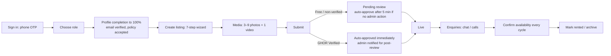

### 7.3 Listing creation wizard

**Status:** NEEDS CHANGE; today there's a 6-step room/flat wizard with autosave (code).

| Step | Content |
|---|---|
| 1. What | Category → arrangement and size (only the relevant choices) |
| 2. Where | Locality autocomplete (places), private address, pin check on a map |
| 3. Price | Rent, deposit, electricity and water, maintenance, other fees |
| 4. Who can stay | Suitable for; occupancy |
| 5. Media | Guided photo shot list (3–9) + walkthrough video (1) with a script; uploads continue in the background |
| 6. Details | Furnishing, bathroom, amenities, rules, availability, contact mode |
| 7. Preview & submit | Checklist + policy reminder + a **quota check** (§10) + a completion check (§7.1) |

**Quota display:** "You can submit 2 more listings this month (Free plan: 3/month)." (§10)

### 7.4 My Listings (owner dashboard)

Status tabs: Draft · Pending review · Live · Needs changes · Under review (investigation) · Paused (freshness) · Rented · Archived.

Per-listing actions by state. Each card shows:
- approval source ("Automatically approved by GHOR" / "Reviewed by GHOR");
- freshness ("Confirmed 3 days ago");
- enquiries and views;
- badge status.

Insights (views, enquiries, reply rate) exist today (code); detailed analytics are a ₹599 benefit (§10).

---

## 8. Renter experience

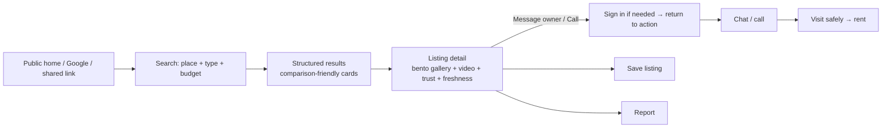

| Principle | Implementation |
|---|---|
| Value before sign-up | Browse, search, detail, media and trust are public (§31) |
| Fast decisions | Cards answer what, where, how much, who can stay, how fresh, how trusted |
| Confidence | The trust panel explains every badge and the approval source |
| Safety | A "Before you pay" checklist; scam warnings; reporting |
| Help for students, newcomers and relocating workers | Near college, workplace or transit searches; locality guides (§20) |

---

## 9. GHOR Verified program

**Status:** NOT IMPLEMENTED. Today's code shows a green "**Verified**" chip on every **approved** listing, meaning only that it was moderated (code). **This must be renamed in Phase 0** or the new paid badge will be meaningless and misleading (§53 C-01).

### 9.1 Definition (D-05, D-06)

**GHOR Verified ✓** is a **paid subscription program** that gives eligible owners **trust, visibility and speed**. It requires passing GHOR's verification (§11), which **only a designated senior reviewer can grant**.

| The badge means | The badge does NOT mean |
|---|---|
| A designated GHOR reviewer checked this owner's identity, contact details and their ownership of (or authorisation for) the property, and reviewed the listing's media and details against GHOR's rules on the recorded date | That the property or owner is "100% safe", fraud-proof or legally clear; that GHOR guarantees future behaviour, the condition of the property or availability; that GHOR is a party to the rental |

**Required public disclaimer** (copy; legal review pending):
> "GHOR Verified means our reviewer checked the owner's identity and their right to rent this property on [date]. It is not a guarantee. Always visit the property and sign a written agreement before paying."

### 9.2 Badge state machine (separate from billing, D-07)

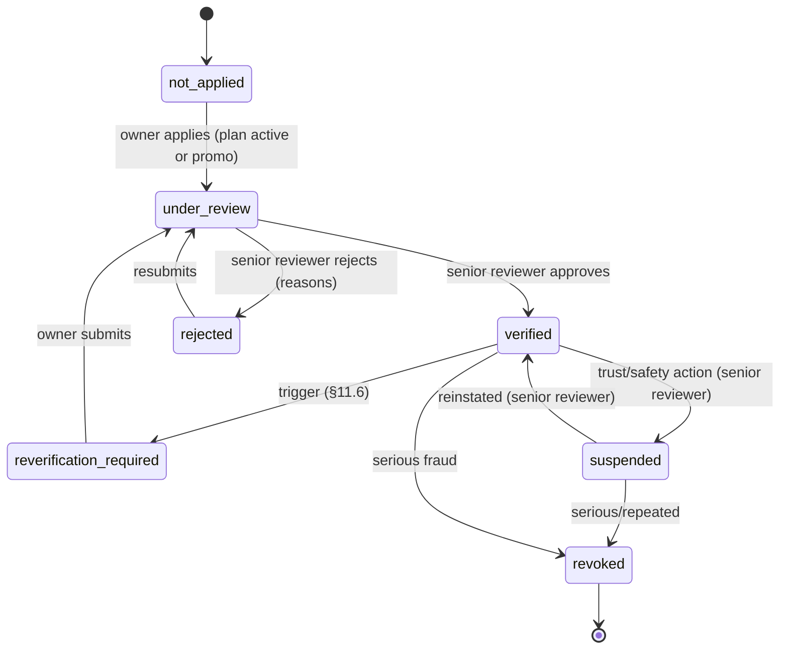

**Badge is displayed if and only if** (the verification state is `verified`) **AND** (the subscription is `active` or `promo_active` or in its billing grace period) **AND** (the owner isn't restricted).

A billing lapse hides the badge without changing the verification state; the badge returns on reactivation (unless re-verification is due). A trust suspension hides the badge **regardless of payment**.

### 9.3 Launch promotion (D-09)

**The first 50 eligible owner profiles get the GHOR Verified program free for their first 5 months.**

| Rule | Spec (PROPOSED details; eligibility in §52 Q-01) |
|---|---|
| "Eligible" | A 100%-complete profile + at least one listing submitted + passes GHOR Verified verification (the senior reviewer grants it). The promotion covers the *program fee*, never the checks |
| Counting | The first 50 **granted** verifications, in order of grant (not application) |
| Plan level | ₹299 (Verified) benefits for free; upgrading to ₹599 during the promotion is paid (proposed) |
| Duration | 5 months from the grant date; reminders at 30 and 7 days before the end |
| After the promotion | Converts to Free unless the owner subscribes (no automatic charge without explicit consent) |
| Payments not live yet | The promotion runs **without payment integration** in Phase 1 (a manual promo entitlement) |
| Abuse | One promotion per person (identity), not per account; revocable on a trust violation |
| Display | The same badge as paid; the admin sees the "Promo" entitlement |

### 9.4 Feature spec — GHOR Verified (program)

| Field | Spec |
|---|---|
| Goal | A credible, revocable, paid trust signal plus visibility and speed benefits |
| User | Owners (apply, maintain); renters (read); the senior reviewer (grant) |
| User problem | Renters can't tell genuine owners from brokers or scammers; genuine owners can't prove it |
| User flow | Owner: Profile → "Get GHOR Verified" → plan choice (or promo) → submit evidence (§11) → under review → decision → badge. Renter: taps the badge → an explanation sheet |
| UX | Explanation sheet with the date and scope; the badge only on verified-and-entitled owners |
| UI | "GHOR Verified ✓" badge (a distinct visual, not the green "Reviewed" style); owner profile section |
| Frontend | Application flow; status page; badge component; explanation sheet |
| Backend | Verification cases; senior-reviewer permission; entitlement service (promo/plan); badge computation; audit log |
| Database | `verification_cases`, `verification_evidence_meta`, `entitlements`, `subscriptions` (Phase 2), `badge_events` (§42) |
| API | `POST /verified/apply`, `GET /verified/status`; admin: `POST /admin/verification/:id/decision` (senior only) |
| AuthZ | Only the `senior_reviewer` permission can grant, suspend, revoke or reinstate |
| Analytics | `verified_applied`, `verified_granted/rejected/suspended/revoked`, `badge_viewed`, `badge_explained` |
| Error / edge | Promotion slots exhausted (a clear message); billing lapses while under review (continue the review, show the badge when entitled) |
| Abuse | Buying a badge with fake documents (senior review, evidence rules); transferring a verified account (a phone or email change triggers re-verification) |
| Security | Evidence access limited and logged (§33) |
| Performance | Badge computed on write and cached on the owner record |
| Accessibility | The badge has a text label and an accessible name including the date |
| SEO | Badge text is not in structured data (avoid implying guarantees) |
| Acceptance | No badge without a `verified` case **and** an active entitlement; every grant has a senior-reviewer audit row; revoke removes the badge everywhere within 1 minute |
| Dependencies | §11 verification, §10 entitlements, the senior reviewer role |
| Priority | P1 (verification + promo); P2 (paid billing) |
| Status | NOT IMPLEMENTED |

---

## 10. Subscription plans

**Status:** NOT IMPLEMENTED (there is no payment code; code). **Payments ship in Phase 2**; Phase 1 runs Free + the promotion only.

| | **Free** | **GHOR Verified — ₹299/month** | **GHOR Verified Pro — ₹599/month** |
|---|---|---|---|
| Owner profile + listings | ✓ | ✓ | ✓ |
| Listing quota | **3 listings/month** | **5 listings/month** | **12 listings/month** |
| GHOR Verified ✓ badge | ✗ | ✓ (after verification) | ✓ (after verification) |
| Approval flow | Pending → auto-approve after 5 min if no admin action | Immediate automatic approval (admin notified) | Immediate automatic approval (admin notified) |
| Visibility | Standard | **Increased** (bounded boost, §22) | **Stronger** (bounded boost + priority placement within relevant results) |
| Trust presentation | Standard | Verified-owner presentation | Verified-owner presentation + enhanced owner profile |
| Moderation / support | Standard | Faster approval | Faster moderation + priority support |
| Analytics | Basic insights (CURRENT) | Basic | **Listing analytics** (views over time, enquiries, reply rate, search appearances, confirmation history) |

### 10.1 Quota rules (PROPOSED; D-10 left the details to implementation; see §52 Q-02)

| Rule | Spec |
|---|---|
| What counts | **A listing submitted for publication** (the first submission of a new listing) within the quota period |
| What doesn't count | Drafts; edits; availability confirmations; renewal from paused; resubmission after "needs changes"; relisting a rented listing (proposed) |
| Period | Free: calendar month (IST). Paid: the billing cycle (e.g. the 14th to the 13th) |
| Reset | At the period start; unused quota doesn't roll over |
| Over quota | Submit disabled: "You've used 3 of 3 listings this month. Upgrade or wait until <date>." |
| Downgrade | Takes effect at the next period; **existing live listings stay live** (the quota limits submissions, not active listings) |
| Upgrade | Immediate; the quota increases to the new plan's limit for the current period (pro-rated billing in Phase 2) |
| Abuse | Deleting and recreating to dodge the quota → deleted listings still count; multi-account quota evasion → phone, email and identity linkage flags |

### 10.2 Subscription lifecycle (Phase 2; provider undecided, §52 Q-03)

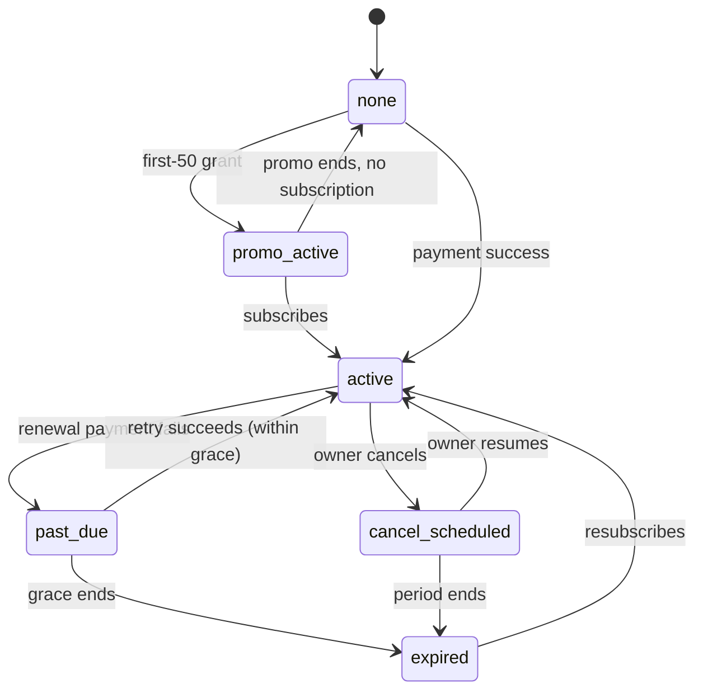

| Event | Behaviour |
|---|---|
| Renewal | Automatic (with a mandate or card on file, per provider), with a reminder 3 days before |
| Failed payment | `past_due`; **7-day grace** (proposed); benefits continue; retries on days 1, 3 and 6; reminders |
| Grace ends | `expired` → the badge is hidden (verification state preserved), visibility boost off, quota falls back to Free next period; live listings remain |
| Cancellation | Effective at the period end; no pro-rated refund (policy §52 Q-04) |
| Upgrade / downgrade | Upgrade immediate (pro-rated); downgrade at the next renewal |
| Badge suspension | **Independent:** a trust suspension hides the badge even if paid; billing continues unless the owner cancels (policy on refunds for trust suspensions §52 Q-05) |
| Webhooks | Signed, idempotent, replay-safe (§32) |
| Invoices / GST | Needs a registered business entity (per `CLAUDE.md` §7.2) (§52 Q-06) |

---

## 11. Verification architecture

**Status:** NOT IMPLEMENTED. The `id_verification_status`, `id_document_url` and `property_verified` fields exist but are unused (code).

### 11.1 Two kinds of verification

| Scope | What | Reusable? |
|---|---|---|
| **Owner (person)** | Identity, phone, email, contact details, representative authority | **Yes**, across all of that owner's properties (D-11) |
| **Property (per listing / property)** | Ownership or authorisation for *this* address, property details, address consistency, utility or property documents, media genuineness | **No**: each property is verified separately; later properties use a **streamlined** process; high-risk properties escalate (D-11) |

### 11.2 Checks (D-06)

| Check | Evidence (accepted documents are a founder decision, §52 Q-07; proposed list) | Who | Retained |
|---|---|---|---|
| Phone | OTP (existing) | System | Verified timestamp |
| Email | Email link | System | Verified timestamp |
| Government identity | PAN / driving licence / voter ID / passport; **Aadhaar only through user-initiated offline verification with masking**; a DigiLocker fetch when available (Phase 2). **No Aadhaar authentication API** (reported legal constraint) | Senior reviewer | Document type, **masked reference** (e.g. last 4), name as on the document, match result, reviewer, date. **No document image after the retention window** (§33) |
| Ownership / authorisation | GMC property-tax receipt / Jamabandi-Patta / sale deed / registered rent agreement or lease (PG operators); representatives: the **owner's signed authorisation letter + the owner's ownership document + the representative's identity** | Senior reviewer | Document type, masked reference, address match, name match, reviewer, date |
| Address / property consistency | Listing address vs document address vs map pin vs media | Senior reviewer | Match result + notes |
| Utility / property documentation | APDCL electricity bill (supporting evidence of address) | Senior reviewer | Type, month, match |
| Photos | Genuine, current, of this property, no stock or watermark | Reviewer | Result + notes |
| Walkthrough video | Genuine, recent, representative, shows the offered unit | Reviewer | Result + notes |
| Basic fraud checks | Duplicate photo hash, phone/email/ID reuse across accounts, price outliers, prior reports | System + reviewer | Flags + resolution |
| Basic safety checks | No payment-before-visit instructions in the text; contact details valid; no prohibited content | Reviewer | Result |
| Contact information | Call-back or message to the listed number (optional, risk-based) | Reviewer | Result |

### 11.3 Process

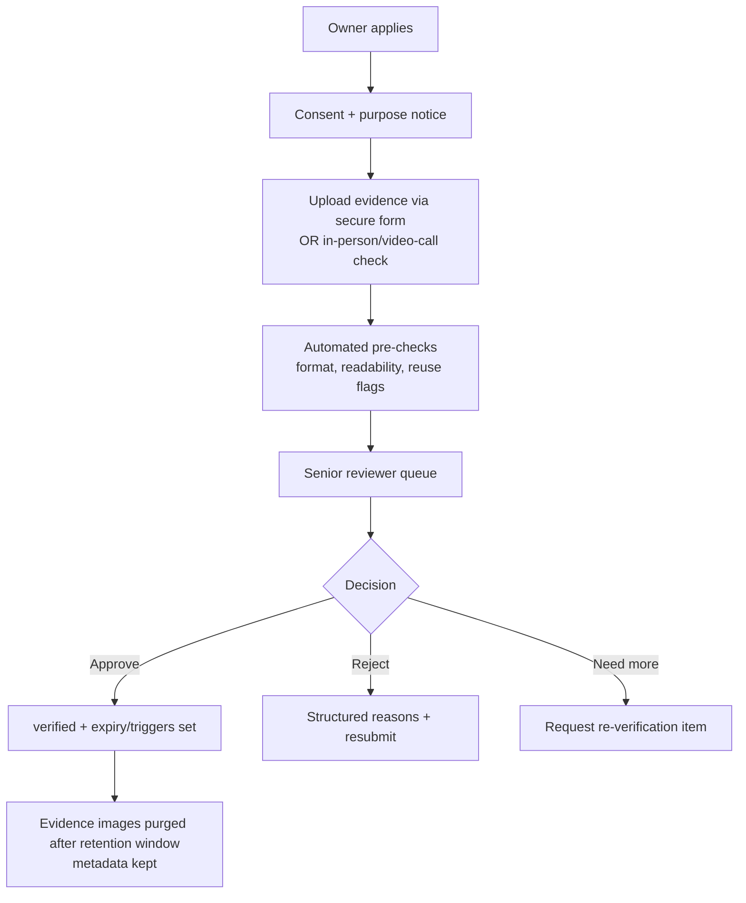

**Phase 1 method (PROPOSED):**
- **secure upload** into a private storage folder with short-lived admin URLs, **or** an in-person/video-call check with no storage (owner's choice);
- automated pre-checks limited to file type and size and reuse flags.

**Phase 2:** a DigiLocker partner. The detailed choice is §52 Q-08.

### 11.4 Authority (D-12)

| Role | Can |
|---|---|
| Regular admin | Review listings, handle reports, **recommend** verification decisions, pause listings for safety |
| **Senior reviewer** (designated; a new permission) | **Grant, reject, suspend, revoke, reinstate and request re-verification** of GHOR Verified; view verification evidence |
| System | Compute badge display; hide the badge on billing lapse |

Every decision is recorded: reviewer, timestamp, decision, reason code(s), note, verification status before and after, and evidence metadata IDs.

### 11.5 Multi-property owners

| Situation | Process |
|---|---|
| First property | Full owner verification + property verification |
| Additional property, same owner, low risk | **Streamlined:** one ownership document + an address match + media review |
| Additional property, high risk (new locality far from others, price outlier, reports, a representative for a new owner) | Escalated: full property verification, and optionally a call or in-person check |
| Representative for multiple owners | Authority verified **per owner** |

### 11.6 Re-verification (risk-based, D-14)

| Trigger | Action |
|---|---|
| Ownership change (reported or detected) | Property re-verification; the badge on that listing suspended pending review |
| Important property changes (address, category, size) | Property re-verification |
| Major contact changes (phone or email) | Owner re-verification of contact + identity match |
| Major media changes (replace the video or most photos) | Media re-review (the listing may stay live; see §13.4) |
| Serious reports | Senior review; possible suspension |
| Suspicious activity (reuse flags, rapid listings) | Review |
| Long inactivity (proposed: 6 months without any listing activity) | Contact re-confirmation |
| Policy change | Scheduled re-verification with notice |

---

## 12. Listing lifecycle

**Status:** NEEDS CHANGE. Code states: draft, pending, approved, rejected, rented (PRD §5).

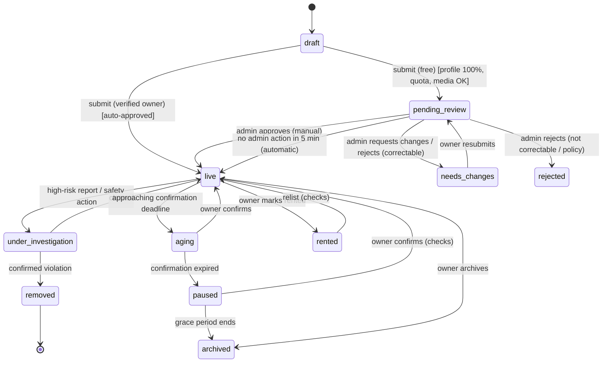

| State | Public visibility | Search | Owner sees |
|---|---|---|---|
| draft | No | No | Draft |
| pending_review | No | No | "Pending review. It goes live automatically within about 5 minutes unless our team needs changes" (free) |
| live | Yes | Yes | Live + approval source |
| aging | Yes ("Last confirmed N days ago") | Yes (ranked lower) | "Confirm availability" |
| paused | Detail reachable by link, marked unavailable; noindex | No | "Paused: confirm to restore" |
| needs_changes | No | No | Structured report (§13.5) |
| rejected | No | No | Structured report; appeal if eligible |
| under_investigation | No (temporarily hidden) | No | "Your listing is under review…" (§14.4) |
| removed | No | No | Enforcement notice + appeal |
| rented | "Rented" on detail; noindex | No | Relist |
| archived | "No longer available"; 410 for search engines | No | Restore (checks) |

**Deletion:** listings are never hard-deleted by owners (they're archived), so other people's conversations are preserved (§46). **Today's code hard-deletes with cascades (NEEDS CHANGE, code).**

---

## 13. Listing approval

**Status:** NEEDS CHANGE. Today every listing waits for manual approval (code).

### 13.1 Non-verified owner (D-17)

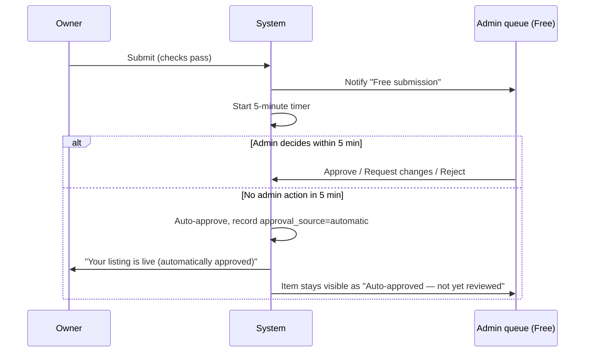

### 13.2 Verified owner (D-18)

Submit (checks pass) → **live immediately** with `approval_source=automatic` → the admin is notified in the **"Verified-owner submissions"** queue → post-review can result in confirmed · correction requested · rejected · trust escalation · verification review.

### 13.3 Safeguards (PROPOSED; they implement "normal system checks" without changing the decision)

| Check (runs before any approval, manual or automatic) | Failure effect |
|---|---|
| Profile 100% complete; quota available | Submit blocked |
| Media standard met (3–9 photos + 1 processed video) | Submit blocked |
| Required fields valid; prohibited terms (discriminatory wording, "brokerage", "advance before visit", external payment links) absent | Submit blocked with a reason |
| Account not restricted | Submit blocked |
| **Risk flags** (duplicate photo hash with another account, phone/ID reuse with a banned account, price outlier, new account + a far-away locality) | ⚠ **Auto-approval of flagged items is a founder decision (§52 Q-10).** Recommended: a flagged submission is **not** auto-approved and waits for an admin (high-risk queue) |

"Doing something" in the 5-minute window (PROPOSED): an admin decision **or** an explicit **"Hold for review"** action stops auto-approval. Merely opening the item doesn't.

### 13.4 Renter-facing approval transparency (D-17, D-18)

| Approval source | Public label (card: small text; detail: trust panel) | Admin label |
|---|---|---|
| Manual approval by an admin | "Reviewed by GHOR" | Manually approved (admin, time) |
| Automatic approval (free, 5 min) | "**Automatically approved by GHOR**" + an info sheet: "Listings go live automatically after basic checks. Our team may review later. Always verify before paying." | Automatically approved (5-minute rule) — pending post-review |
| Automatic approval (verified owner) | "**Automatically approved by GHOR**" alongside "GHOR Verified ✓" | Automatically approved (verified owner) — post-review pending |
| Post-review confirmed | "Reviewed by GHOR" replaces the automatic label | Confirmed by admin |

**Never** display automatic approval as if GHOR had manually verified the property.

### 13.5 Rejection experience (D-20)

A structured **Listing Review Report** sent in-app and by email:

| Section | Content |
|---|---|
| Decision | Needs changes (correctable) **or** Rejected (policy) |
| What was wrong | Each issue, e.g. "Video doesn't show the room offered" |
| Why | Plain explanation |
| Policy | A link to the specific GHOR policy clause |
| How to fix | Concrete steps ("Record a 30–45 s walkthrough starting from the entrance…") |
| Next step | "Edit and resubmit" button **or** "Appeal" (if eligible) |
| Resubmission allowed? | Yes / No (with the reason) |

**Reason-code catalogue** (initial):

| Group | Codes |
|---|---|
| Photos | too few · blurry or dark · not this property · stock or watermark · contains contact details |
| Video | missing · not this property · not a walkthrough · edited to mislead · shows the exact address or people |
| Details | price or deposit inconsistent · category wrong · location incomplete |
| Policy | duplicate listing · appears to be a broker · discriminatory wording · prohibited property · payment-before-visit instruction |
| Other | free text (required note) |

---

## 14. Trust & safety

### 14.1 Principles

- Protect renters without publicly accusing owners.
- Act proportionately.
- Preserve evidence.
- Log everything.
- Keep humans in the loop for serious decisions.

### 14.2 Graduated enforcement (D-23)

| Level | Action | Typical triggers | Decided by |
|---|---|---|---|
| 1 | Correction request | Minor inaccuracies | Admin |
| 2 | Warning | Repeated minor issues | Admin |
| 3 | Temporary restriction (can't submit new listings for N days) | Repeated policy breaches | Admin |
| 4 | Listing rejection or removal | Policy violation | Admin |
| 5 | Badge suspension | Trust concern with a verified owner | **Senior reviewer** |
| 6 | Account restriction | Serious or repeated issues | Admin (senior for verified owners) |
| 7 | Account suspension | Fraud indicators under investigation | Senior reviewer |
| 8 | Account termination (+ phone, email and ID blocklist) | Confirmed fraud, repeated serious violations | Senior reviewer |

Serious fraud or safety cases can **skip levels** (D-23).

### 14.3 Protective actions on high-risk reports (D-21)

High-risk categories (scam; property doesn't exist; fake documents; serious safety issue; major misrepresentation; fraud) cause:
1. the listing to be **temporarily hidden** automatically;
2. an investigation case to be created;
3. the owner to be notified (§14.4);
4. evidence to be **preserved** (a listing snapshot, media IDs, relevant chat excerpts, report text);
5. the case to be placed in the high-risk queue.

Lower-risk categories stay visible while under investigation.

**No public "scammer" labels are ever shown** (D-21).

### 14.4 Owner "under review" experience (D-22)

Exact copy (from the founder):
> **Your listing is under review**
> GHOR is reviewing a concern reported about this listing. Your listing is temporarily hidden while we investigate.
> **What happens next:** Our team will review the information and may contact you if clarification is required.

The owner does **not** see the reporter's identity, private reporter information or private evidence.

### 14.5 Safety guidance for renters

A "**Before you pay**" panel on detail and in chat:
- visit first;
- see the documents;
- sign a written agreement (the Assam Tenancy Act 2021 requires one (reported));
- never pay visit charges or booking amounts before visiting;
- police tenant verification is available online (reported).

A one-time chat notice appears when payment words appear (§24).

---

## 15. Reporting

**Status:** PARTIAL. Reporting exists with 4 categories + a threshold auto-revert (code); it needs the new categories, the risk tiers and investigations.

| Category | Risk tier | Immediate action |
|---|---|---|
| Scam / asked for money before visit | **High** | Hide + investigate |
| Property doesn't exist | **High** | Hide + investigate |
| Fake or suspicious documents | **High** | Hide + investigate; notify the senior reviewer if verified |
| Serious safety issue | **High** | Hide + investigate |
| Major misrepresentation | **High** | Hide + investigate |
| Fraud / impersonation ("that's my property") | **High** | Hide + investigate |
| Broker posing as owner | Medium | Investigate (visible) |
| Not available / already rented | Medium | Investigate; **2 distinct reports in 7 days → pause** (proposed) |
| Wrong details (price, location, photos) | Low | Investigate (visible) |
| Inappropriate content | Medium | Investigate |
| **Other / Custom reason** (free text required) | Triage | An admin assigns the tier |

| Spec field | Detail |
|---|---|
| Flow | "Report" → category → details (required for Other) → optional evidence (screenshots) → confirmation + case number → an outcome notice when closed |
| AuthN | Required (accountability); the public "Report" button prompts sign-in |
| Abuse | Competitors mass-reporting: distinct reporters; accounts with a high false-report rate are down-weighted; high-risk auto-hide needs **1 report from an account ≥ 7 days old with a verified phone** or **2 distinct reporters** (proposed, §52 Q-11) |
| Data | `reports` + `investigations` + `evidence_snapshots` (§42) |
| Acceptance | A high-risk report hides the listing within 1 minute and creates an investigation; the reporter's identity is never shown to the owner |

---

## 16. Appeals

**Status:** NOT IMPLEMENTED.

| Aspect | Spec |
|---|---|
| Eligible decisions | Listing rejection or removal, restriction, badge suspension or revocation, account suspension (termination for confirmed fraud: appealable once) |
| Flow | "Appeal" on the decision notice → reason (required) + optional evidence → case → review by **a different reviewer** (senior for badge and account decisions) |
| SLA | Acknowledge immediately; decide within 72 h (proposed) |
| Outcomes | Uphold · modify · restore listing · restore or keep the badge suspended |
| Limits | One appeal per decision; abusive appeals can be closed |
| Logging | Every appeal and outcome is audited |
| Acceptance | An appeal can't be decided by the reviewer who made the original decision (enforced) |

---

## 17. Freshness

**Status:** NOT IMPLEMENTED.

### 17.1 Cycles (D-25, D-26)

| Category | Confirmation cycle | Reminders | Aging label from | Expiry → paused | Grace → archive |
|---|---|---|---|---|---|
| Room · Shared Room · PG / Co-living | **14 days** (founder) | Day 11 + day 14 | Day 8 ("Last confirmed N days ago") | **Day 14 without confirmation** | + 7 days grace (PROPOSED) → archived |
| Flat · House | **30 days** (PROPOSED; the founder said "longer, defined in implementation") | Day 25 + day 30 | Day 15 | Day 30 | + 14 days grace (PROPOSED) → archived |

The windows are configurable in app config.

### 17.2 Behaviour

| Aspect | Spec |
|---|---|
| Renter labels | ≤ 7 days: "**Confirmed N days ago**" (fresh). 8 days to expiry: "**Last confirmed N days ago**" (aging, amber) |
| Confirmation | One tap from a notification, email or My Listings; **any edit also confirms**; a chat reply doesn't |
| Expiry | Removed from search; the owner is notified with a **"Still available — renew"** action; the grace period starts |
| Grace | Detail reachable by direct link, marked "Availability not confirmed"; noindex |
| Archive | After grace; "No longer available"; 410 for search engines |
| Renter updates | Renters who **saved** the listing are notified: "This listing is no longer available" |
| Restore | Owner confirms → live again; **re-review required only if content changed or the listing was archived** (proposed) |
| Admin override | Pause, restore or archive with a reason (logged) |

---

## 18. Media system

**Status:** NEEDS CHANGE. Photos are 1–20 (≥ 3 to publish) with signed uploads to `ghor/listings/`; **there's no video**; orphaned media is never cleaned (code).

### 18.1 Requirements (D-15)

| | Minimum | Maximum |
|---|---|---|
| Photos | 3 | 9 |
| Video (genuine walkthrough) | 1 | 1 |

- **The owner provides all media.** GHOR offers no photography service at launch.
- The video must be genuine, recent, representative, relevant and clearly show the offered property.
- No stock or unrelated footage, misleading edits or another property.

### 18.2 Technical limits: grounded in current infrastructure (code + provider docs)

| Parameter | Current infrastructure fact | Specified limit | Status |
|---|---|---|---|
| Photo formats | Server signature allows jpg, jpeg, png, webp, heic, heif (code) | Same | IMPLEMENTED |
| Photo processing | Browser resizes to 1,600 px; incoming cap 2,000 px (code) | Same; **minimum long edge 1,000 px** (new) | NEEDS CHANGE |
| Photo input size | Cloudinary free plan max image 10 MB (observed) | ≤ 10 MB before browser compression | PROPOSED |
| Video plan limits | Cloudinary **Free: max video 100 MB, 25 credits/month; Plus ($99/month or $89 yearly): 2 GB, 225 credits; Advanced: 600 credits** (observed) | **The final limits depend on the plan chosen in Phase 0 (§52 Q-12)** | UNKNOWN until the plan is chosen |
| Video duration | Credits: 250 HD processing-seconds per credit (observed) | **10–60 s** (proposed; the guidance suggests 30–45 s) | PROPOSED |
| Video file size | A phone at 1080p30 ≈ 15–20 Mbit/s → 60 s ≈ 110–150 MB (inferred) | Free plan: **≤ 100 MB** (the guide asks for 1080p or 720p recording); Plus: **≤ 200 MB** | PROPOSED |
| Accepted video formats | none | MP4, MOV (H.264/HEVC), WebM | PROPOSED |
| Delivered renditions | none | 480p (mobile / cellular default) + 720p (desktop / Wi-Fi) + poster image (≤ 60 KB); adaptive HLS deferred | PROPOSED |
| Upload | Cloudinary chunked upload: default 20 MB chunks (minimum 5 MB); required above 100 MB (reported) | Chunked, resumable; automatic retry with backoff (3 attempts per chunk); resume sessions valid 24 h | PROPOSED |
| Processing | none | States: uploading → processing → ready / failed; submit only with a ready video | PROPOSED |
| Server validation | Own-cloud URL validator for images (code) | Server confirms duration, size and format through the provider API before attaching (not trusting the browser) | PROPOSED |
| Cleanup | None (debt, code) | Abandoned uploads 7 days; replaced or removed media 30 days; rejected listings 90 days; archived 180 days; account deletion 30 days; reference check before destroy | PROPOSED |
| Moderation | Photos reviewed manually (code) | Checklist incl. video genuineness, no exact address, faces or plates visible; review at 1.5× | PROPOSED |

**Cost model (inferred, planning only; §49 R-06):**
- Processing ≈ 0.45 credits per 45 s video (upload + 2 renditions).
- Bandwidth ≈ 4.5 MB per 480p play (1 credit = 1 GB).
- At launch (≈ 100 new listings, ≈ 3,000 plays per month): **≈ 60–70 credits/month, above the free 25 → the Plus plan is needed** once video is mandatory.

### 18.3 Feature spec — Media standard

| Field | Spec |
|---|---|
| Goal | Every listing shows the real place: 3–9 photos + 1 walkthrough video |
| User problem | Misleading or stale photos on portals and Facebook; renters waste visits |
| User flow | Wizard step 5: shot list → photos → video script → record or pick → background upload → ready → continue |
| UX | Progress per file; "Keep this tab open, or continue filling details"; Wi-Fi hint for video; clear failure reasons |
| UI | Media checklist ("✓ 4 photos · ✓ video 0:42"); cover selection; optional room tags; reorder |
| Frontend | Minimum-resolution and EXIF-date read (a moderation hint only); a video duration and size pre-check; a chunked uploader with resume; a playback component |
| Backend | Signatures for photo and video (single-use `public_id`, `overwrite=false`, server-chosen folder, extending the current design, code); post-upload verification; cleanup jobs |
| Database | `listing_media` replaces `listing_images` (type, order, dimensions, duration, poster, room tag, phash, state) (§42) |
| API | `POST /uploads/signature {kind}`; `POST /listings/:id/media` (ordered); `POST /listings/:id/media/video/confirm` |
| AuthZ | Owner of the listing only; media URLs must be in GHOR's own account and folders (current validator extended) |
| Analytics | `photo_uploaded`, `video_upload_started/completed/failed` {bytes, seconds, network}, `media_step_abandoned`, `video_played` |
| Error states | Too short or too long, too large, unsupported codec, network loss (auto-resume), processing failure (retry once, then replace) |
| Loading | Per-file progress; skeleton tiles |
| Edge cases | Portrait video (letterboxed); HEVC not playable in a browser (serve the H.264 rendition); an owner replacing the video on a live listing (§11.6 re-review) |
| Abuse | Stock or stolen media (pHash within GHOR; reverse image search later); the same video on several listings (hash of the poster + duration flag) |
| Security | Signed, single-use uploads; no public access to originals; content-type verification server-side |
| Performance | No video bytes on cards or before a tap on mobile; the poster only |
| Accessibility | Photo alt text "Bedroom, photo 2 of 6"; video controls labelled; captions not required (no speech expected); reduced motion respected |
| SEO | A `VideoObject` in listing structured data |
| Acceptance | Submit is impossible (UI + API) without 3–9 photos and 1 ready video; a 60 s, 150 MB file uploads over throttled 4G with a network drop and resumes (on a plan that allows the size); unreferenced media older than its window is deleted and referenced media never is |
| Dependencies | The Cloudinary plan (Phase 0); the listing model |
| Priority | P1 |
| Status | NEEDS CHANGE |

---

## 19. Search

**Status:** PARTIAL. Today search is a case-insensitive substring match over title, locality and description, with locality suggestions from a hand-made list; it requires sign-in (code).

### 19.1 Architecture (D-29, D-30: deterministic, no AI)

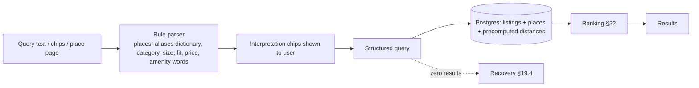

### 19.2 Search box

- **Placeholder:** "Search locality, college, landmark…".
- **Suggestions** are grouped as Places (with a type icon), Popular searches (admin-curated, later data-driven) and Recent searches (on the device).
- The **dictionary is shipped with the page** (places + aliases), so suggestions are instant offline.
- Matching: prefix, alias, and edit distance ≤ 2 for typos.

### 19.3 Parser rules and acceptance tests

| Query | Parsed |
|---|---|
| "1BHK near GU under ₹12,000" | size=1BHK (flat/house) · near=Gauhati University · rent ≤ 12000 |
| "rooms near Gauhati University" | category=Room · near=Gauhati University |
| "1BHK near Six Mile under ₹12000" | size=1BHK · near=Six Mile · rent ≤ 12000 |
| "PG near Dispur" | category=PG/Co-living · near=Dispur |
| "flats near IIT Guwahati" | category=Flat · near=IIT Guwahati |
| "room in Beltola" | category=Room · locality=Beltola |
| "2BHK near Ganeshguri" | size=2BHK · near=Ganeshguri |
| "house near Zoo Road" | category=House · near=Zoo Road |
| "near GMCH" | near=GMCH (hospital) |
| "girls pg jhalukbari 6k" | PG · occupancy=women only · Jalukbari (alias) · rent ≤ 6000 |
| "shared room near cotton for students" | Shared Room · near=Cotton University · suitable_for=students |

**Token classes:**
- category words (room, shared, pg, paying guest, hostel, coliving, flat, apartment, house, portion);
- sizes (1rk, studio, 1bhk…4bhk+);
- occupancy and fit (girls/ladies/women, boys/men, family, couple, students, working/professionals);
- price (under, below, upto, ≤, "12k", ranges);
- proximity (near, close to, around);
- places (canonical + aliases);
- amenities (furnished, ac, attached bathroom, parking, wifi).

Leftover text becomes a keyword search.

**Where AI might help later:** mixed Assamese or Hindi transliteration. Not in scope (D-30).

### 19.4 No-result experience (D-31)

When there are 0 exact results, the page shows:
1. **Why:** "No 1BHK flats under ₹8,000 near Gauhati University right now."
2. **Relaxations**, each with a live count (computed by removing or widening one constraint at a time, up to 3 suggestions):
   - a wider radius: "Within 3 km: 6 listings";
   - a higher budget: "Up to ₹10,000: 4";
   - a compatible type: "1RK flats: 3";
   - PG or rooms: "Rooms nearby: 9".
3. **Nearby localities with results** (from place adjacency).
4. **Honest empty state** if the city-wide inventory is thin.
5. Saved-search alerts (Phase 2).

### 19.5 URLs

- **App search:** `/rent/guwahati?category=flat&size=1bhk&near=gauhati-university&rent_max=12000` → noindex; canonical to the matching SEO page when it exists (§31).
- **Maps:** secondary toggle; approximate pins (±150 m jitter, code); "Search this area" rather than refetching on every pan.

### 19.6 Feature spec — Search + parser

| Field | Spec |
|---|---|
| Goal | Find relevant listings from how Guwahati people actually search |
| User problem | Substring search misses aliases, colleges, sizes and budgets (code) |
| Frontend | Parser in the browser (for instant chips) + a dictionary; chips; a URL state sync (CURRENT pattern) |
| Backend | The same parser (authoritative); query builder; ranking; relaxation counts |
| Database | `places`, `place_aliases`, `listing_place_distances`; indexes (§42) |
| API | `GET /listings/search` (public); `GET /listings/search/relax` (public); `GET /places/dictionary` (public, cached) |
| AuthN | None (public), with rate limits |
| Analytics | `search_started` {parsed fields}, `search_results` {count}, `zero_results` {query, place}, `suggestion_selected`, `relaxation_clicked` |
| Edge cases | Conflicting tokens ("1bhk room" → size wins → flat); unknown place → "Did you mean…"; very long queries (truncate to 80 characters, CURRENT limit) |
| Abuse | Scraping through search (rate limits, no phone numbers in results) |
| Performance | API p95 ≤ 250 ms at 5,000 listings; suggestions ≤ 50 ms in the browser |
| Accessibility | Combobox semantics (CURRENT pattern); chips removable with the keyboard |
| Acceptance | All §19.3 examples pass as unit tests; zero-result pages always show at least one recovery path when any inventory exists |
| Priority | P1 |
| Status | PARTIAL → NEEDS CHANGE |

---

## 20. Local intelligence

**Status:** PARTIAL. An `institutions` table exists with **0 rows** (code); the web has a hand-made locality suggestion list (code).

### 20.1 Places database (D-28)

| Field | Purpose |
|---|---|
| id, **slug** | SEO URLs |
| **city_id** | Multi-city ready |
| **type** | locality · neighbourhood · road · college · university · school (limited) · hospital · workplace / business area · market · transit (rail, bus, airport) · landmark · institution |
| **canonical name** | "Jalukbari" |
| **aliases** | "Jhalukbari", "Jalukbary"; "GU" → Gauhati University; "Zoo Tiniali" / "Zoo Road Tiniali" |
| point (lat/lng) | Distances |
| parent_locality | e.g. GU → Jalukbari |
| nearby_localities | Curated adjacency (no-result recovery, SEO internal links) |
| SEO metadata | Title and description overrides; an indexable flag |
| derived: popular categories, rent ranges | From live listings; **rent ranges shown only when ≥ 5 listings** in that category and place |
| derived: nearby institutions | From the distance table |
| status | active / hidden |

**Rules:**
- **No fake places.** The founder curates every entry (§52 Q-13); the OLX locality facet list (CPS §4.4, observed) serves only as a checklist.
- Distances are precomputed per listing (a haversine calculation; no PostGIS needed at this scale).

### 20.2 Student, newcomer and relocation features (D-27: features, not brand)

| Feature | Phase |
|---|---|
| "Near college / university" search + pages | P1 |
| "Near workplace / business area" search | P1 |
| "Near transit" (railway station, ISBT, airport) | P1 |
| Distance labels on cards ("0.8 km from GU") | P1 |
| Locality guides (typical rent from real data, transit, hospitals, safety) | P2 (data-gated) |
| Commute context (approximate distance and time to a chosen place) | P2 |
| "New to Guwahati" safety and move-in kit (written agreement, police tenant verification link) | P1 (static content) |

### 20.3 Scaling

Each new city = a dataset (places + aliases) + configuration (map bounds) + a supply threshold before indexing. No code change.

---

## 21. Filters

**Status:** PARTIAL. Today: type (room/flat), rent, 6 amenities, institutions (empty) (code).

| Tier | Always visible (mobile: ≤ 4 chips) | In the "All filters" sheet (with a live count on the apply button) |
|---|---|---|
| All | Budget · Property type · Suitable for · Available by | Deposit max · maintenance included · furnishing · bathroom · occupancy · amenities · freshness ("Confirmed in last 7 days") · "GHOR Verified owners" · manual review ("Reviewed by GHOR") · posted within |
| Flat / House | + Size (1RK…4BHK+) | Parking · lift · floor · balcony · area |
| Room / Shared / PG | + Occupancy (women / men only) | Meals · kitchen access · beds in room · curfew |

**Curated amenities (≈ 18):** Wi-Fi · power backup · water 24×7 · geyser · AC · refrigerator · washing machine · TV · wardrobe · study table · lift · security guard · CCTV · gated property · housekeeping (PG) · laundry (PG) · kitchen · balcony. Furnishing, bathroom, parking and meals are structured fields, not amenities.

**Filter spec:** URL state; the sheet shows a live count; "Clear all"; filter changes feel instant (INP ≤ 200 ms at 4× CPU). **Today's measured baseline is 160–256 ms** (CPS, measured on the current code).

---

## 22. Ranking

**Status:** NOT IMPLEMENTED. Today: newest or price sort only (code).

### 22.1 Architecture (D-32)

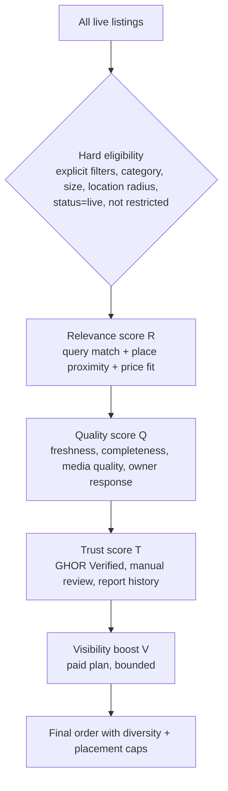

| Stage | Rule |
|---|---|
| **Eligibility (hard)** | Explicit renter filters, category and size, location radius, and safety and trust rules (restricted or investigated listings excluded). **Payment can never make an ineligible listing eligible.** |
| Relevance R | Keyword and place match; proximity to the chosen place (distance decay); rent fit within the range |
| Quality Q | Freshness (fresh > aging); completeness; media quality (reviewer rating or automated resolution checks); owner reply rate and time |
| Trust T | GHOR Verified; manually reviewed; clean report history |
| Engagement | Legitimate saves and contacts (rate-limited; ignoring self and repeat actions) |
| **Paid visibility V** | ₹299: a small multiplier (e.g. +5% of the score); ₹599: a moderate multiplier (e.g. +10%) **plus** eligibility for **"priority placement" slots**. Multipliers and slots are app-config values (§52 Q-14) |
| Priority placement caps (₹599) | At most **2 paid-priority slots per results page of 20**, placed at positions 3 and 8, filled only by listings **already in the eligible set** and within the **top 30 by organic score**; never above a listing with far better relevance (score gap guard); **labelled** (e.g. "Featured": whether to disclose is §52 Q-15; recommended: yes) |
| Diversity | At most 3 listings from the same owner in the top 20 |

### 22.2 Anti-abuse rules

| Abuse | Guard |
|---|---|
| Paying to dominate | Caps; eligibility and relevance first; a score-gap guard |
| Freshness gaming (confirming without availability) | "Not available" reports lead to pauses and trust penalties |
| Engagement farming (self-saves, fake contacts) | Engagement signals exclude self, repeats and new-account bursts |
| Duplicate listings to take multiple slots | pHash duplicates + the per-owner diversity cap |
| Keyword stuffing | The parser uses structured fields; description keywords are weighted low |

---

## 23. Saved listings

**Status:** NOT IMPLEMENTED (`favorites` is PLANNED in `CLAUDE.md`).

| Feature | Phase | Spec |
|---|---|---|
| Saved listings | **P1** | A heart on cards and detail (sign-in required, resuming the action); `/saved`; notifications only for **no longer available, paused/archived, price drop, owner reply** |
| Recently viewed | **P1** | On the device, last 20; "Continue where you left off" on Home |
| Saved searches + alerts | P2 | Daily digest maximum; one-tap unsubscribe (D-35) |
| Compare listings | Not planned | none |

---

## 24. Contact system

**Status:** NEEDS CHANGE. Chat is implemented; the phone number is returned on detail to any signed-in viewer (code); there are no per-listing contact modes.

| Aspect | Spec (D-34) |
|---|---|
| Owner control per listing | **Chat only** (default) or **Chat + calls** |
| Chat | Existing real-time chat (code) + a pre-filled first message + quick replies (CURRENT) |
| Calls (if enabled) | A "Call owner" button → sign in if needed → a confirmation sheet with the safety note → **the number is revealed** and a `tel:` link offered |
| Reveal logging | `contact_reveals` (viewer, listing, time, IP hash) |
| Rate limits | 10 reveals per user per day; 3 per listing per user; new accounts 5/day; per-IP limits |
| Anti-scraping | No phone number in any card, search, SEO or detail response; revealed only through the reveal endpoint; bot detection on bursts |
| Visit request | P2: a "Propose visit" structured chat message |
| WhatsApp | Future, unresolved (§52 Q-16) |
| Chat safety | A one-time notice when a message contains payment words (advance, token, booking amount, UPI, pay first) or external links; a local check at send time; content isn't profiled |
| Report from chat | "Report this conversation" (admins see only the reported excerpt) |

| Spec field | Detail |
|---|---|
| Acceptance | No endpoint except `POST /listings/:id/reveal-phone` returns an owner phone (automated test); chat-only listings return 403 on reveal; caps enforced |
| Priority | P1 |

---

## 25. Notifications

**Status:** PARTIAL. In-app notifications exist (4 types, polling 60 s); Expo push is mobile only; **there's no email** (code).

### 25.1 Channels

| Channel | Use |
|---|---|
| In-app (notification centre + badges) | All events |
| Email | Owners: enquiries (grouped, sent if unread after 30 min), approvals and rejections (report), freshness, verification and badge, subscription. Renters: owner replies (if unread after 30 min), saved-listing changes |
| SMS | Phase 2 (after DLT): freshness expiry and urgent enquiries (opt-in) |
| Push | Mobile app (existing code) |
| Admin | Dashboard queues + counts; email digest for high-risk items |

### 25.2 Event catalogue

| Recipient | Event | In-app | Email | Notes |
|---|---|---|---|---|
| Owner | Listing submitted | ✓ | — | "Pending review" or "Live (verified)" |
| Owner | Listing approved (manual) | ✓ | ✓ | none |
| Owner | Listing auto-approved | ✓ | ✓ | States "automatically approved" |
| Owner | Listing needs changes / rejected | ✓ | ✓ | Structured report (§13.5) |
| Owner | Listing under review (investigation) | ✓ | ✓ | Founder copy (§14.4) |
| Owner | Verification status change | ✓ | ✓ | none |
| Owner | Badge granted / suspended / revoked / re-verification needed | ✓ | ✓ | none |
| Owner | Subscription (promo start/end, renewal, failure, grace, expiry) | ✓ | ✓ | P1: promo only; P2: billing |
| Owner | Freshness reminder / expiry / archived | ✓ | ✓ | none |
| Owner | Renter enquiry | ✓ | ✓ (grouped) | none |
| Owner | Appeal outcome | ✓ | ✓ | none |
| Renter | Owner replied | ✓ | ✓ (delayed) | none |
| Renter | Saved listing: unavailable / price drop | ✓ | ✓ | none |
| Renter | Report outcome | ✓ | — | none |
| Renter | Saved-search alerts | — | ✓ | P2 |
| Admin | Free submission | Queue | — | none |
| Admin | Verified-owner submission (auto-approved) | Queue | — | none |
| Admin | Report / high-risk report | Queue | ✓ (high-risk) | none |
| Admin | Verification request | Senior queue | — | none |
| Admin | Appeal | Queue | — | none |
| Admin | Freshness or system issues (job failures, credit threshold) | Queue | ✓ | none |

### 25.3 Rules

- Group notifications per conversation.
- Quiet hours for email and SMS: 22:00–08:00 IST, except security.
- Notification preferences on the profile; mandatory ones (security, enforcement, verification) can't be turned off.
- Rate caps per user per day.

---

## 26. Admin Console (`apps/admin`)

**Decision D-46:** GHOR has a **separate Admin Console application**, `apps/admin`. It is the **fourth application surface**, it uses the **same `apps/api` backend**, and it contains **no renter or owner UI**.

**Status:** NOT IMPLEMENTED. Today the admin UI lives inside `apps/web` at `/admin` (6 pages: queue, reports, reviews, users, config, analytics). Its access check is a client-side `role !== 'admin'` test in `app/admin/layout.tsx`, and it shares the renter/owner session cookie (code). The API already enforces `AdminGuard` on admin routes (code). **The `apps/web/admin` pages are legacy** and are removed only after migration (§26.13).

### 26.1 Target architecture

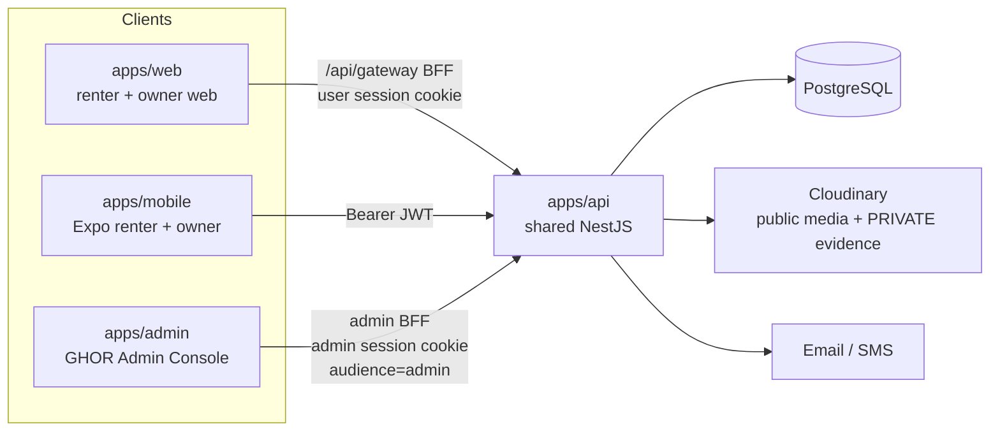

| Principle | Rule |
|---|---|
| One backend | `apps/admin` calls `apps/api` only. **There's no second backend and no business logic in the admin frontend** (validation, state transitions, permissions and approval timers all live in the API) |
| No direct database access | No client application (web, mobile, admin) connects to PostgreSQL. Only `apps/api` uses Prisma (CURRENT rule, code) |
| Separate surface | A separate repository workspace, build, deployment, domain and session boundary from `apps/web` |
| Server-enforced permissions | The UI hides what a role can't do, but **the API is the only authority**; every admin endpoint checks permissions |
| Audit by default | Every privileged mutation and every sensitive view writes an audit record (in the API, not the client) |

### 26.2 Technology (PROPOSED)

| Aspect | Choice | Why |
|---|---|---|
| Language | TypeScript | Monorepo standard |
| Framework | **Next.js (App Router), client-rendered operational pages + server route handlers used as the admin BFF** | The same team knowledge and patterns as `apps/web` (BFF with httpOnly cookies, code); no SEO needs; a server layer to keep tokens out of JavaScript |
| Data | TanStack Query + a typed API client (the same pattern as `apps/web`, code) | Caching, queue refresh, optimistic locks |
| UI | GHOR design tokens (`design-tokens.js`, code) in a **dense operational variant**: 13–14 px body, tables, split panes, keyboard shortcuts; no marketing styles, no GSAP | Information-dense work |
| Layout | Desktop-first (≥ 1280 px primary); responsive down to tablet; on phones read-only plus urgent actions (approve, hold, hide) | Moderators work at desks; urgent triage on the go |
| Shared code | Allowed: design tokens and generated API types. **Not shared:** renter or owner components, and the web session | Clean boundary |
| Workspace | `apps/admin` as a new npm workspace (created only when implementation is approved) | Monorepo convention |

### 26.3 Deployment (PROPOSED)

| Aspect | Spec |
|---|---|
| Domain | **Production: `admin.ghor.co.in` · Staging: `admin-staging.ghor.co.in`** (separate origins; cookies isolated from `ghor.co.in`) (D-47) |
| Hosting | A separate deployment from `apps/web` (its own project and pipeline); staging and production |
| Indexing | `X-Robots-Tag: noindex, nofollow`; `robots.txt` disallow all; not linked from the public site |
| Headers | Strict CSP, `frame-ancestors 'none'`, HSTS, `Referrer-Policy: no-referrer` |
| Network | **No mandatory IP allowlist or VPN at launch** (D-47). Optional later hardening (roadmap P3-8) |
| CORS (API) | Admin endpoints accept requests only through the admin BFF (server-to-server); browser CORS allows the admin origin for the admin socket only if needed |
| Releases | Deployed independently; the API stays backward-compatible across admin and web releases |

### 26.4 Authentication and session

| Aspect | Spec (PROPOSED) |
|---|---|
| Identity | Admin users are **GHOR accounts with admin roles** (the same `profiles` table), but they sign in **through the admin console's own login** |
| Factors | Phone OTP (existing) **+ an authenticator-app TOTP, mandatory for every admin role (`admin`, `senior_reviewer`, `super_admin`)** at every sign-in (D-47). No console access before TOTP enrollment |
| TOTP enrollment | During first admin sign-in: a QR code (RFC 6238, 30 s, 6 digits) → confirm with a valid code → **recovery codes issued** (D-47). The TOTP secret is encrypted at rest and never displayed again |
| Recovery codes (PROPOSED details) | **10 single-use codes** shown once at enrollment (download/print); stored **hashed**; each use is audited, alerts the account holder and super_admins, and prompts TOTP re-enrollment; regenerating codes invalidates all previous ones; when ≤ 2 codes remain the console prompts regeneration |
| Lost authenticator | Recovery code → re-enroll. With no codes left: a TOTP reset by a super_admin (audited; for a super_admin, by another super_admin once ≥ 2 exist; the bootstrap super_admin through the deployment-level `ADMIN_PHONES` path) |
| Token audience | The API issues **admin-audience tokens** (`aud=admin`) only through the admin login. **User tokens (web or mobile) are rejected by admin endpoints, and admin tokens are rejected by user endpoints** |
| Session storage | httpOnly, `Secure`, `SameSite=Strict` cookies on the admin origin only; tokens never exposed to JavaScript |
| Lifetimes | Access ≤ 10 min; refresh ≤ 12 h; **idle timeout 30 min**; absolute session 12 h |
| Step-up | Re-authentication (**TOTP re-entry**, D-47) required within the last 10 min for **sensitive actions**: viewing verification evidence, granting, suspending or revoking badges, role changes, account termination, configuration changes, audit export |
| Revocation | Role removal or ban ends all admin sessions immediately (the role is read from the database on each request, CURRENT pattern in `JwtStrategy`, code) |
| Rate limiting | Login attempts per IP and account; API requests per admin session; stricter caps on evidence views and bulk actions |
| Bootstrap | The first `super_admin` via deployment configuration (the CURRENT `ADMIN_PHONES` mechanism, code, extended to assign `super_admin`); all later roles through the console with an audit trail |

### 26.5 RBAC

**Enforced in `apps/api`.** The UI mirrors it; it doesn't enforce it.

| Permission | admin | senior_reviewer | super_admin |
|---|---|---|---|
| View dashboard, queues, listings, owners, renters (non-sensitive) | ✓ | ✓ | ✓ |
| Listing decisions (approve, hold, request changes, reject, pause, restore) | ✓ | ✓ | ✓ |
| Mark suspicious; escalate; add note | ✓ | ✓ | ✓ |
| Report and investigation handling (non-verified owners) | ✓ | ✓ | ✓ |
| Restrictions up to level 4 (MPB §14.2) | ✓ | ✓ | ✓ |
| Appeals (not their own decisions) | ✓ | ✓ | ✓ |
| Places CRUD; reviews hide/unhide | ✓ | ✓ | ✓ |
| **View verification evidence** (step-up, audited) | — | ✓ | ✓ (break-glass, audited) |
| **Grant, reject, suspend, revoke or reinstate GHOR Verified; request re-verification** | — (recommend only) | ✓ | — (unless also a senior reviewer) |
| Account suspension or termination | — | ✓ | ✓ |
| Subscriptions and promotions (view) | ✓ | ✓ | ✓ |
| Subscriptions, promotions and refunds (change) (Phase 2) | — | — | ✓ |
| Configuration (app config, freshness windows, caps, ranking parameters) | — | — | ✓ |
| Admin users, roles and permissions | — | — | ✓ |
| Audit log (view) | own actions | own + trust actions | all + export |
| System health | view | view | view + acknowledge |
| **Private renter–owner chats** | **✗** | **✗** | **✗** |

**Chats:** no role reads private conversations. Admins see **only** the excerpts attached to a report or investigation as evidence snapshots (MPB §15). Any future chat-access policy needs a separate founder decision and a privacy-policy change.

**Separation of duties:**
- The reviewer who made a decision can't decide the appeal against it.
- **GHOR Verified authority belongs to `senior_reviewer`.** `super_admin` does **not** automatically receive it and can exercise it **only if explicitly assigned the `senior_reviewer` capability** (D-47). Assigning it is itself an audited, step-up-protected role change.
- Role changes to or from `senior_reviewer` or `super_admin` require a second `super_admin` approval once there are ≥ 2 (proposed).

### 26.6 API boundaries

| Rule | Spec |
|---|---|
| Namespace | All admin operations under `/admin/*` in `apps/api` (existing admin routes already use `/admin/...` or `AdminGuard`, code), each decorated with a **permission**, not just a role check |
| Guards | `AdminAudienceGuard` (token `aud=admin`) + `PermissionGuard(permission)` + `StepUpGuard` for sensitive endpoints |
| DTO projections | Admin DTOs include only the fields the permission allows. **Evidence is never inlined:** evidence endpoints return **short-lived signed URLs** (≤ 5 min) and write an evidence-access audit row |
| State transitions | Only through explicit action endpoints (`POST /admin/listings/:id/decision`, `…/hold`, `…/pause`); the API validates allowed transitions |
| Optimistic concurrency | Decisions include the listing `version`; the API rejects stale decisions (two moderators acting at once) |
| Claiming | `POST /admin/queues/items/:id/claim` (soft lock, 10 min) to avoid duplicate work. **"Claimed" is an assignment state (who is working on an item), not a listing lifecycle status:** it's never shown to owners or renters and never changes the listing's status (D-47). **Claiming is not an admin decision** and doesn't stop the 5-minute auto-approval; only a decision or an explicit **Hold** does (MPB §13.3) |
| Bulk actions | Limited to 50 items; each item individually audited; bulk badge actions are not allowed |
| Audit | Written server-side in the same transaction as the mutation |
| Rate limits | Per session and per permission (e.g. evidence views ≤ 60/hour) |

### 26.7 Information architecture

```
GHOR Admin Console
├── Overview (dashboard)
├── Moderation
│   ├── Free Listings          (pending + countdown; auto-approved awaiting post-review)
│   ├── Verified Listings      (auto-approved immediately; post-review)
│   ├── Reports
│   ├── High Risk              (high-risk reports, investigations, risk-flagged submissions)
│   ├── Rejected / Needs Changes
│   └── Expiring / Stale       (aging, paused, archived-with-enquiries)
├── Trust
│   ├── Verification           (owner + property verification cases)       [senior]
│   ├── GHOR Verified          (verified owners, entitlement + badge state)
│   ├── Badge Actions          (suspend / revoke / reinstate / re-verify)  [senior]
│   └── Appeals
├── Marketplace
│   ├── Listings               (search all listings, any state)
│   ├── Owners                 (profile, plan, badge, listings, history)
│   ├── Renters                (profile, reports filed, restrictions)
│   ├── Places                 (places + aliases + adjacency)
│   └── Reviews                (hide / unhide)
├── Business
│   ├── Subscriptions          (Phase 2)
│   ├── Plans                  (Free / ₹299 / ₹599 definitions, quotas)   [super]
│   ├── Payments               (Phase 2)
│   └── Promotions             (first-50 counter, grants, expiries)
├── Communication
│   ├── Notifications          (templates, delivery logs, failures)
│   └── System Alerts
├── Analytics
│   ├── Overview · Marketplace · Owners · Renters · Verification · Revenue (Phase 2)
└── System
    ├── Admin Users                                                        [super]
    ├── Roles & Permissions                                                [super]
    ├── Audit Log
    ├── Configuration                                                      [super]
    └── System Health
```

Global elements:
- a search bar (listing ID, owner phone or email, locality);
- a queue counter badge;
- the role indicator;
- the environment banner (STAGING in amber);
- a session timer;
- keyboard shortcuts (`a` approve, `h` hold, `c` changes, `r` reject, `j`/`k` next/previous).

### 26.8 Dashboard ("What needs GHOR's attention right now?")

| Tile / list | Content | Action |
|---|---|---|
| **Pending free listings** | Count + list sorted by time remaining; **"approaching 5-minute auto-approval"** highlighted (< 2 min left) | Open → review / Hold |
| **Auto-approved, awaiting post-review** | Free and verified split; age of the oldest (target < 24 h) | Open queue |
| **Reports** | Open by tier; oldest unassigned | Open |
| **High-risk cases** | Hidden listings under investigation; SLA timers (< 4 h) | Open |
| **Verification applications** | Pending count (senior); oldest | Open (senior) |
| **Badge actions** | Re-verification triggers, suspensions pending | Open (senior) |
| **Appeals** | Pending by type; SLA | Open |
| **Stale listings** | Paused with active enquiries; owners not confirming | Open |
| **System alerts** | Job failures (auto-approval tick, freshness, purge), provider errors (SMS, email, Cloudinary), credit thresholds | Acknowledge |
| **Operational health** | API p95, 5xx rate, queue SLA compliance today, moderator coverage (who's on shift) | none |
| **Key metrics (today / 7 days)** | New submissions, % auto-approved, % of auto-approved later rejected, reports per 100 listings, verification grants | Analytics |

The dashboard refreshes every 30 s while visible (polling; no new realtime infrastructure) (PROPOSED).

### 26.9 Moderation model in the console

**Free / non-verified:**
```
Submitted → Pending Review ──(admin decision)──▶ Approved (manual) / Needs changes / Rejected
                 │
                 └──(no decision or Hold within 5 min)──▶ Automatically Approved → Live → post-review
```

**Verified owner:**
```
Submitted → Automatically Approved → Live → Admin post-review → Confirmed / Correction requested / Rejected / Trust escalation / Verification review
```

**Status vocabulary (always shown with an icon and colour, never colour alone):** Manually approved · Automatically approved (5-minute rule) · Automatically approved (verified owner) · Under review (investigation) · Needs changes · Rejected · Restored · Suspended · Paused (freshness) · Archived.

### 26.10 Review workspace

A three-pane layout: queue on the left · workspace in the centre · context on the right.

| Panel | Content |
|---|---|
| **Media** | All photos at full size (zoom), room tags, EXIF capture-date hint, **duplicate-hash matches** side by side; **video player** (1.5× default, frame scrub, poster); media checklist (genuine, this property, no address or faces or plates, no stock) |
| **Property facts** | All listing fields; the generated label; the cost breakdown; location (private address visible to admins) + map pin + the locality match |
| **Listing status** | Current state, approval source, freshness state, quota usage, auto-approval countdown |
| **Changes since previous approval** | A field-level diff + media added, removed or reordered (from `listing_snapshots`) |
| **Approval history / moderation timeline** | Every action: who, what, when, reason codes, notes; auto-approval events; post-review outcomes |
| **Owner profile** | Name, role (owner / representative / PG operator), completion, account age, phone and email verified, contact mode default, restrictions |
| **Owner plan** | Free / Verified / Pro / promo; entitlement dates; quota used |
| **GHOR Verified status** | Badge state, verification cases (status only; **evidence behind a step-up, senior only**), expiry and re-verification triggers |
| **Other listings** | This owner's listings with states; flags on others |
| **Reports** | Against this listing and owner: category, tier, status, outcome |
| **Previous rejections** | Reasons and dates |
| **Response behaviour** | Reply rate, median reply time, enquiries and reveals (counts only; **no chat content**) |
| **Risk flags** | Each flag with an explanation (duplicate photo with account X, phone reuse with a banned account, price outlier vs locality range, new account + a distant locality, prohibited terms) |

**Actions** (each requires a reason code where applicable; all audited):

| Action | Effect | Permission |
|---|---|---|
| Approve | Manual approval (or confirms an auto-approved listing) | admin+ |
| Hold | Stops the 5-minute auto-approval; the listing stays pending | admin+ |
| Request changes | Needs-changes state + the structured report to the owner | admin+ |
| Reject | Rejected state + the structured report; appeal eligibility set | admin+ |
| Pause | Hidden from search (safety or freshness) | admin+ |
| Mark suspicious | Adds a risk flag; routes the owner to High Risk | admin+ |
| Escalate | Sends to a senior reviewer (trust or verification concern) | admin+ |
| Restrict | Account restriction (level 3); higher levels senior only | admin+ / senior |
| Add note | An internal note (never shown to the owner) | admin+ |

### 26.11 Security requirements (summary)

- Strict RBAC in the API.
- Admin-audience tokens.
- **Mandatory TOTP for all admin roles** (with recovery codes) + TOTP step-up for sensitive actions (D-47).
- httpOnly `SameSite=Strict` cookies on a separate origin.
- Rate limits.
- An audit log for every privileged action.
- **An evidence-access log for every evidence view.**
- Signed short-lived evidence URLs.
- No private chat access.
- No verification documents in any list or table response.
- **No client-only permission checks.**

The admin console gets its own security review before launch.

### 26.12 Audit log

| Field | Content |
|---|---|
| actor | Admin user id + role at the time |
| action | e.g. `listing.approve`, `listing.hold`, `badge.revoke`, `evidence.view`, `role.change`, `config.update` |
| target | Entity type + id |
| reason | Reason codes + note |
| before / after | State snapshot (redacted: never document contents) |
| context | Timestamp, session id, IP hash, user agent, step-up timestamp |
| retention | ≥ 1 year (DPDP access-log minimum (reported)); proposed 3 years; export by super_admin only |
| integrity | Append-only (no update or delete endpoint); a daily hash chain or checksum (proposed) |

### 26.13 Migration from `apps/web/admin` (D-46)

| Step | Action | Exit criterion |
|---|---|---|
| 1 | **Build `apps/admin`** (scaffold, auth with an admin audience + **mandatory TOTP and recovery codes**, RBAC shell, layout, design tokens; staging at `admin-staging.ghor.co.in`) | Admins can sign in to staging; no data pages yet |
| 2 | **Reuse the existing API:** point the console at the current admin endpoints (queue, bulk status, reports, reviews, users, config, analytics; code) | The console lists pending listings from the existing API |
| 3 | **Move functionality** from `apps/web/admin`: queue + bulk approve/reject + reject confirmation; reports (dismiss/confirm); reviews (hide/unhide); users (role, ban); config; analytics | A **feature-parity checklist** (below) passes |
| 4 | **Add the new queues and trust workflows:** free vs verified queues, auto-approval countdown, Hold, post-review, High Risk, investigations, Needs Changes, Expiring, Verification (senior), Badge actions, Appeals, Places, Promotions, Audit, System health | MPB §26.7 areas implemented per phase |
| 5 | **Verify feature parity** + security review + an admin E2E suite | All parity items ✓; the security review has no open high findings |
| 6 | **Switch operational use** to `apps/admin`: moderators use only the console; `apps/web/admin` shows a banner ("Moved to the Admin Console") and becomes read-only | 2 weeks of operation without fallback to the legacy pages |
| 7 | **Remove `apps/web/admin`** (pages, admin-only hooks and components in `apps/web`, the `/admin` middleware entries); API endpoints stay (they serve the console) | `apps/web` has no admin code; bundle and route audit passes |

**Parity checklist** (the legacy capabilities, code):

| # | Capability |
|---|---|
| 1 | Pending listings queue with photos and details, oldest first |
| 2 | Select-all + bulk approve/reject |
| 3 | Reject confirmation dialog |
| 4 | Reports: dismiss / confirm (revert to pending) |
| 5 | Reviews: filter visible/hidden/all; hide/unhide |
| 6 | Users: list; change role; ban/unban |
| 7 | App config: edit key/value |
| 8 | Analytics: funnel counts + totals |
| 9 | Access denied for non-admins |

**During migration,** both UIs call the same API, so there's no data divergence. New trust workflows ship **only** in `apps/admin`.

### 26.14 Acceptance criteria (admin)

| # | Criterion |
|---|---|
| ADM-01 | `apps/admin` is a separate deployment on a separate origin; `apps/web` and `apps/mobile` contain no new admin features |
| ADM-02 | User (web/mobile) tokens are rejected by every `/admin/*` endpoint; admin tokens are rejected by user endpoints (automated tests) |
| ADM-03 | Every `/admin/*` endpoint declares a permission; an automated test enumerates all admin routes and fails if any lacks a permission guard |
| ADM-04 | The permission matrix (§26.5) is covered by authorisation tests for all three roles + a non-admin |
| ADM-05 | Sensitive actions require a step-up within the last 10 min |
| ADM-06 | Every privileged mutation writes an audit row in the same transaction; every evidence view writes an evidence-access row |
| ADM-07 | Evidence is only available through signed URLs that expire in ≤ 5 min; no list or table response contains evidence URLs or document numbers |
| ADM-08 | No admin endpoint returns private chat messages except report-attached excerpts |
| ADM-09 | Free and verified queues are separate; the auto-approval countdown is visible; Hold stops auto-approval; claiming doesn't |
| ADM-10 | The review workspace shows every panel in §26.10; decisions use optimistic concurrency (a stale decision is rejected) |
| ADM-11 | The dashboard shows every §26.8 item with live counts refreshed ≤ 30 s |
| ADM-12 | The parity checklist (§26.13) passes before `apps/web/admin` is switched off |
| ADM-13 | The admin console isn't indexed (noindex headers + robots) and isn't linked from public pages |
| ADM-14 | The idle session timeout (30 min) and the absolute session limit (12 h) are enforced server-side |
| ADM-15 | Performance: queue pages interactive ≤ 2 s on a desktop broadband connection; list actions ≤ 300 ms API p95 |
| ADM-16 | Every admin role must enroll TOTP before any console access; every sign-in requires TOTP; recovery codes are issued at enrollment, stored hashed, single-use, and every use is audited (D-47) |
| ADM-17 | "Claimed" never appears as, or changes, a listing status; a claimed pending listing still auto-approves at 5 minutes unless a decision or Hold is recorded (D-47) |
| ADM-18 | A super_admin without the senior_reviewer capability receives 403 on every GHOR Verified decision endpoint (D-47) |

---

## 27. Design system

**Status:** IMPLEMENTED (Blue, Navy & Cream; Geist headings; motion only on the landing page (code, `DESIGN.md`)); it NEEDS CHANGE for the new trust and media components.

| Aspect | Direction |
|---|---|
| Character | **Warm editorial realism:** real photography, precise facts, calm surfaces; never OLX-dense, never a generic SaaS template |
| Typography | Geist headings (tight tracking); system body; rent is the one loud number (tabular figures); ≤ 3 weights per screen |
| Colour | Primary blue for actions only; navy for depth; cream canvas; **"GHOR Verified" gets a distinct badge treatment** (e.g. navy + a check), separate from the green used for "Reviewed" and freshness; amber for aging and warnings; red for errors |
| Spacing | 4 px base; 16 / 24 / 32 px gutters; 40 / 64 px section rhythm |
| Radius | Media and panels 16 px; controls 12 px; chips fully rounded; ≤ 3 radii per screen |
| Borders / shadows | Hairlines; shadows only on hover, sticky and float |
| Cards | Media-led, comparable; one trust badge + freshness + approval source (small) |
| Navigation | Desktop: Explore · Saved · Messages · List your property · notifications · profile. Mobile bottom tabs: **Home · Explore · Saved · Messages · Profile** |
| Motion | Landing: expressive, reduced-motion safe. Product: ≤ 200 ms functional transitions; no scroll effects; no autoplaying video on mobile or cellular |
| States | Designed empty, loading (exact-geometry skeletons), error and success states (CURRENT standards) |

**⚠ Required change (Phase 0):** rename the current green "**Verified**" chip (it means "approved", code) to **"Reviewed by GHOR"** or **"Automatically approved by GHOR"** according to the approval source (§13.4).

---

## 28. Bento gallery

**Status:** NEEDS CHANGE. Today there's a 1 + 4 mosaic on desktop and a swipe strip on mobile, with a lightbox (code).

| Surface | Layout | Why |
|---|---|---|
| Search results | **Structured, comparable 4:3 cards** (no masonry) | Scanning and comparison; layout stability |
| Home / collections | Editorial rows (1 large + 2 small) | Visual richness in bounded rows |
| **Listing detail** | **Bento** + video tile + immersive viewer | "Let renters understand the property visually before contacting the owner" |
| Optional "Explore by photo" | Masonry | Later, only if the data shows demand |

**Detail layouts (desktop), with fixed aspect ratios so nothing shifts:**

Three photos + video:
```
┌──────────────────────┬──────────┐
│                      │ PHOTO 2  │
│   HERO (cover)       ├──────────┤
│                      │ PHOTO 3  │
├──────────────────────┴──────────┤
│      ▶ VIDEO TOUR · 0:42        │
└─────────────────────────────────┘
```

Five to nine photos + video:
```
┌──────────────────────┬──────────┬──────────┐
│                      │ PHOTO 2  │ PHOTO 3  │
│   HERO (cover)       ├──────────┼──────────┤
│                      │ ▶ VIDEO  │ +N photos│
└──────────────────────┴──────────┴──────────┘
```

| Element | Spec |
|---|---|
| Hero | Server-rendered; `fetchpriority=high`; responsive `srcset`; a tiny inline blur placeholder |
| Video tile | Poster + ▶ + duration + "Video tour"; a click opens the viewer at the video. **Desktop muted inline preview:** optional (≤ 6 s) when the connection is fast, Save-Data is off and reduced motion is not set (§52 Q-17) |
| Mobile | Full-bleed swipe; **the video is slide 2**; a "▶ Video tour" chip; a counter; tap for the viewer |
| Viewer | Full-screen; swipe, arrows, keyboard and Escape (CURRENT); thumbnails (desktop); optional room-tag filter; pinch zoom; inline video (480p on mobile and cellular, 720p on desktop and Wi-Fi); ≤ 3 decoded full images in memory |
| Loading | Hero first; the other tiles when visible; exact-geometry skeletons |
| Accessibility | Focus trap (CURRENT); "Photo 3 of 7, Bedroom"; labelled video controls |

---

## 29. Accessibility

**Status:** PARTIAL. Focus rings, dialogs with focus traps, labelled fields, a keyboard-operable viewer (code); **no formal audit.**

| Requirement | Target |
|---|---|
| Standard | WCAG 2.2 AA on all public and owner flows |
| Keyboard | Every action reachable; visible focus; no traps except modals (with Escape) |
| Screen readers | Landmarks; labelled controls; live regions for search counts, upload progress and errors |
| Contrast | ≥ 4.5:1 body text (the muted text on cream needs an audit, per the `DESIGN.md` known gap) |
| Touch targets | ≥ 44 px |
| Media | Meaningful alt text generated from room tags; decorative images `alt=""` |
| Motion | `prefers-reduced-motion` respected everywhere |
| Forms | Errors announced; the first invalid field focused (CURRENT pattern) |
| Testing | An automated axe check in CI + a manual screen-reader pass per release |

---

## 30. Performance

**Status:** PARTIAL.

**Measured on 2026-09-29** on the current code, which is **unchanged since** (code, so the measurements still apply). Conditions: slow 4G + 4× CPU:
- JS 186–243 KB per route;
- listing detail LCP **4.2 s**;
- browse CLS **0.117** (the Popular-areas rail shifts the grid);
- filter interaction 160–256 ms;
- 3 navigation API calls on every page;
- landing LCP 2.6 s.

**Not re-measured in this task:** no code has changed and re-measuring needs seeded media. Re-measure after Phase 1 (§47).

### 30.1 Budgets

| Metric | Good network | Slow 4G + mid Android (4× CPU) | Low-end Android (6× CPU) |
|---|---|---|---|
| LCP (home, explore, detail) | ≤ 1.2 s | **≤ 2.5 s** | ≤ 3.5 s |
| INP | ≤ 100 ms | **≤ 200 ms** | ≤ 300 ms |
| CLS | ≤ 0.05 | ≤ 0.05 | ≤ 0.05 |
| TTFB (cached HTML) | ≤ 200 ms | ≤ 600 ms | none |
| Search API p95 (server) | ≤ 250 ms | none | none |
| Detail API p95 | ≤ 200 ms | none | none |
| Autocomplete | ≤ 50 ms (in the browser) | ≤ 50 ms | ≤ 100 ms |
| Video | 0 bytes before a tap (mobile); poster ≤ 60 KB; start ≤ 2 s at 480p on 4G | none | none |

| Route | JS | Above-the-fold images | Fonts |
|---|---|---|---|
| Home | ≤ 170 KB (GSAP lazy on marketing sections) | ≤ 200 KB | ≤ 40 KB |
| Explore / place pages | ≤ 190 KB | ≤ 150 KB | ≤ 40 KB |
| Listing detail | ≤ 210 KB (viewer, video player and map lazy) | ≤ 220 KB | ≤ 40 KB |
| Create listing | ≤ 250 KB (uploader split) | none | none |
| Admin | ≤ 300 KB | none | none |

### 30.2 Techniques

| Technique | Spec |
|---|---|
| Server rendering + CDN caching | Public pages: `s-maxage=60, stale-while-revalidate=300`; on-demand revalidation when a listing changes |
| Static generation | Trust, safety, how-it-works and legal pages |
| Image CDN | A Cloudinary loader (`f_auto,q_auto,w_…`) instead of optimising images on the web server |
| Responsive images | Widths 320/480/640/960/1280; AVIF and WebP |
| Lazy loading / preload | Lazy below the fold; preload only the detail hero |
| Route splitting | Map, viewer, uploader, video player, admin, GSAP |
| Prefetch | Desktop hover only; never on cellular or Save-Data |
| Pagination | "Load more" pages of 20 (bounded memory; shareable URLs) |
| API aggregation | `/me/summary` replaces 3 navigation calls; detail in 1 call |
| Database | Indexes (§42); precomputed distances |
| Skeletons | Exact geometry (fixes CLS) |
| Data saver | 1× images, q=60, no card photo strips, 480p video only |

---

## 31. SEO

**Status:** NOT IMPLEMENTED. Everything except the landing and legal pages requires sign-in; there's no sitemap, robots.txt or structured data (code).

| Page | URL | Indexable when |
|---|---|---|
| City hub | `/rent/guwahati` | ≥ 20 fresh listings |
| Category | `/rent/guwahati/rooms` · `/pg` · `/shared-rooms` · `/flats` · `/houses` | ≥ 10 fresh |
| Locality | `/rent/guwahati/jalukbari` | ≥ 5 fresh |
| Locality × category | `/rent/guwahati/jalukbari/rooms` | ≥ 5 fresh |
| Locality × size | `/rent/guwahati/six-mile/1bhk` | ≥ 5 fresh + a demand signal |
| Near a place | `/rent/guwahati/near-gauhati-university` (+ `/rooms`, `/pg`) | ≥ 5 fresh within 2 km |
| Listing | `/rent/guwahati/listing/[slug]-[shortId]` | Live/aging; noindex when paused or rented; 410 when archived |
| App search (query parameters) | `/rent/guwahati?…` | Never (canonical to the matching page if one exists) |
| Owner profile | `/owner/[id]` | noindex (privacy) |
| Guides | `/guides/guwahati/…` | Human-written and data-backed |

**Technical:**
- a sitemap index (daily; indexable URLs only; `lastmod` = the confirmation date);
- `robots.txt` (disallow admin, account, messages, API and query-parameter search);
- canonical URLs;
- **structured data:** `Accommodation`/`Apartment`/`House`/`Room` + `Offer` (INR) + `VideoObject` + `BreadcrumbList` for listings; `ItemList` for hubs;
- Open Graph and Twitter cards (cover image, rent, locality);
- visible breadcrumbs;
- internal links (place ↔ nearby places ↔ categories; listing → hubs);
- 301 redirects from legacy routes (`/browse`, `/listing/[id]`).

**Thin-page guard:** thresholds + real listings server-rendered + no template-only pages (§49 R-10).

---

## 32. Security

| Area | Current (code) | Required |
|---|---|---|
| Authentication | Phone OTP (hashed, cooldown, daily cap, attempt limits); JWT access (15 min) + rotating refresh (30 days); httpOnly cookies on the web | + a real SMS provider; + email verification; Google removed until implemented (D-36) |
| Authorization | Guards; role and ban read from the database on every request; owner checks; 404 for non-visible listings | + roles `senior_reviewer`, `super_admin`; + **admin-audience tokens** (user tokens rejected on `/admin/*`), a second factor + step-up for sensitive actions (§26.4); + a permission guard on every admin route (automated route-coverage test, ADM-03); + plan and entitlement checks for quotas |
| Rate limiting | OTP per phone; upload signatures 120/hour per user (in memory) | + per-IP limits on public endpoints; reveal caps; report caps; email sends; multi-instance → a shared store only when scaling out |
| OTP abuse | Daily cap 10 per number; 5 attempts | + a per-IP send cap; carrier-fraud monitoring |
| Scraping | Phone on detail (**exposed to any signed-in user**) | Phone only via reveal; public responses exclude phone and address; burst detection |
| Uploads | Signed, single-use `public_id`, `overwrite=false`, own-cloud URL validation, 2,000 px cap, image formats | + video signatures; server-side media verification; content-type checks; private folder for verification evidence |
| XSS | React escaping; no raw HTML | Keep; sanitise user text in email templates; CSP header (proposed) |
| CSRF | Cookie session through a same-origin BFF (SameSite=Lax) | Keep; add origin checks on mutating BFF routes |
| SQL injection | Prisma parameterisation | Keep; review any raw SQL in ranking and search |
| IDOR | Owner and participant checks (verified by the 27-check authorisation suite, run outside the repo) | Extend the tests to the new resources (verification cases, appeals, entitlements, reveals) |
| CORS | **Any origin** (API and socket) | Restrict to GHOR origins (Phase 0) |
| Admin audit | Moderation isn't logged | Full audit log + evidence-access log (§26.12) |
| Payment webhooks | none | Signature verification, idempotency keys, replay protection, amount/currency validation (Phase 2) |
| Sensitive data | ID document fields exist, unused | §33 |
| Secrets | Environment variables only; none in the bundle (verified) | Keep; a secret-rotation runbook |

---

## 33. Privacy / data retention

| Data | Purpose | Retention (PROPOSED; legal review §52 Q-18) | Access |
|---|---|---|---|
| Profile (name, phone, email, role) | Account, contact | While the account exists; on deletion → anonymised (§46) | User; admins |
| Verification **evidence images** (ID, ownership documents) | Verification decision | **Deleted 30 days after the decision** (or immediately for an in-person or video-call check with no upload) | Senior reviewer only, through short-lived URLs; every view logged |
| Verification **metadata** (document type, masked reference, match results, reviewer, dates) | Proving the decision; re-verification; fraud prevention | While the badge exists + 3 years (fraud and disputes; proposed) | Senior reviewer; audit |
| Aadhaar | none | **Never store the full number or unmasked image** (reported legal constraint) | none |
| Listing media | Listing | §18.2 cleanup windows | Public (listing); private originals |
| Chat messages | Communication | While the conversation is active + 2 years (proposed); removed on account deletion (the other party sees "Deleted user") | Participants; admins only for reported excerpts |
| Reports + evidence snapshots | Investigations | Closed cases + 2 years (proposed) | Admins |
| Contact reveal logs | Anti-scraping | 1 year | Admins |
| Audit logs | Accountability | ≥ 1 year (DPDP minimum for access logs (reported)); proposed 3 years | Super admin |
| Payment records | Tax and accounting | As required by tax law (Phase 2; UNKNOWN until the entity and provider are chosen) | Finance |
| Analytics events | Product metrics | 2 years; user IDs removed on account deletion (CURRENT: set to null) | Admins |

**DPDP obligations** (reported):
- consent and purpose notices at collection (especially for verification);
- erasure when the purpose ends or on request;
- 48 h notice before purpose-based erasure where applicable;
- a named grievance officer (**currently a placeholder**, code);
- breach response procedures.

---

## 34. Analytics

**Status:** PARTIAL. There are 6 events (signup, listing_view, contact_tap, chat_started, listing_created, listing_shared) and all-time counts (code).

**Funnel:**

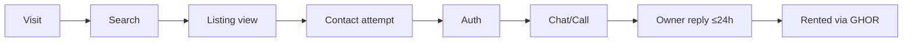

| Group | Events (new unless marked) |
|---|---|
| Discovery | `page_view` (anonymous first-party id), `search_started`, `search_results`, `zero_results`, `relaxation_clicked`, `filter_used`, `place_selected`, `listing_view` (CURRENT), `gallery_opened`, `photo_viewed`, `video_played`, `badge_explained` |
| Conversion | `contact_tap` (CURRENT), `auth_prompt_shown`, `auth_completed_from_prompt`, `chat_started` (CURRENT), `phone_revealed`, `listing_saved` |
| Supply | `listing_created` (CURRENT), `wizard_step_viewed`, `media_step_abandoned`, `listing_submitted`, `listing_status_changed` {from, to, source manual/automatic}, `availability_confirmed`, `listing_paused/archived` |
| Trust | `report_submitted` {category, tier}, `investigation_opened/closed`, `verified_applied/granted/suspended/revoked`, `appeal_filed/decided` |
| Business | `quota_blocked`, `plan_viewed`, `promo_granted`, later `subscription_*` |
| Performance | `web_vital` {metric, value, route, connection} |

**Admin analytics:**
- the funnel;
- supply by category × locality;
- fresh share;
- approval split (manual vs automatic);
- post-review outcomes for auto-approved listings (**a key safety metric**);
- report rates;
- moderation SLAs;
- media-step abandonment;
- Cloudinary credits;
- field web-vitals.

---

## 35. Business model

**Status:** NOT IMPLEMENTED (D-37, D-38).

| Plan | Price | Listings / month | Key benefits |
|---|---|---|---|
| Free | ₹0 | 3 | Full profile + listing; standard approval (5-minute auto-approval) |
| GHOR Verified | ₹299 / month | 5 | Badge (after verification); increased visibility; immediate automatic approval; verified presentation |
| GHOR Verified Pro | ₹599 / month | 12 | + stronger visibility; priority placement (bounded); priority support; enhanced profile; listing analytics; faster moderation |
| Launch promotion | Free for 5 months | (Verified level) | For the first 50 eligible verified owners |

**Never:** renter fees, booking fees, contact fees, forced payments or ads (unless separately approved later).

**Not decided:** the payment provider; GST and business entity (§52).

**Future options** (not approved): GHOR property visits; agreement drafting through partners; moving and services referrals. Each requires a separate decision.

**Unit-economics note (inferred):** at launch, media cost (≈ Plus plan $89–99/month) and SMS (≈ ₹0.15 per OTP) are the main variable costs. About 30 paying ₹299 owners roughly cover the Plus plan (before GST and payment fees).

---

## 36. Launch requirements

**Do not launch publicly until every item is met.**

| Area | Minimum requirement |
|---|---|
| Authentication | Production SMS OTP (≥ 95% delivered within 30 s in testing across Jio, Airtel, Vi and BSNL); email verification; no broken Google button |
| Hosting | Web + API hosted; staging + production; TLS; custom domain |
| Database | Managed Postgres; **daily backups + a tested restore**; migrations applied via CI |
| Media | Cloudinary plan decided; video pipeline working; cleanup jobs running |
| Verification | Senior reviewer role assigned (a named person); evidence storage or in-person process ready; the retention job running |
| Admin operations | All 10 queues; audit log; reason catalogues; on-call coverage for the 5-minute window (§49 R-02) |
| Moderation capacity | Named moderators covering **08:00–22:00 IST** daily (proposed) |
| Legal | Privacy policy, terms, owner policy, verification consent, disclaimers; grievance officer named; lawyer-reviewed |
| Monitoring | Error tracking, uptime, job-failure alerts, API latency, credit alerts |
| Rate limits | Public endpoints, reveal caps, OTP, reports |
| Performance | Budgets met in the lab on home, explore and detail |
| SEO | Sitemap, robots.txt, structured data, canonical URLs, thresholds |
| Analytics | Funnel events live; the admin funnel view |
| **Initial supply** | **≥ 60 live listings with full media**, covering at least Rooms, PG and Flats, concentrated in **3 launch clusters** (Jalukbari–GU, Six Mile–Ganeshguri–Dispur, Beltola–Hatigaon), each cluster with ≥ 15 listings (proposed; `LAUNCH.md` targets 60–100) |
| Operational capacity | Seeding: owner outreach, with owners filming their own media (D-15) |

---

## 37. Phase 0

**Production readiness.** Detail is in the roadmap document.

| # | Item | Why |
|---|---|---|
| P0-1 | Real SMS OTP (a DLT-registered provider) | Production sign-in is impossible today (code) |
| P0-2 | Remove or hide the Google button (D-36) | Dead UI (code) |
| P0-3 | Hosting, staging/production environments, domains, TLS | None configured (code) |
| P0-4 | Backups + restore drill | Launch requirement |
| P0-5 | Commit the test suites to the repository + CI | No committed tests (code) |
| P0-6 | Legal pages + owner policy + verification consent + grievance officer | Placeholders (code) |
| P0-7 | Keyed map tiles + geocoder | Public OSM policy limits (code) |
| P0-8 | Cloudinary plan + folder structure (public media vs private verification) | Video needs the Plus plan (§18.2) |
| P0-9 | Restrict CORS; per-IP rate limits for public endpoints | Any-origin CORS (code); public browsing is coming |
| P0-10 | Soft-delete / archive model; account anonymisation | Hard deletes destroy other people's chats (code) |
| P0-11 | **Rename the "Verified" chip** to approval-source labels | Conflicts with the paid badge (§27) |
| P0-12 | Monitoring (errors, uptime, jobs, latency) | Launch requirement |
| P0-13 | **API-side** admin RBAC (`admin`, `senior_reviewer`, `super_admin`; permission guards on every `/admin/*` route), **admin-audience tokens**, a step-up mechanism, and the audit + evidence-access log foundation | Required by D-12, D-46; the Admin Console depends on it |
| P0-16 | **Admin Console foundation** (`apps/admin` scaffold, admin login with **mandatory TOTP + recovery codes**, RBAC-aware shell, staging at `admin-staging.ghor.co.in` and production at `admin.ghor.co.in`) (§26.2–26.4) | D-46; the legacy `apps/web/admin` stays in use until parity |
| P0-14 | Email infrastructure (sending domain, templates) | Email verification and notifications |
| P0-15 | Documentation reconciliation (`CLAUDE.md`, `DESIGN.md`, STATUS files) | Contradictions (§53) |

## 38. Phase 1

**Marketplace foundation.**

Listing model v2 · owner profile completion (email verification) · media standard (photos 3–9 + video) · places database + search parser + filters + no-result recovery + ranking v1 (without paid boost, since payments aren't live) · public server-rendered discovery + contact-gated authentication + SEO · bento detail + viewer · approval flows (the 5-minute auto-approval + verified-owner auto-approval) + structured rejections · reporting tiers + investigations + graduated enforcement + appeals · freshness · contact modes + reveal logging + email notifications · saved listings + recently viewed · **Admin Console (`apps/admin`): parity with the legacy admin + the new queues, review workspace, trust workflows and dashboard (§26.7–26.10); operational switch-over from `apps/web/admin`** + senior-reviewer verification + **GHOR Verified (manual grant, no payments) + the first-50 promotion entitlement** · quotas (Free: 3/month enforced; Verified-level quotas through the promo entitlement) · analytics v1 · performance gates.

## 39. Phase 2

**Growth and trust.**

Payments and subscriptions (₹299/₹599, lifecycle, webhooks) + the Admin Console Business area (subscriptions, payments) and Revenue analytics · **removal of the legacy `apps/web/admin`** after the parity period (§26.13 step 7) · ranking boosts + Pro priority placement · Pro analytics · DigiLocker partner / verification scale-up · saved searches + alerts · SMS notifications · locality guides and commute context · visit proposals · trigram typo tolerance · the mobile app catching up with web.

## 40. Future

- Second Assam city (after the Guwahati thresholds).
- PG bed-level availability.
- Assamese owner flows.
- WhatsApp integration (if decided).
- Optional GHOR property visits.
- Services partnerships (each requires a separate decision).
- Adaptive video streaming.
- Reverse-image checks for stock photos.

---

## 41. Technical architecture implications

| Area | Implication | Keep simple |
|---|---|---|
| Web | Move public routes to **server components** with CDN caching; authenticated surfaces stay client-rendered through the existing BFF (code) | No new framework |
| **Admin** | **`apps/admin`**: a separate Next.js app (client-rendered operational pages + its own BFF), separate origin and deployment, admin-audience sessions, **no business logic** (§26) | Reuses the web stack patterns; same API |
| API | New modules: places, search, media, verification, entitlements (plans and quotas), freshness jobs, investigations, appeals, audit, notifications (email) | One NestJS service (no microservices) |
| Jobs | Per-minute scheduler (the 5-minute auto-approval), daily jobs (freshness, cleanup, retention purges, verification expiry) | In-process scheduler on a **single API instance**; add a lock table before running multiple instances |
| Storage | Cloudinary: public listing media + a **private** verification folder (or a separate account) | none |
| Search | Postgres + dictionaries + precomputed distances | No Elasticsearch |
| Caching | CDN for public pages; an HTTP cache for the places dictionary | No Redis until there are multiple instances |
| Email | Transactional provider (Resend already used for the waitlist, code) | none |
| SMS | DLT provider (MSG91-class) | none |
| Payments | Phase 2; provider undecided | none |
| Observability | Error tracking + logs + uptime + web-vitals events | none |

---

## 42. Database implications

**All PROPOSED** (Prisma migrations; nothing changed yet).

| Change | Details |
|---|---|
| `profiles` | + `email` (unique), `email_verified_at`, `lister_role`, `primary_place_id`, `about`, `default_contact_mode`, `owner_policy_accepted_at`, `represents_name`, `restricted_until`, `status` (active / restricted / suspended / terminated), `anonymised_at` |
| Roles | `user_role` + `senior_reviewer`, `super_admin` (or a separate `admin_permissions` table); `admin_sessions` (audience, TOTP-verified timestamp, step-up timestamp, idle/absolute expiry); `admin_totp` (encrypted secret, enrolled_at, last_used_step to prevent code reuse); `admin_recovery_codes` (hash, created_at, used_at); `audit_log`; `evidence_access_log`; `queue_claims` (soft locks); `listings.version` (optimistic concurrency) |
| `listings` | Replace `property_type` with `category`; + `arrangement`, `size`, `beds_in_room`, `bathrooms`, `bathroom_type`, `furnishing`, `occupancy_gender`, `suitable_for[]`, `max_occupants`, `deposit` (required), `maintenance`, `electricity_mode`, `electricity_amount`, `water_mode`, `other_fees` (JSON), `meals`, `kitchen_access`, `floor`, `total_floors`, `area_sqft`, `parking`, `is_portion`, `is_coliving`, `rules` (JSON), `min_lease_months`, `notice_period_days`, `locality_place_id`, `address_private`, `contact_mode`, `lister_role`, `approval_source` (manual / automatic), `approved_at`, `approved_by`, `post_review_status`, `confirmed_at`, `freshness_state`, `archived_at`, `submitted_at`; status enum extended (pending_review, live, needs_changes, rejected, under_investigation, removed, paused, rented, archived) |
| `listing_media` | Replaces `listing_images`: type (photo/video), position, public_id, url, width, height, bytes, duration_s, poster_url, room_tag, exif_taken_at, phash, state, `pending_delete_at` |
| Places | `places` (city, type, slug, name, point, parent, SEO, status), `place_aliases`, `place_adjacency`, `listing_place_distances` (listing, place, meters; index on place + meters); migrate `institutions` → `places` |
| Verification | `verification_cases` (subject owner/property, level, status, decision, reviewer, reasons, timestamps, expiry), `verification_evidence_meta` (doc type, masked ref, match results, storage ref, purge_at), `badge_events` |
| Plans | `entitlements` (owner, plan free/verified/pro, source promo/paid, starts, ends, state), `quota_usage` (owner, period, used), `promotions` (first-50 counter) |
| Payments (P2) | `subscriptions`, `payments`, `webhook_events` (idempotency) |
| Moderation | `moderation_actions` (listing, actor, action, reason codes, note, before/after), `listing_snapshots` (the approved version, for diffs) |
| Trust & safety | `reports` (+ tier, custom reason), `investigations`, `evidence_snapshots`, `enforcement_actions`, `appeals`, `risk_flags` |
| Contact | `contact_reveals`; `favorites`; `saved_searches` (P2) |
| Audit | `audit_log` (actor, action, target, metadata, ip hash, time) |
| Notifications | `notifications` (+ new types), `email_log`, `notification_preferences` |
| Indexes | `(status, freshness_state, city, category, created_at desc)`; `(owner_id, status)`; places indexes; `listing_media (listing_id, position)`; `(listing_id)` on reports |

---

## 43. API implications

| Area | New / changed endpoints (PROPOSED) |
|---|---|
| Public (no auth, rate-limited) | `GET /public/listings/search`, `GET /public/listings/search/relax`, `GET /public/listings/:id`, `GET /public/places/dictionary`, `GET /public/places/:slug`, `GET /public/owners/:id` |
| Auth / profile | `POST /auth/email/start`, `POST /auth/email/verify`, `GET /me/profile-completion`, `GET /me/summary`, `PATCH /me/profile` |
| Listings (owner) | `POST /listings` (draft), `PATCH /listings/:id`, `POST /listings/:id/submit` (checks: completion, quota, media, prohibited terms, risk flags), `POST /listings/:id/confirm-availability`, `POST /listings/:id/mark-rented`, `POST /listings/:id/archive`, `POST /listings/:id/restore` |
| Media | `POST /uploads/signature {kind: photo/video}`, `POST /listings/:id/media`, `POST /listings/:id/media/video/confirm` |
| Contact | `POST /listings/:id/reveal-phone`; chat unchanged |
| Saved | `POST/DELETE /favorites/:listingId`, `GET /favorites` |
| Reports / appeals | `POST /reports` (+ tier, custom), `POST /appeals`, `GET /appeals/:id` |
| Verified | `GET /me/plan`, `POST /verified/apply`, `GET /verified/status` |
| Admin | `GET /admin/queues/:queue`, `POST /admin/listings/:id/decision`, `POST /admin/listings/:id/hold`, `POST /admin/investigations/:id/decision`, `POST /admin/enforcement`, `POST /admin/appeals/:id/decision`, `POST /admin/verification/:id/decision` (**senior only**), `POST /admin/badges/:ownerId/{suspend,revoke,reinstate,request-reverification}` (**senior only**), `GET /admin/audit` (super), admin CRUD for places, `POST /admin/auth/login` + `/admin/auth/totp/enroll` + `/admin/auth/totp/verify` + `/admin/auth/recovery` + `/admin/auth/recovery-codes/regenerate` + `/admin/auth/step-up` (admin audience), `POST /admin/queues/items/:id/claim`, `GET /admin/evidence/:id/url` (senior; step-up; signed URL ≤ 5 min; audited), `GET /admin/dashboard` (aggregated counts). **All `/admin/*` routes: `AdminAudienceGuard` + `PermissionGuard` (+ `StepUpGuard` where sensitive); consumed only by `apps/admin`** |
| Payments (P2) | `POST /billing/checkout`, `POST /billing/webhook` (signed), `POST /billing/cancel`, `POST /billing/change-plan` |
| Removed or changed | The phone is **no longer returned** on `GET /listings/:id` (code today returns it); `DELETE /listings/:id` becomes archive; `PATCH` status transitions replaced by explicit action endpoints |

---

## 44. Web implications

- **The legacy `/admin` pages stay** until the Admin Console reaches parity and switch-over (§26.13), then get removed along with the admin-only hooks, components and middleware entries. **No new admin features are added to `apps/web`.**
- A new route map: public `/rent/guwahati/...`, `/owner/[id]`, guides; authenticated `/saved`, `/messages`, `/listings`, `/profile`, `/profile/verification`.
- Legacy routes redirect with 301s.
- Middleware stops protecting public routes (code today protects `/browse`, `/listing`, `/owner`).
- Public pages become server components; the BFF stays for authenticated calls.
- New components: completion meter, media uploader (video, chunked), bento gallery, trust panel with badge sheets, approval-source label, freshness badge, report flow, appeal flow, plan and quota panel, admin queues.
- Remove the Google button (Phase 0).
- Rename the "Verified" chip (Phase 0).
- Performance budgets in CI.

---

## 45. Mobile implications

**Status:** the Expo app (SDK 56, `apps/mobile`) mirrors the old web features, and **its photo upload uses an unsigned Cloudinary preset** (code), which the API now rejects (own-cloud URLs only). **The mobile app is out of scope for Phases 0–1 (web-first).**

| Implication | Plan |
|---|---|
| API changes (listing model, submit endpoint, phone removed from detail) break mobile listing creation and calls | **Freeze mobile owner features** (hide create/edit with "List on the web" messaging) or don't distribute the app until Phase 2 (§52 Q-19) |
| Push notifications | Keep (mobile only) |
| Phase 2 | Rebuild mobile on the new API: signed uploads including video (native recording), public browse, trust UI |

---

## 46. Migration plan

**Current data** (read-only query, 2026-09-29):

| Item | Count |
|---|---|
| Listings | **0** |
| Listing images | 0 |
| Institutions | 0 |
| Profiles | **31** (11 owners, **7 admins**, the rest seekers), mostly development test accounts |

| Step | Action |
|---|---|
| 1 | Schema migrations for §42, with defaults: `category` from `property_type` (room → Room, flat → Flat); new required fields nullable at the database level, enforced at submit |
| 2 | Existing listings: **none in dev.** If any exist at cut-over: mark `needs_details`; grandfather them live for 30 days (proposed) with an owner prompt to add a video and the new fields; after 30 days → paused (not deleted) |
| 3 | Freshness: set `confirmed_at = approved_at` (or now) for existing live listings |
| 4 | Verification: all owners start at `not_applied`; no badge migration (no badges exist) |
| 5 | Approval source: existing approved listings → `manual` |
| 6 | Profiles: email is missing for everyone → completion < 100% → they must verify their email before their **next** submission (existing live listings unaffected) |
| 7 | Admin accounts: **review all 7 admins; demote test accounts** before production; assign `senior_reviewer` to named people only |
| 8 | `institutions` → `places` (0 rows; nothing to migrate) |
| 9 | Hard delete → archive: change the service behaviour; no data change |
| 10 | Production database: created fresh from migrations (no dev data copied), seeded with places only |

---

## 47. Testing strategy

| Layer | What | Where |
|---|---|---|
| Unit | Search parser (all §19.3 examples), ranking and caps, quota calculator, profile completion, freshness transitions, badge-display rule, auto-approval timer logic, entitlement states, reason catalogues | API (Jest; the repository has a Jest setup, code) |
| Integration (API + DB) | Regression 16, security 6, photos 13, authorisation 27 (**currently outside the repo; commit them**) + new: submit guards, auto-approval, investigations, appeals, senior-only actions, reveal caps, public DTO privacy | CI with a disposable Postgres |
| End-to-end (browser) | Owner: profile → email → wizard with media → submit → (auto-)approval. Renter: public search → detail → sign in at contact → chat → save → report. Admin: queues, decisions, audit. Senior: verification grant and revoke | Playwright in CI |
| Media | Chunked upload with an interruption; invalid duration or size; processing failure; cleanup windows | Integration + manual |
| Performance | A throttled lab run (slow 4G, 4× CPU) on home, explore, detail and create against the budgets | CI gate |
| Accessibility | axe in CI + a manual screen-reader pass | CI + release checklist |
| Security | Authorisation matrix (roles × endpoints), rate limits, webhook signature tests (P2), dependency audit | CI |
| Load | Public search 50 req/s at p95 < 300 ms on staging | Pre-launch |
| Usability | 10 owners (wizard + media) and 8 renters (search, trust comprehension) | Pre-launch |

---

## 48. Monitoring

| Signal | Alert |
|---|---|
| API 5xx rate | > 1% for 10 minutes |
| API p95 latency (search, detail) | Above target for 3 days |
| Scheduler jobs (auto-approval tick, freshness, cleanup, purge) | A missed run or a failure |
| **Auto-approval volume vs admin reviews** | Unreviewed auto-approvals older than 24 h (post-review backlog) |
| OTP delivery | Success < 90% over 1 hour |
| Email bounces | > 5% |
| Cloudinary credits | 70% and 90% of the plan |
| Field web-vitals | p75 LCP > 2.5 s or CLS > 0.05 on key routes (weekly) |
| High-risk reports | Any unassigned case older than 2 h |
| Backups | Daily success; monthly restore test |

---

## 49. Risk register

| ID | Risk | Type | Likelihood | Impact | Mitigation |
|---|---|---|---|---|---|
| R-01 | **Empty marketplace at launch** | Product | High | Critical | Launch supply gate (§36); cluster seeding; honest empty states |
| R-02 | **The 5-minute auto-approval puts scams live** before anyone reviews them | Trust | Medium–high | Critical | Pre-approval system checks (§13.3); risk-flagged items excluded (**Q-10**); the "Automatically approved by GHOR" label; staffed review hours; post-review within 24 h; high-risk report auto-hide |
| R-03 | **Mandatory video reduces supply** (owner provides it; no GHOR shooting) | Product | High | High | A guided script, resumable uploads, clear limits; monitor media-step abandonment weekly; outreach support (guidance, not shooting) |
| R-04 | **Perception that trust is for sale** (a paid badge) | Brand / trust | Medium | High | Verification is required and revocable; precise badge copy; free owners are not labelled negatively; manual review shown separately |
| R-05 | Moderation and verification load on a small team | Operations | High | High | Automation of checks; queues and SLAs; the senior reviewer only for badges; plan a hire before scaling |
| R-06 | Cloudinary cost (video bandwidth) | Financial | Medium | Medium | Tap-to-play, 480p default, posters, credit alerts; review at 250 credits/month |
| R-07 | Legal and privacy exposure (ID documents, DPDP, discrimination wording) | Legal | Medium | High | Minimum retention; masked references; senior-only access with logs; a lawyer's review; positive fit wording |
| R-08 | SMS / DLT delays block launch | Technical / operational | Medium | High | Start DLT registration immediately |
| R-09 | Payment provider and business entity not ready → subscriptions delayed | Business | Medium | Medium | Phase 1 runs Free + promo without payments |
| R-10 | SEO cold start / thin pages | Growth | High | Medium | Thresholds; offline and community acquisition first |
| R-11 | Paid ranking erodes relevance | Product | Medium | Medium | Caps, eligibility-first rules, a score-gap guard |
| R-12 | Fraud incident in a small market | Trust | Medium | Critical | High-risk auto-hide; safety UX; fast investigations |
| R-13 | Scope creep delays launch past the demand window (Dec–Jan, `LAUNCH.md`) | Delivery | High | High | The phase gates and build order (§54); the anti-scope list |
| R-14 | Mobile app shipped with breaking API changes | Technical | Medium | Medium | Freeze or hide mobile owner features (§45) |
| R-15 | Leftover test admin accounts reach production | Security | Medium | High | A fresh production database; role review (§46) |
| R-16 | Serving everyone too early → thin categories | Product | Medium | Medium | Brand for everyone; supply concentrated by cluster; indexing thresholds |
| R-17 | Freshness fatigue among owners | Product | Medium | Medium | One-tap confirmation; grace periods; configurable windows |
| R-18 | A national competitor (NoBroker) enters Guwahati | Market | Low–medium | High | Local operations moat; free contact; owner-only integrity |
| R-19 | **Two admin UIs during migration diverge** or the legacy one stays in use | Operational | Medium | Medium | Both call the same API; new workflows only in `apps/admin`; a parity checklist; a dated switch-over; a legacy read-only banner (§26.13) |
| R-20 | **The admin surface is compromised** (it's the highest-privilege entry point) | Security | Low–medium | Critical | A separate origin; admin-audience tokens; mandatory TOTP + recovery codes + TOTP step-up (D-47); short sessions; API-enforced permissions; audit + evidence logs; IP allowlist optional later (not required at launch); a dedicated security review |

---

## 50. Product metrics

**North-star:** **weekly qualified connections**, meaning chats or calls on fresh listings where the owner replies or answers within 24 h.

| Group | Metrics |
|---|---|
| Supply | Live listings by category × cluster; fresh share (confirmed within the cycle); media-step abandonment; time to live; % from GHOR Verified owners |
| Demand | Public visits; searches; zero-result rate (by place); views per session; contact rate; saves; returning renters |
| Marketplace | Owner 24 h reply rate; median first reply; rented via GHOR (owner-reported) |
| Trust | Reports per 100 listings (by tier); **% of auto-approved listings later rejected in post-review**; investigation outcomes; badge suspensions; appeal overturn rate |
| Business | Verified applications → grants; promo slots used; (P2) paid conversion, churn, MRR |
| Performance | Field p75 LCP, INP and CLS by route; API p95 |
| Cost | Cloudinary credits per live listing; SMS cost per sign-in |

---

## 51. Founder decisions

All settled decisions are in **[`GHOR-DECISION-REGISTER.md`](GHOR-DECISION-REGISTER.md)** (D-01 to D-47). They are not reopened here.

## 52. Open questions

Only genuinely unresolved items. Each carries a recommendation; the founder decides.

| ID | Question | Recommendation |
|---|---|---|
| Q-01 | What makes an owner profile "**eligible**" for the first-50 promotion? | A 100%-complete profile + ≥ 1 submitted listing + passing verification; counted by grant order |
| Q-02 | Quota definition: what counts as a "listing per month", and does relisting count? | New submissions only; relisting, renewals and edits don't count (§10.1) |
| Q-03 | Payment provider (`CLAUDE.md` mentions Razorpay as a plan, not a decision) | Decide with the business entity; Phase 2 |
| Q-04 | Refund and cancellation policy | No pro-rated refunds; cancel at the period end |
| Q-05 | Refunds when the badge is suspended for trust reasons while the subscription is paid | No refund for a confirmed violation; pro-rated credit if the suspension is overturned on appeal |
| Q-06 | Business entity + GST registration timing | Before Phase 2 payments |
| Q-07 | Accepted identity and ownership documents (final list) | §11.2 proposed list, after a lawyer's review |
| Q-08 | Evidence method in Phase 1: secure upload vs in-person/video-call only | Offer both; purge uploads after 30 days |
| Q-09 | PG listings with mixed room types: one listing per room type, or one listing with variants? | One listing per room type (simpler search) |
| Q-10 | **Should risk-flagged submissions be excluded from the 5-minute auto-approval?** | **Yes** (protects renters; doesn't change the rule for normal submissions) |
| Q-11 | High-risk report threshold for automatic hiding | 1 report from an established account (≥ 7 days, phone verified) or 2 distinct reporters |
| Q-12 | Cloudinary plan at launch (sets the video file limits) | Plus ($89–99/month) → 200 MB input limit |
| Q-13 | Who curates the places dataset, and by when? | The founder, before Phase 1 search work |
| Q-14 | Paid visibility multipliers and slot counts | ₹299 +5%, ₹599 +10% + 2 capped slots per 20 (app-config tunable) |
| Q-15 | Should paid priority placements be labelled (e.g. "Featured")? | **Yes** (transparency; consumer-protection expectations for paid placement) |
| Q-16 | WhatsApp in the future: owner opt-in link after the first chat, or never? | Revisit with reply-rate data after launch |
| Q-17 | Desktop muted inline video preview on detail | Yes (desktop + fast connection + no Save-Data) |
| Q-18 | Retention periods (§33) | Adopt the proposals after a lawyer's review |
| Q-19 | Mobile app during Phases 0–1: hide owner features or withdraw distribution? | Don't distribute until the Phase 2 rebuild |
| Q-20 | Flat/house freshness cycle length (founder: "longer") | 30 days + 14-day grace |
| Q-21 | Rooms/PG grace period after expiry | 7 days |
| Q-22 | Moderation hours coverage (affects the auto-approval risk) | 08:00–22:00 IST staffed |
| Q-23 | Tenant-fit wording (legal review) | Positive "Suitable for" + occupancy only |
| ~~Q-24~~ | Admin Console domain | **Resolved: D-47:** `admin.ghor.co.in` (production), `admin-staging.ghor.co.in` (staging) |
| ~~Q-25~~ | Production admin network restriction | **Resolved: D-47:** no mandatory IP allowlist or VPN at launch |
| ~~Q-26~~ | Admin second factor | **Resolved: D-47:** authenticator-app TOTP mandatory for **all** admin roles; recovery codes at enrollment |
| ~~Q-27~~ | Can super_admin grant GHOR Verified? | **Resolved: D-47:** no, unless explicitly assigned the senior_reviewer capability |

---

## 53. Documentation vs code audit

| ID | Topic | Old documentation | Current decision | Actual code | Final source of truth |
|---|---|---|---|---|---|
| C-01 | "Verified" meaning | PRD: "Verified by GHOR" = approved; V2/P01: rename to "Reviewed" | **GHOR Verified ✓ = a paid, reviewer-granted, revocable program**; approval labels are separate | A green "Verified" chip on every approved listing | This blueprint §9, §13.4; **rename the chip in P0** |
| C-02 | Moderation before live | `CLAUDE.md` §7.5: "Moderation is a feature, not a delay"; all listings pending | Auto-approve free listings after 5 minutes; verified owners immediately | All pending until an admin approves | Blueprint §13 (risk R-02) |
| C-03 | Paid verification | `CLAUDE.md` §8: "paid verification badge" (later); CPS/V2: "never pay-to-be-trusted" | Paid program (₹299/₹599) with a revocable badge | None | Blueprint §9–10 (**`CLAUDE.md` §8 was right; CPS/V2 are superseded**) |
| C-04 | Ads | `CLAUDE.md` §2/§8: an interstitial ad before contact (mobile) | No ads unless separately approved | No ads on web; mobile ad code status UNKNOWN (not inspected) | Blueprint §35 |
| C-05 | Browsing access | `CLAUDE.md` §2: login before browsing | Public browsing; auth for protected actions | Sign-in required | Blueprint §31 |
| C-06 | Categories | `CLAUDE.md`: rooms + flats only | Room · Shared Room · PG/Co-living · Flat · House · Other; size is an attribute | room / flat | Blueprint §6 |
| C-07 | Photos | `CLAUDE.md` §2: 3+ photos | 3–9 photos + 1 video | 1–20 photos, ≥ 3 to publish; no video | Blueprint §18 |
| C-08 | Contact | `CLAUDE.md`: chat + call (`tel:`) | Per-listing chat only / chat + calls; logged reveal | Phone returned on detail to any signed-in viewer | Blueprint §24 |
| C-09 | Email | None | Verified email required for profile completion | No email field | Blueprint §7.1 |
| C-10 | Admin roles | Single admin | Senior reviewer for badges | Single `admin` role; 7 admin accounts in dev | Blueprint §26.5 |
| C-11 | Deletes | `CLAUDE.md` §14.4: soft state | Archive (soft) | Hard delete with cascades | Blueprint §12, §46 |
| C-12 | Freshness | `CLAUDE.md`: fast-follow; CPS: 14-day hide; V2: 14/21/60 | Rooms/PG/shared 14-day cycle; flats/houses longer | None | Blueprint §17 |
| C-13 | Assisted media | P01/V2: an "assisted shoot" option | Owners provide media; no GHOR shooting at launch | none | Blueprint §18 |
| C-14 | Google sign-in | `CLAUDE.md`: Google + OTP | Implement properly or remove until ready | Web button non-functional; API endpoint exists | Blueprint §32 (remove in P0) |
| C-15 | SMS | `CLAUDE.md`: provider "to be provided" | Real SMS in Phase 0 | Not implemented; production refuses | Blueprint §37 |
| C-16 | Tests | STATUS files cite passing suites | Committed tests in CI | No committed suites; CI runs no tests | Blueprint §47 |
| C-17 | Stale docs | `DESIGN.md`: "admin not built", "browse grid unresolved"; root STATUS: "zero commits" | none | Admin built; grid resolved; committed and merged | Update in P0-15 |
| C-18 | Ranking | "Most viewed" sort (`CLAUDE.md`) | Multi-factor ranking; paid boost bounded | Newest / price only | Blueprint §22 |
| C-19 | Reviews | `CLAUDE.md`: real reviews in scope; V2: display at ≥ 3 | Not specified by the founder | Implemented (reviews from people who messaged) | Keep as implemented; the display threshold is a detail (not blocking) |
| C-20 | Institutions | `CLAUDE.md`: curated institutions table | Curated places database (broader) | Table exists, 0 rows | Blueprint §20 |
| C-21 | Admin location | `CLAUDE.md` §3/§14.10: admin at `ghor.co.in/admin` inside `apps/web` | **Separate `apps/admin` application** (D-46) | Admin pages inside `apps/web`; a client-side role check; a shared user session; `AdminGuard` on the API | Blueprint §26 (migrate, then remove the legacy admin) |

---

## 54. Final build order

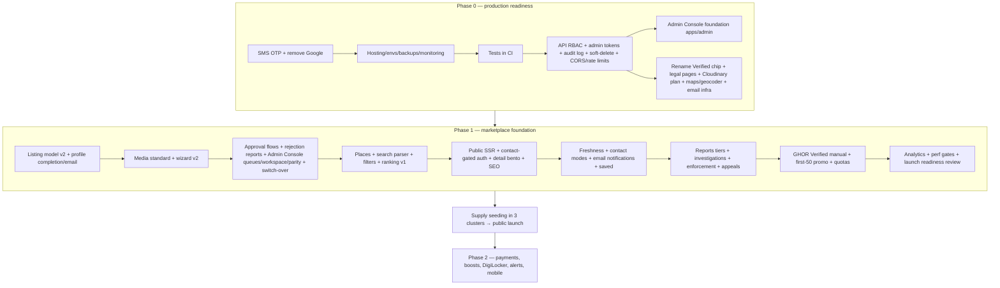

**Parallel non-engineering tracks** (start now): DLT registration · hosting account · Cloudinary plan · legal review (policies, consent, fit wording, badge copy) · the places dataset · owner outreach for seeding · naming the senior reviewer and moderators · business entity (for Phase 2 payments).

---

## 55. Acceptance criteria

Launch-level; each must be verifiable.

| # | Criterion |
|---|---|
| AC-01 | A new user signs in with a real SMS OTP in production; there's no dead Google button |
| AC-02 | Public users can search, filter and open listings, including photos and video, without signing in; contacting prompts sign-in and resumes the action |
| AC-03 | No public response contains an owner phone number, private address or verification evidence (automated test) |
| AC-04 | Owners can't submit below 100% profile completion (including a verified email) or above quota (UI + API) |
| AC-05 | Submission requires 3–9 photos + 1 ready video (UI + API) |
| AC-06 | Free submissions auto-approve after 5 minutes without admin action, recorded as `approval_source=automatic`, shown as "Automatically approved by GHOR" to renters and admins; risk-flagged items follow Q-10 |
| AC-07 | Verified-owner submissions go live immediately and appear in the verified-owner admin queue |
| AC-08 | Rejections produce a structured report with reason codes, a policy link, fix guidance and resubmission eligibility |
| AC-09 | A high-risk report hides the listing within 1 minute, creates an investigation, notifies the owner with the approved copy, and reveals nothing about the reporter |
| AC-10 | Only `senior_reviewer` can grant, suspend or revoke the badge; every action is audited with reviewer, time, decision, reason and evidence metadata |
| AC-11 | The badge shows only when verification is `verified` AND the entitlement is active; revocation hides it everywhere within 1 minute |
| AC-12 | Freshness cycles move listings through aging → paused → archived per category; saved-listing renters are notified |
| AC-13 | Phone reveal only on chat + calls listings, logged, rate-limited |
| AC-14 | Search parses every §19.3 example correctly; zero-result pages offer recovery |
| AC-15 | Paid visibility never places an ineligible listing and never exceeds 2 priority slots per 20 results (P2) |
| AC-16 | Budgets met in lab tests (LCP ≤ 2.5 s, CLS ≤ 0.05, INP ≤ 200 ms at slow 4G + 4× CPU) on home, explore and detail |
| AC-17 | Sitemap, robots.txt, canonical URLs and listing structured data (including VideoObject) valid; thin pages noindexed |
| AC-18 | Evidence images are purged per the retention policy; evidence views are logged |
| AC-19 | Daily backups plus a successful restore drill |
| AC-20 | ≥ 60 live listings with full media across the 3 clusters before public launch |
| AC-21 | All admin acceptance criteria ADM-01 to ADM-15 (§26.14) pass, and moderators operate exclusively in `apps/admin` before public launch |

---

## Final audit

### 1. Current reality

A **working development web marketplace** with:
- phone OTP auth logic;
- browse, search and filters;
- a map;
- listing detail;
- chat;
- in-app notifications;
- an owner wizard with signed photo uploads;
- moderation;
- reports (threshold-based);
- reviews;
- admin (queue, reports, reviews, users, config, analytics);
- account deletion;
- a polished responsive UI.

**Not production-ready.** It has 0 listings, 0 institutions, no email, no video, no payments, no public pages and no committed tests.

### 2. Biggest blockers

1. No production SMS OTP.
2. The broken Google button.
3. No hosting, backups or monitoring.
4. Legal placeholders.
5. Map and geocoder policy limits.
6. No committed tests.
7. Hard deletes.
8. **Zero supply.**

### 3. Biggest product opportunities

- Owner-only integrity + precise, revocable verification (GHOR Verified).
- Enforced freshness.
- Mandatory genuine video.
- The Guwahati places database (search by college, workplace, hospital, transit).
- Free contact without lead harvesting.
- Speed on mobile.

### 4. Biggest risks

- An empty marketplace.
- Auto-approval exposing renters to unreviewed scams.
- Video friction.
- Paid-badge perception.
- Moderation capacity.
- Legal and DPDP exposure.
- SMS/DLT delays.
- Cloudinary cost.
- Scope creep.

### 5. Top 10 things to build first

1. Real SMS OTP + remove the Google button.
2. Hosting, environments, backups and monitoring.
3. Test suites committed and running in CI.
4. API-side admin RBAC + admin-audience tokens + audit log + soft-delete + CORS and rate limits; then the Admin Console foundation (`apps/admin`).
5. Rename the "Verified" chip; legal pages; Cloudinary plan; keyed maps and geocoder; email infrastructure.
6. Listing model v2 + profile completion with email verification.
7. The media standard (photos 3–9 + video) + wizard v2.
8. Approval flows (5-minute auto-approval, verified-owner auto-approval) + structured rejections + admin queues.
9. Places + search parser + filters + ranking v1.
10. Public server-rendered discovery + contact-gated authentication + bento detail + SEO.

### 6. Things NOT to build yet

- Payments (Phase 2).
- Paid ranking boosts (Phase 2).
- DigiLocker.
- Saved-search alerts.
- WhatsApp.
- AI.
- Masonry search.
- Microservices, Redis, Elasticsearch.
- The mobile rebuild.
- New cities.
- Services marketplaces.
- Adaptive video streaming.
- Reverse image search.

### 7. Founder decisions still required

Q-01 to Q-23 (§52). **The most consequential:**
- Q-10 (auto-approval of risk-flagged items);
- Q-12 (Cloudinary plan);
- Q-07/Q-08 (documents and evidence method);
- Q-03/Q-06 (payment provider and business entity);
- Q-01 (promo eligibility);
- Q-02 (quota definition);
- Q-22 (moderation hours).

### 8. Final recommended build sequence

Phase 0 (items 1–5 above, including the `apps/admin` foundation) → Phase 1 in the order of §54 (B1 → B9, with the Admin Console reaching parity and taking over moderation before launch) → a launch readiness review against §36 and §55 → supply seeding (≥ 60 listings, 3 clusters) → public launch → Phase 2 (payments and subscriptions, boosts, DigiLocker, alerts, SMS notifications, mobile rebuild) → Phase 3 (scale: second city, PG beds, Assamese, optional visits).

Non-engineering tracks run in parallel from day one: DLT, legal, places dataset, supply outreach, reviewer staffing, business entity.
