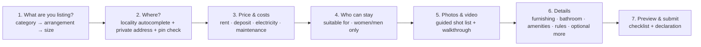
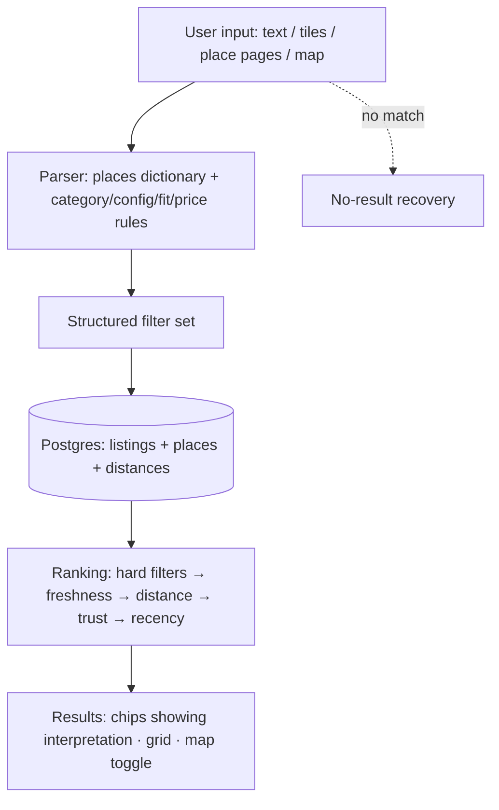
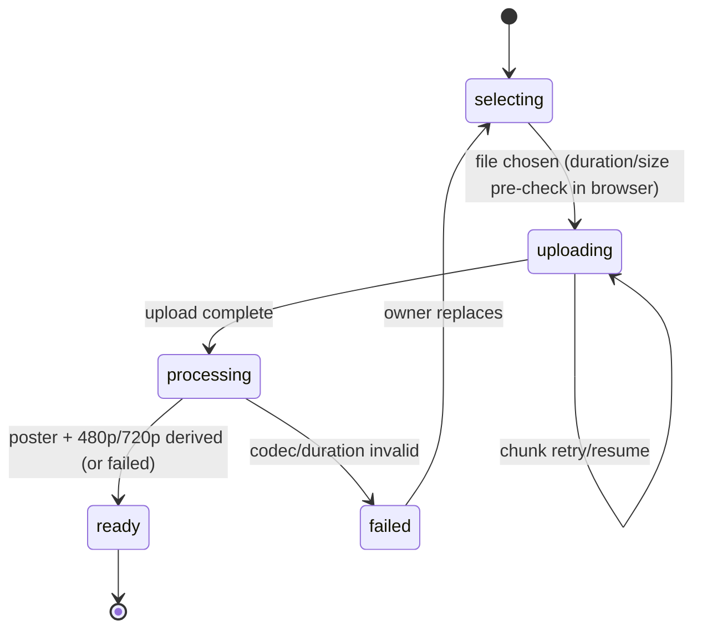
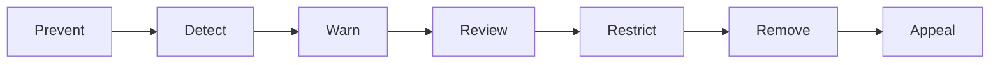
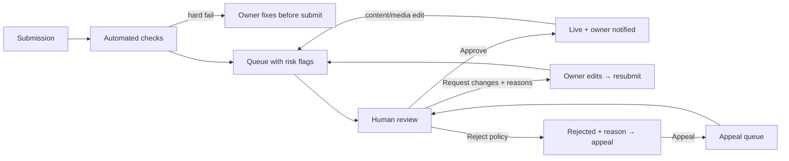
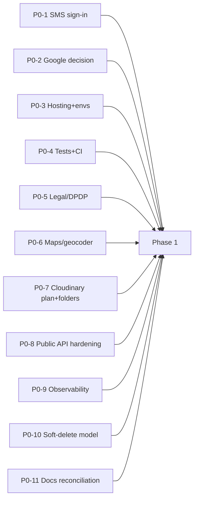
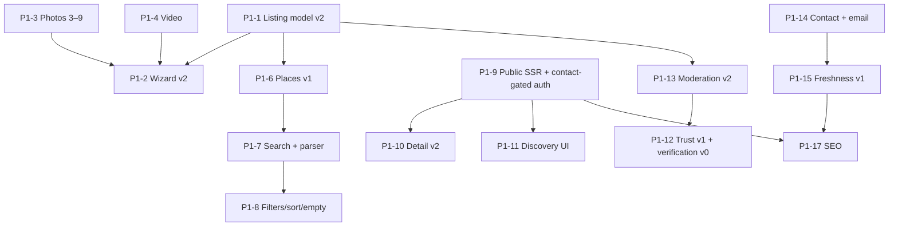

# GHOR — Phase 0 / Phase 1 Product Blueprint

| | |
|---|---|
| **Status** | Canonical, implementation-ready product definition for the next development cycle. Where this blueprint conflicts with earlier documents, **this blueprint wins** (the reconciliations are listed in Part 0). |
| **Supersedes (for scope and decisions)** | `GHOR-V2-PRODUCT-STRATEGY.md` R2 (strategy) · `GHOR-COMPETITIVE-PRODUCT-STRATEGY.md` (research, which remains the evidence base) |
| **Current-state reference** | `GHOR-PRODUCT-REQUIREMENTS.md` (PRD: what the code does today) |
| **Code baseline** | `dev` @ `a5cde89` |
| **Date** | 2026-09-29 |
| **Nature** | Product and technical specification. **Nothing here is implemented yet** unless it's labelled CURRENT. No code, schema, configuration or dependency was changed. |

## Labels

| Label | Meaning |
|---|---|
| **CURRENT** | Exists in the code on `dev` (verified) |
| **PLANNED** | Previously documented intent, not built |
| **PROPOSED** | This blueprint's specification |
| **FOUNDER DECISION** | Must be decided before or while building the item |
| **UNKNOWN** | Couldn't be established; needs research or testing |

Evidence carries a second label: *(observed)* = seen live or in code; *(measured)* = measured on GHOR; *(reported)* = secondary source; *(inferred)* = reasoned, not proven.

---

## Contents

**Foundations**
- [Part 0 — Reconciliation of existing documents](#part-0--reconciliation-of-existing-documents)
- [Part 1 — The final GHOR product](#part-1--the-final-ghor-product)

**Core product systems**

2. [Property and listing taxonomy](#part-2--property--listing-taxonomy)
3. [Search and discovery](#part-3--search--discovery)
4. [Places system](#part-4--places-system)
5. [Verification and trust](#part-5--verification--trust)
6. [Listing media system](#part-6--listing-media-system)
7. [Video strategy](#part-7--video-strategy)
8. [Freshness](#part-8--freshness)
9. [Anti-fraud](#part-9--anti-fraud)
10. [Public vs authenticated](#part-10--public-vs-authenticated)
11. [Contact and communication](#part-11--contact--communication)
12. [Saved listings and searches](#part-12--saved-listings--searches)
13. [Admin and moderation](#part-13--admin--moderation)

**Experience and platform**

14. [UI/UX direction](#part-14--uiux-direction)
15. [Performance](#part-15--performance)
16. [SEO](#part-16--seo)

**Market**

17. [Competitive differentiation](#part-17--competitive-differentiation)
18. [Business model](#part-18--business-model)

**Delivery**

19. [Phase 0 / Phase 1 implementation spec](#part-19--phase-0--phase-1-implementation-spec)
20. [Founder decisions](#part-20--founder-decisions)
21. [Final product blueprint](#part-21--final-product-blueprint)
22. [Red flags](#part-22--red-flags)

- [Sources](#sources)

---

# PART 0 — Reconciliation of existing documents

The three documents were written in sequence and disagree in places. This blueprint resolves each disagreement as follows.

| # | Topic | PRD (current code) | CPS | V2 R1 | V2 R2 | **Blueprint resolution** |
|---|---|---|---|---|---|---|
| 1 | Identity and positioning | Rooms and flats for seekers | "Owner-only room and flat finder for students/young professionals" | Rooms-first | For everyone | **For everyone**; rooms, PG and shared accommodation as an underserved *wedge*; students/newcomers as *one* acquisition channel (Part 1) |
| 2 | Categories | room, flat | + PG/shared later | Room subtypes | room, pg, flat, house | **Room, PG/Co-living, Flat, House** + arrangement + configuration. "1BHK" is a *configuration*, not a category (Part 2) |
| 3 | Photos | 1–20, ≥3 to publish | ≥3 | ≥3 | 3–9 | **3–9** |
| 4 | Video | None | — | — | 1 required | **Exactly 1, required to submit** (Parts 6–7) |
| 5 | Freshness | None | Auto-hide after 14 days | 14 / 21 / 60 | 14 / 21 / 60; flats 21 / 30 / 60 | **Category-specific defaults** (Part 8) |
| 6 | Verification | Phone only; ID and property fields unused | "Reviewed" wording; ID/property later | Separate facts | Separate facts; representatives | **Two linked ladders** (account and listing), mapped to the founder's L0–L5 (Part 5) |
| 7 | Public browsing | Sign-in required | Recommended public | Public | Public | **Public** browse and detail; sign-in at the moment of contact (Part 10) |
| 8 | Phone numbers | Shown on detail to any signed-in user | — | Reveal on tap | Reveal on tap | **Reveal on tap, logged, rate-limited** |
| 9 | URLs | `/browse`, `/listing/[id]` | `/rooms-in-…` | `/rent/[locality]` | `/rent/[category]/[place]` | **City-scoped**: `/rent/guwahati/...` (Part 16) |
| 10 | Autoplay | n/a | — | — | Never on mobile | **No autoplay in discovery.** On detail: muted inline preview only on desktop with a good connection and no Save-Data (Part 7) |
| 11 | Email fallback | None | P1 | Phase 2 | Phase 2 | **Phase 1**: public launch increases enquiries; reachability is launch-critical |
| 12 | Freshness timing | — | P1 | Phase 2 | Phase 2 | **Phase 1 (v1)**: public, indexed pages must not be stale |
| 13 | Favorites | Not implemented (PLANNED) | P2 | Phase 3 | Next | **Phase 1** (small, table stakes); saved searches stay Phase 2 |
| 14 | Identity verification | — | Later | Later | Phase 2 | **Phase 1 as "Verification v0"**: admin-attested, with **no document storage** (Part 5.6). In-app uploads or DigiLocker in Phase 2. |
| 15 | Deletes | Hard delete, cascading | — | — | — | **Soft states** (archive) before public launch; hard delete only for account-erasure obligations |
| 16 | Reviews | Implemented | — | Show at ≥3 | Show at ≥3 | Keep; **display at ≥3** |

---

# PART 1 — The final GHOR product

## 1.1 Definition

**GHOR is a rental-home discovery platform for Guwahati.** It helps anyone find a place to live (a room, a PG or co-living bed, a flat or a house) **directly from its real owner or an authorised representative**, with **real media** (photos + a video walkthrough), **stated verification**, and **availability that is kept current**.

## 1.2 Positioning (FOUNDER DECISION; not locked)

The evidence supports **trust + currency + locality** as the differentiators (CPS §1). It does not yet support any specific wording, so the tagline should be **tested with real users** (Part 20 D-1).

| Candidate | Use |
|---|---|
| "Find your next home in Guwahati." | Headline candidate: broad, local |
| "Real owners. Real videos. Still available." | Proof line candidate: three differentiators, all backed by mechanisms |
| "…from verified owners" | **Only after owner verification is live and covers most listings.** Using it earlier would make GHOR the "100% verified" portal it criticises. |

**Product promise (PROPOSED):**
> Every listing on GHOR comes from the owner or someone they've authorised, shows the real place on video, and was confirmed available recently. Contacting owners is always free.

## 1.3 Users and jobs

| Side | User | Primary job | Secondary jobs |
|---|---|---|---|
| Demand | **Anyone renting a home** | Find a suitable, available place I can trust, in the area I need, within budget, quickly | Compare options; avoid brokers and scams; arrange a visit; move in safely |
| Demand segments (all served) | Families and couples; working professionals; students; people relocating to Guwahati (job, education, personal); people moving within the city (cheaper, bigger, closer); people seeking PG or shared rooms; women seeking women-only accommodation | Same | Segment-specific: near a college or work; family-suitable; women-only; furnished; short notice |
| Supply | Individual owner (1 unit to a few units) | Fill a vacancy with a reliable tenant without broker fees | Control, few calls, safety |
| Supply | Multi-property landlord | Keep units occupied | Manage many listings efficiently |
| Supply | Authorised representative (family member, caretaker, property manager) | List on the owner's behalf | Not be treated as a broker |
| Supply | PG / co-living operator | Fill beds | Manage bed availability (later) |
| Operations | GHOR moderator / trust operations | Keep every live listing real, authorised and available | Handle reports and verifications efficiently |

**Acquisition focus (not identity):** launch marketing starts where pain and word of mouth are highest: students and newcomers near colleges, and working professionals in office corridors. **The product and brand never say "for students".** Families are served from day one by the same inventory. (inferred)

## 1.4 Product principles

1. **Trust you can check.** Every trust claim maps to a mechanism, and every badge explains itself.
2. **Current, not cached.** A stale listing is a broken listing.
3. **Media-first detail, fact-first discovery.** Browsing is scannable and comparable; listings are visual and immersive.
4. **Local by design.** GHOR speaks Guwahati's geography (localities, colleges, landmarks, alternate spellings).
5. **Value before sign-up.** Public browsing; sign-in when the user acts.
6. **Fast on ordinary phones.** Performance budgets are product requirements.
7. **Honest by default.** No invented listings, numbers or claims (CURRENT design rule, `DESIGN.md`).
8. **Owner-direct, free for renters.** Renters never pay to contact owners.
9. **Minimum data.** Collect only what trust requires; delete what isn't needed.

## 1.5 What GHOR must not become

A broker or agent marketplace · a sales or commercial portal · a co-living operator · a payments or rent-collection company · a social network · a general classifieds site · a "super-app" of services · a product that collects identity documents it doesn't need · a heavy, animated website.

---

# PART 2 — Property & listing taxonomy

## 2.1 Three orthogonal dimensions (PROPOSED)

⚠ **Challenge to the founder's list:** "1RK / 1BHK / 2BHK… Flat" mixes *what kind of place it is* with *how big it is*. Making each size a separate category produces overlapping filters and SEO duplication (a "1BHK" and a "Flat" category for the same listing). They should be separate dimensions:

| Dimension | Values | Answers |
|---|---|---|
| **Category** (what kind of home) | `room` · `pg` (PG / hostel / co-living) · `flat` (flat / apartment / builder floor) · `house` (independent house / portion of a house) · `other` (admin-only; for legitimate edge cases) | "What am I renting?" |
| **Arrangement** (what you get) | `private` (a private room) · `shared` (a shared room or bed) · `entire` (the whole flat, house or portion) | "Do I share?" |
| **Configuration** (size) | `1rk` · `studio` · `1bhk` · `2bhk` · `3bhk` · `4bhk_plus` (flats and houses); `beds_in_room` 1–6 (room and PG shared) | "How big?" |

**Valid combinations:**

| Category | Arrangements | Configuration |
|---|---|---|
| room | private, shared | beds_in_room (if shared) |
| pg | private, shared | beds_in_room; `is_coliving` flag |
| flat | entire (a flat-share is `room` + `shared`, not a flat) | 1rk…4bhk_plus, studio |
| house | entire (whole house or portion) | 1rk…4bhk_plus; `is_portion` |

**User-facing labels are generated** (e.g. "Private room", "Shared room · 2 beds", "PG · Women only", "1BHK flat", "2BHK house portion"). **SEO and search** map "1BHK" to category=flat/house + configuration=1bhk.

## 2.2 Field model

### A. Universal fields (every listing)

| Field | Type | Required | Status |
|---|---|---|---|
| category, arrangement | enum | ✓ | PROPOSED (today `property_type` room/flat, CURRENT) |
| title | text ≤ 80 | Optional; **generated** if empty ("1BHK flat in Beltola") | PROPOSED (today required, 8–120 on the web, CURRENT) |
| description | text ≤ 2,000 | Optional (recommended) | CURRENT (≤ 4,000) → PROPOSED 2,000 |
| locality (canonical place) | reference to a place | ✓ | PROPOSED (today free text, CURRENT) |
| private address (street, house) | text | ✓ (never public) | PROPOSED |
| approximate point | geocoded, jittered publicly | Automatic | CURRENT (jitter exists) |
| rent (monthly) | integer ₹ 500 – 5,00,000 | ✓ | CURRENT (API 1 – 1 crore; web 500 – 2 lakh) → PROPOSED to unify |
| deposit | integer ₹ | ✓ (0 allowed) | CURRENT optional → PROPOSED required |
| maintenance | integer ₹/month | Optional | PROPOSED |
| electricity | included / separate metered / fixed ₹ | ✓ | PROPOSED |
| water | included / separate | Optional | PROPOSED |
| available_from | date (today or later) | ✓ | CURRENT optional → PROPOSED required |
| suitable_for | multi: students, working professionals, families, couples, anyone | ✓ (default "anyone") | PROPOSED |
| occupancy_gender | any / women only / men only | ✓ (default any) | PROPOSED |
| furnishing | furnished / semi-furnished / unfurnished | ✓ | PROPOSED (today an amenity key) |
| bathroom | attached / shared / common (room and PG); count (flat/house) | ✓ | PROPOSED |
| amenities | curated set (§2.3) | Optional | CURRENT (6 keys, unvalidated) → PROPOSED curated and validated |
| media | 3–9 photos + 1 video | ✓ to submit | PROPOSED (CURRENT photos 1–20, ≥3 to publish) |
| lister_role | owner / authorised representative / PG operator | ✓ | PROPOSED |
| owner declaration | checkbox + timestamp | ✓ | PROPOSED |

### B. Category-specific fields

| Field | room | pg | flat | house |
|---|---|---|---|---|
| beds_in_room (if shared) | ✓ | ✓ | — | — |
| meals (none / some / all) | optional | ✓ | — | — |
| curfew / gate time | optional | optional | — | — |
| kitchen access (own / shared / none) | ✓ | optional | — | — |
| bedrooms / bathrooms count | — | — | ✓ (from configuration) | ✓ |
| balcony count | — | — | optional | optional |
| floor / total floors | optional | optional | ✓ | optional |
| carpet or built-up area (sq ft) | optional | — | optional | optional |
| parking (none / 2W / 4W / both) | optional | optional | ✓ | ✓ |
| lift | — | optional | ✓ | — |
| is_portion (part of a house) | — | — | — | ✓ |
| is_coliving (managed co-living) | — | ✓ | — | — |

### C. Optional detail (a collapsed "More details" step)

`min_lease_months` · `notice_period_days` · house rules (visitors, pets, smoking, cooking, alcohol — each allowed / not allowed / ask) · `preferred_move_in_note` (≤ 140 characters).

### D. Fields that must NOT exist

| Field | Why |
|---|---|
| Religion, caste, community, food habits, state or origin, language preference of tenants | Discriminatory; legally and ethically unacceptable (V2 §5.5) |
| Marital status as an *exclusion* ("no bachelors") | Legal grey zone; phrase positively via `suitable_for` |
| Exact house number or street in any **public** field | Privacy and safety; revealed by the owner in chat |
| Owner's Aadhaar number or any ID number in listing data | Aadhaar rules and DPDP (Part 5) |
| "Brokerage" or "commission" amount | Against policy |
| Free-text "price negotiable" tags or ALL-CAPS promotional flags | Clutter |

## 2.3 Curated amenities (PROPOSED)

About 18, grouped, each shown only when relevant to the category:

| Group | Amenities |
|---|---|
| Essentials | Wi-Fi · power backup · water 24×7 (or fixed hours) · geyser · attached bathroom (room/PG; a structured field for flats) |
| Comfort | AC · refrigerator · washing machine · TV · wardrobe · study table |
| Building | Lift · security guard · CCTV · gated property · parking (a structured field) |
| PG services | Meals (a structured field) · housekeeping · laundry service |

## 2.4 Listing creation experience (PROPOSED)

**Goal:** about 5 minutes including the video; **never** one long form.



| Principle | Implementation |
|---|---|
| Intent first | Step 1 decides which fields exist later (a PG never sees "balcony count") |
| Smart defaults | suitable_for = anyone; occupancy = any; available_from = today; electricity = separate metered (PROPOSED default, FOUNDER DECISION) |
| Generated title | Shown in the preview; editable |
| Media step early enough | Media is the biggest effort; start uploads in the background while the owner fills step 6 |
| Save anytime | Drafts autosave (CURRENT for the web wizard; extended to video upload state) |
| Checklist, not a score | "Ready to submit: ✓ 5 photos ✓ video ✓ price ✓ who can stay" |
| Declaration | "I am the owner / authorised by the owner / the operator of this PG. I will not charge renters a brokerage fee." |

---

# PART 3 — Search & discovery

## 3.1 Architecture overview (PROPOSED)



**No AI and no search engine in Phase 1.** Postgres with dictionaries handles Guwahati's scale. A trigram index is added when typo volume justifies it (Phase 1 includes the alias list; trigram is optional in Phase 1b).

## 3.2 Search box

| Element | Spec |
|---|---|
| Prompt | "Search area, college, landmark…" plus a placeholder cycling through real examples ("1BHK in Beltola", "PG near Cotton University") |
| Suggestions (as you type) | Grouped: **Places** (with a type icon: locality, college, hospital, transit, landmark) · **Popular searches** · **Recent** (on the device). Matching includes aliases and prefixes; ≤ 8 items |
| Parser | Runs on submit, and on selecting a suggestion |
| Interpretation chips | "Flat · 1BHK · Near Six Mile · ≤ ₹12,000 ✕", editable and removable |
| Keyboard / accessibility | Combobox semantics (CURRENT pattern), arrows and Enter, Escape closes |
| Offline dictionary | The places and aliases dictionary (≈ 5–15 KB gzipped, (inferred)) ships with the page, so suggestions don't wait on the network |

## 3.3 Parser rules (deterministic)

| Token class | Examples | Mapping |
|---|---|---|
| Category words | room, single room, pg, paying guest, hostel, coliving, flat, apartment, house, portion | category (+ arrangement) |
| Configuration | 1rk, 1 rk, studio, 1bhk, 1 bhk, 2bhk, 3bhk, 4bhk+ | configuration (implies flat or house) |
| Arrangement | shared, sharing, twin sharing, private | arrangement |
| Occupancy / fit | girls, ladies, women, female · boys, men, male · family, families · couple · students · working, professionals, office | occupancy_gender / suitable_for |
| Price | under 12000, below 12k, ≤12,000, 8-12k, 12k | rent max/min |
| Proximity | near X, close to X, around X, X side | place (near) |
| Place names | canonical names + aliases (Part 4) | locality or place |
| Features (small set) | furnished, ac, attached bathroom, parking, wifi | filters |

**Example parses (acceptance tests):**

| Query | Output |
|---|---|
| "rooms near Gauhati University" | category=room · near=gauhati-university |
| "1BHK near Six Mile under ₹12000" | category∈{flat,house} · config=1bhk · near=six-mile · rent ≤ 12000 |
| "PG near Dispur" | category=pg · near=dispur |
| "flats near IIT Guwahati" | category=flat · near=iit-guwahati |
| "room in Beltola" | category=room · locality=beltola |
| "2BHK near Ganeshguri" | config=2bhk · near=ganeshguri |
| "house near Zoo Road" | category=house · near=zoo-road |
| "girls pg jalukbary 6k" | category=pg · occupancy=women · locality=jalukbari (alias) · rent ≤ 6000 |

Unmatched tokens become a text search over title and description.

## 3.4 Filters (intent-shaped)

| Tier | Visible chips (mobile ≤ 4) | Sheet ("All filters", with a live count) |
|---|---|---|
| All | Budget · Category · Who can stay · Available by | Deposit max · furnishing · bathroom · amenities · "Recently confirmed" · "Owner verified" · "Identity verified" · posted within |
| room / pg | + Private/shared · Women/Men only | Meals · kitchen access · beds in room |
| flat / house | + Size (1RK…4BHK+) · Furnishing | Parking · lift · floor · balcony · area |

## 3.5 Sort

- **Recommended** (default): freshness → distance to the chosen place → trust → recency.
- Newest.
- Rent (low to high, high to low).
- **Nearest** (only when a place is chosen).

"Most viewed" is **not** offered: it's a popularity loop and reveals little. (PROPOSED)

## 3.6 URL structure (search state)

- **App search:** `/rent/guwahati?category=room&near=gauhati-university&rent_max=8000&fit=students` (**noindex**; canonical to the matching SEO page if one exists).
- **SEO landing pages:** Part 16.

## 3.7 Map search

| Aspect | Decision |
|---|---|
| Role | **Secondary.** A "Map" toggle; on mobile the list comes first with a floating "Map" button |
| Pins | Rent pill; clustered at low zoom; approximate (±150 m jitter, CURRENT) |
| Interaction | Pan → "Search this area" button (no auto-refetch on every pan, to save data) |
| Provider | Keyed tile provider (Phase 0; OSM public tiles aren't allowed at scale, CURRENT limitation) |
| Performance | The map bundle loads on toggle only (CURRENT pattern) |

## 3.8 Empty states and no-result recovery

| Case | Response |
|---|---|
| No results with filters | "No 1BHKs under ₹8,000 near GU right now." Offer to **relax the filter that removes the most** ("12 listings if you allow up to ₹10,000"), show **nearby places with results**, and offer a **"Tell me when one is listed"** alert (sign-in) |
| Unknown place text | "Did you mean Jalukbari?" (alias and edit distance ≤ 2) |
| Place with no supply | An honest message: "No homes listed in Maligaon yet — get notified" + nearest areas with listings |
| Zero inventory city-wide (launch risk) | Never show fake items; show "New homes are reviewed daily" + an alert signup (honesty rule, CURRENT) |

## 3.9 Typo tolerance

- **Phase 1:** alias lists (curated) + edit distance ≤ 2 against place names in the browser dictionary.
- **Phase 2:** a Postgres trigram index on title and locality for free text.

---

# PART 4 — Places system

## 4.1 Data model (PROPOSED)

| Field | Notes |
|---|---|
| id, slug | Stable; the slug is used in SEO URLs (`gauhati-university`) |
| city_id | Guwahati first; **every place belongs to a city**, which is what makes expansion possible |
| type | locality · neighbourhood · road · college · university · school (limited) · hospital · business area · market · transit (rail, bus, airport) · landmark · institution |
| canonical_name | "Jalukbari" |
| aliases[] | "Jhalukbari", "Jalukbary", "GU area" (curated) |
| point (lat/lng) | Verified by the founder |
| parent_locality_id | For non-locality places (e.g. Gauhati University → Jalukbari) |
| nearby_locality_ids[] | Curated adjacency (Six Mile ↔ Khanapara ↔ Ganeshguri) |
| seo | title and description override; indexable flag |
| stats (derived, cached daily) | fresh listing counts by category; **rent ranges (p25–p75) by category**, only with **≥ 5 listings** |
| status | active / hidden |

**Derived data per listing (PROPOSED):** the distance from each listing to every place within 3 km (precomputed on save and on place edits). Used for "near X" filtering, "0.8 km from GU", nearest sort and SEO pages. **No PostGIS needed at this scale** (a haversine calculation in the application, stored in a join table). (inferred)

## 4.2 Seed set (FOUNDER DECISION; the founder is the source of truth)

| Type | Initial examples (to verify; not authoritative) |
|---|---|
| Localities | Jalukbari, Six Mile, Beltola, Hatigaon, Dispur, Ganeshguri, Chandmari, Zoo Road / Zoo Tiniali, Maligaon, Paltan Bazaar, Bhangagarh, Ulubari, Lokhra, Kahilipara, Basistha, Bhetapara, Ambikagirinagar, Panjabari, Rukminigaon, Survey, Khanapara, Uzan Bazar, Silpukhuri, Chandmari, Noonmati, Narengi, Adabari, Garchuk, Lalganesh, Borjhar (supply-weighted per the OLX facet counts (observed)) |
| Education | Gauhati University, Cotton University, IIT Guwahati, Assam Engineering College, Royal Global University, Assam downtown University, GMCH, other major colleges |
| Health | GMCH, GNRC (Six Mile), Apollo, Nemcare, Down Town Hospital |
| Work | Dispur (Secretariat), GS Road commercial belt, Guwahati Club / Ganeshguri |
| Transit | Guwahati Railway Station (Paltan Bazaar), Kamakhya Junction, ISBT, LGBI Airport |
| Landmarks | Kamakhya Temple, Guwahati Club, Beltola market, Fancy Bazaar |

**Target for Phase 1:** about 60 localities and 40 non-locality places, each with aliases. The quality of this dataset is **directly** the quality of search. (inferred)

## 4.3 Uses

Search, suggestions, filters, distance labels on cards, SEO pages, place guides, similar listings, price context (with enough data), launch-cluster reporting.

## 4.4 Scaling to other cities

Each city is a **dataset**, not code:
- create the city;
- import its localities and places with aliases (the founder or a local partner curates them);
- configure the tile and geocoder bounding box;
- enable indexing once the listing thresholds are met.

All URLs are already city-scoped (`/rent/<city>/...`).

---

# PART 5 — Verification & trust

## 5.1 Legal and privacy constraints (reported; not legal advice)

| Constraint | Consequence for GHOR |
|---|---|
| Aadhaar *authentication* by private entities needs government approval (2025 amendment rules) | **Don't** use Aadhaar authentication APIs |
| Offline Aadhaar verification must be user-initiated (QR or XML); **never store the full Aadhaar number** | If Aadhaar is accepted at all, only through offline verification with a **masked** reference |
| DigiLocker: consent-based fetching through requester partners | The preferred digital path (Phase 2) |
| DPDP Act 2023 + Rules 2025: purpose limitation; erase when the purpose is served; access logs ≥ 1 year; 48 h pre-erasure notice; penalties up to ₹50 cr | Minimum collection, short retention, logs, consent text |
| Assam Tenancy Act 2021: written tenancy agreements | Verification ≠ contract; renters still sign an agreement |
| Assam ownership evidence: Jamabandi/Patta (Dharitree; certified via RTPS), GMC holding number and **property-tax receipt**, sale deed; utility bill (APDCL) as supporting evidence | Accepted document list (FOUNDER DECISION) |

**Required legal review before Phase 2 uploads:** consent text, retention schedule, privacy policy changes, badge disclaimers. (FOUNDER DECISION)

## 5.2 ⚠ Challenge: a single L0–L5 ladder is misleading

The founder's ladder puts "GHOR reviewed" (a listing check) *above* ownership (a property fact) and identity (a person fact). A listing can be reviewed without the owner being identity-verified, and an identity-verified person can post a listing that isn't theirs. A single ladder would suggest that "Level 4" contains Levels 1–3. **Recommendation:** **two linked ladders.**

### Account ladder (a person)

| Level | Name (public) | Proves | Doesn't prove | Evidence | Verified by | Valid for | Expires or resets when |
|---|---|---|---|---|---|---|---|
| A0 | (none) | — | — | — | — | — | (Accounts can't exist without a phone, so A0 is never public) |
| A1 | **Phone verified** | The user controls this mobile number | Identity, ownership | Phone code (CURRENT) | System | While the number is unchanged | Phone change → re-verify |
| A2 | **Identity verified** | The account holder's name matches a government photo ID they presented | Ownership; honesty | v0: ID shown to an admin in person or on a video call (no copy stored). v1 (Phase 2): DigiLocker fetch **or** an upload of PAN / DL / voter ID / passport + selfie; Aadhaar only offline and masked | Admin (v0/v1) or partner API (DigiLocker) | **24 months** | Name change, a suspicious report, or a failed re-check → badge removed and review required |

### Listing ladder (a property / listing)

| Level | Name (public) | Proves | Doesn't prove | Evidence | Verified by | Valid for | Expires or resets when |
|---|---|---|---|---|---|---|---|
| L1 | **Reviewed by GHOR** | Listing text and media passed GHOR's rules at review time | Ownership, condition, availability | Moderation (CURRENT, extended) | Moderator | Until content or media changes | Any content or media change → re-review (CURRENT behaviour) |
| L2 | **Owner verified** or **Authorised representative** | The A2-verified lister owns this property, or holds the owner's written authorisation for it | Property condition; legal title beyond the document; availability | Name match between A2 and one ownership document for **this address** (GMC tax receipt / Jamabandi / sale deed; an APDCL bill as supporting evidence). Representatives: the owner's signed authorisation + the owner's ownership document | Admin | **12 months** | Address change, owner change, lister change, expiry → the badge is removed, the listing stays live |
| L3 | **Visited by GHOR** | A GHOR person saw the property on a date and it matched the media | Condition later; title | Field visit + geotagged photos + checklist | GHOR staff | **12 months** or until media changes | Media replaced → the badge is removed |
| L-F | **Available · confirmed N days ago** | The lister confirmed availability N days ago | Current availability | Freshness system (Part 8) | Lister (system-recorded) | Rolling | Part 8 |

### Mapping to the founder's L0–L5

L0 → no badge · L1 → A1 · L2 → A2 · L3 → L2 · L4 → L1 (always required to go live) · L5 → L3.

## 5.3 What's mandatory (PROPOSED; FOUNDER DECISION)

| Lister | A1 Phone | A2 Identity | L1 Reviewed | L2 Ownership / authorisation | L3 Visit |
|---|---|---|---|---|---|
| Owner, ≤ 3 active listings | **Required** | Optional (rewarded) | **Required** | Optional (rewarded) | Optional (future service) |
| Owner, > 3 active listings | Required | **Required** | Required | Required per listing within 30 days of going live | Optional |
| Authorised representative | Required | **Required** | Required | **Required before going live** | Optional |
| PG / co-living operator | Required | **Required** | Required | **Required** (lease or ownership of the premises) | Optional |

**Why not mandatory for everyone:** it would sharply reduce early supply (inferred). The **rewards** are a badge, an "Owner verified" filter, and ranking above unverified listings *within the same freshness tier*.

## 5.4 What users see

| Surface | Display |
|---|---|
| Card | At most **one** trust badge (the strongest: Visited > Owner verified > Identity verified > Reviewed) + freshness |
| Detail trust strip | All earned badges + "Availability confirmed N days ago" + lister role + account age + reply time (≥ 5 enquiries) |
| Badge tap | A sheet explaining exactly what was checked, when, by whom (GHOR) and **what it doesn't guarantee**, plus a link to `/trust` |
| Never shown | Document images, document numbers, report counts, risk flags |

**Standard disclaimer (PROPOSED copy; legal review needed):** "GHOR checks what's stated on each badge. Always visit the property and sign a written agreement before paying anything."

## 5.5 What admins see

- A verification queue with each case's documents (**short-lived signed URLs**);
- a name-match helper;
- previous attempts;
- account history;
- a decision with reason codes.

**Every document view is logged** (admin, time, case).

## 5.6 Verification v0 (Phase 1): admin-attested, no document storage (PROPOSED)

⚠ **Challenge:** building secure document storage, encryption, retention jobs and DPDP processes *before launch* is heavy. **v0** gives real verification without storing documents:
- The lister requests verification → the founder or an admin inspects the original documents **in person or on a video call**.
- The admin records: document type, masked reference (e.g. PAN last 4), name match yes/no, property address match yes/no, date, admin.
- **No image or copy is stored.**
- Status and expiry are set, and the badge appears.
- **It scales only to about 10–30 verifications a week (inferred)**, which is enough for launch clusters.
- In Phase 2, add in-app uploads and a DigiLocker partner for scale.

## 5.7 Edge cases

| Case | Handling |
|---|---|
| Multiple properties, one owner | A2 once; L2 per property |
| Joint owners or family property | Any registered owner's document, or the family member's authorisation |
| Tenant sub-letting | **Not allowed** unless the owner's written authorisation → the representative path |
| Property manager with many owners | Representative path per owner (a batch in the admin tool) |
| Name mismatch (e.g. document in a parent's name) | Representative path |
| Document replaced | New review; old record superseded |
| Suspected fake document | Freeze verification; request an in-person check; no automated ban |
| Impersonation report ("that's my house") | Immediate pause + priority review (Part 9) |
| Agent posing as owner | Reports + phone reuse → review → ban on evidence (Part 9) |

---

# PART 6 — Listing media system

## 6.1 Requirements (FOUNDER DECISION: fixed)

- **Minimum:** 3 photos + 1 video.
- **Maximum:** 9 photos + 1 video.
- **Submission is blocked** until met, in both the UI and the API.

This blueprint **does not weaken the requirement.** It adds a **monitoring threshold** (Part 20 D-4): if media-step abandonment exceeds 30% over 4 weeks, the founder reviews the *assistance* offered (e.g. GHOR-shot videos), not the standard.

## 6.2 Photo specification (PROPOSED)

| Item | Spec | Reason |
|---|---|---|
| Formats in | JPEG, PNG, WebP, HEIC/HEIF | CURRENT accepted set |
| Minimum size | Long edge ≥ 1,000 px | Rejects tiny images and screenshots |
| Browser processing | Resize to a 1,600 px long edge, JPEG q≈0.82 (CURRENT) | Upload time on 4G |
| Server cap | 2,000 px incoming limit (CURRENT) | Storage |
| Input size | ≤ 10 MB before processing | Cloudinary free-tier image cap (observed); a safe ceiling |
| Room tags | Optional per photo: bedroom, bathroom, kitchen, living, building, view, other | Enables grouping in the viewer and moderation checks |
| Order | Owner-defined; first = cover; moderators can reorder with a note | CURRENT reordering exists |
| Capture date | Read from EXIF **before** compression; stored as *unverified metadata*; moderation hint only | Authenticity hint; never a badge (EXIF can be faked) |

## 6.3 Discovery UI vs listing detail UI (the key separation)

| Surface | Goal | Layout | Media per item | Why |
|---|---|---|---|---|
| **Search results / category / place grids** | Scan and compare quickly | **Uniform 4:3 cards** in a stable grid | 1 cover (a 3-photo swipe on mobile, lazy) | Comparable facts; predictable layout (no CLS); fewer bytes |
| **Home and editorial collections** | Inspire; show variety | **Editorial rows**: 1 large + 2 small tiles, or a horizontal rail | 1 cover each | Visual richness in bounded rows |
| **Listing detail** | Desire + confidence | **Bento gallery** + video tile + immersive viewer | All media | The decision moment |
| **"Explore by photo"** (optional, later) | Inspiration browsing | Masonry | Covers | Only if data shows demand; never the default |

⚠ **Masonry in search is explicitly rejected:** it makes price comparison harder, creates height variance that makes layout shift more likely, and loads more image bytes per screen. (inferred, consistent with measured CLS sensitivity)

## 6.4 Bento gallery (listing detail, desktop and tablet)

Layouts adapt to the media count (all layouts have fixed aspect ratios, so there's no layout shift):

**Layout A — 3 photos + video**
```
┌───────────────────────┬───────────┐
│                       │  PHOTO 2  │
│       HERO (cover)    ├───────────┤
│                       │  PHOTO 3  │
├───────────────────────┴───────────┤
│        ▶ VIDEO TOUR  0:42         │   (wide poster tile)
└───────────────────────────────────┘
```

**Layout B — 5–9 photos + video**
```
┌───────────────────────┬───────────┬───────────┐
│                       │  PHOTO 2  │  PHOTO 3  │
│       HERO (cover)    ├───────────┼───────────┤
│                       │ ▶ VIDEO   │ +4 photos │
└───────────────────────┴───────────┴───────────┘
```

| Detail | Spec |
|---|---|
| Hero | 2×2 span; server-rendered; `fetchpriority=high`; responsive `srcset`; blur placeholder |
| Video tile | Poster + play glyph + duration + "Video tour" label; click opens the viewer at the video |
| "+N photos" tile | Opens the viewer at photo 5 |
| Hover | Scale ≤ 1.02 over 300 ms (desktop only) |
| Labels | Frosted chips: "Bedroom", "Bathroom" (when tagged) |

## 6.5 Mobile gallery

- A full-bleed swipe strip (4:3).
- **The video is slide 2** (poster).
- A counter ("2 / 7") and a "▶ Video tour" chip that jumps to it.
- Tap for the viewer.
- Swiping has native scroll-snap (CURRENT pattern).
- Only slide 1 loads eagerly; slides 2+ load lazily.

## 6.6 Immersive viewer

| Feature | Spec |
|---|---|
| Layout | Full-screen dark; media centred; thumbnails strip (desktop) and dots (mobile) |
| Navigation | Swipe, arrows, keyboard ←/→, Escape (CURRENT) |
| Grouping | Optional filter chips by room tag ("Bedroom · Bathroom · Kitchen · Video") |
| Zoom | Pinch or double-tap (images) |
| Video | Inline player; muted start; tap to unmute; 480p on mobile and cellular, 720p on desktop and Wi-Fi |
| Accessibility | Focus trap, labelled controls, "Photo 3 of 7, Bedroom" announcements, reduced motion |
| Memory | Keep ≤ 3 decoded full-size images; release on close |

## 6.7 Loading states

- **Skeletons** with exact geometry.
- **Blur placeholders:** a tiny (≈ 20 px) Cloudinary-generated preview inlined as a data URI for the hero only; the others use a flat cream colour.
- **Progressive:** the hero first, then tiles when visible.

## 6.8 Media lifecycle

| Event | Behaviour |
|---|---|
| Media replaced or removed on a live listing | The listing goes back to review (CURRENT rule, extended to video); the old asset is marked `pending_delete` |
| `pending_delete` | Purged after **30 days** if unreferenced (a daily job) |
| Listing rejected, never resubmitted | Media purged **90 days** after rejection |
| Listing archived | Media retained 180 days (appeals and disputes), then purged |
| Account deleted | Media purged within **30 days** (privacy) |
| Abandoned uploads (never attached) | Purged after **7 days** |

This closes PRD debt D3 (orphaned photos, CURRENT).

---

# PART 7 — Video strategy

## 7.1 Limits (PROPOSED, with reasoning)

| Parameter | Value | Reasoning |
|---|---|---|
| Count | Exactly 1 | Founder standard |
| Duration | **10–60 s** (guide suggests 30–45 s) | A room or flat walkthrough fits; processing credits and moderation time scale with length; shorter = fewer failures |
| Accepted containers and codecs | MP4, MOV (H.264 / HEVC), WebM (VP8/9); 3GP rejected | Covers Android and iOS defaults |
| Input resolution | Up to 4K accepted | Phones default to 1080p or 4K |
| Input file size | **≤ 200 MB** | A 60 s 1080p phone clip ≈ 110–150 MB (inferred from typical bitrates of 15–20 Mbit/s); 4K is larger → the guide says "record at 1080p". Requires a paid Cloudinary plan (free cap 100 MB (observed)) |
| Upload method | **Chunked, resumable** (Cloudinary chunked upload; 5–20 MB chunks) | Flaky mobile networks; Cloudinary requires chunking above 100 MB (reported) |
| Browser compression | **None** | Encoding video in the browser (ffmpeg.wasm) is too heavy for budget phones |
| Stored master | **720p H.264** via an incoming transformation (the original isn't kept) | Cuts storage roughly 5–10× (inferred); **verify that Cloudinary supports incoming video transformations on the chosen plan (UNKNOWN)** |
| Delivery versions | **480p (~0.8 Mbps) + 720p (~2 Mbps)** MP4 + a poster (WebP, 2 s frame, ≤ 60 KB) | Two versions are cheaper than an HLS ladder; 480p for mobile and cellular |
| Adaptive streaming (HLS) | Phase 2+ if bandwidth data justifies it | Credit cost |
| Audio | Kept; **muted by default**; the moderation checklist covers speech | Privacy |
| Orientation | Portrait or landscape; letterboxed | Phones |

## 7.2 Playback rules

| Context | Behaviour |
|---|---|
| Search cards | **Never** load or play video. A "▶ 0:42" duration chip only |
| Detail (mobile) | Poster; tap to play (muted) |
| Detail (desktop, 4G/Wi-Fi, no Save-Data, no reduced motion) | Optional **muted inline preview loop (≤ 6 s)** when the video tile is visible for over 1 s; full playback on click (FOUNDER DECISION D-10) |
| Viewer | Tap or click to play; remembers the mute state |
| Never | Autoplay with sound; autoplay on cellular or Save-Data; more than one video element loaded at a time |

## 7.3 Pipeline and states



| Step | Spec |
|---|---|
| Browser pre-check | Read the duration through `<video>` metadata; reject outside 10–60 s or above 200 MB **before** uploading |
| Signature | Server-issued, single-use `public_id` in `ghor/listings/video/<uuid>`, `resource_type=video`, `overwrite=false` (extends the CURRENT image signature design) |
| Server verification | After upload, the API checks the asset's duration, size and format through the Cloudinary Admin API **before** accepting it on the listing (prevents bypassing the browser checks) |
| Processing | Versions generated eagerly on upload (so moderators and the preview use them) **or** after approval (cheaper): FOUNDER DECISION D-11 |
| UI states | "Uploading 45% · 32 MB of 70 MB" → "Processing video…" → ready thumbnail; errors with a reason and a "Try again" button |
| Background | The wizard continues to other steps while the upload runs; leaving the page warns before cancelling |

## 7.4 Cost model (inferred; verify against real billing)

**Cloudinary facts** (observed/reported):
- 1 credit = 1 GB storage, **or** 1 GB bandwidth, **or** 1,000 transformations, **or** 500 SD seconds, **or** 250 HD seconds of video processing.
- **Free:** 25 credits/month.
- **Plus:** 225 credits for $99/month ($89/month billed yearly).
- **Advanced:** 600 credits for $249/month.

**Assumptions per listing:**
- 1 video of 45 s;
- processing: upload normalisation (HD) + 480p (SD) + 720p (HD) ≈ 45/250 + 45/500 + 45/250 ≈ **0.45 credits**;
- stored: a 720p master (~11 MB) + 480p (~5 MB) + 9 photos (~3 MB) ≈ **0.02 GB**;
- bandwidth per video view at 480p ≈ 4.5 MB.

| Scenario (monthly) | New listings | Live listings | Video plays | Photo detail views | Processing | Storage | Bandwidth (video + photos) | **Total credits** |
|---|---|---|---|---|---|---|---|---|
| Launch | 100 | 100 | 3,000 | 10,000 | 45 | 2 | 13.5 + 5 ≈ 19 | **≈ 66** → Plus |
| Growing | 300 | 500 | 20,000 | 60,000 | 135 | 10 | 90 + 30 = 120 | **≈ 265** → above Plus |
| City-scale | 800 | 1,500 | 80,000 | 250,000 | 360 | 30 | 360 + 125 | **≈ 875** → Advanced+ |

**Conclusions:**
- **Bandwidth, not processing, becomes the main cost once there's traffic.** Tap-to-play, 480p defaults and posters are *cost controls*, not just performance.
- At the growth stage, compare with a video-specialist CDN (UNKNOWN pricing; Part 20 D-12).

## 7.5 Moderation of video

Checklist:
- it matches the photos;
- it shows the property (inside);
- no house number, street name or vehicle plates;
- no people's faces;
- no speech with personal details;
- no watermark from another site.

Reviewed at 1.5×.

---

# PART 8 — Freshness

## 8.1 States (PROPOSED)

| State | Public label | Search | SEO |
|---|---|---|---|
| **New** (approved ≤ 3 days, first confirmation) | "Just listed" | Normal + "new" sort | Index |
| **Fresh** | "Available · confirmed N days ago" | Normal | Index |
| **Aging** | "Availability not confirmed recently" (amber) | Ranked below fresh | Index (with a date) |
| **Paused** | Detail: "The owner hasn't confirmed availability" | Hidden | noindex |
| **Rented** | "Rented" | Hidden | noindex → 410 after 30 days |
| **Archived** | "No longer available" | Hidden | 410 |

## 8.2 Defaults by category (PROPOSED; FOUNDER DECISION D-6)

| Category | Reminder | Aging from | Auto-pause | Archive | Why |
|---|---|---|---|---|---|
| room / pg | Day 10 | Day 14 | **Day 21** | Day 60 after pause | Rooms and PGs turn over quickly (inferred); fast staleness |
| flat / house | Day 14 | Day 21 | **Day 30** | Day 60 after pause | Longer letting cycles (inferred) |
| pg with multiple beds | Day 10 | Day 14 | Day 21 | Day 60 | Plus a "beds available" number (Phase 2) |

**Trade-offs:** shorter windows mean a more accurate feed but more owner effort and supply churn; longer windows mean staleness. These defaults are **configurable in app config** so they can be tuned from data.

## 8.3 Mechanics

| Mechanism | Spec |
|---|---|
| Confirmation | A one-tap "Still available" in the notification, email or My Listings; **or** any edit. **A chat reply doesn't count.** |
| Reminders | In-app + email (Phase 1); SMS after DLT (Phase 2). At most 2 reminders per cycle |
| Renew from paused | One tap → Fresh, **no re-review** unless content changed |
| Relist from archived | Goes back to review (content may be outdated) |
| Admin override | Pause, unpause or archive with a reason (logged) |
| "Not available" reports | ≥ 2 from different users within 7 days → **auto-pause** + owner notification (PROPOSED) |
| Chats on paused or rented listings | Continue (CURRENT behaviour for rented) |
| Renter visibility | Fresh/aging labels on cards and detail; favorites notify on pause or rent |

---

# PART 9 — Anti-fraud

## 9.1 Pipeline



| Stage | Controls (Phase 1 unless marked) |
|---|---|
| **Prevent** | Phone-verified accounts (CURRENT); the media standard (video makes bulk faking costly); declarations; **new-account limits** (≤ 2 listings in the first 7 days; ≤ 5 active listings without A2); OTP rate limits (CURRENT); rate limits on public APIs; phone reveal caps |
| **Detect** | Perceptual hash (pHash) of each photo and the video poster → duplicates within GHOR; the same phone or verification reference on multiple accounts; one account listing in more than 4 distant localities within 30 days; a price outlier (outside the locality p10–p90 once n ≥ 10); report thresholds; **chat keyword signals** (advance, token, booking amount, UPI, "pay first", "Telegram", links); rapid repeated edits after approval |
| **Warn** | Detail: a safety panel. Chat: a **one-time inline notice** when money or off-platform words appear. The "Before you pay" checklist (visit first; see documents; written agreement per the Assam Tenancy Act; police tenant verification (reported)) |
| **Review** | Risk flags feed admin queues with a reason list (no automatic bans) |
| **Restrict** | Pause a listing; freeze new listings; hide the phone reveal; remove badges; limit messages to 20 per day for new accounts |
| **Remove** | Reject or archive; ban an account (phone blocked; verification reference blocked) |
| **Appeal** | One appeal per decision; a different admin when possible; a 48 h target |

## 9.2 Threat matrix

| Threat | Detection | Response |
|---|---|---|
| Duplicate listing (same owner) | pHash + locality + rent | Merge prompt / reject duplicate |
| Duplicate across accounts | pHash + address similarity | Pause both; review; possible impersonation |
| Stolen photos (from the web) | pHash within GHOR (Phase 1); reverse image search (Phase 3, paid) | Reject; flag the account |
| Fake owner claim | L2 verification; "that's my property" reports | Pause; review; ban on evidence |
| Agent posing as owner | Many listings, phone reuse, "brokerage" in chat, agent reports | Review → the representative path or a ban |
| Bait listing (underpriced) | Price outlier + new account | Manual review before approval |
| Unavailable listing | Freshness; "not available" reports | Auto-pause at the threshold |
| Advance-payment scam | Chat keywords + "asked for money before visit" report | Warn the renter; priority review; ban |
| Phishing links | URLs in chat from new accounts | Link warning banner; admin flag |
| Off-platform move (WhatsApp/Telegram) | Keywords | A soft notice: "You'll lose GHOR's protections off-platform" (not blocked) |
| Mass listing abuse | Rate limits | Freeze |
| Fake documents | v0 in-person check; later DigiLocker | Freeze verification |

## 9.3 Privacy guardrails (no surveillance)

- Chat content is scanned **only** for a short keyword list, **on the sender's device or at send time**, to show a warning. Messages are **not stored for profiling**.
- Admins see message content **only** when it's reported (the reported message ± 5 surrounding messages).
- These rules are disclosed in the privacy policy (FOUNDER DECISION D-18).

---

# PART 10 — Public vs authenticated

| Capability | Public | Signed in | Reason |
|---|---|---|---|
| Home, explore, search, filters, map | ✓ | ✓ | Acquisition, SEO |
| Listing detail: photos, video, facts, trust badges, approximate map | ✓ | ✓ | Value before sign-up |
| Owner public profile (name, role, badges, since, reply time, listings) | ✓ | ✓ | Trust |
| Place and category pages, guides, `/trust`, `/safety` | ✓ | ✓ | SEO |
| Message owner | — | ✓ | Accountability; anti-spam |
| Show phone number | — | ✓ (logged, capped) | Anti-scraping |
| Save listing, save search, alerts | — | ✓ | Needs identity |
| Report | — | ✓ | Accountability (a public "Report" button prompts sign-in) |
| Create and manage listings, verification | — | ✓ | Obviously |

**Security for public endpoints:**
- per-IP rate limits (e.g. 120 req/min for browse, 60/min for detail);
- no owner phone numbers in public responses;
- the precise address is never public;
- bot-friendly caching (server-rendered pages served from the CDN).

**Current state:** everything except landing and legal requires sign-in (CURRENT). This is **the biggest change in Phase 1.**

---

# PART 11 — Contact & communication

| Channel | Phase 1 spec |
|---|---|
| **Chat** (primary) | CURRENT chat, plus: after sign-in at "Message owner", the first message is pre-filled ("Hi, is this still available? I'm looking to move by <date>"); quick replies (CURRENT) |
| **Show phone number** | Button → confirmation sheet ("Calls are best for arranging visits. Never pay before visiting.") → number revealed and `tel:` link. **Logged** (viewer, listing, time). **Caps:** 10 reveals per user per day, 3 per listing per user; new accounts 5/day. The owner can choose **"Chat only"** (hide their number) in settings (PROPOSED) |
| **Enquiry (structured)** | Optional chips in the first message: move-in date, number of people, duration. This helps owners respond |
| **Visit request** | Phase 2: a "Propose visit" action that creates a structured message (date and time chips) + a safety checklist |
| **Notifications** | In-app (CURRENT, polling 60 s) + **email** for: new enquiry (grouped per conversation, sent if unread after 30 min), owner reply, freshness reminders, moderation outcomes |
| **WhatsApp** | **Not in Phase 1** (FOUNDER DECISION D-14). Future options, in order: (1) the owner's opt-in "Continue on WhatsApp" link after the first GHOR message (keeps the first contact on-platform); (2) WhatsApp Business API notifications to owners (cost; template approval) |
| Owner reachability metric | Owner 24 h reply rate (a north-star component) |

---

# PART 12 — Saved listings & searches

| Feature | Phase | Spec |
|---|---|---|
| **Favorites** | **1** | A heart on cards and detail (sign in at the tap); `/saved`; notify on **rented, paused or price drop** only |
| Recently viewed | **1** | On the device (localStorage), last 20; "Continue where you left off" on Home |
| Saved searches + new-listing alerts | 2 | Save the current search; **daily email digest max**; one-tap unsubscribe |
| Price alerts | 2 (via favorites) | Price drops on saved listings only |
| Availability alerts | 2 | "Tell me when a 1BHK in Beltola is listed" = a saved search |
| Compare listings | **Don't build yet** | Low usage expected for rentals (inferred); the detail page + favorites suffice |

---

# PART 13 — Admin & moderation

## 13.1 Workflow



## 13.2 Automated checks (before human review)

| Check | Type |
|---|---|
| Media counts (3–9 photos, 1 video), video duration and size, photo minimum resolution | Hard (blocks submission) |
| Required fields; rent and deposit bounds; valid place | Hard |
| Description: phone numbers, URLs, "brokerage", exclusionary terms | Flag (or hard for exclusionary terms) |
| Duplicate photo hash | Flag |
| Price outlier | Flag |
| New account with more than 2 listings | Flag |
| Phone or verification reference reused | Flag |

## 13.3 Queues and targets

| Queue | Target |
|---|---|
| Urgent reports (money before visit, impersonation, unsafe) | < 4 h |
| New submissions (flagged first, then oldest) | < 12 h |
| Edits to live listings (with a diff) | < 12 h |
| Verification requests (v0 scheduling) | < 48 h |
| Standard reports | < 24 h |
| Risk hints | < 48 h |
| Appeals | < 48 h |
| Freshness exceptions | Weekly |

## 13.4 Review screen

- **Media:** photos at full size; the video player at 1.5×; pHash matches side by side.
- **Listing facts** plus a **diff since the last approval**.
- **Owner panel:** role, account age, badges, other listings, past rejections and reports, phone-reveal counts, reply rate.
- **Risk flags,** each with an explanation.
- **History:** the moderation log.

**Actions:** Approve · Request changes (reason templates + note) · Reject (policy reason) · Pause · Mark suspicious · Freeze owner · Ban · Assign · Add note.

## 13.5 Rejection and change-request reasons (templates)

- Photos: too few, unclear, not of this property, contains contact details or a watermark.
- Video: doesn't show the property; reveals the exact address; unclear.
- Price or details inconsistent.
- Duplicate listing.
- Appears to be a broker.
- Exclusionary or discriminatory wording.
- Incomplete location.
- Prohibited property type.
- Other (free text).

## 13.6 Other admin areas

| Area | Phase 1 scope |
|---|---|
| Users | Search; view; role; ban/unban (CURRENT) + freeze; verification status; phone-reveal history |
| Verification | v0 records (attestation form), expiry list |
| Reports | Categories (spam, fake, agent/broker, not available, asked for money, impersonation, inappropriate, other); outcome notices to reporters |
| Places | CRUD for places and aliases (the founder maintains the dataset) |
| Analytics | Funnel (search → view → contact → reply), supply by cluster and category, freshness share, moderation SLAs, media-step abandonment, Cloudinary credit usage (manual entry or API) |
| Audit log | Every admin action + every document or verification record view |
| Configuration | Freshness windows, caps, thresholds (CURRENT app-config UI) |
| Support cases | Phase 2 (email-based support first) |

---

# PART 14 — UI/UX direction

## 14.1 Character

**"Warm editorial realism."** GHOR looks like a **well-edited local home magazine with a precise utility layer**: real photography carries the emotion, and type and data carry the trust. It is the opposite of both OLX (dense and cheap) and generic SaaS (blue buttons on white cards). (PROPOSED)

| Attribute | Expressed through |
|---|---|
| Premium | Generous media, restrained UI chrome, typographic contrast |
| Editorial | Large headings, short section intros, collections with editorial titles ("Quiet rooms near Gauhati University") |
| Warm | Cream canvas, warm neutrals, real interiors, human copy |
| Trustworthy | Precise badges, dates, explanations; green reserved for verification |
| Local | Place names, landmarks and distances everywhere; Guwahati imagery on marketing pages |
| Confident / simple | One primary action per region; few colours; no decoration without purpose |

## 14.2 Typography (PROPOSED, extends the CURRENT Geist + system stack)

| Role | Font | Size / line height (mobile → desktop) | Weight | Tracking |
|---|---|---|---|---|
| Marketing display | Geist | 36/40 → 56/60 | 700 | −0.035em |
| Page title (h1) | Geist | 26/32 → 36/42 | 700 | −0.02em |
| Section (h2) | Geist | 20/26 → 24/30 | 700 | −0.015em |
| Card title | System | 16/22 | 600 | 0 |
| Rent (card) | Geist, tabular numbers | 20/24 | 700 | −0.01em |
| Rent (detail) | Geist, tabular numbers | 28/32 → 32/36 | 700 | −0.02em |
| Body | System | 15/24 → 16/26 | 400 | 0 |
| Meta (locality, freshness) | System | 13/18 | 500 | 0 |
| Label / tag | System | 11/14, uppercase | 700 | +0.08em |

**Rules:** at most 3 weights per screen; one loud number per card; line length 60–75 characters for prose.

## 14.3 Colour (PROPOSED refinement of the CURRENT tokens)

| Token | Value (existing where noted) | Use |
|---|---|---|
| canvas | cream #FBF8F3 (CURRENT) | Page background |
| surface | white | Panels, sheets |
| surface-2 | cream-deep #F3EDE3 (CURRENT) | Secondary tiles, skeleton base |
| ink | #0B1B3F navy (CURRENT) for headings; #1F2937 for body | Text |
| muted | #6B7280 | Meta |
| action | #2563EB primary (CURRENT) | Buttons and links only |
| depth | navy #0B1B3F | Sticky bars, active chips, the footer |
| **trust** | #15803D (green-deep) | **Only** verification-backed badges |
| fresh | #16A34A dot · aging #B45309 (amber) | Freshness dots and labels |
| warning | #B45309 on #FEF3C7 | Scam and safety notices |
| error | #B91C1C on #FEE2E2 | Errors |
| hairline | rgba(11,27,63,0.08) | Dividers, card rings |

## 14.4 Spacing, radius, borders, shadows

| Token | Spec |
|---|---|
| Spacing base | 4 px; component padding 12/16; section rhythm 40 (mobile) and 64 (desktop) |
| Gutters | 16 mobile, 24 tablet, 32 desktop; content max 1,200 px (editorial pages 720 px) |
| Radius | **Media 16 px**; panels 16 px; controls 12 px; chips fully rounded; **never mix more than 3 radii on a screen** |
| Borders | Hairline rings instead of heavy borders; no double borders |
| Shadows | **None by default.** "Lift" only on hover and sticky; "float" only for UI over photography |

## 14.5 Components

| Component | Direction |
|---|---|
| Cards | Media-led; no box around the text; hairline only in compact mode |
| Buttons | primary / navy / secondary / ghost / destructive (CURRENT system); 44 px minimum height on mobile |
| Chips | Toggle chips; the selected state is a navy fill |
| Top nav (desktop) | Logo · Explore · Saved · Messages · [List your property] · bell · avatar |
| Mobile nav | Bottom tabs: **Home · Explore · Saved · Messages · Profile**; the owner's "My listings" lives in Profile plus a floating "+ List" on Home for owners; hidden on screens with their own action bar (CURRENT pattern) |
| Sheets | Filters, trust explanations, phone reveal, report (CURRENT Dialog with focus trap) |
| Trust badge | Icon + exact text; taps open an explanation sheet |
| Freshness | Dot + text |
| Owner card | Avatar (initials, CURRENT) + name + role + badges + since + reply time |
| Collections | Editorial rows (1 large + 2 small), titled with place and category |

## 14.6 Image and video treatment

- Always `object-cover` within fixed aspect ratios: 4:3 for cards; bento spans on detail.
- No filters on real listing photos.
- Frosted label chips for room tags and video duration.
- Posters are always present; there are no black video boxes.
- The video duration is always shown.

## 14.7 Motion

| Surface | Allowed | Budget |
|---|---|---|
| Marketing (landing, `/list`, `/trust`) | GSAP reveals, reduced-motion safe, content visible by default (CURRENT policy) | Not on product routes |
| Discovery | Card hover lift and media scale ≤ 1.02 (desktop); skeleton shimmer; chip state transitions ≤ 150 ms | No scroll animations |
| Detail | Viewer open/close ≤ 200 ms; bento hover; optional desktop muted preview | none |
| Workflows (wizard, chat, admin) | Functional only (progress, state) | none |

## 14.8 States

| State | Standard |
|---|---|
| Empty | Icon composition + what's empty + why + next action (CURRENT standard) |
| Loading | Skeletons with **exact final geometry**; no spinners except inside upload progress |
| Error | A human message + retry; never raw errors (CURRENT `friendlyError`) |
| Success | Inline confirmation or a toast (CURRENT) |
| Offline / slow | "You're offline — showing saved results" (Phase 2) |

---

# PART 15 — Performance

## 15.1 Targets (PROPOSED)

These are measured on the CPS §12 profiles: slow 4G is 1.6 Mbps down with 150 ms RTT; mid-range Android is 4× CPU slowdown; low-end Android is 6× CPU on slow 4G. Field values are p75 of real users.

| Metric | Good network | Slow 4G + mid Android | Low-end Android |
|---|---|---|---|
| LCP (home, explore, detail) | ≤ 1.2 s | **≤ 2.5 s** | ≤ 3.5 s |
| INP | ≤ 100 ms | **≤ 200 ms** | ≤ 300 ms |
| CLS | ≤ 0.05 | ≤ 0.05 | ≤ 0.05 |
| TTFB (cached HTML) | ≤ 200 ms | ≤ 600 ms | none |
| First listing card visible (explore) | ≤ 1.0 s | ≤ 2.0 s | ≤ 3.0 s |
| Search response (API p95, server) | ≤ 250 ms | none | none |
| Listing detail API p95 | ≤ 200 ms | none | none |
| Autocomplete (browser dictionary) | ≤ 50 ms | ≤ 50 ms | ≤ 100 ms |

**Baseline** (measured): detail LCP **4.2 s**; explore CLS **0.117**; filter INP 160–256 ms at 4× CPU; JS 186–243 KB per route.

## 15.2 Per-route budgets (gzipped transfer)

| Route | JS | CSS | Above-the-fold images | Fonts | Requests before LCP |
|---|---|---|---|---|---|
| Home | ≤ 170 KB (GSAP lazy, marketing sections only) | ≤ 15 KB | ≤ 200 KB | ≤ 40 KB (subset Geist) | ≤ 12 |
| Explore / category / place | ≤ 190 KB | ≤ 15 KB | ≤ 150 KB (4 covers at 1×–2×) | ≤ 40 KB | ≤ 12 |
| Listing detail | ≤ 210 KB (viewer, video player and map lazy) | ≤ 15 KB | ≤ 220 KB (hero + 2 tiles) | ≤ 40 KB | ≤ 12 |
| Create listing | ≤ 250 KB (uploader split) | ≤ 15 KB | none | ≤ 40 KB | none |
| Admin | ≤ 300 KB | none | none | none | none |

**Image rules:**
- cards: 1× ≈ 25–40 KB, 2× ≈ 60–90 KB (AVIF/WebP, `q_auto`);
- hero ≤ 120 KB at the mobile width;
- a blur placeholder ≤ 1 KB, inline;
- the video poster ≤ 60 KB.

## 15.3 Architecture (PROPOSED)

| Technique | Where | Spec |
|---|---|---|
| **Server rendering + CDN caching** | Home, explore (first page), category and place pages, detail | Next.js server components fetch from the API; `s-maxage=60, stale-while-revalidate=300` on public pages; **on-demand revalidation** when a listing changes (the API calls a revalidate hook) |
| Static generation | `/trust`, `/how-it-works`, `/safety`, legal pages | Build-time |
| Streaming | Detail: similar listings and reviews below the fold | React Suspense |
| Image CDN | All listing media | A Cloudinary loader (`f_auto,q_auto,c_fill,w_{w},dpr_auto`); Next's server-side image optimisation turned off for Cloudinary sources |
| Responsive `srcset` | Cards, hero, tiles | Widths 320/480/640/960/1280 |
| Lazy loading | Everything below the fold; card photo strips; viewer images | Native `loading=lazy` + IntersectionObserver |
| Preloading | Detail hero only; `fetchpriority=high` | none |
| Video | `preload="none"`; poster only; player code loaded on interaction | none |
| Route splitting | Map, viewer, uploader, admin, GSAP | Dynamic imports (partly CURRENT: map) |
| Prefetch | Desktop only, on hover or viewport of listing cards; never on cellular or Save-Data | none |
| Pagination | **Paged "Load more"** (20 per page) instead of unbounded infinite scroll; the URL keeps the page | Memory on low-end phones; shareable state |
| API aggregation | `/me/summary` (profile + unread counts) replaces 3 calls (measured waste); detail returns listing + owner card + trust in 1 call | none |
| Database | Existing composite indexes (CURRENT) + `(status, freshness_state, city, category, created_at)` + listing↔place distance table index + trigram index (Phase 1b) | none |
| Third-party scripts | Analytics ≤ 10 KB total; nothing else | none |
| Data saver | Save-Data or 2g: 1× images, q=60, no card strips, no hover preview, 480p video | none |
| Low memory | ≤ 1 video element; release viewer images; cap rendered cards at 60 per page | none |

## 15.4 Measurement (acceptance)

| Tool | Gate |
|---|---|
| CI lab test (throttled Playwright/Lighthouse on home, explore, detail, create) | Fails the build on budget regressions greater than 10% |
| Field web-vitals to the events table | A weekly p75 report per route and connection type |
| API timing logs | p50/p95 per route; alert if the p95 target is exceeded for 3 days |

---

# PART 16 — SEO

## 16.1 URL system (PROPOSED)

| Page | URL | Indexable when | Canonical |
|---|---|---|---|
| City hub | `/rent/guwahati` | ≥ 20 fresh listings | self |
| Category hub | `/rent/guwahati/rooms` · `/pg` · `/flats` · `/houses` | ≥ 10 fresh in the category | self |
| Locality | `/rent/guwahati/jalukbari` | ≥ 5 fresh listings (any category) | self |
| Locality × category | `/rent/guwahati/jalukbari/rooms` | ≥ 5 fresh in that combination | self |
| Locality × configuration | `/rent/guwahati/six-mile/1bhk` | ≥ 5 fresh + a demand signal (search volume) | self |
| Near a place | `/rent/guwahati/near-gauhati-university` (+ `/rooms`, `/pg`) | ≥ 5 fresh within 2 km | self |
| Listing | `/rent/guwahati/listing/[slug]-[shortId]` (e.g. `1bhk-flat-beltola-7f3k2`) | Fresh or aging; noindex when paused; 410 when archived | self; old slugs 301 |
| App search | `/rent/guwahati?…` (query params) | **Never** | The matching SEO page when one exists, else noindex |
| Owner profile | `/owner/[id]` | noindex | none |
| Guides | `/guides/guwahati/renting-near-gauhati-university` | Yes (human-written, data-backed) | self |

**Legacy routes** (CURRENT: `/browse`, `/listing/[id]`, `/chats`, `/my-listings`) are permanently redirected (301) to the new ones.

## 16.2 Page content standards

| Page type | Must contain | Must not contain |
|---|---|---|
| Place / category | Real listings (server-rendered), a short honest intro, typical rent **only when n ≥ 5**, nearby places, the last-updated date | Template text without listings; invented statistics |
| Listing | Full details, media, trust, freshness date | The exact address, the phone number |
| Guide | Human-written, local, useful (areas, transit, safety, agreement checklist, police-verification link) | Keyword stuffing |

## 16.3 Technical SEO

| Item | Spec |
|---|---|
| `robots.txt` | Allow public routes; disallow `/admin`, `/messages`, `/saved`, `/profile`, `/api`, query-param search |
| Sitemaps | `sitemap-index.xml` → places, categories, listings (fresh/aging only), guides; regenerated daily; `lastmod` = the confirmed date |
| Structured data | Listing: `Accommodation` (or `Apartment`/`House`/`Room`) + `Offer` (price, INR, availability) + **`VideoObject`** (thumbnail, duration, upload date) + `BreadcrumbList`. Hubs: `ItemList` + `BreadcrumbList`. Guides: `Article` |
| Metadata | Unique titles ("1BHK flats for rent in Beltola, Guwahati · 12 available · GHOR"); descriptions from data; `lang=en` (CURRENT) |
| Open Graph | Cover photo (1,200×630 crop), title, rent + locality |
| Breadcrumbs | Home › Guwahati › Beltola › Flats › Listing (visible + structured) |
| Internal links | Locality ↔ nearby localities ↔ categories ↔ nearby institutions; listing → its locality and category hubs; similar listings |
| Stale handling | Pause → noindex; archive → 410; rented → noindex, then 410 after 30 days |

## 16.4 Cold start (⚠ risk)

New domains rank slowly, and thresholds keep most pages noindexed early. **SEO is a 6–12-month channel** (inferred). **Launch acquisition must come from** campus and landlord outreach, Facebook group participation (posting GHOR links to real listings where group rules allow), QR to-let boards, and word of mouth (`LAUNCH.md`).

---

# PART 17 — Competitive differentiation

Evidence is in the CPS and V2 R2. The matrix below is interpretive, built on that evidence.

| Competitor | Strength (observed) | Weakness (observed) | User pain | GHOR opportunity | How hard to replicate | Priority |
|---|---|---|---|---|---|---|
| **OLX** | Largest owner supply (883 owner ads); speed of posting; "Bachelors allowed" | 749 dealer ads; no verification; slow (3.4 s to first byte); featured ads | Agents, scams, stale ads | Owner-only + verification + freshness + structure | **Hard** for OLX (horizontal classifieds, and featured-ad revenue depends on volume) | High |
| **Housing.com** | 2,059 rentals; structured data; landmark highlights; freshness stamps | Top results were agents under "100% verified"; heavy | Agent calls; misleading trust | Precise verification + owner-only | Hard (agent revenue) | High |
| **MagicBricks** | Tenant-preferred and availability on cards; owner names | Lead-capture wall (WhatsApp number + name + email); stale complaints | Being harvested as a lead; stale | Free contact without harvesting; freshness | Medium–hard | Medium |
| **99acres** | Scam banner; rich filters; video support; locality ratings | "Login to unlock"; dealers first | Walls; dealers | Public browse; owner-only; mandatory video | Medium | Medium |
| **NoBroker** | Brand; owner-only model; services | Not in Guwahati; **seekers pay ₹999–5,499** | Paywall | Free contact | Easy for NoBroker to enter the city (risk) | Watch |
| **Facebook groups** | Habit, speed, community ("Guwahati Rent Without Agents") | No search, structure, freshness or verification | Scrolling; scams | Structured search + trust | Easy to *use*, hard to *structure* | High |
| **Bhara Ghor** | Same idea; map-first; local filters | 2 listings; unindexable; unsubstantiated "100% verified" | Empty | Execution + supply | **Easy** (same idea) | Medium |
| **Airbnb** (UX reference only) | Media-first detail; trust presentation; host response | Not long-term rental | n/a | Detail and gallery craft | n/a | Inspiration |
| **Zolo / Colive / Stanza** | Managed PG quality | Not in Guwahati | n/a | List local PGs with verification | n/a | Low |

**The genuine moat (brutally honest):**
- **The UI is not a moat.** Bhara Ghor proves the idea can be copied in weeks.
- **The moat is operational and data-based:**
  1. owner and authorisation verification done carefully and locally;
  2. freshness enforced daily;
  3. a mandatory, moderated video library;
  4. the Guwahati places graph;
  5. supply relationships in clusters.

Each is replicable alone; **together, run consistently, they cost a national portal its agent revenue model and cost a small clone months of operations.** None of this exists yet. **Today GHOR has no moat; it has a plan for one.** (inferred)

---

# PART 18 — Business model

| Horizon | Model | Who pays | Notes |
|---|---|---|---|
| **V1 (launch → liquidity)** | **Free for everyone** | Nobody | Liquidity first (CURRENT policy) |
| **V2** (after liquidity in 3 clusters) | **Promoted placement** for multi-listing owners and PG operators (clearly labelled "Promoted"; never above the fit or freshness filters) | Supply | The first revenue candidate (PLANNED in `CLAUDE.md` §8) |
| V2 | **GHOR Visit** (paid in-person property verification → "Visited by GHOR") | Owner (optional) | Must not become pay-to-be-trusted: the free L2 path must remain |
| V2 | Owner tools for PG operators (bed-availability management, multi-listing) | PG operators | Subscription |
| Future | Rental agreement drafting (Assam Tenancy Act format) through a legal partner | Either (a service fee) | Must not be required |
| Future | Moving, cleaning, furniture partners (referral) | Partners | Clearly separate from discovery |
| Future | Tenant verification (police-verification assistance) | Owner | Assam police already offers an online route (reported); add value only through convenience |
| **Never** | Renter contact fees; brokerage; pay-to-rank above fresh or verified listings | none | Core promise |

---

# PART 19 — Phase 0 / Phase 1 implementation spec

**Conventions:**
- IDs: **P0-n** is Phase 0 (foundation and launch blockers); **P1-n** is Phase 1 (core marketplace V2).
- "FE" = web frontend (`apps/web`), "BE" = API (`apps/api`), "DB" = Prisma schema.
- All items are **PROPOSED**; nothing is implemented. **The mobile app is out of scope** (web-first).

## Phase 0 — Foundation / launch blockers



### P0-1 Production phone sign-in (SMS)

| | |
|---|---|
| **User problem** | Nobody can sign in in production (CURRENT: SMS not implemented; production refuses to send codes) |
| **UX** | Unchanged screens (CURRENT sign-in and OTP); an error copy for SMS delays ("Didn't get it? Resend in 0:45") |
| **FE** | none (existing) |
| **BE** | Implement a provider adapter (MSG91-class) in the auth service where it currently throws "not implemented"; delivery status logging (without the code); a provider timeout and retry once |
| **DB** | none |
| **API** | Unchanged (`/auth/otp/send`, `/verify`) |
| **Analytics** | `otp_requested`, `otp_delivered` (provider callback, if available), `otp_verified`, `otp_failed` (reason) |
| **Edge cases** | DLT template mismatch; carrier delays; the number blocked by the daily cap (CURRENT 10/day); a user switching numbers |
| **Security** | Never log codes (CURRENT dev-only log is refused in production); provider secrets in env only; per-IP send limit (new, 20/hour) |
| **Performance** | OTP send p95 < 2 s (provider) |
| **Acceptance** | ≥ 95% of codes delivered within 30 s in a 50-attempt test on Jio, Airtel, Vi and BSNL; sign-in success ≥ 90% |
| **Dependencies** | DLT entity + header + template registration (≈ 3–7 days, reported); a provider account |

### P0-2 Google sign-in decision

| | |
|---|---|
| **Problem** | The web "Continue with Google" button does nothing (CURRENT) |
| **Options** | (a) Remove the button (fast); (b) implement Google Identity Services on the web → the existing `POST /auth/google` |
| **Recommendation** | (a) for Phase 0; (b) in Phase 1 if user testing shows demand (FOUNDER DECISION D-19) |
| **Acceptance** | No dead buttons |

### P0-3 Hosting, environments, secrets

| | |
|---|---|
| **Problem** | No deployment configuration (CURRENT) |
| **Spec** | Web on a Next.js-capable host with a CDN; API on a long-running Node host (WebSockets); managed Postgres (existing Supabase, Mumbai); staging and production environments; environment-variable management; custom domain; HTTPS |
| **Security** | Restrict CORS to GHOR origins (CURRENT allows any origin); JWT secrets validated at boot (CURRENT); separate Cloudinary folders or accounts for staging and production |
| **Acceptance** | Staging deploys automatically from `dev`; production is a manual promotion; rollback in ≤ 5 min |
| **Dependencies** | Hosting choice (FOUNDER DECISION D-20) |

### P0-4 Tests + CI

| | |
|---|---|
| **Problem** | No committed tests; CI runs typecheck and build only (CURRENT) |
| **Spec** | Commit API integration suites (regression, security, authorisation, media); a Playwright smoke suite (sign-in, create listing, moderate, browse, chat); performance lab checks (P1-19) |
| **Acceptance** | CI runs all suites against a disposable database; must be green to merge |

### P0-5 Legal and DPDP baseline

| | |
|---|---|
| **Problem** | Placeholders on `/privacy` and `/terms` (CURRENT) |
| **Spec** | Grievance officer, contact mailbox, operator entity; privacy policy covering media, verification (v0: no document storage), chat-report access, keyword safety notices, retention schedule (Part 6.8); a terms section on owner declarations and the broker policy; a consent checkbox at listing submission |
| **Acceptance** | A lawyer has reviewed it; no placeholders |
| **Dependencies** | The founder's legal details |

### P0-6 Keyed maps and geocoder

| | |
|---|---|
| **Problem** | Public OSM tiles and Nominatim aren't permitted at production scale (CURRENT limitation) |
| **Spec** | A keyed tile provider + attribution; a Nominatim-compatible paid geocoder; environment variables exist (CURRENT) |
| **Acceptance** | Maps and geocoding work under provider keys; the usage dashboard is monitored |

### P0-7 Cloudinary plan and folder structure

| | |
|---|---|
| **Spec** | Choose the plan (Plus expected; §7.4); folders `ghor/listings/photo/`, `ghor/listings/video/`, `ghor/private/verification/` (reserved for Phase 2), and separate staging/production; confirm incoming video transformation support and chunked upload |
| **Acceptance** | A credit-usage report is visible to the founder weekly |

### P0-8 Public API hardening (a prerequisite for public browsing)

| | |
|---|---|
| **Spec** | Public read endpoints (browse, detail, places) with **per-IP rate limits** (a shared store is not needed with a single instance; Redis is only needed when the API scales out); response shapes that **exclude phone and address**; bot user-agent caching |
| **Acceptance** | Load test: 50 req/s browse at p95 < 300 ms on staging |

### P0-9 Observability

| | |
|---|---|
| **Spec** | Error tracking (web + API); uptime checks; API timing logs; a field web-vitals event; a weekly performance and credit report |
| **Acceptance** | Alerts for 5xx above 1% over 10 min, and API p95 above target |

### P0-10 Soft-delete and archive model

| | |
|---|---|
| **Problem** | Hard deletes cascade into other people's chats (CURRENT) |
| **Spec** | Listings: `archived` state instead of delete (the owner's "delete" = archive); conversations preserved. Accounts: DPDP erasure = anonymise the profile (name removed, phone hashed or removed), delete their media; keep messages visible to the other party as "Deleted user" (FOUNDER DECISION D-21) |
| **Acceptance** | Deleting a listing never removes the other party's conversation |

### P0-11 Documentation reconciliation

| | |
|---|---|
| **Spec** | Update `CLAUDE.md`, `DESIGN.md` and the STATUS files to match this blueprint and the code (PRD §22 discrepancies) |
| **Acceptance** | No contradictions flagged by a doc review |

## Phase 1 — Core marketplace (V2)

**Build order (dependencies):**



### P1-1 Listing model v2

| | |
|---|---|
| **User problem** | Only room/flat; missing fit, costs, configuration and rules (CURRENT) |
| **UX** | Invisible directly; enables P1-2 and P1-8 |
| **FE** | Types and API client updated; generated labels ("PG · Women only") |
| **BE** | Validation per category (the matrix in Part 2); a title generator; costs model; lister role; declaration |
| **DB** | `listings`: `category`, `arrangement`, `configuration`, `beds_in_room`, `furnishing`, `bathroom_type/count`, `suitable_for[]`, `occupancy_gender`, `maintenance`, `electricity_mode`, `electricity_amount`, `water_mode`, `meals`, `kitchen_access`, `floor`, `total_floors`, `area_sqft`, `parking`, `is_portion`, `is_coliving`, `min_lease_months`, `notice_days`, `rules` (JSON: visitors, pets, smoking, cooking, alcohol), `locality_place_id`, `address_private` (encrypted at rest optional), `lister_role`, `owner_declared_at`, `confirmed_at`, `freshness_state`, `archived_at`. The amenity set becomes validated keys. **Migration:** `property_type` room → category room/arrangement private; flat → category flat/arrangement entire, configuration unknown (the owner is prompted on next edit) |
| **API** | `POST/PATCH /listings` accept the new fields; public responses **exclude** `address_private` and phone |
| **Analytics** | `listing_created` gains category and configuration properties |
| **Edge cases** | Legacy listings with missing required fields → allowed to stay live, with a banner asking the owner to complete details (FOUNDER DECISION D-22) |
| **Security** | `address_private` is never in public DTOs; tested |
| **Performance** | New composite index `(status, freshness_state, city, category, created_at desc)` |
| **Acceptance** | Every valid combination in Part 2.1 can be created; invalid combinations are rejected with field errors; public responses have no private fields (test) |
| **Dependencies** | P0-10 |

### P1-2 Listing creation wizard v2

| | |
|---|---|
| **User problem** | A long, generic form; no fit, costs or media guidance |
| **UX** | The 7 steps in Part 2.4; intent-first; generated title; background uploads; a checklist; the declaration; draft autosave (CURRENT pattern, extended); ≈ 5 minutes |
| **FE** | Step router; conditional fields; place autocomplete (P1-6); a media step (P1-3/P1-4); a preview using the same components as detail (CURRENT pattern) |
| **BE** | Draft create/update; a submit endpoint that validates everything including media |
| **DB** | As P1-1 |
| **API** | `POST /listings` (draft) · `PATCH /listings/:id` · `POST /listings/:id/submit` (new: explicit, instead of a status patch) |
| **Analytics** | `listing_wizard_step_viewed` (step), `listing_wizard_abandoned` (last step), `listing_submitted`, `media_step_time` |
| **Edge cases** | Refresh mid-upload (resume if possible, else re-add); a change of category after media (keep media); leaving with an upload in progress (warning) |
| **Security** | The server re-validates everything; owner-only edits (CURRENT) |
| **Performance** | Wizard JS ≤ 250 KB; the uploader chunk lazy |
| **Acceptance** | 10 test owners complete a listing in a median of ≤ 7 min (usability test) |
| **Dependencies** | P1-1, P1-3, P1-4, P1-6 |

### P1-3 Photos 3–9 standard

| | |
|---|---|
| **User problem** | Quality varies; the current cap is 20 (CURRENT) |
| **UX** | A shot list per category (e.g. room: room wide, bed, bathroom, entrance); optional room tags; reorder and cover (CURRENT); a live count "4 of 3–9" |
| **FE** | Minimum-resolution check before compression; EXIF date read; tags UI |
| **BE** | Enforce a max of 9 and min of 3 at submit; minimum resolution checked on the Cloudinary asset; pHash computed on upload (P1-16) |
| **DB** | `listing_media` (replaces `listing_images`): `id`, `listing_id`, `type` (photo/video), `position`, `public_id`, `url`, `width`, `height`, `bytes`, `duration_s`, `poster_url`, `room_tag`, `exif_taken_at`, `phash`, `state` (uploading/processing/ready/failed/pending_delete), `created_at` |
| **API** | `POST /uploads/signature` extended with a media type; `PATCH /listings/:id/media` (ordered list) |
| **Analytics** | `photo_uploaded`, `photo_upload_failed` (reason), `photo_rejected_low_res` |
| **Edge cases** | HEIC in unsupported browsers (convert through Cloudinary); duplicates within the same listing (warn) |
| **Security** | CURRENT own-cloud URL validator extended to `ghor/listings/photo/` |
| **Performance** | Card thumbnails ≤ 40 KB at 1× |
| **Acceptance** | Can't submit with fewer than 3 or more than 9 (UI + API tests); existing listings with more than 9 keep their first 9 (the owner chooses which) |
| **Dependencies** | P0-7 |

### P1-4 Video upload, processing and playback

| | |
|---|---|
| **User problem** | No video (CURRENT) |
| **UX** | A script ("door → room → bathroom → kitchen → view; 30–45 s; film inside; don't show the house number"); pick or record; a pre-check message; chunked progress; background processing; a ready thumbnail; replace |
| **FE** | Duration and size pre-check; chunked upload with resume; states (Part 7.3); a playback component (poster, tap to play, 480p/720p selection by connection); the desktop preview rule (D-10) |
| **BE** | Signature for `resource_type=video`; server-side verification of duration, size and format through the Admin API before attaching; eager 480p/720p + poster (or deferred, per D-11); failure handling |
| **DB** | `listing_media` type=video (P1-3) |
| **API** | `POST /uploads/signature {type:'video'}`, `POST /listings/:id/media/video/confirm` |
| **Analytics** | `video_upload_started`, `video_upload_completed` (size, duration, seconds taken, connection type), `video_upload_failed` (reason), `video_play` (listing, position on the page) |
| **Edge cases** | Portrait video; HEVC not playable in a browser (deliver the transcoded H.264); a 61 s video (reject with guidance); an upload interrupted overnight (the resume session expires after 24 h → re-upload); processing fails (retry once, then ask to re-upload) |
| **Security** | Single-use `public_id`, `overwrite=false` (CURRENT pattern); server verification prevents bypassing the limits; no public access to the original |
| **Performance** | No video bytes before the user plays; poster ≤ 60 KB |
| **Acceptance** | A 60 s 1080p clip uploads on a throttled 4G profile with a network drop and resumes; submission is blocked without a ready video; mobile detail loads zero video bytes before a tap |
| **Dependencies** | P0-7 (plan); D-10, D-11 |

### P1-5 Media lifecycle and orphan cleanup

| | |
|---|---|
| **Problem** | Orphaned media is never deleted (CURRENT debt) |
| **Spec** | The Part 6.8 rules; a daily job; a reference check before deletion; a deletion log |
| **BE** | A scheduled job in the API (single instance); Cloudinary Admin API destroy |
| **Acceptance** | A test asset marked `pending_delete` 31 days ago is deleted; any referenced asset is never deleted (test) |

### P1-6 Places v1

| | |
|---|---|
| **User problem** | Free-text localities; 0 institutions (CURRENT) |
| **UX** | Place autocomplete in the wizard and search; distance labels ("0.8 km from GU") |
| **FE** | The dictionary shipped in the page (places + aliases, versioned); autocomplete matching (prefix + alias + edit distance ≤ 2) |
| **BE** | Places CRUD (admin); a distance calculation on listing save and place edit; `nearby_localities` |
| **DB** | `places` (§4.1), `place_aliases`, `listing_place_distances (listing_id, place_id, meters)` with an index on `(place_id, meters)`; the `institutions` table is migrated into `places` |
| **API** | `GET /places/dictionary?city=guwahati` (cached, ETag); `GET /places/:slug`; admin CRUD |
| **Analytics** | `place_selected` (type) |
| **Edge cases** | A listing locality not in the list → "Other" + an admin task to add it (never block the owner) |
| **Security** | Admin-only writes |
| **Performance** | Dictionary ≤ 15 KB gzipped (inferred target) |
| **Acceptance** | ≥ 60 localities and ≥ 40 places with aliases seeded by the founder; "jalukbary" resolves to Jalukbari |
| **Dependencies** | The founder's dataset (D-9) |

### P1-7 Search + parser + suggestions

| | |
|---|---|
| **User problem** | Substring search only (CURRENT) |
| **UX** | Part 3.2–3.3; interpretation chips; recent searches (on the device); popular searches (admin-curated at first) |
| **FE** | Parser runs in the browser for instant chips (the same rules are also on the server); URL state (CURRENT pattern) |
| **BE** | The parser for server requests; a query builder using places and distances; ranking (Part 3.5) |
| **API** | `GET /listings/search?q=&category=&near=&...` (public) |
| **Analytics** | `search_started` (raw query length, parsed fields), `search_results` (count), `zero_results` (query, place), `suggestion_selected` |
| **Edge cases** | Conflicting tokens ("1bhk room") → prefer configuration → flat; an unknown place → text search + "Did you mean" |
| **Acceptance** | All the example parses in Part 3.3 pass as unit tests; p95 ≤ 250 ms with 5,000 listings (synthetic, staging) |
| **Dependencies** | P1-6 |

### P1-8 Filters, sort and no-result recovery

| | |
|---|---|
| **UX** | Part 3.4–3.8; a mobile sheet with a live count; chips; "Relax" suggestions |
| **FE** | Filter state in the URL; a count endpoint for the sheet |
| **BE** | `GET /listings/count?…` (fast count); relaxation hints (count with one filter removed at a time; limited to the 3 most restrictive) |
| **Analytics** | `filter_used` (filter, value), `filter_relaxed` |
| **Acceptance** | Filter changes show results in ≤ 300 ms on staging; interactions meet INP ≤ 200 ms at 4× CPU |

### P1-9 Public server-rendered pages + contact-gated authentication

| | |
|---|---|
| **User problem** | The sign-in wall (CURRENT) |
| **UX** | Public home, explore, place and category pages and detail. Actions (message, phone, save, report) open a **sign-in sheet** that returns to the same action afterwards |
| **FE** | Server components for public routes; the middleware no longer protects public routes; a sign-in sheet with an intent-resume parameter |
| **BE** | Public endpoints (P0-8); a revalidation hook to the web on listing change |
| **Analytics** | `page_view` (public, anonymous id), `auth_prompt_shown` (action), `auth_completed_from_prompt` |
| **Edge cases** | A signed-in user on a stale cached page (actions still work client-side); owner or admin viewing their own non-public listing (client-rendered, authenticated route) |
| **Security** | No private fields in server-rendered HTML; rate limits |
| **Performance** | Part 15 budgets; CDN caching |
| **Acceptance** | Signed out, detail LCP ≤ 2.5 s on slow 4G + 4× CPU (lab); "Message owner" → sign-in → the message composer opens pre-filled |
| **Dependencies** | P0-8, P0-3 |

### P1-10 Listing detail v2

| | |
|---|---|
| **UX** | Bento (desktop), swipe with the video as slide 2 (mobile), immersive viewer, trust strip, costs breakdown, who can stay, rules, nearby places, owner card, safety panel, similar listings |
| **FE** | Components per Part 6.4–6.7 and 16; hero preload; the video player lazy |
| **BE** | A single detail endpoint (listing + owner card + trust + nearby places) |
| **Analytics** | `listing_view` (CURRENT, server), `gallery_opened`, `photo_viewed` (index, tag), `video_play`, `trust_badge_opened` (badge), `contact_tap` (CURRENT) |
| **Accessibility** | Viewer focus trap (CURRENT pattern); alt text "Bedroom photo 2 of 6"; captions not required (no speech expected) |
| **Acceptance** | CLS ≤ 0.05; LCP ≤ 2.5 s (slow 4G, 4× CPU); keyboard-operable viewer; no private data in the HTML |

### P1-11 Discovery UI (home, explore, cards, collections)

| | |
|---|---|
| **UX** | Home: search + 4 intent tiles (Rooms, PG, Flats, Houses) + "Near your college/work" + data-backed collections + recently viewed. Explore: chips + grid + map toggle. Cards per Part 15 of V2 R2 (category tag, video duration chip, rent, what, where + distance, who, one trust badge + freshness) |
| **FE** | Editorial rows (fixed geometry), a stable grid, skeletons |
| **Analytics** | `collection_clicked`, `card_clicked` (position) |
| **Acceptance** | CLS ≤ 0.05 (the Popular-areas rail issue is fixed by reserved geometry); collections hidden when their data is below threshold |

### P1-12 Trust v1 + verification v0

| | |
|---|---|
| **User problem** | "Verified by GHOR" is ambiguous; no identity or ownership signals (CURRENT) |
| **UX** | Badges: Phone verified, Reviewed by GHOR, Identity verified (v0), Owner verified / Authorised representative (v0); explanation sheets; the `/trust` page; lister role labels |
| **FE** | Badge components + sheets; the "Owner verified" filter |
| **BE** | Verification records (v0): `verifications (id, subject_type account/listing, subject_id, level A2/L2, method in_person/video_call, doc_type, doc_ref_masked, name_match, address_match, verified_by, verified_at, expires_at, status, notes)` — **no document files**; an expiry job (reminder 30 days before); badge computation |
| **API** | Public: badges in listing and owner responses. Admin: create or revoke verification records; list expiring |
| **Analytics** | `verification_requested`, `verification_granted/rejected`, `trust_badge_opened` |
| **Edge cases** | Expiry → the badge disappears silently for renters, and the owner is notified; a representative without L2 → can't go live |
| **Security** | Admin-only writes; an audit log for every record view and change; masked references only |
| **Acceptance** | No badge is ever shown without a matching record; the text of every badge is reviewed against Part 5.2; representatives and PG operators can't be approved without L2 (test) |
| **Dependencies** | P1-13; P0-5 (privacy text); D-7, D-8 |

### P1-13 Moderation v2

| | |
|---|---|
| **UX (admin)** | Queues, the review screen, reasons, a diff, risk flags, appeals (Part 13) |
| **UX (owner)** | "Changes requested" with reasons and a one-tap edit; appeals |
| **BE** | Automated checks on submit; `moderation_actions (id, listing_id, admin_id, action, reason_codes[], note, created_at)`; appeals; notifications |
| **DB** | `moderation_actions`, `appeals` |
| **API** | Admin: `GET /admin/queue?type=`, `POST /admin/listings/:id/decision`; owner: `POST /listings/:id/appeal` |
| **Analytics** | `listing_status_changed` (from, to, reason), time-to-decision |
| **Acceptance** | Every decision has a reason and a log row; SLA dashboard |

### P1-14 Contact v2 + email fallback

| | |
|---|---|
| **UX** | Part 11 (pre-filled first message; phone-reveal sheet; the owner's "chat only" option) |
| **BE** | `contact_reveals (viewer_id, listing_id, created_at)`; caps; email notifications (Resend, already used for the waitlist); grouping + a 30-minute delay rule |
| **API** | `POST /listings/:id/reveal-phone` → `{phone}` or 429 or 403 (chat-only) |
| **Analytics** | `phone_revealed`, `phone_reveal_capped`, `email_notification_sent/opened/clicked` |
| **Security** | The phone is removed from detail responses (CURRENT returns it on detail); caps; abuse report |
| **Acceptance** | The phone never appears in any response except `reveal-phone`; unread enquiry emails arrive within 35 min, grouped |

### P1-15 Freshness v1

| | |
|---|---|
| **UX** | Part 8 labels; one-tap confirm (email + in-app + My Listings); pause and renew |
| **BE** | A daily job: state transitions, reminders; config-driven windows; "not available" report threshold |
| **DB** | `confirmed_at`, `freshness_state` (P1-1) |
| **API** | `POST /listings/:id/confirm-availability`; admin override |
| **Analytics** | `availability_confirmed` (channel), `listing_auto_paused`, `listing_renewed` |
| **Acceptance** | A simulated clock moves a room listing to aging on day 14 and paused on day 21; paused listings disappear from search and the sitemap; renew needs no re-review unless content changed |

### P1-16 Anti-fraud v1

| | |
|---|---|
| **Spec** | Part 9: pHash on upload; phone and verification reuse flags; new-account limits; a price outlier (once data exists); chat keyword notices (client-side); report categories and outcome notices |
| **DB** | `listing_media.phash`; `risk_flags (subject, type, details, created_at, resolved_at)` |
| **Analytics** | `risk_flag_created` (type), `scam_notice_shown` |
| **Acceptance** | An identical photo uploaded to 2 accounts creates a flag; money words show a notice once per conversation |

### P1-17 SEO foundation

| | |
|---|---|
| **Spec** | Part 16: URLs, thresholds, sitemaps, robots, structured data (including VideoObject), metadata, Open Graph, breadcrumbs, 301s from legacy routes, stale handling |
| **Acceptance** | The Rich Results test passes for a listing; the sitemap contains only indexable URLs; filter URLs are noindexed |

### P1-18 Analytics v1

| | |
|---|---|
| **Spec** | The events listed in P0 and P1; an anonymous id for public users (first-party, no third-party cookies); a funnel dashboard in admin: search → view → contact → owner reply (24 h) → (rented, owner-reported) |
| **Acceptance** | The north-star metric is computable weekly |

### P1-19 Performance gates

| | |
|---|---|
| **Spec** | Part 15.4 CI lab checks + field vitals |
| **Acceptance** | Budgets enforced in CI |

### P1-20 Favorites + recently viewed

| | |
|---|---|
| **Spec** | Part 12 (V1 scope); the `favorites` table (PLANNED in `CLAUDE.md`) |
| **Acceptance** | Saving requires sign-in (a sheet that resumes the action); notifications only for rented, paused or price drop |

### Phase 1 scope guard

**Not in Phase 1:**
- saved-search digests;
- visit proposals;
- in-app document uploads or DigiLocker;
- the Visited-by-GHOR service;
- PG bed counts;
- WhatsApp;
- AI;
- masonry;
- a compare feature;
- the mobile app;
- monetization.

---

# PART 20 — Founder decisions

| ID | Decision | Options | Recommended | Why | Risk | If chosen differently |
|---|---|---|---|---|---|---|
| D-1 | Positioning / tagline | Several (Part 1.2) | Test "Find your next home in Guwahati" + "Real owners. Real videos. Still available." | Backed by mechanisms | "Verified owners" is premature until L2 has coverage | A generic line → no differentiation |
| D-2 | Public browsing | Public / sign-in wall / hybrid | **Public, contact-gated** | Acquisition, SEO | Scraping (mitigated) | Wall → no SEO, lower conversion |
| D-3 | Categories | Room, PG, Flat, House (+ arrangement and configuration) / flat list of 13 types | **4 categories × arrangement × configuration** | Clean filters, SEO | Learning curve for owners (mitigated by the wizard) | A flat list → overlapping filters and duplicate pages |
| D-4 | Mandatory video | Required / optional / required for badges | **Required** (founder standard) + assisted shooting + an abandonment review threshold at 30% | Differentiation | Supply friction, cost | Optional → parity with the portals |
| D-5 | 3–9 photos | 3–9 / 3–20 / 5–12 | **3–9** | Consistency, cost | Some owners want more | More → bytes and moderation time |
| D-6 | Freshness windows | Part 8 table / uniform 14/21 / 30 days | **Category-specific** (room/PG 10/14/21; flat/house 14/21/30) | Accuracy vs effort | Owner fatigue | Longer → stale; shorter → churn |
| D-7 | Verification requirements | Part 5.3 / all mandatory / all optional | **Part 5.3** (mandatory for representatives, operators and more than 3 listings) | Supply vs trust | Some agents may slip through as owners | All mandatory → supply collapse; all optional → weak moat |
| D-8 | Identity documents | v0 attestation without storage → Phase 2 uploads/DigiLocker / uploads now | **v0 now, DigiLocker Phase 2**, never Aadhaar authentication | DPDP, effort | v0 doesn't scale | Uploads now → security and legal burden before launch |
| D-9 | Places dataset | Founder-curated / scraped / third party | **Founder-curated** (+ OLX facet names as a checklist) | Accuracy | Founder time | Scraped → errors, licensing |
| D-10 | Desktop muted preview on detail | Yes (good network) / never | **Yes, desktop + fast network only** | Premium feel | Bandwidth cost | Never → a slightly less "alive" page |
| D-11 | Video processing timing | On upload / after approval | **On upload** (moderators and the preview need it) unless cost > budget | UX | Credits on rejected listings | After approval → moderators review the original; cheaper |
| D-12 | Video host at scale | Cloudinary / a video-specialist CDN later | **Cloudinary now; review at about 250 credits a month** | Simplicity | Bandwidth cost | Switch early → integration work |
| D-13 | Tenant-preference model | suitable_for + occupancy gender / free text / none | **suitable_for + occupancy**, positive wording, no protected attributes, a lawyer's review | Key decision fact | Legal grey zone | None → wasted contacts; free text → discrimination |
| D-14 | WhatsApp | None / owner opt-in after the first message / Business API | **None in Phase 1**; revisit with reply-rate data | Keeps records and trust data | Users prefer WhatsApp | Early → loses the conversation record and response metrics |
| D-15 | Phone reveal | On detail / on tap + caps / chat only | **On tap + caps + the owner's chat-only option** | Anti-scraping | Slight friction | On detail → scraping by brokers |
| D-16 | Saved listings | Phase 1 / later | **Phase 1** (favorites + recently viewed) | Table stakes | Small scope | Later → weaker retention |
| D-17 | Saved searches / alerts | Phase 1 / Phase 2 | **Phase 2** (daily digest) | Needs inventory to be useful | none | Earlier → empty alerts |
| D-18 | Chat safety scanning | Client-side keyword notice / none / server moderation | **Client-side keyword notice**; admin sees only reported messages | Safety with privacy | Misses clever scams | Server scanning → privacy concerns |
| D-19 | Google sign-in on the web | Remove / implement | **Remove in Phase 0**; implement if users ask | Speed | Some users prefer Google | Keep broken → trust damage |
| D-20 | Hosting | Choices (Vercel + Railway suggested in `CLAUDE.md`) | Founder's choice (web on a Next.js host with a CDN; API on a long-running host) | none | Cost | none |
| D-21 | Account deletion semantics | Anonymise + keep the other party's chat / hard delete | **Anonymise** (DPDP-compliant erasure of personal data) | The other party keeps their history | Legal review needed | Hard delete → other users lose chats (CURRENT) |
| D-22 | Legacy listings missing new fields and video | Grandfather until the next edit / require immediately | **Grandfather 30 days**, then pause until complete | Keeps supply | Mixed standards briefly | Immediate → sudden supply loss |
| D-23 | SEO thresholds | Part 16 / index everything | **Thresholds** | Avoid thin pages | Slower indexing | Everything → thin-content penalties (inferred) |
| D-24 | Map role | Secondary / map-first | **Secondary** | Data, speed, focus | Some users like maps | Map-first → heavier and slower |
| D-25 | College / workplace discovery | Places for both / colleges only | **Both** (workplaces as hub places) | Everyone, not only students | Data effort | Colleges only → a student-app feel |
| D-26 | Owner-only policy | Strict / allow agents | **Strict: no brokers charging renters** | The core promise | Less supply | Agents → the portals' problem |
| D-27 | Authorised representatives | Allow with proof / disallow | **Allow with L2 proof** | Real-world supply (family members, caretakers) | Abuse | Disallow → loses legitimate supply |
| D-28 | PG operators | Allow with L2 + A2 / disallow | **Allow, verified** | Demand | Operator quality | Disallow → PG seekers leave |
| D-29 | Monetization timing | Free until liquidity / early promotion | **Free until liquidity targets are hit** | Supply growth | Runway | Early → trust and supply damage |
| D-30 | Launch geography | 3 clusters / all Guwahati | **All Guwahati open; supply seeding in 3 clusters** | Density where marketing happens | Other areas look thin | Uniform → empty everywhere |
| D-31 | Future cities | After thresholds / early | **After thresholds** (e.g. ≥ 300 fresh listings and ≥ 60% owner 24 h reply rate in Guwahati — PROPOSED) | Focus | Delayed growth | Early → diluted operations |
| D-32 | Reviews display | ≥ 3 / always / remove | **≥ 3** | Fairness | Fewer visible reviews | Always → one bad review dominates |

---

# PART 21 — Final product blueprint

| Question | Answer |
|---|---|
| **What GHOR is** | A rental-home discovery platform for Guwahati: rooms, PGs/co-living, flats and houses, directly from real owners or their authorised representatives, with a video tour on every listing, stated verification and availability kept current. Free for renters. |
| **What GHOR is not** | A broker or agent marketplace; a sales or commercial portal; a co-living operator; a payments company; a social network; general classifieds; a super-app; a heavy animated website; a student-only product |
| **Who GHOR serves** | Anyone renting a home in Guwahati (families, couples, professionals, students, people relocating, people moving within the city), and owners, representatives and PG operators who want reliable tenants without brokers |
| **How a renter discovers a property** | Public home → "Search area, college, landmark…" (or intent tiles, or place and category pages from Google) → interpreted chips → comparable results (rent, what, where + distance, who can stay, one trust badge, freshness) → media-first detail (bento, video, trust strip) → sign in only at "Message owner" / "Show number" → chat → visit → rent |
| **How an owner lists** | `/list` → choose role → a 7-step intent-first wizard (≈ 5 min) with guided photos and a 10–60 s video → declaration → submit → review within 12 h with reasons → live → enquiries by chat and email → confirm availability with one tap → mark rented |
| **How GHOR creates trust** | Separate, precise signals: Phone verified · Identity verified · Owner verified / Authorised representative · Reviewed by GHOR · Availability confirmed N days ago · (later) Visited by GHOR. Each is backed by a record and explained, never "100% verified" |
| **How GHOR prevents fraud** | Prevent (phone, media standard, declarations, limits) → detect (photo hashes, reuse, outliers, reports, keywords) → warn (safety panel, chat notices) → review (queues with flags) → restrict → remove → appeal, with rules and human review rather than surveillance or ML |
| **Why someone chooses GHOR** | Real owners (not agents), a real video, still available, precise trust, local search that understands places, free and private contact, fast on a phone |
| **What makes GHOR hard to copy** | Operations and data together: careful local verification, enforced freshness, a moderated video library, the Guwahati places graph, cluster supply relationships. **Not** the UI. **None of this exists yet.** |
| **What we build first** | Phase 0 (sign-in, hosting, tests, legal, maps, Cloudinary, public API hardening, soft deletes) → Phase 1: listing model v2, wizard, the media standard, places + search, public server-rendered pages, detail v2, trust v1 + verification v0, moderation v2, contact v2 + email, freshness v1, anti-fraud v1, SEO, analytics, performance gates, favorites |
| **What we deliberately do not build yet** | AI; masonry search; mobile autoplay; WhatsApp; payments or booking; in-app document storage; Aadhaar authentication; Visited-by-GHOR at scale; saved-search digests; compare; social; gamification; microservices, Redis or a search engine; new cities; monetization; the mobile app rewrite |

---

# PART 22 — Red flags

## 22.1 Things we're currently getting wrong

1. **Strategy is running ahead of evidence.** Four strategy documents, but **zero conversations with real owners or renters** recorded in the repository. Every conversion assumption (video, verification, freshness) is untested. (observed: no research artefacts in the repo)
2. **Zero supply.** The dev database has no listings (observed during QA). The launch plan depends on 60–100 seeded listings (`LAUNCH.md`), which now also each need a video.
3. **The product can't be used in production** (sign-in). Everything else is secondary until that's fixed.
4. **Scope keeps growing.** Phase 1 as specified here is large (20 items) for a solo founder with an AI-assisted build. Without ruthless sequencing it becomes a year.
5. **"Verified" language is ahead of reality.** CURRENT "Verified by GHOR" means only "reviewed". Marketing drafts say "verified owners".
6. **Hard deletes and cascades** (CURRENT) would destroy other users' chats; that's unacceptable once the product is public.
7. **Phone numbers are exposed** to every signed-in viewer on detail (CURRENT), an easy harvest for brokers.
8. **No tests in the repository** (CURRENT). Launch-level quality depends on scripts that live outside it.
9. **The documents contradict each other** (Part 0; PRD §22). The team could build the wrong thing.

## 22.2 Things that could kill this product

| Risk | How it kills GHOR | Mitigation |
|---|---|---|
| **Empty marketplace** | Users try once, see nothing, never return | Cluster seeding; honest empty states with alerts; don't launch publicly below the thresholds |
| **Mandatory media reduces supply** | Owners abandon at the video step | An assisted shoot in the clusters; guidance; measure abandonment; review assistance at 30% |
| **Verification friction** | Representatives and operators won't comply | v0 in person (fast); verification optional for small owners |
| **Moderation cost** | Video review + verification + reports overwhelm a solo founder | Automated checks; 60 s cap; queue SLAs; a part-time moderator budget by month 3 |
| **Cloudinary cost** | Bandwidth grows faster than revenue (none) | Tap-to-play, 480p default, posters, credit alerts, a review at ~250 credits a month |
| **SEO cold start** | No organic traffic for months | Offline and community acquisition first; SEO as a long-term compounding channel |
| **Owner acquisition** | Owners stay on Facebook, OLX and to-let boards | Field outreach; QR to-let kits; show enquiries quickly; free |
| **Renter acquisition** | Renters don't know GHOR | Campus + workplace outreach; Facebook group presence with real listings; referrals |
| **Stale inventory** | Trust collapses like the portals' | Freshness v1 at launch; auto-pause |
| **Fraud incident** | One scam story destroys trust in a small market | Safety UX, fast report handling, verification for high-risk listers, a public safety page |
| **Legal / privacy** | DPDP penalties, discrimination complaints | Minimum data, v0 without storage, positive fit wording, a lawyer's review |
| **Feature scope / overengineering** | Launch slips past the demand window (Dec–Jan per `LAUNCH.md`) | Phase gates; the anti-roadmap; cut P1-20 or P1-16 extras if late |
| **Poor mobile performance** | Media-heavy pages feel slow on 4G | Budgets in CI; server rendering; lazy video |
| **Serving everyone too early** | Every category looks thin | Brand for everyone, **supply focus** in 3 clusters; thresholds hide thin pages |
| **A national competitor enters** (NoBroker) | Out-spends GHOR | Local operations moat; owner-only integrity; free contact |
| **A solo founder bottleneck** | Moderation, verification, sales and development all on one person | Hire or partner for field operations (verification, shooting) before the public launch |

---

## Sources

This blueprint relies on the evidence cited in `GHOR-COMPETITIVE-PRODUCT-STRATEGY.md` and `GHOR-V2-PRODUCT-STRATEGY.md` (R2). Additional sources, accessed 2026-09-29:

**Cloudinary**
- (observed) Plans and credits: Free 25; Plus 225 credits, $99/month or $89 billed yearly; Advanced 600 credits, $249/month — https://cloudinary.com/pricing
- (observed) File limits (free: image 10 MB, video 100 MB; Plus: video 2 GB) and credit definitions — https://cloudinary.com/pricing/compare-plans
- (reported) Chunked uploads (default 20 MB chunks, minimum 5 MB; required above 100 MB):
  - https://support.cloudinary.com/hc/en-us/articles/208263735-Guidelines-for-implementing-chunked-upload-to-Cloudinary
  - https://cloudinary.com/documentation/upload_images

**Co-living**
- (reported) Co-living landscape, with no identified Guwahati operator: https://tracxn.com/d/companies/coho/__KmbuHJtRepslqjzzt9MchaaKgiX8QiM1GzjzvLZ_vUI · https://www.colive.com/
