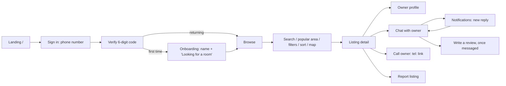
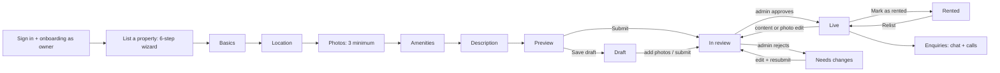
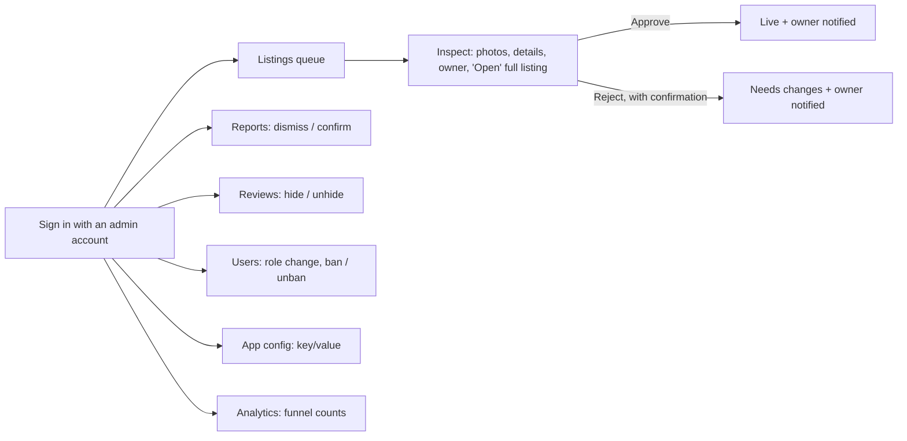
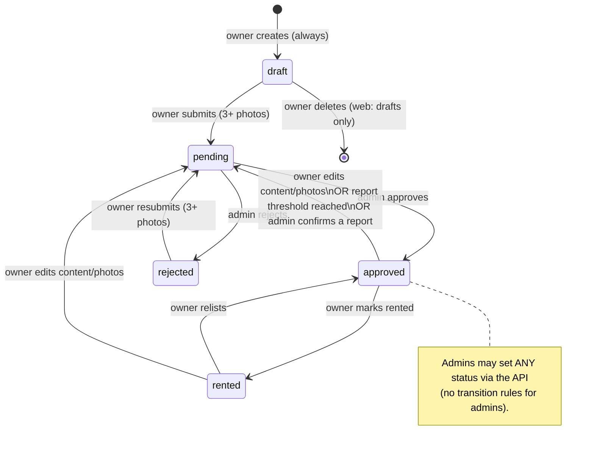
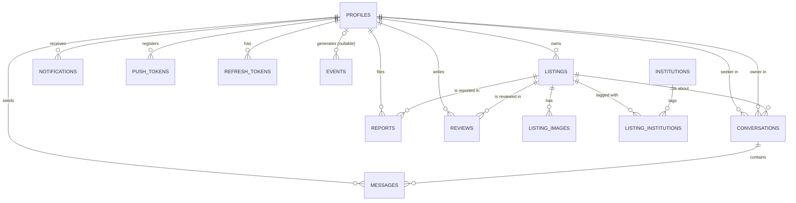
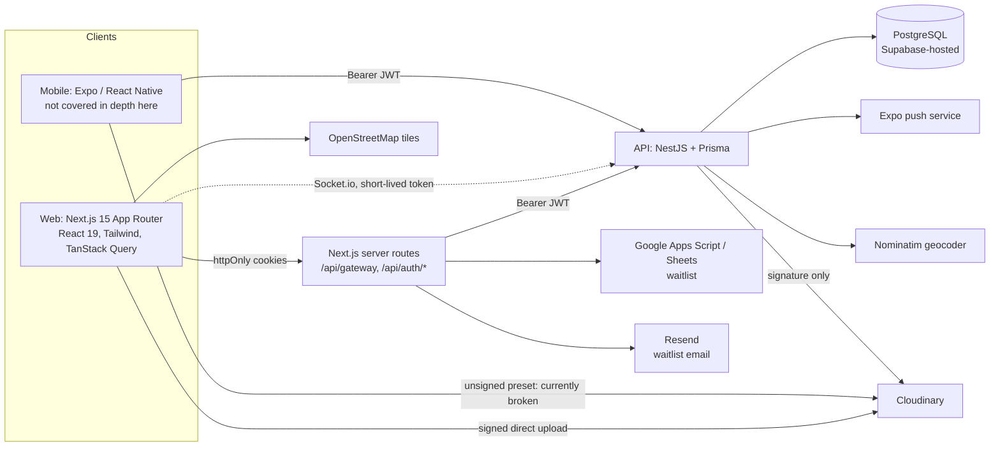

# GHOR — Product Requirements & Source of Truth

| | |
|---|---|
| **Product** | GHOR ("ghor" means *home*) |
| **Document owner** | Founder |
| **Status of this document** | Living document. First edition 2026-09-29 |
| **Based on** | `dev` at `a5cde89`, which is the merge of PR #1 (`25b6e38`, "complete GHOR web redesign and release hardening") |
| **Scope** | The whole product, with the web app (`apps/web`) and API (`apps/api`) inspected in depth. The Expo mobile app (`apps/mobile`) is referenced but was **not** re-inspected for this edition. |

## How to read this document

Every capability carries one of these labels. When a label conflicts with any other document in the repository, **this document wins for current behaviour, because it was written from the code**. Earlier planning documents (`CLAUDE.md`, `LAUNCH.md`, `DESIGN.md`) remain the record of *intent*.

| Label | Meaning |
|---|---|
| **IMPLEMENTED** | Exists in the code on `dev` and works end-to-end on the web. Verified by reading the code; most was also exercised in the browser during the 2026-09-28 release-candidate QA. |
| **PARTIAL** | Some layers exist (for example database fields or display), but the capability is not usable end-to-end. |
| **PLANNED** | Written down as a decision in the repository's planning documents, but not built. |
| **PROPOSED** | A suggestion in this document. Nobody has decided it. |
| **UNKNOWN / NEEDS DECISION** | The repository does not answer this question. |

---

## Contents

1. [Executive product definition](#1-executive-product-definition)
2. [Users](#2-users)
3. [User journeys](#3-user-journeys)
4. [Feature inventory](#4-feature-inventory)
5. [Listing lifecycle](#5-listing-lifecycle)
6. [Search & discovery](#6-search--discovery)
7. [Trust & safety](#7-trust--safety)
8. [Communication: chat & notifications](#8-communication-chat--notifications)
9. [Admin product](#9-admin-product)
10. [UX & design system](#10-ux--design-system)
11. [Performance](#11-performance)
12. [Security architecture](#12-security-architecture)
13. [Data model](#13-data-model)
14. [API inventory](#14-api-inventory)
15. [Technical architecture](#15-technical-architecture)
16. [Current limitations](#16-current-limitations)
17. [Roadmap](#17-roadmap)
18. [Product metrics](#18-product-metrics)
19. [Product principles](#19-product-principles)
20. [Open product decisions](#20-open-product-decisions)
21. [Glossary](#21-glossary)
22. [Appendix: documentation vs. code discrepancies](#22-appendix-documentation-vs-code-discrepancies)

---

## 1. Executive product definition

### 1.1 What GHOR is

GHOR is a **property discovery marketplace for rooms and flats, starting in Guwahati, Assam**. People looking for a place to live find listings and talk to the property owner directly. GHOR removes the broker and replaces the noise of Facebook and WhatsApp groups with **reviewed listings, real photos and in-app chat**.

### 1.2 The problem

Renting a room in Guwahati today usually runs through brokers or informal social-media groups.

- **Brokers tax the seeker.** The founding example (recorded in `CLAUDE.md` §1): a broker charged **₹400 just to show a room** and wanted **about ₹3,500 commission** on a ₹7,000/month room. That is roughly ₹3,900 before a single month's rent.
- **Social groups are untrustworthy and unsearchable.** Posts are unverified, often duplicated or stale, and can't be filtered by budget, locality or what's included.
- **Owners lack a simple, credible channel.** Listing in a group is easy but produces low-quality enquiries. Going through a broker costs the owner control.

### 1.3 Who it is for

| Side | Who | Status |
|---|---|---|
| Demand | People looking for a **room or a whole flat** to rent in Guwahati, typically students and working professionals (the product copy targets both, e.g. "Suits a student or working professional") | IMPLEMENTED |
| Supply | **Property owners** who rent out a room or a flat | IMPLEMENTED |
| Operator | **GHOR staff (admin)** who moderate listings, reports and users | IMPLEMENTED |
| Future supply | PG/hostel operators, brokers acting as listers, builders/agents | PLANNED (`CLAUDE.md` §8) |

### 1.4 Geography

| | |
|---|---|
| **Launch city** | **Guwahati only** (IMPLEMENTED as the default city everywhere: listings default `city = "Guwahati"`, `state = "Assam"`, and discovery queries default to Guwahati) |
| **Next** | Other Assam cities, e.g. Jorhat, Dibrugarh, Sivasagar (PLANNED, `CLAUDE.md` §2) |
| **Long-term** | Northeast India, and then beyond (stated ambition, not yet a plan) |

The data model is already city-scoped (listings, institutions and popular-locality queries all carry a city), so adding a city is mostly data and operations work, not schema work. There is **no city selector in the UI** today.

### 1.5 Core value proposition

> **"No ₹400 viewing fees. No ₹3,500 brokerage. Find your room directly."** (launch positioning, `CLAUDE.md` §1)

- **For seekers:** free discovery and free contact, listings a person has checked, real photos, and a direct line to the owner.
- **For owners:** a listing that takes a few minutes, reaches renters who are actually searching, and produces enquiries through in-app chat or a phone call.

### 1.6 Marketplace model

- **Two-sided, owner-direct.** GHOR connects the two sides and then gets out of the way. There is no booking, no payment and no commission in the product (IMPLEMENTED: none of these exist).
- **Curated supply.** Every listing passes human moderation before anyone can see it (IMPLEMENTED).
- **Free at launch.** No fees and no ads on the web (IMPLEMENTED: no monetization code exists on the web).
- **Future revenue comes from the supply side** (featured listings, subscriptions for professional listers, verification, services), **never from taxing the rental transaction** (PLANNED, `CLAUDE.md` §8).

### 1.7 What makes GHOR different

| Differentiator | Status |
|---|---|
| Human review of every listing before it goes live | IMPLEMENTED |
| At least 3 real photos required to publish | IMPLEMENTED (enforced by the UI and the API) |
| Local, locality-first discovery ("Six Mile", "Jalukbari", "near Gauhati University") | IMPLEMENTED (free-text locality search and popular areas; institution tags PARTIAL, see §6) |
| Direct owner chat that stays attached to the listing | IMPLEMENTED |
| Anti-broker positioning, free for seekers | IMPLEMENTED (as policy and copy) |
| Honest presentation: no invented listings, ratings, counts or testimonials | IMPLEMENTED (design rule enforced in the 2026-09 redesign, `DESIGN.md` "Honesty rule") |

### 1.8 What GHOR deliberately is NOT (today)

- **Not a broker** and not a transaction platform. There is no booking, rent collection, deposit escrow or commission.
- **Not a general real-estate portal.** Rooms and flats for rent only: no sales, land, commercial, PG or hostel categories yet.
- **Not an open classifieds board.** Nothing is public until approved, and browsing requires sign-in.
- **Not a social network.** There are no profile photos or follower relationships.
- **Not multi-city yet.**

---

## 2. Users

### 2.1 Current user types

The system has exactly three roles: `seeker`, `owner` and `admin` (the `UserRole` enum). The role is chosen once during onboarding as seeker ("Looking for a room") or owner ("I am a room owner"). `admin` can never be chosen by a user.

> **Important:** the owner role currently shapes **navigation only** (it shows "My listings" and "List a property"). The API lets **any** signed-in user create listings. There is **no UI path** for a seeker to become an owner later; the API technically allows onboarding to be re-submitted. See §20.

#### Seeker (renter), IMPLEMENTED

| | |
|---|---|
| **Goals** | Find a suitable room or flat in the right locality, within budget, quickly, and without paying a broker |
| **Problems today** | Broker fees; unverified, stale social-media posts; no way to filter by budget, locality or amenities |
| **Motivations** | Save money; feel safe; find something near college or work |
| **Important actions** | Search a locality; filter; compare listings; view photos; check the owner; chat or call; share; report a bad listing; review after contact |
| **Permissions** | Browse approved listings; view approved listing detail, including the owner's phone number (for the Call button); start chats on approved listings; message in their own conversations; report approved or rented listings; review a listing they have messaged about; manage their own profile; delete their account |
| **Information needed** | Rent, deposit, locality, type, photos, what's included, move-in date, the owner's identity and responsiveness, and whether GHOR checked the listing |
| **Success** | Contacting a real owner about a suitable place, and then renting it without a broker |
| **Frustrations GHOR removes** | Viewing fees and brokerage; fake or duplicate posts; not knowing whether a place is still available (partly: rented listings disappear from Browse) |

#### Owner, IMPLEMENTED

| | |
|---|---|
| **Goals** | Get genuine enquiries and rent the property quickly, without a broker |
| **Problems today** | Brokers take control and fees; social posts attract low-quality enquiries |
| **Motivations** | Fill a vacancy; keep direct control of who rents |
| **Important actions** | Create a listing with photos; save a draft; submit for review; edit; resubmit after rejection; answer chats; mark rented or available; watch views and enquiries |
| **Permissions** | Create, read, edit and delete their own listings (the web UI only exposes delete for drafts, see §16); change their own listing status within allowed transitions; see per-listing insights; chat in their own conversations |
| **Information needed** | Review status, why a listing is not live, enquiries, and how the listing performs |
| **Success** | An approved listing receiving enquiries, ending with "Mark as rented" |
| **Frustrations GHOR removes** | Broker dependence; spammy contacts (every contact is a signed-in user with a verified phone number) |

#### Admin (GHOR staff), IMPLEMENTED

| | |
|---|---|
| **Goals** | Keep the marketplace trustworthy: approve genuine listings quickly, remove bad ones, handle reports, manage users |
| **Important actions** | Approve or reject listings (individually or in bulk); resolve reports; hide or unhide reviews; ban or unban users; change roles; edit configuration; read funnel counts |
| **Permissions** | Everything a regular user has, plus the admin endpoints. Admins can see listings in any status and can edit or delete any listing through the API. Admins **cannot** read private chats (no endpoint exists) and cannot demote themselves. |
| **Success** | A short review queue, consistent moderation decisions, and a low report rate |

### 2.2 Future personas (NOT current)

| Persona | Source | Status |
|---|---|---|
| PG / hostel operator (many rooms per lister) | `CLAUDE.md` §8, `LAUNCH.md` §2 | PLANNED as supply; no dedicated product features |
| Broker acting as a supplier (a power-lister paying for visibility) | `CLAUDE.md` §8 | PLANNED |
| Field agent verifying properties | `CLAUDE.md` §2 "Property verification" | PLANNED (field exists, no flow) |
| Tenant with a verified identity | none | PROPOSED |
| Service providers (movers, rental agreements, interiors) | `CLAUDE.md` §8 | PLANNED (long-term) |

---

## 3. User journeys

These journeys describe the **web app as implemented**.

### 3.1 Seeker journey

| Step | What happens (implemented) |
|---|---|
| Landing | The marketing page at `/`. A signed-in visitor (session cookie present) is sent straight to `/browse`. |
| Sign in | Enter a 10-digit Indian mobile number (+91 is fixed). A **"Continue with Google" button is shown but does not work on the web**: it shows "Google sign-in isn't available yet". |
| Verify | Enter a 6-digit code. It expires in 5 minutes. A new code can be requested after 60 seconds. At most 10 codes per number per 24 hours and 5 wrong attempts per code. |
| Onboarding | First sign-in only: full name plus role (seeker or owner). |
| Return to destination | A signed-out visitor who opens a protected URL is sent to sign-in with `?next=` and returned to that URL after signing in. |
| Browse | Approved listings in Guwahati, newest first. Discovery rails appear only when the data supports them. |
| Search and filter | Free-text search; property type; rent; amenities; nearby institution; sort; list or map view (§6). |
| Listing detail | Photo mosaic and full-screen viewer; rent, deposit, move-in date; amenities; approximate map area; owner card; "Before you visit" advice; reviews; similar homes. |
| Owner profile | Name, verification badges, activity, response stats and the owner's live listings. |
| Chat | "Chat with owner" opens (or reuses) the one thread per seeker per listing. |
| Call | "Call owner" dials the owner's phone number (shown only on listing detail). |
| Follow-up | Notifications and unread badges refresh about every 60 seconds and when the user returns to the tab. The chat thread itself updates live. |

**Seeker edge cases (implemented behaviour)**

- Search with no results: a designed empty state that offers "Clear filters" and suggests areas that do have homes.
- Opening a listing that is not approved, or is someone else's draft: "This listing isn't available", returned as a 404 so its existence isn't confirmed.
- Opening a chat that isn't theirs, or doesn't exist: "This conversation isn't available", with no message box.
- A listing is marked rented after the seeker chatted about it: the existing thread stays usable, but no *new* conversations can start.
- Session expired: the access token is refreshed silently. If the refresh token is invalid, the cookies are cleared and the user is sent to sign-in with their destination kept.

### 3.2 Owner journey

| Step | What happens (implemented) |
|---|---|
| Create | A 6-step wizard: Basics (type, title, rent, deposit, move-in date) → Location (locality, area preview on a map, nearby institutions) → Photos → Amenities → Description → Preview. A live "How it looks in search" card is shown alongside. |
| Autosave | The form, the URLs of photos that have finished uploading, and the current step are saved on the device. After a refresh the wizard restores them and returns to the same step. Photos that were still uploading must be added again. |
| Photos | Compressed in the browser, then uploaded directly to Cloudinary with a server-issued signature. The owner can reorder photos and choose the cover (the first photo). |
| Save draft | Allowed with fewer than 3 photos. Drafts are visible only to the owner. |
| Submit | Requires 3 or more photos (checked by the UI and the API). The listing becomes **In review**. |
| Moderation | An admin approves or rejects it. The owner receives an in-app notification (and a mobile push if they have a registered device). |
| Rejected | Shown as "Needs changes". The owner edits the listing and resubmits it. **No rejection reason is recorded** (§16). |
| Edit a live listing | Any change to the content, photos, dates, amenities or institutions sends the listing **back to review**. The edit page warns about this first. |
| Enquiries | Chats appear under Chats with the listing's context. Views, enquiries and response rate are shown per listing (Insights). |
| Lifecycle | "Mark as rented" hides the listing from search. "Relist" makes it live again. |

**Owner edge cases (implemented behaviour)**

- Submit with fewer than 3 photos: the wizard returns to Photos and brings the explanation into view.
- A draft with fewer than 3 photos: My Listings offers **Add photos** rather than Submit.
- The create request fails: a friendly message; everything entered is kept; the owner can retry.
- Opening someone else's edit URL: "This listing can't be edited".
- Upload signature limit reached (120 per hour): "You've added a lot of photos in the last hour…".
- Photo uploads not configured on the server: a configuration notice instead of a per-photo error.

### 3.3 Admin journey

| Step | What happens (implemented) |
|---|---|
| Access | `/admin` requires sign-in. A non-admin sees "You don't have access to this page", and every admin API call returns 403. |
| First admin | Created by deployment configuration: phone numbers listed in the `ADMIN_PHONES` server variable are promoted on their next sign-in. Later admins are promoted from the Users page. |
| Queue | Listings in review, oldest first, with photos, details, owner name and phone-verified status, and how long each has waited. Select-all and bulk approve/reject are available. Reject asks for confirmation. |
| Reports | Open reports. **Dismiss** keeps the listing live; **Confirm** sends it back to review. |
| Reviews | Filter visible, hidden or all; hide or unhide. |
| Users | Name, contact, role, listing count, join date, status; change role; ban or unban. |
| Config | Edit `app_config` key/value rows. Only `report_threshold` is used by any code today. |
| Analytics | All-time counts of signups, listing views, contact taps, chats started and listings created, plus current totals. |

**Admin edge cases**

- An admin cannot remove their own admin role (API-enforced).
- Banning immediately revokes all of the user's sessions and disconnects their open chat connections.
- Bulk approve/reject does **not** check the listing's current status or photo count (§16).
- There is **no dashboard overview page**: `/admin` is the listings queue.

---

## 4. Feature inventory

Legend: **I** = implemented, **P** = partial.

### 4.1 Summary

| # | Feature | Status | Primary user | Web entry point |
|---|---|---|---|---|
| 1 | Authentication (phone OTP) | I (dev) / **blocked in production** (§16) | All | `/sign-in` → `/verify-otp` |
| 2 | Google sign-in | P (API only; the web button does nothing) | All | `/sign-in` |
| 3 | Onboarding | I | New users | `/onboarding` |
| 4 | Profile | I | All | `/profile` |
| 5 | Listing creation | I | Owner | `/listing/new` |
| 6 | Listing editing | I | Owner / admin | `/listing/[id]/edit` |
| 7 | Photo upload (signed) | I | Owner | Wizard step 3 / edit page |
| 8 | Photo management | I | Owner | Wizard / edit page |
| 9 | Moderation | I | Admin | `/admin` |
| 10 | Browse | I | Seeker | `/browse` |
| 11 | Search | I | Seeker | `/browse` search box |
| 12 | Filters | I (institution filter has no data yet) | Seeker | `/browse` chips and Filters dialog |
| 13 | Sort | I | Seeker | `/browse` |
| 14 | Map | I | Seeker | `/browse` → Map |
| 15 | Listing detail | I | Seeker / owner | `/listing/[id]` |
| 16 | Similar homes | I | Seeker | Listing detail |
| 17 | Owner profile | I | Seeker | `/owner/[id]` |
| 18 | Chat | I | Seeker / owner | `/chats`, `/chat/[id]` |
| 19 | Notifications (in-app) | I | All | `/notifications`, bell |
| 20 | Push notifications | P (API sends to Expo tokens; mobile only; no web push) | Mobile users | none on web |
| 21 | Email notifications | Not implemented (PLANNED as mandatory, `CLAUDE.md` §7.7) | none | none |
| 22 | My Listings | I | Owner | `/my-listings` |
| 23 | Owner insights | I | Owner | My Listings → Insights |
| 24 | Reviews & ratings | I | Seeker / admin | Listing detail; `/admin/reviews` |
| 25 | Reporting | I | Seeker / admin | Listing detail → Report; `/admin/reports` |
| 26 | Admin: users, config, analytics | I | Admin | `/admin/*` |
| 27 | Account deletion | I | All | `/profile` → Delete account |
| 28 | Session management | I | All | Automatic |
| 29 | Share listing | I | Seeker | Listing detail → Share |
| 30 | Waitlist | I | Visitors | Landing page form |
| 31 | Legal pages | P (placeholders remain, §16) | All | `/privacy`, `/terms` |
| 32 | Error, empty and loading states | I | All | Throughout |
| 33 | Responsive web (1440 → 375 px) | I | All | Throughout |
| 34 | Institution tags | P (code complete; **0 institutions in the database**) | Owner / seeker | Wizard step 2; Filters |
| 35 | Owner ID verification | P (fields and badge display only; no flow) | none | none |
| 36 | Property verification | P (field and badge display only; no way to set it) | none | none |
| 37 | Interstitial ad before contact | Not on web (a mobile concept, `CLAUDE.md` §2) | none | none |
| 38 | Favorites / saved listings | Not implemented (PLANNED fast-follow) | none | none |

### 4.2 Feature details

#### Authentication

| | |
|---|---|
| **Purpose** | Identify every user; browsing requires sign-in (a product decision, `CLAUDE.md` §7.4) |
| **Workflow** | Phone number → the API creates a 6-digit code (stored hashed) → the user enters it → the API issues an access token (15 min by default) and a refresh token (30 days by default) → the web server keeps both in httpOnly cookies |
| **API** | `POST /auth/otp/send`, `POST /auth/otp/verify`, `POST /auth/refresh`, `POST /auth/logout`, `GET /auth/me` (Google: `POST /auth/google`) |
| **Entities** | `profiles`, `phone_otps`, `refresh_tokens` |
| **Validation** | Code expires in 5 min; 60 s between sends; 10 sends per number per 24 h; 5 attempts per code (checked atomically); refresh tokens rotate on every use and are stored hashed |
| **Edge cases** | Banned user → "This account has been banned"; with no SMS provider configured in production, sending a code returns 503 "Phone login is temporarily unavailable" |
| **Current limitation** | **Real SMS delivery is not implemented.** In development the code is written to the server log. In production, sending is refused (if no provider is set) or throws "not implemented yet" (if one is set). **Google sign-in is not wired up on the web.** Together these mean **no one can sign in to a production deployment today** (§16 blocker B1). |

#### Onboarding

| | |
|---|---|
| **Workflow** | After the first successful sign-in: full name plus "Looking for a room" or "I am a room owner". Records a `signup` event on first completion. |
| **API** | `PATCH /auth/onboarding` (through the web handler `/api/auth/onboarding`, which reissues tokens when the role changes) |
| **Rules** | Role must be `seeker` or `owner`; `admin` can never be set here, and an existing admin is never demoted by onboarding |
| **Limitation** | There is no way in the UI to switch between seeker and owner later |

#### Profile

| | |
|---|---|
| **Contents** | Avatar (initials; there are no profile photos), name, role, "on GHOR since", phone-verified badge; Activity links (Chats, Notifications with unread count, and Find a home or My listings); Account (edit name, phone number shown formatted, account type); Legal; Sign out; Delete account |
| **API** | `GET /auth/me`, `PATCH /auth/me` (full name only) |
| **Limitation** | The phone number can't be changed (would need a re-verification flow that doesn't exist); no profile photos |

#### Listing creation

| | |
|---|---|
| **Fields** | Property type (room/flat), title (8–120 characters in the web form; the API requires 1–120), rent (web: ₹500–₹2,00,000; API: ₹1–₹1,00,00,000), deposit (optional; web warns above 12× rent), move-in date (optional, today or later), locality (2–100 characters), nearby institutions (optional), amenities, description (up to 4,000 characters), 1–20 photos |
| **API** | `POST /listings` always creates a **draft**; publishing is a separate `PATCH /listings/:id {status:'pending'}` |
| **Location** | The owner types a locality name only. Coordinates come from a server-side geocoder (OpenStreetMap Nominatim by default, rate-limited to 1 request per second, cached). A preview shows the approximate area before saving (`GET /listings/geocode-preview`). |
| **Events** | `listing_created` |
| **Limitation** | City is always Guwahati in the UI; no pincode; no floor plan or room size fields |

#### Listing editing

| | |
|---|---|
| **Workflow** | The edit page covers every field plus full photo management. "Save changes" or "Save & send for review" for live listings; "Save & submit" for drafts and rejected listings. |
| **Rules** | Only the owner or an admin may edit. The web page refuses to render the form for anyone else. Any content change by an owner to a **live or rented** listing returns it to **In review**. |
| **API** | `PATCH /listings/:id` (images are replaced as a whole, in one transaction) |

#### Photo upload and management

| | |
|---|---|
| **Workflow** | Pick or drag photos → the browser compresses them (longest edge 1,600 px, JPEG) → requests a signature (`POST /uploads/signature`) → uploads directly to Cloudinary with progress → the URL is saved on the listing |
| **Server-enforced rules** | The server chooses the storage name (`ghor/listings/<random id>`), each signature can be used once, existing photos can never be overwritten, Cloudinary caps stored images at 2,000 px on the long edge, only image formats (jpg, jpeg, png, webp, heic, heif) are accepted, and each user may request 120 signatures per hour |
| **Listing rule** | A listing only accepts photo URLs from **GHOR's own Cloudinary account under `ghor/`**, at most 20 per listing, 3 or more to publish |
| **Management** | Reorder, choose the cover, remove, retry failed uploads, and cancel uploads in progress |
| **Limitation** | Photos removed from a listing, or uploaded but never saved, are **never deleted from Cloudinary** (orphans, §16). |

#### Moderation

See §9. Status: IMPLEMENTED (approve or reject; no reason recorded).

#### Browse, search, filters, sort and map

See §6.

#### Listing detail

| | |
|---|---|
| **Content** | Status banner for owners (Draft / In review / Needs changes / Rented); photo mosaic (desktop) or swipe strip (phone) with a full-screen viewer (arrow keys, Escape, thumbnails, swipe); type tag; "Verified by GHOR" badge (= approved) and a "Property verified" badge (never set today); title; locality; key facts (type, rent, deposit, move-in); owner card (phone-verified, activity); About; What's included; "Where it is" map (approximate); Meet the owner; Before you visit (safety advice and a Report link); Reviews; Similar homes nearby; a sticky contact card or bar (rent, Chat with owner, Call owner) |
| **Visibility** | Approved listings are visible to every signed-in user. Other statuses are visible only to the owner and admins. Everyone else gets a 404 ("This listing isn't available"). |
| **Events** | `listing_view` (not counted when the owner views their own listing), `contact_tap` (chat or call), `listing_shared` |
| **Privacy** | The owner's **phone number is returned on this page only** (for Call). It is not in the Browse feed or on the public owner profile. |

#### Owner profile

| | |
|---|---|
| **Content** | Name, "Property owner in Guwahati", phone-verified badge, ID-verification badge (display only; never set today), number of live listings, "Active today / X days ago", member since, response rate and median response time (over the last 90 days), and the owner's approved listings |
| **API** | `GET /owners/:id`, which never returns the phone number or ID document |

#### Chat, notifications

See §8.

#### My Listings

| | |
|---|---|
| **Content** | Summary line ("5 live · 1 in review · 3 need your attention"); tabs All / Live / In review / Needs changes / Drafts / Rented with counts; a card per listing with cover, status badge, rent, a status hint, views and enquiries, and actions |
| **Actions by status** | **Draft:** Add photos (if fewer than 3) or Submit, Edit, Preview, Delete draft. **In review:** Edit, Preview, Insights. **Live:** Mark as rented, Edit, View, Insights. **Needs changes:** Resubmit, Edit, Preview, Insights. **Rented:** Relist, Edit, Preview, Insights. |
| **Insights** | Views (total and unique), a 30-day views chart, contact taps, enquiries and response rate (`GET /listings/:id/insights`, owner/admin only) |
| **Limitation** | One insights request per card; the web offers delete only for drafts |

#### Reviews and ratings

| | |
|---|---|
| **Rules** | 1–5 stars plus an optional comment (up to 1,000 characters); one review per seeker per listing; **only seekers who have sent at least one message about that listing**; no review of your own listing; live immediately; no editing after posting; an admin can hide it |
| **Display** | Aggregated average and count on the listing (hidden reviews excluded); a "New" badge when there are no reviews |
| **API** | `GET/POST /listings/:listingId/reviews`, `GET/PATCH /admin/reviews` |
| **Notification** | `new_review` notification to the owner |

#### Reporting

| | |
|---|---|
| **Rules** | Only for approved or rented listings; not your own listing; one open report per reporter per listing; category (spam / fake / inappropriate / other) plus a reason (1–1,000 characters) |
| **Automatic action** | When the number of **distinct reporters with open reports** reaches `report_threshold` (config value, currently 3, default 3), a live listing returns to **In review** |
| **Admin** | Dismiss, or Confirm (sends the listing back to review whatever the count) |

#### Account deletion

| | |
|---|---|
| **Workflow** | Profile → Delete account → confirmation dialog → `DELETE /auth/me` → signed out |
| **Effect** | **Hard delete** of the profile. Everything that references it is deleted too: their listings (with images, conversations, reports and reviews), conversations on both sides, messages, push tokens, refresh tokens and notifications. Analytics events are kept but no longer linked to the user. |
| **Rules** | Banned accounts cannot delete themselves ("Contact support") |
| **Limitation** | Cloudinary photos are not deleted. The **other person in a conversation also loses the thread.** |

#### Session management

| | |
|---|---|
| **Model** | Tokens are held only on the web server, in httpOnly cookies (`ghor_at`, `ghor_rt`; `secure` in production; `SameSite=Lax`). The browser never sees a token. All API calls go through the web server's gateway (`/api/gateway/*`), which refreshes once on a 401 and retries. |
| **Behaviour** | Protected routes redirect signed-out users to `/sign-in?next=…`. `/sign-in` and `/verify-otp` redirect signed-in users to `/browse`. An invalid session clears the cookies and redirects to sign-in. Multiple tabs share one session. |
| **Real time** | The chat socket gets a short-lived token from `/api/chat/socket-token` |

#### Error, empty and loading states

IMPLEMENTED across the product:
- Layout-shaped loading placeholders (never a bare spinner, except inside photo uploads).
- Designed empty states that say what is empty and what to do next.
- Friendly error messages mapped from API errors (`lib/errors.ts`).
- Toasts for completed actions.
- 404-style states for unavailable listings and chats.

#### Responsive web

IMPLEMENTED: 1440, 1280, 1024, 768, 390 and 375 px were all checked on 2026-09-28 (90 page loads, no horizontal overflow). Phones get a bottom tab bar (Explore, Listings for owners, Chats, Profile) and a sticky contact bar on listing detail.

---

## 5. Listing lifecycle

### 5.1 States

The status names in the code are `draft`, `pending`, `approved`, `rejected` and `rented`. The UI labels are **Draft, In review, Live, Needs changes, Rented**.

### 5.2 State rules

| State | Enter by | Leave by | Visible to | New chats allowed? | Existing chats | Notifications on entry |
|---|---|---|---|---|---|---|
| **Draft** | Owner (every new listing) | Owner submits → In review; owner deletes | Owner, admins | No | none exist | none |
| **In review** (`pending`) | Owner submit or resubmit; automatic return after a content edit or reports; admin | Admin approves or rejects | Owner, admins | No | Remain usable if it was live before | none |
| **Live** (`approved`) | Admin approves; owner relists from Rented | Owner marks rented; content edit, report threshold or admin confirmation → In review | **All signed-in users** (Browse, map, search, owner profile, similar homes) | **Yes** | Usable | "Your listing is live" (in-app, plus push on mobile) |
| **Needs changes** (`rejected`) | Admin rejects | Owner resubmits → In review | Owner, admins | No | Usable if any exist | "Your listing needs changes" |
| **Rented** | Owner marks rented from Live | Owner relists → Live; owner content edit → In review | Owner, admins (hidden from all discovery) | No | **Remain usable** | none |

**Allowed transitions for owners (enforced by the API):** draft→pending, rejected→pending, approved→rented, rented→approved. Anything else returns 403 "Cannot change status from X to Y". **Admins are not restricted.**

**Content changes:** on a **live or rented** listing, *any* change to the title, description, type, rent, deposit, locality, city, move-in date, amenities, institutions, or photos (added, removed or reordered) moves it to **In review**. Changes to drafts, listings in review and rejected listings keep their status.

**Photo changes:** the photos are replaced as a whole in one transaction. Submitting with 3 or more photos in the same request counts toward the publishing requirement.

**Deletion:** the API allows owners (and admins) to **hard-delete a listing in any status**. This cascades to its images, conversations, messages, reports, reviews and institution tags. The web UI only exposes deletion for drafts.

**Not implemented:** automatic expiry or "still available?" checks; archived or inactive states; a rejection reason; version history; approval of edits as a separate revision (the live version is simply replaced and returned to review).

---

## 6. Search & discovery

All discovery requires sign-in and only ever returns **approved** listings in **Guwahati**.

| Mechanism | Behaviour (implemented) | Limitations |
|---|---|---|
| **Free-text search** (`q`) | Case-insensitive substring match across **title, locality and description** | No typo tolerance, synonyms, ranking or transliteration (e.g. "Jalukbari" vs "Jalukbari Tiniali" relies on substrings); no search index (plain database `ILIKE`) |
| **Locality filter** (`locality`) | Case-insensitive substring match on locality; set by tapping a popular area | Free-text localities are not normalised ("Six Mile" vs "6 Mile" are different) |
| **Search suggestions** | A combobox that suggests known localities (a built-in Guwahati locality list plus localities that have homes) and sort shortcuts; keyboard-navigable | The locality list is hand-curated in the web app (`features/listings/localities.ts`) |
| **Popular areas** | Up to 8 localities with the most approved listings, each showing a count and the lowest rent (computed from up to 2,000 approved listings) | Only shown when there's data; the unfiltered view only |
| **Discovery rails** | "Just listed" (when there are more than 4 listings) and "Under ₹7,000 a month" (when there are more than 2 such listings); unfiltered view only | Fixed ₹7,000 threshold |
| **Property type** | All / Rooms / Flats | Only 2 types |
| **Rent** | "Under ₹7k" chip; presets (under ₹5k, ₹5k–10k, ₹10k–20k, ₹20k+) and a custom min/max | none |
| **Amenities** | All selected amenities must be present (AND). The web offers **Wi-Fi, parking, attached bath, furnished, 24×7 water, lift**. | The API accepts any amenity key; the list is not enforced |
| **Nearby institution** | Filter by one or more institutions (a listing matches if tagged with any of them) | **No institutions are seeded** (0 rows), so the filter shows nothing useful yet |
| **Sort** | Newest first (default), rent low→high, rent high→low | "Most viewed" (planned in `CLAUDE.md`) is **not** implemented |
| **Pagination** | Cursor-based, 20 per page by default, infinite scroll | none |
| **Map view** | Leaflet map with OpenStreetMap tiles; rent-pill pins for up to 500 listings matching the filters; tapping a pin shows a preview card; list and map side by side on desktop, map first on phones. Pins are offset by roughly 55–155 m so they are **approximate** and don't stack. | Listings whose locality couldn't be geocoded don't appear on the map (the UI says how many are missing); the public OSM tile server isn't allowed for heavy production use |
| **URL state** | Search, locality, type, rent, amenities, sort and view live in the URL (`/browse?q=…&type=room&amenities=furnished,wifi&sort=price_asc`), so they survive a refresh and a copied link. Queries wait until the URL has been read. | Filter changes *replace* the history entry, so Back leaves Browse rather than stepping back through filters |
| **Empty search** | "No homes match that yet", with Clear filters and "Areas with homes right now" | none |
| **Similar homes** | On listing detail: up to 6 approved listings in the same city that share the locality (strongest), an institution tag, or a rent within ±25% | none |

**Not implemented (discovery):** saved searches, alerts, favorites, recently viewed (planned as a device-only list in `CLAUDE.md` §2; not found on the web), a "people viewed this today" counter (planned; the data exists in `events`), a city selector, and radius or "near me" search.

---

## 7. Trust & safety

### 7.1 Current trust features

| Mechanism | How it works (implemented) |
|---|---|
| **Sign-in required** | No listing data is available without an account |
| **Phone verification** | Signing in with a phone code sets `phoneVerified`. Shown as "Phone verified" / "Phone-verified owner" on cards, detail pages and profiles. |
| **Human moderation** | Every listing is reviewed before it is visible; edits to live listings go back to review |
| **"Verified by GHOR" badge** | Shown when `status = approved` (meaning "a person reviewed this", **not** "someone inspected the property") |
| **Photo requirements** | 3–20 photos to publish; photos must be uploaded through GHOR's own Cloudinary account (prevents swapping images behind an approved URL) |
| **Reports** | Categorised reports; automatic return to review at the threshold; admin confirm or dismiss; you can't report your own listing; duplicate open reports are blocked |
| **Reviews** | Only from seekers who actually messaged about the listing; admin can hide |
| **Owner activity signals** | "Active X days ago", response rate and response time (last 90 days) |
| **"Before you visit" guidance** | Don't pay before seeing the place; get the address in chat; agree the terms in writing |
| **Chat privacy** | Only the two participants can read or send; the sender is always the signed-in user; admins have no chat access |
| **Public profile privacy** | The phone number appears only on listing detail (for Call); public owner profiles never include phone or ID data; map positions are approximate |
| **Bans** | Take effect on the next request and disconnect open chat connections; banned users can't sign in or delete their account |
| **Account deletion** | Self-service; removes the user's data (see §4.2) |
| **Cloudinary security** | Signed uploads only; the secret stays on the server; single-use storage slots; size and format limits; rate limit |

### 7.2 Partially built trust features

| Mechanism | State |
|---|---|
| **Owner ID verification** | Database fields (`idVerificationStatus`, `idDocumentUrl`) and badge display exist. **No upload, review or admin flow exists**, so the badge can never appear. Needs a compliance review before it's built (`CLAUDE.md` §2). |
| **Property verification** | The `propertyVerified` field and a "Property verified" badge exist. **Nothing can set it** (not even admins through the API). |

### 7.3 Future trust opportunities (PROPOSED unless noted)

- ID verification and in-person property verification flows (PLANNED, `CLAUDE.md` §2).
- Availability freshness: "Mark as rented" reminders (PLANNED), then periodic "still available?" checks (PLANNED as a fast-follow).
- Rejection reasons shown to owners (PROPOSED).
- Blocking a user from chat and reporting a user or a message (PROPOSED; only listings can be reported today).
- Report outcomes communicated to the reporter (PROPOSED).
- Duplicate-listing and duplicate-photo detection (PROPOSED).
- Tenant verification (PROPOSED).
- A trust score (PROPOSED; see §20).

---

## 8. Communication: chat & notifications

### 8.1 Chat (IMPLEMENTED)

| Aspect | Behaviour |
|---|---|
| **Who can start** | Any signed-in user except the listing's owner ("You cannot start a conversation on your own listing") |
| **When** | Only on a **live** listing. An existing thread is reused (one thread per seeker per listing) and **stays usable** after the listing is rented, returned to review or rejected. |
| **Listing context** | Every thread shows the listing's photo, title, locality and rent, with "View listing"; the chat list shows the listing on every row |
| **Messages** | Text only, 1–4,000 characters; quick-reply chips ("Is parking available?", "Is WiFi included?", "Can I visit today?", "Security deposit?"); day separators and timestamps; the owner is shown as "Owner" and the seeker as "Interested renter" |
| **Delivery** | Sent through the API and saved, then pushed live to both participants over Socket.io. Each conversation is its own room, and joining a room requires being a participant. |
| **Read and unread** | Opening a thread marks the other person's messages as read. Unread counts appear on the chat list, the Chats nav item and the phone tab bar. |
| **Refresh** | The open thread updates live. The chat list and nav counts refresh about every 60 seconds while the tab is visible, and when the user returns to the tab. |
| **Privacy** | Only participants can read or send. Unavailable or foreign threads show "This conversation isn't available" with no message box. |
| **Bans and deletion** | A banned or deleted user's socket is disconnected; their REST calls are refused. If either participant deletes their account, **the whole thread is deleted for both**. |
| **Events** | `chat_started` (the seeker's first message in a thread); `contact_tap` with channel `chat` or `call` |
| **Not implemented** | Attachments or photos, typing indicators, read receipts shown to the sender, blocking, message reporting, message deletion or editing, rate limiting of messages, and message search |

### 8.2 Notifications

| Type | Triggered when | In-app text (web) | Opens | Push (mobile) |
|---|---|---|---|---|
| `new_message` | Any message is sent | "{Sender} messaged you about '{Listing}'." (older rows: "You have a new message in one of your chats.") | The chat thread | Yes; the body is a message preview |
| `listing_approved` | Admin approves | "'{Listing}' passed review. Renters can now find it and message you." | Listing detail | Yes |
| `listing_rejected` | Admin rejects | "'{Listing}' wasn't approved this time. Edit the details and resubmit it for review." | **Edit page** | Yes |
| `new_review` | A seeker posts a review | "Someone rated your listing N out of 5." | Listing detail | not verified for this document |

- **Notification centre (IMPLEMENTED):** Today / This week / Earlier groups, All or Unread filter, mark one as read (on click) or mark all as read, and an unread count on the bell. The latest 50 are shown.
- **Isolation:** a user can only read and mark their own notifications (other users' IDs return 403 or 404).
- **Volume:** **one notification per message**. There's no batching per conversation (§16).
- **Push:** sent from the API to Expo for users with registered device tokens, so **mobile only**. Invalid tokens are removed.
- **Web push:** not implemented.
- **Email fallback:** **not implemented**, although `CLAUDE.md` §7.7 calls it mandatory for owner reachability. **SMS alerts:** not implemented (planned after DLT registration).

---

## 9. Admin product

| Section | Route | Capabilities (implemented) | API |
|---|---|---|---|
| Listings queue | `/admin` | Listings in review, oldest first; photos, key facts, owner name and phone-verified status, waiting time, "Open" the full listing; select-all; bulk approve or reject; reject confirmation; toasts | `GET /listings/admin/queue`, `POST /listings/admin/bulk-status` |
| Reports | `/admin/reports` | Open reports with the listing, category and reason; Dismiss, or Confirm (sends the listing back to review) | `GET /reports`, `PATCH /reports/:id` |
| Reviews | `/admin/reviews` | Visible / hidden / all; hide or unhide (averages recalculated) | `GET /admin/reviews`, `PATCH /admin/reviews/:id` |
| Users | `/admin/users` | All accounts with name, phone, role, listing count, join date and status; change role; ban or unban | `GET /admin/users`, `PATCH /admin/users/:id/role`, `PATCH /admin/users/:id/ban` |
| App config | `/admin/config` | View and edit key/value settings | `GET /admin/config`, `PATCH /admin/config/:key` |
| Analytics | `/admin/analytics` | All-time counts (signups, listing views, contact taps, chats started, listings created) and current totals (profiles, listings, listings in review, open reports) | `GET /admin/analytics` |
| Map backfill | none (API only) | Queue geocoding for up to 100 listings without coordinates | `POST /listings/admin/geocode-backfill` |

**Security boundaries.** Every admin route checks the role **from the database on every request** (so a demotion takes effect immediately). Non-admins get 403. The `/admin` pages show an access-denied screen to non-admins. The first admin comes from the `ADMIN_PHONES` server setting.

**Admins can:**
- approve or reject any listing and set any status through the API;
- edit or delete any listing through the API;
- change roles, but not demote themselves;
- ban and unban users;
- hide reviews;
- resolve reports;
- edit configuration.

**Admins cannot:**
- read private chats;
- see ID documents (no upload flow exists);
- set property verification;
- record a rejection reason;
- edit listing content from the admin UI;
- delete listings from the admin UI;
- view an audit log (none exists);
- see time-series analytics (counts only).

**Not implemented:**
- a dashboard overview (`/admin` is the queue);
- moderation notes, an audit trail, or multi-admin assignment;
- charts;
- institution management (institutions must be inserted directly into the database, by design at MVP).

---

## 10. UX & design system

Source: `DESIGN.md` (its 2026-09-26 and 2026-09-27 amendments override its older sections) and the implemented web kit.

| Aspect | Current implementation |
|---|---|
| **Visual direction** | "Blue, Navy & Cream": *editorial + property + product + local*. Photography and rent lead; decoration follows. |
| **Colours** | `primary` #2563EB (actions); `navy` #0B1B3F / `navy-soft` #15295A (depth: hero bands, active chips, sticky bars, admin header); `cream` #FBF8F3 canvas and `cream-deep` #F3EDE3; `primary-tint` #DBEAFE; semantic success, warning and destructive. **Green is used only for verification.** |
| **Typography** | Web headings: **Geist**, self-hosted (no third-party request), tight tracking. Body: the system font stack. Mobile: the system font only. |
| **Spacing and layout** | Tailwind scale; every responsive grid declares a base single column; max content width about 1280 px |
| **Cards** | Listing cards are **not boxes**: a rounded 4:3 photo with overlays (type tag, "Verified", photo count, availability), then rent (large, navy), title, locality, up to 3 amenities and a trust line underneath. Panels are white with a hairline border and a 16 px radius; shadows appear only on hover or sticky elements. |
| **Buttons** | One system: primary / navy / secondary / ghost / destructive / light, each in sm / md / lg; a press effect scales to 0.98 |
| **Forms** | Labelled fields with hints and inline errors; the first invalid field receives focus; a summary alert is announced; ₹ inputs |
| **Dialogs and sheets** | One `Dialog` (a sheet on phones, a modal on desktop) that traps and returns focus and closes on Escape; toasts |
| **Navigation** | Desktop: a top bar with labelled links, "List a property" for owners, the bell and profile. Phones: a slim top bar plus a bottom tab bar, hidden where a screen has its own fixed action bar. |
| **Image treatment** | Cover-cropped photos; a gapless mosaic on detail; a full-screen viewer; browser-side compression; landing images are licensed stock labelled "Example listing" / "Illustrative" |
| **Empty and loading states** | Every list has a designed empty state (what's empty, why, what next) and a loading placeholder shaped like the content |
| **Accessibility** | Visible focus rings; labelled controls; combobox semantics on search; dialogs trap and return focus; alert and status regions; tap targets of 40 px or more; the photo viewer works by keyboard; decorative images have empty alt text. **No formal contrast or screen-reader audit has been done.** |
| **Honesty rule** | No invented listings, ratings, counts, testimonials or partner logos. Discovery sections render only when real data supports them. |

### 10.1 Animation philosophy (product decision)

> **Heavy animation belongs to the marketing landing page only. Core rental discovery must never become slow or harder to use because of animation.**

Implemented as:
- **GSAP** (scroll reveals, hero entrance) runs only on `/`. It respects `prefers-reduced-motion`, content is visible by default, and animations that show a number or hide content have a force-finish timeout. The hero headline is fully visible within about 1 second on a normal device.
- **Product screens** use only a press effect, hover states, sheet and modal transitions, and loading shimmer. There are no scroll-driven or decorative animations in Browse, detail, chat or the owner tools.

---

## 11. Performance

This section describes the current architecture. **No performance measurements have been captured**; there are no metrics or monitoring in the repository.

| Area | Current approach | Known debt |
|---|---|---|
| **Images: upload** | The browser compresses to a 1,600 px long edge before upload; Cloudinary caps incoming images at 2,000 px | Photos never removed from Cloudinary (orphans) |
| **Images: display** | Next.js `<Image>` resizes and serves images at sizes matched to each slot (card, mosaic tile, viewer); lazy loading below the fold; priority loading for the top cards and the detail hero | Next.js image optimisation runs on the web server (a hosting cost to consider); no Cloudinary delivery transformations are used |
| **API calls** | Every request goes through the web server gateway (one extra hop), with TanStack Query caching (2-minute stale time, no retries on 4xx). Browse queries wait until the URL has been read. | My Listings sends **one insights request per card** |
| **Polling** | Conversation list and notifications refresh every 60 s while the tab is visible, and on focus | Polling instead of push over the existing socket |
| **Search** | Postgres `ILIKE` substring search over title, locality and description; composite indexes on (status, city, created_at) and (status, city, property_type, created_at) | No text or trigram index; each amenity filter is a JSON path check |
| **Map** | Up to 500 pins per request; geocoding in the background (1 request per second, in-memory cache) | The public OSM tile server and Nominatim are not suitable for production scale; the cache is lost on restart |
| **Chat** | Socket.io room per conversation; messages paginated 30 at a time (maximum 100) | The socket connects only inside an open thread |
| **Popular areas** | Aggregated in the application from up to 2,000 approved listings per request | Recomputed on every request |
| **Database** | One Postgres instance (Supabase-hosted, Mumbai region per `CLAUDE.md`); each authenticated request reads the profile and updates `last_active_at` | One database write on every authenticated request |
| **Landing** | The GSAP bundle loads on the landing page only | none |

---

## 12. Security architecture

| Area | Implementation |
|---|---|
| **Authentication** | Phone code (hashed with bcrypt, expiry, cooldown, daily cap, atomic attempt counter). Google ID tokens are verified on the server when configured. Access token 15 min, refresh token 30 days by default. Refresh tokens are stored as SHA-256 hashes and rotated on use; reusing a revoked token fails. |
| **Production safeguards** | The API refuses to start in production unless the JWT secrets are at least 32 characters, not placeholders, and different from each other. Phone login refuses to send without an SMS provider in production (it never logs codes there). |
| **Sessions (web)** | Tokens are held only in httpOnly, `Secure` (in production), `SameSite=Lax` cookies. Browser JavaScript never sees a token. The gateway forwards requests with a Bearer header. |
| **Authorization** | Every route except `/health` and the three login steps requires sign-in. **The role and ban status are re-read from the database on every request.** Admin routes require the admin role. |
| **Listing ownership** | Update, delete and insights check the owner or admin role. Non-visible listings return 404 rather than 403, so their existence isn't confirmed. Owners are limited to the four allowed status changes; coordinates and verification fields can't be set by clients. |
| **Chat privacy** | Participant checks on reading, sending and joining a socket room; the sender is always the signed-in user; banned or deleted users' sockets are disconnected |
| **Notification isolation** | Users can only list and mark their own notifications. Notifications are created only by the server. |
| **Profile privacy** | The ID document URL is never returned by any endpoint; the phone number is only on listing detail and in the admin user list; users can't set their own role (except seeker/owner at onboarding), ban status, or verification fields |
| **Cloudinary** | Signed uploads only; the secret stays on the server; the server chooses the storage name; no overwrites; incoming size cap; image-only formats; own-account URL check on listings |
| **Rate limiting** | OTP: per phone number (60 s cooldown, 10 per 24 h, 5 attempts). Upload signatures: 120 per user per hour (in memory, so per API instance). **There is no general or per-IP rate limiting.** |
| **Validation** | A global validation pipe strips unknown fields and converts types; DTO limits on every write (lengths, ranges, enums, UUIDs, array sizes) |
| **Secrets** | Environment variables only; the `.env` files are ignored by git (only `.example` templates are committed); no Cloudinary variables in the web app; no secrets in the client bundle; no source maps shipped (verified 2026-09-28) |
| **CORS** | The API allows **any origin** (`enableCors()` with defaults, and `*` on the socket gateway). The risk is lower because authentication uses Bearer tokens rather than cookies, but it should be restricted before production (§16). |
| **Dev-only surfaces** | `/api/debug-google` returns 404 in production |

---

## 13. Data model

Source: `apps/api/prisma/schema.prisma` (one migration, `20260818062250_init`, which contains every table below).

| Entity | Purpose | Key fields and rules |
|---|---|---|
| `profiles` | The user record (no separate auth table) | `phone` (unique), `google_id` (unique), `role` (seeker/owner/admin), `banned`, `phone_verified`, `last_active_at`, `id_verification_status`, `id_document_url` (never returned) |
| `refresh_tokens` | Session tokens | Hash only, `expires_at`, `revoked_at` |
| `phone_otps` | One-time codes | Hash only, `expires_at`, `attempts` |
| `listings` | A room or flat | `status` (draft/pending/approved/rejected/rented), `property_type` (room/flat), `rent`, `deposit`, `locality`, `city` (default Guwahati), `state` (default Assam), `available_from`, `amenities` (JSON flags), `latitude`/`longitude` (set by the server), `property_verified`, `avg_rating`/`review_count` (stored aggregates) |
| `listing_images` | Ordered photos | `cloudinary_url`, `position` |
| `institutions` | Curated schools, colleges and universities | `name`, `type`, `city`. **Currently empty.** |
| `listing_institutions` | Many-to-many tags | Composite key |
| `conversations` | One per seeker per listing | Unique (`listing_id`, `seeker_id`), `last_message_at` |
| `messages` | Chat messages | `body`, `read_at` |
| `notifications` | In-app notification record | `type`, `payload` (JSON: conversation or listing ID, sender name, listing title), `read_at` |
| `reports` | Listing reports | `reason_category`, `reason`, `status` (pending/reviewed/dismissed) |
| `reviews` | Listing reviews | `rating` (1–5), `comment`, `hidden`; unique per (listing, reviewer) |
| `push_tokens` | Expo device tokens | Unique per (user, token) |
| `app_config` | Runtime settings | Key → JSON value. Only `report_threshold` (= 3) exists and is used. |
| `events` | Funnel analytics | `event_name`, `properties` (JSON), user ID (nullable, set to null on account deletion) |

**Deletion behaviour.** Nearly every relationship **cascades**. Deleting a profile or a listing removes everything that depends on it; only `events` keep their rows (with the user unlinked). **There are no soft deletes.**

**Not in the schema:** favorites (planned), a rejection reason, audit logs, a pricing or payments model, visit scheduling, property attributes beyond those listed (size, floor, furnishing detail, gender or occupancy preferences, bills included), multiple cities as data (city is a free-text column).

---

## 14. API inventory

Base: `apps/api` (NestJS). The web app reaches it only through `/api/gateway/*`, except the chat socket. "Auth" means a valid access token is required. "Owner" means the listing's owner.

### Authentication & profile

| Method & path | Purpose | Actor / authorization | Key input / validation |
|---|---|---|---|
| `POST /auth/otp/send` | Send a login code | Public | Phone number; 60 s cooldown; 10 per 24 h; 503 without SMS in production |
| `POST /auth/otp/verify` | Exchange the code for tokens | Public | Phone + 6-digit code; 5 attempts; refused for banned users |
| `POST /auth/google` | Google sign-in | Public | Google ID token; 503 if not configured (**not used by the web**) |
| `POST /auth/refresh` | Rotate tokens | Public (refresh token) | Refused if revoked, expired or banned |
| `POST /auth/logout` | Revoke a refresh token | Auth | none |
| `GET /auth/me` | Own profile | Auth | Never includes the ID document |
| `PATCH /auth/me` | Edit own name | Auth | `fullName` only |
| `DELETE /auth/me` | Delete own account | Auth, not banned | Hard delete with cascade |
| `PATCH /auth/onboarding` | Set name and role | Auth | Role must be seeker or owner; admins stay admin |

### Listings

| Method & path | Purpose | Actor / authorization | Key input / validation |
|---|---|---|---|
| `POST /listings` | Create (always a draft) | Any signed-in user | Title 1–120, rent 1–10,000,000, locality 1–100, description ≤4,000, 0–20 own-Cloudinary images, amenities object, known institution IDs |
| `GET /listings` | Browse feed (approved only) | Auth | `q` (≤80), `locality`, `propertyType`, `rentMin`/`rentMax`, `amenities` (comma list), `institutionIds`, `sort` (newest/price_asc/price_desc), `limit` 1–50, `cursor` |
| `GET /listings/map` | Map pins (≤500) | Auth | Same filters |
| `GET /listings/localities` | Popular areas | Auth | `city` (default Guwahati) |
| `GET /listings/geocode-preview` | Preview a locality's position | Auth | `locality` (≤100 characters). **Not rate-limited per user.** |
| `GET /listings/mine` | Own listings, all statuses | Auth | none |
| `GET /listings/:id` | Detail (includes the owner's phone) | Anyone if approved; otherwise the owner or an admin (404 for others) | Records `listing_view` |
| `GET /listings/:id/similar` | Similar homes | Same visibility as detail | none |
| `GET /listings/:id/insights` | Owner statistics | Owner or admin | none |
| `PATCH /listings/:id` | Edit, change status, replace photos | Owner or admin | Owner status changes are limited (§5); 3+ photos to publish; content edits return live listings to review |
| `DELETE /listings/:id` | Hard delete | Owner or admin | Any status (the web UI exposes drafts only) |
| `GET /listings/admin/queue` | Listings in review | Admin | none |
| `POST /listings/admin/bulk-status` | Approve or reject | Admin | `ids` (UUID array), `status` approved/rejected; notifies owners |
| `POST /listings/admin/geocode-backfill` | Queue geocoding | Admin | none |

### Uploads, institutions and owners

| Method & path | Purpose | Actor | Notes |
|---|---|---|---|
| `POST /uploads/signature` | A signed Cloudinary upload slot | Auth | 120 per user per hour; 503 if not configured; never returns the secret |
| `GET /institutions` | Curated institutions | Auth | `search`, `city` (default Guwahati) |
| `GET /owners/:id` | Public owner profile | Auth | No phone or ID data; approved listings only; response statistics over 90 days |

### Chat, notifications and push

| Method & path | Purpose | Actor | Notes |
|---|---|---|---|
| `POST /conversations` | Get or create a thread | Auth, not the owner | A new thread needs an approved listing; existing threads are reused |
| `GET /conversations` | My threads plus unread counts | Auth | none |
| `GET /conversations/:id/messages` | Messages (cursor-paginated; marks as read) | Participant | `limit` 1–100 |
| `POST /conversations/:id/messages` | Send | Participant | 1–4,000 characters; notification + push + socket broadcast |
| Socket.io `conversation:join` / `conversation:leave` | Live updates | Participant (token checked on connect) | One room per conversation |
| `GET /notifications` | My latest 50 | Auth | none |
| `PATCH /notifications/:id/read`, `PATCH /notifications/read-all` | Mark as read | Owner of the notification | none |
| `POST /push-tokens`, `DELETE /push-tokens` | Register or remove a mobile device | Auth | Mobile only |

### Reviews, reports, events, config, admin and health

| Method & path | Purpose | Actor | Notes |
|---|---|---|---|
| `GET /listings/:listingId/reviews` | Visible reviews + whether the user can review | Auth (listing must be visible) | Cursor-paginated |
| `POST /listings/:listingId/reviews` | Post a review | A seeker who messaged about it | Rating 1–5, comment ≤1,000, once per listing |
| `GET /admin/reviews`, `PATCH /admin/reviews/:id` | Moderate reviews | Admin | `hidden` flag only |
| `POST /reports` | Report a listing | Auth | Approved or rented listings only; not your own; category + reason ≤1,000; one open report per reporter |
| `GET /reports`, `PATCH /reports/:id` | Resolve reports | Admin | `dismiss` or `confirm` |
| `POST /events` | Client funnel event | Auth | Only `contact_tap` (with channel) and `listing_shared` |
| `GET /config` | Read app config | Auth | All keys |
| `GET /admin/users`, `PATCH /admin/users/:id/ban`, `PATCH /admin/users/:id/role` | Manage users | Admin | Can't remove own admin role; a ban revokes sessions |
| `GET /admin/config`, `PATCH /admin/config/:key` | Manage config | Admin | Any key and any JSON value |
| `GET /admin/analytics` | Funnel counts | Admin | Counts only |
| `GET /health` | Health check | Public | Reports database connectivity |

### Web-server routes (Next.js)

| Route | Purpose |
|---|---|
| `POST /api/auth/otp/send`, `/api/auth/otp/verify` | Sign in and set the session cookies |
| `PATCH /api/auth/onboarding` | Onboarding (reissues tokens when the role changes) |
| `POST /api/auth/logout` | Clear the session |
| `GET /api/chat/socket-token` | Short-lived token for the chat socket |
| `/api/gateway/*` | Authenticated proxy to the API with refresh-and-retry |
| `POST /api/waitlist` | Landing page waitlist: validated, deduplicated by email, stored through a Google Apps Script (Google Sheets); optional welcome email through Resend |
| `GET /api/debug-google` | Development only (404 in production) |

---

## 15. Technical architecture

| Layer | Technology (from the repository) |
|---|---|
| Monorepo | npm workspaces: `apps/web`, `apps/api`, `apps/mobile`; shared `design-tokens.js` |
| Web | Next.js 15 (App Router), React 19, Tailwind 3, TanStack Query 5, Leaflet/react-leaflet, Socket.io client, GSAP (landing only), lucide icons, Geist font |
| API | NestJS, Prisma, class-validator, Passport JWT, bcrypt, Socket.io gateway, Google auth library |
| Database | PostgreSQL through Prisma (`DATABASE_URL` and `DIRECT_URL`); Supabase used only as the host |
| Media | Cloudinary (signed uploads from the web) |
| Realtime | Socket.io inside the API |
| Push | Expo Push API (mobile devices) |
| Geocoding and maps | Nominatim (OpenStreetMap) by default, configurable; OSM tiles by default, configurable |
| CI | GitHub Actions: typecheck and build for API and web, typecheck for mobile. **No tests run in CI.** |
| Code ownership | CODEOWNERS requires the repository owner's review |
| **Hosting / deployment** | **UNKNOWN.** There are no deployment configuration files in the repository. `CLAUDE.md` names Vercel for the web and recommends Railway for the API, but neither is set up. |
| **Automated tests** | The only committed test is the NestJS scaffold (`test/app.e2e-spec.ts`, which expects a "Hello World" route that doesn't exist). The regression, security, photo and authorization suites used during the 2026-09 QA **were run from a temporary workspace and are not in the repository.** |

---

## 16. Current limitations

### Blockers (before any public launch)

| # | Limitation |
|---|---|
| **B1** | **No working sign-in in production.** Real SMS sending is not implemented (the API refuses to send codes in production without a provider, and throws "not implemented yet" with one). The web's "Continue with Google" button is non-functional. SMS delivery also requires a DLT-registered provider in India. |
| **B2** | **Hosting and deployment are not set up** for the web or the API (no configuration in the repository). |
| **B3** | **Legal pages contain placeholders:** grievance officer "To be named before public launch", an unconfirmed support mailbox, and the operator entity (`apps/web/lib/legal.ts`). The privacy policy also mentions Google sign-in, which the web doesn't offer. |
| **B4** | **Production map services:** the public OSM tile server and Nominatim are not allowed for production-scale use; a keyed provider is needed (`.env` templates note this). |
| **B5** | **Mobile photo uploads are broken.** The mobile app still uses the removed unsigned Cloudinary preset. This blocks only the mobile launch. |
| **B6** | **No institutions seeded**, so the "near a college" discovery, a key local differentiator, is empty. (Operational, not code.) |

### Important debt

| # | Limitation |
|---|---|
| D1 | No email or SMS notification fallback. Web users get in-app notifications only, and owners who aren't in the app can miss enquiries (`CLAUDE.md` §7.7 calls this mandatory). |
| D2 | No rejection reason: owners aren't told *why* a listing was rejected. |
| D3 | Orphaned Cloudinary photos are never cleaned up (removed photos, abandoned uploads, deleted listings and accounts). |
| D4 | Hard deletes everywhere. Deleting a listing or an account removes the **other party's** conversations too. `CLAUDE.md` §14.4 says "soft state, not deletes". |
| D5 | The API allows owners to delete listings in any status, but the web exposes delete for drafts only. The product rule is undecided. |
| D6 | The owner role doesn't gate anything in the API, and there's no UI path from seeker to owner. |
| D7 | Admin bulk approve/reject doesn't check the current status or the 3-photo minimum. |
| D8 | No general or per-IP rate limiting (only OTP and upload signatures); `geocode-preview` isn't limited per user; the upload limit is held in memory (one instance only). |
| D9 | CORS allows any origin on the REST API and the socket. |
| D10 | No automated tests in the repository or in CI. |
| D11 | ID and property verification exist as fields and badges but can't be used. |
| D12 | Notifications: one per message (no grouping); polling rather than using the socket. |
| D13 | Analytics are all-time counts only; no time series or funnel ratios. |
| D14 | Search is substring-only (no typo tolerance or locality normalisation); free-text localities fragment the data. |

### Minor debt

- My Listings sends one insights request per card.
- A returning visitor with an expired session who opens `/` goes to sign-in instead of the landing page.
- Filter changes replace the browser history entry, so Back leaves Browse.
- Web and API validation limits differ (rent ₹500–₹2,00,000 on the web vs ₹1–₹1,00,00,000 in the API; title 8+ characters on the web vs 1+ in the API).
- `app_config` accepts any key, but only `report_threshold` is read.
- `next.config` allows images from any Cloudinary account (the API is stricter).
- An unused `glass` badge tone remains in the design kit.
- Stale planning documents (see the Appendix).

### Future enhancements (not missing features, just not built)

Favorites; saved searches and alerts; recently viewed; "X people viewed this today"; "Mark as rented" reminders; freshness checks; visit scheduling; rental agreements; payments; featured listings; PG and co-living categories; multiple cities; a city selector; multiple languages (English only today; no internationalisation set up).

---

## 17. Roadmap

Everything beyond Phase 1 is **PROPOSED** unless it is marked as documented in `CLAUDE.md`, in which case it is **PLANNED**.

### Phase 1: Current MVP (web + API built; launch blocked by §16 blockers)

**Built:**
- Phone sign-in (code-complete, SMS provider pending).
- Browse, search, filters, map, listing detail and owner profiles.
- Chat, notifications and reviews.
- Owner wizard, My Listings and insights.
- Moderation, reports and the admin panel.
- Account deletion and legal pages.

**Remaining to launch:**
- B1–B6 from §16.
- Supply seeding: target **60–100 approved Guwahati listings before public launch** (`LAUNCH.md` §2).
- Launch window: **December 2026–January 2027** (`LAUNCH.md`, not a committed date).

### Phase 2: Post-MVP (trust and retention)

| Item | Status |
|---|---|
| Favorites / saved listings | PLANNED fast-follow (`CLAUDE.md` §2) |
| "Mark as rented" reminder, then freshness checks | PLANNED |
| Email fallback for enquiries; SMS alerts after DLT | PLANNED (`CLAUDE.md` §7.7) |
| Owner ID verification and in-person property verification | PLANNED (the data model exists) |
| Recently viewed, "people viewed today" | PLANNED (`CLAUDE.md` §2) |
| Rejection reasons, owner re-engagement | PROPOSED |
| Saved searches and alerts | PROPOSED |
| Post-signup share prompt | PLANNED (`LAUNCH.md` §3) |

### Phase 3: Marketplace expansion

| Item | Status |
|---|---|
| More Assam cities (Jorhat, Dibrugarh, Sivasagar, …) | PLANNED (`CLAUDE.md` §2) |
| PG, hostel and co-living listings | PLANNED direction (`CLAUDE.md` §1) |
| Featured / promoted listings (first revenue) | PLANNED (`CLAUDE.md` §8) |
| Subscriptions for professional listers (PGs, brokers, builders) | PLANNED (`CLAUDE.md` §8) |
| Paid verification badge | PLANNED (`CLAUDE.md` §8) |
| Visit scheduling | PROPOSED |
| Assamese / Hindi | PLANNED as "revisit later" (`CLAUDE.md` §2) |

### Phase 4: Long-term platform

| Item | Status |
|---|---|
| Northeast India, then beyond | Stated ambition |
| Property services marketplace (loans, digital rental agreements, movers, interiors) as native promoted services | PLANNED direction (`CLAUDE.md` §8) |
| Land and sales categories | PLANNED direction (`CLAUDE.md` §1) |
| Payments (Razorpay; requires a registered business entity with GST) | PLANNED direction (`CLAUDE.md` §3, §7) |
| Tenant verification, roommate matching | PROPOSED / listed as later phases |

---

## 18. Product metrics

### 18.1 What is measured today (IMPLEMENTED)

| Data | Source |
|---|---|
| `signup`, `listing_view`, `contact_tap` (chat/call), `chat_started`, `listing_created`, `listing_shared` | `events` table |
| Admin totals: profiles, listings, listings in review, open reports | Admin analytics |
| Per listing: views (total, unique, last 30 days), contact taps, enquiries, owner response rate | Owner insights |
| Per owner: response rate and median first-reply time (90 days) | Owner profile |

### 18.2 Proposed product metrics (PROPOSED; not computed today)

| Metric | Definition (proposed) | Data exists? |
|---|---|---|
| Search → listing-view rate | Sessions with a search or filter that open at least one listing | Partially (views yes; searches are not logged) |
| Listing view → contact rate | `contact_tap` or `chat_started` ÷ `listing_view` | Yes |
| Owner listing completion rate | Listings submitted ÷ drafts started | Yes (status + `listing_created`) |
| Photo completion rate | Drafts reaching 3+ photos | Yes |
| Approval time | Submission → decision | **No** (no status-change timestamps) |
| Approval rate / rejection rate | Decisions by outcome | Only current status, no history |
| Enquiry response time | Median first reply | Yes (computed per owner) |
| Successful rental conversion | Listings marked rented after at least one enquiry | Partially (rented status yes; attribution to GHOR no) |
| Listing freshness | Share of live listings updated in the last N days | Yes (`updated_at`) |
| Report rate | Reports per 100 live listings | Yes |
| Repeat seeker usage | Seekers active in 2+ weeks | Partially (`last_active_at` only holds the latest value) |
| Supply liquidity | Live listings per popular locality | Yes |

Launch-week success criteria are in `LAUNCH.md` §8. The 6- and 12-month targets are in `CLAUDE.md` §13 (1,000+ listings and 5,000+ users at 6 months; 10,000+ listings at 12 months).

---

## 19. Product principles

The first four are **established** (written into `CLAUDE.md` §11 and `DESIGN.md`). The rest are **PROPOSED** wording distilled from decisions already visible in the product.

1. **Trust first.** Every feature should increase trust; moderation is a feature, not a delay. *(Established)*
2. **Simplicity for owners.** Listing should be easier than posting in a Facebook group. *(Established)*
3. **Local focus.** Nail Guwahati before expanding. *(Established)*
4. **Honest information.** No invented listings, ratings, counts or testimonials; unknown values are left out, never guessed. *(Established, `DESIGN.md`)*
5. **Owner-direct.** GHOR connects the two sides and never taxes the transaction. *(Established as policy, `CLAUDE.md` §8)*
6. **Useful over decorative.** Heavy motion lives on marketing surfaces; discovery stays fast. *(Established, `DESIGN.md`)*
7. **Discovery before complexity.** Search, filter and contact must stay a few taps; new features must not add steps to that path. *(PROPOSED)*
8. **Fast on ordinary Android phones and mobile data.** Compress, lazy-load, avoid heavy client work on product screens. *(PROPOSED; reflected in current choices)*
9. **Mobile-first behaviour, web at parity.** A feature isn't done until it works on both surfaces. *(Established, `CLAUDE.md` §11)*
10. **Progressive complexity.** Start with the minimal version (for example, a notification before an automated rule) and add depth when data proves the need. *(PROPOSED)*
11. **Privacy by default.** Approximate locations, phone numbers only where the user acts on them, exact address shared in chat. *(PROPOSED; reflected in current choices)*

---

## 20. Open product decisions

Listed for the founder to decide. **This document doesn't choose.**

| Area | Question |
|---|---|
| **Sign-in** | Which DLT-registered SMS provider? Implement Google sign-in on the web, or remove the button? |
| **Monetization** | When to start, and what featured listings cost (`CLAUDE.md` §12)? Should the planned mobile interstitial ad before contact exist at all, and should the web have an equivalent? |
| **Roles** | Must "owner" be a real permission? How does a seeker become an owner, and can someone be both? |
| **Deletion** | Can owners delete live or rented listings? Should deletion be soft (keeping chat history for the other party)? |
| **Rejection reasons** | Free text, a fixed list, or both? Shown to the owner? |
| **Verification depth** | ID verification (which documents, retention, compliance review); property verification (who visits, how it scales; ties to `LAUNCH.md` seeding capacity) |
| **Availability freshness** | Reminder cadence; automatic hiding of stale listings? |
| **Favorites / saved searches / alerts** | Scope and timing of the planned fast-follow |
| **Owner analytics** | What owners see beyond views, enquiries and response rate; is it a paid feature? |
| **Visit scheduling** | In-app scheduling, or leave it to chat? |
| **Rental agreements / payments** | Whether, when, and with which partners (requires a business entity) |
| **PG / co-living** | Separate category with its own fields (beds, meals, rules), or a sub-type? |
| **Geographic expansion** | Which city next, and what readiness criteria (listings count, operations)? |
| **Trust scoring** | Combine verification, response rate, reviews and reports into a score, or keep separate signals? |
| **Login-first browsing** | Keep sign-in before browsing (hurts SEO and first impressions) or move to "browse freely, sign in to contact" (`CLAUDE.md` §7.4)? |
| **Institutions** | Who seeds and maintains the list; when to build admin management |
| **Map and geocoding provider** | Which paid tile and geocoding provider for production |
| **Hosting** | Where the web and API run (Vercel and Railway are suggested but not set up) |
| **Notification channels** | Email for web users; per-conversation grouping |
| **Languages** | When to add Assamese and Hindi |

---

## 21. Glossary

| Term | Meaning |
|---|---|
| **Seeker / Renter** | A user looking for a place (`role = seeker`). The UI says "renter" or "Looking for a room". |
| **Owner** | A user who lists a property (`role = owner`) |
| **Admin / Moderator** | GHOR staff with `role = admin` |
| **Listing** | One room or flat offered for rent |
| **Room / Flat** | The two property types: a private room in a shared house, flat or PG, or a whole self-contained flat |
| **Draft** | A saved listing not yet submitted; only the owner sees it |
| **In review** (`pending`) | Submitted and waiting for moderation |
| **Live** (`approved`) | Approved and visible to all signed-in users |
| **Needs changes** (`rejected`) | Not approved; the owner can edit and resubmit |
| **Rented** | Marked rented by the owner; hidden from discovery |
| **Moderation / review queue** | The admin list of listings in review |
| **Verified by GHOR** | The badge for an approved listing: a person reviewed it. It does **not** mean someone visited the property. |
| **Phone verified** | The user signed in with a phone code |
| **Property verified** | A planned badge for in-person or photo-verified properties; never set today |
| **Locality** | The neighbourhood name the owner types (for example "Six Mile") |
| **Popular areas** | Localities with the most live listings |
| **Institution tag** | A curated school, college or university a listing is near |
| **Enquiry** | A conversation a seeker started about a listing |
| **Contact tap** | A tap on "Chat with owner" or "Call owner" |
| **Insights** | Per-listing statistics for owners |
| **Report threshold** | The number of distinct open reports that automatically returns a live listing to review (config value, currently 3) |
| **Signed upload / signature** | A one-time, server-issued permission to upload one photo to GHOR's Cloudinary |
| **Gateway (BFF)** | The web server proxy that holds session cookies and forwards requests to the API |
| **App config** | Admin-editable key/value runtime settings |
| **DLT** | India's TRAI registration required to send SMS such as login codes |

---

## 22. Appendix: documentation vs. code discrepancies

Where planning documents and the code disagree, **the code (and this document) describe reality**. The documents in the right-hand column should be updated separately.

| Topic | Documentation says | Code actually does |
|---|---|---|
| Google sign-in | `CLAUDE.md` §5: sign-in is Google OAuth + phone OTP | The API supports Google, but the **web button is a non-functional placeholder** |
| SMS delivery | Implied ready once credentials arrive | Sending is **not implemented** even with a provider configured |
| Development code logging in production | Earlier review notes flagged this as a production risk | Production already refuses to send without an SMS provider; codes are never logged there |
| New listing status | `CLAUDE.md` §6: default `pending`, "new non-draft inserts force pending"; the schema default is `pending` | `POST /listings` always creates `draft`; publishing is a separate status change |
| Deletes | `CLAUDE.md` §14.4: "soft state, not deletes" | Listing and account deletion are **hard deletes with cascades** |
| Owner deletion rights | Earlier status notes: "owners can only delete drafts" | That is a **web UI** limit; the API allows deleting any status |
| Sort options | `CLAUDE.md` §2: newest, price low→high, high→low, **most viewed** | No "most viewed" sort |
| Email fallback | `CLAUDE.md` §7.7: mandatory | Not implemented |
| App config tunables | `CLAUDE.md` §14.6: ad frequency, page size, feature flags | Only `report_threshold` exists and is used |
| Institutions | `CLAUDE.md` §2: seeded with Guwahati institutions | 0 rows in the development database; no seed script |
| Recently viewed / "X people viewed today" | `CLAUDE.md` §2: in scope | Not present on the web |
| Admin dashboard | `DESIGN.md`: "Admin … not yet built" | Built (queue, reports, reviews, users, config, analytics) |
| Browse grid | `DESIGN.md` Known Gaps: "Browse-feed grid layout for `apps/web` is still unresolved" | Resolved and implemented (grid plus map split) |
| Motion spec | `DESIGN.md` Known Gaps: "No motion/animation spec" | The 2026-09 amendments define it (landing-only GSAP, reduced motion, force-finish) |
| Landing imagery | `DESIGN.md` first amendment: cropped from mockup renders | The v2 amendment and code: licensed Unsplash stock labelled as examples |
| Git state | Root `STATUS.md`: "zero commits", redesign "NOT yet committed" | Committed and merged (`dev` = `a5cde89`) |
| Tests | Status notes report the 16/6/13/27 suites passing | Those suites are **not in the repository**; CI runs no tests |
| Hosting | `CLAUDE.md` §3: Vercel (web), Railway recommended (API) | Nothing is configured in the repository |
| Privacy policy | Mentions Google sign-in | Not available on the web |
| Validation limits | The web form enforces rent ₹500–₹2,00,000 and title of 8+ characters | The API accepts rent ₹1–₹1,00,00,000 and title of 1+ characters |

---

*End of document. Update the relevant section whenever behaviour changes. Changes to current behaviour must be verified against the code, not copied from planning notes.*
