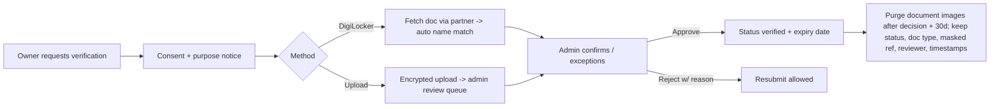

# GHOR V2 — Product Strategy (Revision 2)

| | |
|---|---|
| **Revision** | **R2, 2026-09-29.** Replaces R1 of the same date. R1's research, measurements and competitor evidence are kept; its positioning, taxonomy, trust, media, IA and roadmap are revised to reflect the founder decisions. |
| **Related documents** | [`GHOR-PRODUCT-REQUIREMENTS.md`](GHOR-PRODUCT-REQUIREMENTS.md) (**PRD**: what exists in code) · [`GHOR-COMPETITIVE-PRODUCT-STRATEGY.md`](GHOR-COMPETITIVE-PRODUCT-STRATEGY.md) (**CPS**: market research and performance measurements) · `DESIGN.md` · `CLAUDE.md` · `LAUNCH.md` |
| **Code baseline** | `dev` @ `a5cde89`. Implementation claims were re-checked against the code. |
| **Scope** | Product strategy, UX and architecture only. **No code, schema, configuration or dependency changes.** |

## Labels

| Label | Meaning |
|---|---|
| **[OBSERVED]** | Seen on a live site on 2026-09-29, or in the GHOR code |
| **[MEASURED]** | Measured on GHOR's production build (method in CPS §12) |
| **[REPORTED]** | From a secondary source (news, legal or vendor pages) |
| **[INFERRED]** | A reasoned interpretation, not proven |
| **[REC]** | A recommendation from this document |
| **[FOUNDER DECISION]** | Needs the founder's call |
| **[UNKNOWN]** | Couldn't be verified |

**Where this document disagrees with a founder instruction, it says so and proposes an alternative.** Those places are marked ⚠ **Pushback**.

---

## Contents

**Summaries**
- [A. Executive summary](#a-executive-summary)
- [B. What changed from R1](#b-what-changed-from-r1)

**Part I: Foundations**
1. [Current truth](#1-current-truth)
2. [Product definition and positioning](#2-product-definition--positioning)
3. [Users and intents](#3-users--intents)

**Part II: Product systems**

4. [The universal listing model](#4-the-universal-listing-model)
5. [Discovery, search and filters](#5-discovery-search--filters)
6. [Media standard (photos + video)](#6-media-standard-photos--video)
7. [Verification system](#7-verification-system)
8. [Trust system (what renters see)](#8-trust-system-what-renters-see)
9. [Freshness system](#9-freshness-system)
10. [Safety and anti-fraud](#10-safety--anti-fraud)
11. [Owner experience](#11-owner-experience)
12. [Admin and trust operations](#12-admin--trust-operations)

**Part III: Experience**

13. [Information architecture](#13-information-architecture)
14. [Visual language and media-first UI](#14-visual-language--media-first-ui)
15. [Listing card](#15-listing-card)
16. [Listing detail](#16-listing-detail)
17. [Journeys](#17-journeys)

**Part IV: Market**

18. [Competitive teardown (broad category)](#18-competitive-teardown-broad-category)
19. [Moat](#19-moat)

**Part V: Engineering implications**

20. [Performance](#20-performance)
21. [SEO](#21-seo)
22. [Retention and notifications](#22-retention--notifications)
23. [Data and architecture impact](#23-data--architecture-impact)
24. [Build / buy / defer](#24-build--buy--defer)

**Part VI: Plan**

25. [Now / Next / Later](#25-now--next--later)
26. [Roadmap](#26-roadmap)
27. [Metrics](#27-metrics)
28. [Anti-roadmap and what GHOR is not](#28-anti-roadmap--what-ghor-is-not)
29. [Final blueprint](#29-final-product-blueprint)
30. [Founder decisions — GHOR V2](#30-founder-decisions--ghor-v2)
31. [The 20 highest-leverage changes](#31-the-20-highest-leverage-product-changes)
32. [What to build first and what not to build yet](#32-what-to-build-first--what-not-to-build-yet)
33. [What I should do next](#33-what-i-should-do-next)

- [Sources](#sources)

---

## A. Executive summary

**What GHOR becomes.** A **general rental-home discovery platform for Guwahati**: rooms, PGs, shared accommodation, flats and houses, for everyone looking for a place to live. Its identity is **trust you can see**:
- **graded verification** that says exactly what was checked;
- a **mandatory, authentic media standard** of 3–9 photos plus 1 walkthrough video;
- **confirmed availability**;
- a premium, media-first experience that stays **fast on budget Android phones**.

**Why that can win** [INFERRED from evidence]:
- In Guwahati, supply is plentiful but untrustworthy. Housing.com's top results were agents [OBSERVED]. OLX has 749 dealer ads [OBSERVED]. Stale-listing complaints are common [USER FEEDBACK].
- "Verified" in the Indian portals mostly means a phone-code check (NoBroker's owner verification uses OTP checks [REPORTED]; Housing and Bhara Ghor claim "100% verified" [OBSERVED]).
- NoBroker, Stanza, Zolo and Colive **don't operate in Guwahati** [OBSERVED/REPORTED].
- A precise, document-backed, freshness-enforced marketplace with video is **structurally hard for agent-funded portals to copy** and **operationally hard for small local clones**.

**The main tensions** (⚠ explained in the body):
1. **"For everyone" versus liquidity.** A broad brand is right, but **launch operations must still concentrate** on a few localities and intents, or every category looks empty.
2. **Mandatory video** raises trust and differentiation, but adds owner friction, upload failures on mobile networks, moderation time and real Cloudinary cost. It is recommended with **specific limits, resumable uploads, an assisted path and an abandonment kill-switch**.
3. **Identity and ownership documents** carry heavy **privacy and legal obligations** (DPDP Act; Aadhaar rules). Recommended: **minimum collection**, a DigiLocker-first approach, encrypted short-lived storage, and badges that state exactly what was checked.
4. **Pinterest-style masonry browsing** hurts price comparison and layout stability. Recommended: **editorial media on detail and collection pages**, with a comparable, stable card grid for search.

**What to build first** (after the Phase 0 blockers: sign-in, hosting, legal):
1. the listing model with categories and fit;
2. the media standard;
3. public server-rendered browsing and detail;
4. "Reviewed" and "Phone verified" wording plus rejection reasons;
5. identity verification (Level 1) behind a feature flag.

---

## B. What changed from R1

| Topic | R1 | R2 |
|---|---|---|
| Identity | "Room finder" for newcomer single renters | **General rental-home platform**; rooms are an important *underserved category* and students/newcomers an *acquisition beachhead*, not the identity |
| Positioning | "Find a real room in Guwahati…" | "**Find your next home in Guwahati — from verified owners.**" (evaluated in §2) |
| Taxonomy | Room subtype + fit | A full model: **category × arrangement × configuration × occupancy × fit** (§4) |
| Discovery | Aliases + a simple parser | A **Places graph** (localities, landmarks, institutions, workplaces, transit, hospitals), intents, rule-based parsing, category, locality and institution browsing (§5) |
| Media | ≥3 photos (current code: 3–20) | **3–9 photos + exactly 1 video, required to submit**, with limits, pipeline and cost model (§6) |
| Trust | Honest badges; ID and property checks later | A **graded verification system** (identity, ownership/authorisation, property) with a privacy architecture; property managers and PG operators handled (§7–8) |
| UI | Card and detail refinements | A **media-first visual language**: bento detail, editorial collections, immersive viewer, video tile; masonry deliberately limited (§14–16) |
| Nav / IA | Explore · Saved · Chats · Profile | **Home · Explore · Saved · Messages · Profile** (+ Listings for owners); category and place pages (§13) |
| Roadmap | Freshness in Phase 2 | Media + model + public pages first; verification in phases; freshness in Phase 2 (§26) |

**Kept from R1:** the competitor evidence and measurements; the freshness cycle (with tuned numbers); phone reveal on tap; no WhatsApp for now; the anti-roadmap; the "Reviewed by GHOR" wording; the performance baseline.

---

# PART I — FOUNDATIONS

## 1. Current truth

This is verified in code; the PRD has detail.

| Area | State |
|---|---|
| Categories | Only `room` and `flat` [OBSERVED] |
| Media | **Images only**, 1–20 per listing, ≥3 to publish; signed uploads restricted to image formats; **no video support anywhere** [OBSERVED: `create-listing.dto.ts` `ArrayMaxSize(20)`, `uploads.service.ts` image-only `allowed_formats`] |
| Trust | Phone verified; "Verified by GHOR" (= approved); ID and property verification are **fields only**; reports and a threshold; reviews only from people who messaged [OBSERVED] |
| Discovery | Substring search; 6 amenities; type; rent; institutions (**0 rows**); map; 3 sorts [OBSERVED] |
| Access | **Sign-in before browsing** [OBSERVED] |
| Blockers | **No production sign-in** (SMS not implemented; web Google non-functional); no hosting; legal placeholders; OSM/Nominatim policy limits; no committed tests [OBSERVED] |
| Performance | JS 186–243 KB per route; **detail LCP 4.2 s**; **browse CLS 0.117** on slow 4G at 4× CPU [MEASURED] |
| SEO | None: no public inventory, sitemap, robots.txt or structured data [OBSERVED] |

**What blocks each goal**

| Goal | Blocked by |
|---|---|
| Launch | Sign-in, hosting, legal, map providers |
| Product-market fit | No PG/shared/configuration or fit data; no freshness; trust signals not visible |
| Growth | Sign-in wall; no SEO |
| Trust | Ambiguous "Verified"; no identity or ownership verification; no freshness; no rejection reasons |
| Journey completion | Wall at the start; no email fallback; no visit or closing step |

---

## 2. Product definition & positioning

### 2.1 The broad market and where it's underserved

| Segment (demand) | Served online in Guwahati today? | Evidence |
|---|---|---|
| Families / couples → 2–3 BHK flats and houses | **Well served on volume** (Housing 2,059, 99acres 606+, MagicBricks 608), **poorly on trust** (agent-heavy) | [OBSERVED] |
| Working professionals → 1BHK / 1RK / room | Partially | [OBSERVED] 1RK present on 99acres filters |
| Students and newcomers → rooms, PG, shared | **Poorly served** by portals; lives on Facebook and OLX | MagicBricks: "7+ Single Room options" among 608 flats; OLX "Bachelors allowed" 1,400+; PG & Guest Houses 168 on OLX [OBSERVED] |
| Women seeking women-only accommodation | Partially (PG and filter-level) | 99acres "Single Women"; Bhara Ghor "Girls Only" [OBSERVED] |
| Movers within the city | Served by the same portals | [INFERRED] |

**Conclusion.** GHOR should serve **all** of these [REC], because trust and freshness problems exist in every segment. **Rooms, PG and shared accommodation are the underserved wedge** where GHOR can reach meaningful supply fastest and stand out most. [INFERRED]

### 2.2 ⚠ Pushback: "for everyone" and liquidity

A marketplace isn't useful because it *supports* every category; it's useful when a search **returns good results**. If GHOR launches with 80 listings spread across rooms, PGs, 1BHKs and 3BHKs in 40 localities, **every** search looks empty. [INFERRED]

**Recommendation** [REC]:
- **Brand and product: for everyone.** All categories are supported from day one; the UI never says "for students".
- **Go-to-market: concentrated.** Seed supply in **3 clusters** (Jalukbari–GU, Six Mile–Ganeshguri–Dispur, Beltola–Hatigaon) and across **all categories within them**. Acquisition marketing starts with students and newcomers (highest pain, campus word of mouth) and working professionals.
- **UI safeguard:** category pages and locality pages appear (and are indexed) only once they have enough fresh listings (§21).

### 2.3 Positioning options

| Option | Strength | Weakness | Verdict |
|---|---|---|---|
| "Find a place that feels right." | Warm, broad | Says nothing about renting, Guwahati or trust; generic | ✗ As the main line; fine as a campaign line |
| "Find your next place in Guwahati." | Clear, local, broad | No reason to choose GHOR | Base |
| "Find your next home in Guwahati — from verified owners." | Local + broad + the trust differentiator; "home" echoes *ghor* | "Verified" must be precise (§7) | **Recommended** [FOUNDER DECISION] |
| "Real homes. Real owners. Checked by GHOR." | Punchy trust line | Doesn't say what or where | Supporting tagline |

**Recommended system** [REC]:
- **Headline:** *Find your next home in Guwahati.*
- **Promise line:** *Rooms, PGs and flats from verified owners — with real photos, a video tour, and availability confirmed.*
- **Proof points:** Owners only · Video tour on every listing · Availability confirmed · Free for renters.

**Wording guardrail:** "verified owners" is only allowed once owner verification (§7 Level 1+) is live. Until then, use "**from real owners, reviewed by GHOR**". [REC]

### 2.4 Product hierarchy

```
GHOR — rental-home discovery (Guwahati)
├── Rooms            (private room · shared room)
├── PG / Hostel      (beds or rooms, often with meals and house rules)
├── Flats            (1RK · Studio · 1BHK · 2BHK · 3BHK+)
├── Houses           (independent house · portion / floor)
└── Later:           (serviced apartments · commercial = never in core)
```

### 2.5 Serving different intents without clutter

The home page asks **one question with smart defaults**: *"What are you looking for?"* That opens:
- **4 intent tiles** (Room · PG · Flat · House);
- a **place search** (locality, college, landmark, workplace);
- "Popular near…" collections.

Filters then adapt to the chosen intent (§5.4). **One search engine, intent-shaped UI.**

---

## 3. Users & intents

| User | Job to be done | Main pain | Alternatives today | Why GHOR | Why they'd leave | What brings them back | What makes them recommend it |
|---|---|---|---|---|---|---|---|
| **Seeker: rooms, PG, shared** (students, newcomers, young workers) — *acquisition beachhead* | Safe, affordable place near college or work, soon | Brokers, stale posts, rejection over "who can stay", scams | Facebook, OLX, seniors, brokers | Fit shown up front, owners only, video, confirmed availability | Thin supply in their area | Saved places, new-listing alerts, replies | "Found a PG in 3 days; the video matched the room" |
| **Seeker: flats and houses** (professionals, couples, families) | The right-sized home in a good area | Agent-heavy portals; misleading photos; stale listings | Housing, 99acres, MagicBricks, brokers | Owners only, video tour, documents checked, confirmed availability | Fewer listings than the portals | Alerts; favorites | "No agent calls at all" |
| **Relocating to Guwahati** (job, education, personal) | Decide remotely and safely | Can't visit; scam risk is highest | Portals, contacts | Video, verification tiers, owner responsiveness, move-in kit | Nothing checked in person | Chat updates | "Rented before I arrived" (after a visit) |
| **Supply: individual owner** (1 room to a few flats) | Reliable tenant, no broker, few calls | Broker cuts, spam calls, time | To-let boards, Facebook, brokers | Free, qualified enquiries, control | No enquiries; heavy requirements (video, documents) | Enquiries, one-tap renew | "Got a tenant in a week" |
| **Supply: multi-property landlord / legitimate PG operator** | Keep occupancy high | Managing many listings | Brokers, portals | Multi-listing tools, a verified business profile | Rules too strict for representatives | Performance insights | none |
| **Supply: authorised representative** (family member, caretaker, property manager) | List on behalf of an owner | Treated as a broker | Portals | Authorised-representative status | Being banned as an agent | none | none |
| **Admin / trust operator** | Keep every live listing real, owner-authorised and available | No tools for reasons, documents or duplicates | none | Queues and audit | none | none | none |

---

# PART II — PRODUCT SYSTEMS

## 4. The universal listing model

This is the conceptual model for future schema and API work. [REC] Items marked ★ are new relative to today's code.

| Group | Fields (conceptual) | Notes |
|---|---|---|
| **Category** | `category`: room · pg · flat · house | ★ Replaces `property_type` (room/flat) |
| **Arrangement** | `arrangement`: private · shared · entire | ★ Room: private or shared. PG: private or shared. Flat and house: entire (or "shared flat" for flat-shares) |
| **Configuration** | `configuration`: 1RK · studio · 1BHK · 2BHK · 3BHK · 4BHK+ (flat/house); `beds_in_room` (shared/PG); `room_size_sqft?`; `bathroom`: attached · shared · common; `floor?`, `total_floors?` | ★ |
| **Occupancy (who can stay)** | `suitable_for[]`: students · working professionals · families · couples · anyone; `occupancy_gender`: any · women only · men only; `max_occupants?` | ★ Legal wording in §5.5 |
| **Location** | `locality_id` (canonical) + `address_private` (never public) + geocoded point (approximate on public pages) + `nearby_place_ids[]` (derived) | ★ Canonical locality; private address. Today: free-text locality + lat/lng |
| **Pricing** | `rent`, `deposit`, `maintenance?`, `electricity`: included · separate · metered; `water`: included · separate; `other_fees[]?` (label + amount); `meals_included?` (PG); `negotiable?` | ★ Mostly new |
| **Availability** | `available_from`, `min_lease_months?`, `notice_period?` | `available_from` exists |
| **Features** | Amenity set (curated list, §5.4) | Today 6 keys, and the API accepts any key |
| **House rules** | visitors, cooking, pets, smoking, curfew (PG), gate timing | ★ Structured, not free text |
| **Media** | `photos[3..9]` (ordered, cover = first, optional room tags); `video[1]` (poster, duration) | ★ Video; max 9 photos |
| **Trust** | `lister_role`: owner · authorised representative · PG operator; `ownership_verification` (per listing); identity status (per account); `reviewed_at`; `property_visited_at?` | ★ |
| **Freshness** | `confirmed_at`, state: live · aging · paused · rented · archived | ★ |
| **Contact** | Chat (primary); phone reveal (logged); later: visit proposal | Chat exists |
| **Content** | `title` (optional; generated from category, configuration and locality if empty), `description` | [REC] Auto-titles reduce low-quality titles |

**Important modelling rule:** **identity verification belongs to the account; ownership or authorisation verification belongs to the listing's property.** One person can own several properties, and a representative can act for several owners. [REC]

---

## 5. Discovery, search & filters

### 5.1 The Places graph

A single `places` concept replaces the institutions-only table [REC]:

| Place type | Examples (to be confirmed by the founder; [UNKNOWN] completeness) | Search use |
|---|---|---|
| Locality / neighbourhood | Jalukbari, Six Mile, Beltola, Hatigaon, Dispur, Ganeshguri, Chandmari, Zoo Road / Zoo Tiniali, Maligaon, Paltan Bazaar, Bhangagarh, Ulubari, Lokhra, Kahilipara, Basistha, Bhetapara, Ambikagirinagar, Panjabari… (OLX facet list, CPS §4.4) | Filter + page |
| Road / area | GS Road, VIP Road, AT Road | Filter |
| Education | Gauhati University, Cotton University, IIT Guwahati, Assam Engineering College, Royal Global University, Assam downtown University, GMCH, NIT-area… | "Near" + distance + page |
| Work hubs | Dispur (Secretariat area), GS Road commercial belt, Guwahati Club / Ganeshguri offices | "Near" + distance |
| Transit | ISBT, Guwahati Railway Station (Paltan Bazaar), Kamakhya station, LGBI Airport | "Near" |
| Hospitals | GMCH, GNRC (Six Mile), Apollo, Nemcare | "Near" (Housing highlights proximity to these [OBSERVED]) |
| Landmarks | Guwahati Club, Kamakhya, Beltola market… | Alias / "near" |

Each place has: `name`, `type`, `aliases[]` (spelling variants: "Jhalukbari", "GU", "Gauhati Univ", "6 mile", "Zoo Tiniali"), a point, and `parent_locality`. Listings get **derived distances** to nearby places (computed server-side, never entered by owners).

### 5.2 Search: "What are you looking for?"

**Rule-based parsing (no AI)** runs over a dictionary of places, categories, configurations, fit words and prices:

| Query | Parsed |
|---|---|
| "1BHK near Gauhati University under ₹12,000" | category=flat · config=1BHK · near=GU · rent ≤ 12000 |
| "room near Six Mile for working women" | category=room · near=Six Mile · suitable_for=working · occupancy=women only |
| "PG near Cotton University" | category=pg · near=Cotton University |
| "flat near Dispur" | category=flat · near=Dispur |
| "shared room girls jalukbary 5k" | room · shared · women only · Jalukbari (alias) · rent ≤ 5000 |

Anything left over becomes a text search over title and description. The UI **shows the interpretation as removable chips** ("Flat · 1BHK · Near GU · ≤ ₹12,000 ✕") so users see and correct it. [REC]

**When AI would add value (later, optional):** long, messy queries in Assamese or Hindi transliteration; summarising long descriptions. **Not needed for launch.** [REC]

### 5.3 Discovery paths

| Path | Surface |
|---|---|
| Intent tiles | Home: Rooms · PG · Flats · Houses |
| Place browsing | "Explore by area", "Near your college", "Near work", "Near the station/airport" |
| Collections (editorial, data-backed) | "Available now in Six Mile", "Women-only PGs near Cotton University", "Low deposit (≤ 1 month)", "Newly listed with video" |
| Search | Places, categories and queries with autocomplete |
| Recent / popular searches | Recent: on the device. Popular: from `search_started` events (once volume exists) |
| Map | Secondary toggle; approximate pins |
| SEO pages | Category × place pages (§21) |

### 5.4 Filter architecture (progressive, intent-shaped)

| Level | Always visible (chips) | In "More filters" (sheet) |
|---|---|---|
| All intents | Budget · Category · Who can stay · Available now | Deposit max, maintenance included, amenities, bathroom, furnishing, floor, "Recently confirmed", "Owner identity verified", "Has video" (always true once video is mandatory, so omit it) |
| Room / PG | + Private or shared · Women only / Men only | Meals (PG), curfew, beds in room |
| Flat / House | + Configuration (1RK…4+) · Furnishing | Balcony, lift, parking, kitchen, power backup, floor |

**Amenity list (curated, about 16)** [REC]: attached bathroom, furnished / semi / unfurnished (as furnishing, not an amenity), AC, Wi-Fi, parking (2W/4W), balcony, kitchen access, washing machine, power backup, water (24×7 / fixed hours), lift, security or CCTV, geyser, meals (PG), housekeeping (PG), study table.

**Rule:** at most **4 chips** visible on mobile; the rest go in the sheet, whose button shows a **live result count**. [REC]

### 5.5 ⚠ Tenant fit: legal and ethical wording

India has **no explicit statute** banning private rental discrimination. Religion- and caste-based refusal is legally and constitutionally fraught, and marital-status ("no bachelors") exclusion is a grey zone. [REPORTED]

**Recommendation** [REC]:
- **Allow:** "Suitable for" (students · working professionals · families · couples · anyone) and "Occupancy" (women only · men only · any), because gender-segregated accommodation (PGs, shared rooms) is common and practical.
- **Never:** religion, caste, food habits, community, state or origin, marital status as *exclusions*, or language.
- **Moderation** rejects descriptions containing exclusionary wording.
- **Phrase positively** ("Suitable for families"), never "No X allowed".
- **Get a lawyer's review before launch.** [FOUNDER DECISION]

### 5.6 Ranking

Hard filters, then **freshness state** (fresh > aging), then **distance to the chosen place** (when there is one), then trust level (identity or ownership verified), then recency. **No paid ranking at launch.** [REC]

### 5.7 Devices and networks

- **Desktop:** search bar + chips + results grid with a map toggle.
- **Mobile:** a sticky search pill opens a full-screen sheet (Places / Recent / Popular); filters in a bottom sheet with live counts.
- **Slow networks:** the first results page is server-rendered; the autocomplete dictionary (places and aliases, a few KB gzipped) is **shipped with the page**, so suggestions need no network; plain pagination (no infinite scroll) under Save-Data.

---

## 6. Media standard (photos + video)

### 6.1 Founder decision, as specified

To submit, a listing needs **3–9 photos + exactly 1 video**.

### 6.2 ⚠ Pushback and mitigations

| Risk | Evidence / reasoning | Mitigation [REC] |
|---|---|---|
| Owner friction (older landlords, low-end phones) | [INFERRED] Video is harder than photos | Guided capture with a script ("start at the door → room → bathroom → kitchen → view"); a **draft can be saved without video**; "Ask GHOR to shoot it" assisted path in the launch clusters (operations) |
| Upload failure on mobile networks | A typical phone records 1080p at about 15–20 Mbit/s, so **60 s ≈ 110–150 MB** [INFERRED from typical encoders] | Duration and size limits (below); **chunked, resumable** uploads; "Upload on Wi-Fi" hint; background retry |
| Cost | Cloudinary: **1 credit = 250 HD processing seconds, and each unique video transformation costs credits**; free plan **25 credits/month**, **100 MB max video**; Plus plan: **2 GB max video**, paid [REPORTED/OBSERVED on Cloudinary] | Short videos; few renditions; posters; **no autoplay**; budget for the Plus plan (see estimate below) |
| Moderation time | Each video must be watched | 60 s cap; a checklist; 1.5–2× playback |
| **Privacy leaks in video** | Exterior shots reveal the house number, street, vehicles and neighbours; audio captures voices | Shooting guidance ("film inside; avoid the house number and street"); moderation checklist; **muted by default** |
| Supply drop at launch | [INFERRED] | **Kill-switch:** if media-step abandonment exceeds 30% over the first 4 weeks, revisit (for example, allow "video pending" with reduced ranking). [FOUNDER DECISION] |

### 6.3 Limits and reasoning

| Item | Recommendation | Reasoning |
|---|---|---|
| Photo count | **3–9** | The founder standard; 9 fits a 1 + 4 + 4 gallery rhythm |
| Photo formats | JPEG, PNG, WebP, HEIC/HEIF (converted in the browser or by Cloudinary) | Today's accepted set [OBSERVED] |
| Photo resolution | Minimum **1000 px on the long edge**; the browser compresses to **1600 px** (existing); server cap **2000 px** (existing) | Rejects tiny images and screenshots; keeps uploads about 200–500 KB |
| Photo input size | ≤ **10 MB** before compression | Cloudinary free-plan image cap [OBSERVED] |
| Video count | **Exactly 1** | Founder standard |
| Video duration | **10–60 s** (recommended 30–45 s) | A room or flat walkthrough fits; cost and moderation scale linearly; shorter means fewer failures |
| Video input | MP4 or MOV (H.264/HEVC), WebM; ≤ **150 MB** (needs the Plus plan's 2 GB cap; on the free plan **≤ 100 MB**) | 60 s at phone bitrates ≈ 110–150 MB. Compressing video in the browser (ffmpeg.wasm) is too heavy for budget phones, so **don't** do it |
| Resolution accepted | Up to 4K input; delivered at **≤ 720p** | Delivery bandwidth |
| Delivery encoding | **H.264 MP4, 720p at ~2 Mbps + 480p at ~0.8 Mbps**, plus a **poster JPG/WebP at 2 s**; adaptive streaming (HLS) later if the budget allows | Two fixed versions are cheaper than an HLS ladder. 60 s at 480p ≈ 6 MB (mobile default); at 720p ≈ 15 MB |
| Audio | Kept but **muted by default**; the moderation checklist covers speech | Privacy |
| Orientation | Portrait or landscape both accepted; the player letterboxes | Phones shoot portrait |

**Rough cost** [INFERRED; confirm with Cloudinary billing]:
- Processing a 45 s video in 2 versions ≈ 2 × 45 / 250 ≈ **0.36 credits per video**, plus the poster.
- 100 new listings a month ≈ **36 credits** for processing alone, before storage and bandwidth. **That already exceeds the free plan's 25 credits.**
- Budget the **Plus plan (from $89/month [REPORTED])** at launch, or delay transcoding until approval to avoid spending on rejected listings.

### 6.4 Pipeline [REC]

1. **Photos:** browser compression (existing), then a signed direct upload (existing), then Cloudinary. EXIF capture dates are **read in the browser before compression** and stored as *unverified metadata*, a moderation hint only (it can be faked), **never a badge**.
2. **Video:** signed **chunked** upload directly to Cloudinary (`resource_type=video`, server-chosen `public_id`, `overwrite=false`, duration and size checked after upload), then processing into the 480p and 720p versions and the poster **after approval**. Moderators review the original through a restricted preview.
3. **Progress and retry:** per-file progress; automatic retry with backoff; resume chunked uploads; clear failure messages ("Upload paused — weak connection. We'll keep trying.").
4. **Submission gate:** Submit is disabled until 3–9 photos and 1 processed video exist, and the **API enforces the same rule** (never UI-only).

### 6.5 Editing and orphans

- **Replacing any media item** on a live listing sends it back to review (the same rule as today for photos [OBSERVED]).
- Removed media is marked `pending_delete`; after a **30-day grace period** (for disputes), a daily job deletes it from Cloudinary **if nothing references it**.
- Media from a **rejected** listing is deleted 90 days after rejection unless resubmitted.
- **Account deletion** removes the user's media within 30 days (privacy).
- This closes today's orphan-media debt (PRD §16 D3).

### 6.6 Authenticity (later)

- Perceptual-hash duplicate detection across GHOR photos (Next).
- Checking whether a photo appears elsewhere on the web (stock images, other listings) using a paid reverse-image API (Later; cost).
- Watermark-free originals are kept private; delivered images carry no visible watermark but include listing-specific transformations.

---

## 7. Verification system

### 7.1 Design principles

1. **Say exactly what was checked, and nothing more.**
2. **Collect the minimum**, keep it briefly, show it only to authorised admins.
3. **Verification belongs to the right object:** identity → account; ownership or authorisation → property/listing; visit → property.
4. **Verification is never a guarantee.** Renters still inspect and sign an agreement (the Assam Tenancy Act 2021 requires written agreements [REPORTED]).

### 7.2 Legal and privacy constraints (research)

| Constraint | Implication | Source |
|---|---|---|
| Aadhaar authentication by private entities requires approval (a MeitY/UIDAI process under the 2025 amendment rules) | GHOR shouldn't run Aadhaar authentication at MVP | [REPORTED] |
| Offline Aadhaar verification must be **user-initiated** (QR or XML); **never store the full 12-digit number** (masked or virtual ID only) | If Aadhaar is used, only offline, user-initiated verification, keeping only the masked reference | [REPORTED] |
| DigiLocker: requester integration through partners (APISetu, KYC vendors) to fetch government-issued documents with consent | The cleanest path; no need to store document images | [REPORTED] |
| DPDP Act 2023 + Rules 2025: purpose limitation; **erase when the purpose is served**; access logs ≥ 1 year; 48 h pre-erasure notice; penalties up to ₹50 cr | Short retention, audit logs, deletion processes | [REPORTED] |
| Assam property records: Jamabandi / Patta (Dharitree; certified copies through RTPS); GMC holding number and **property-tax receipt**; sale deed | Realistic ownership evidence in Guwahati | [REPORTED] |

### 7.3 The levels

These are **separate, stackable facts**, not a ladder that implies a total guarantee.

| Signal (public name) | Proves | Doesn't prove | How | Scope | Validity |
|---|---|---|---|---|---|
| **Phone verified** | The lister controls this phone number | Identity, ownership | Phone code (exists) | Account | Permanent while the number is unchanged |
| **Identity verified** | The account holder's name matches a government ID the person holds | Property ownership | **DigiLocker fetch** (preferred, via a partner) **or** a PAN / driving licence / voter ID / passport upload + a live selfie match by an admin; Aadhaar only through **offline, user-initiated** verification, stored masked | Account | **2 years**, or until a name change or suspicion |
| **Owner verified** / **Authorised to list** | The verified person owns, or is authorised for, *this* property | Condition; availability | Name match between the identity and one ownership document: **GMC property-tax receipt**, **APDCL electricity bill** (current, same address), **Jamabandi/Patta**, sale deed or registered rent-authority document. Representatives: an **authorisation letter signed by the owner** + the owner's ownership document + the representative's identity | Property (per listing) | **12 months**, and on a change of address or owner |
| **Visited by GHOR** | A GHOR person saw the property on a date and it matched the media | Current availability; legal title | Field visit + geotagged photos | Property | 12 months |
| **Reviewed by GHOR** | The listing's text and media passed GHOR's rules | Everything above | Moderation (exists) | Listing version | Until content changes |
| **Available · confirmed N days ago** | The owner confirmed availability N days ago | Current availability | Freshness system (§9) | Listing | Rolling |

**Terminology rules:**
- Never write "100% verified".
- Never show one combined "Verified" badge.
- Every badge opens a sheet explaining exactly what it proves.

### 7.4 Who lists: owners, representatives, operators, brokers

| Lister role | Allowed? | Requirements | Public label |
|---|---|---|---|
| Owner | Yes | Phone; identity (for the owner badge); ownership document | "Owner" |
| Authorised representative (family member, caretaker, property manager employed by the owner) | Yes | Identity + owner's authorisation letter + ownership document; **no brokerage charged to renters** (a declaration) | "Listed by an authorised representative" |
| PG / hostel operator (runs the premises) | Yes | Identity + lease or ownership for the premises + trade licence if available [UNKNOWN which licences are standard in Guwahati] | "PG operator" |
| Broker / agent charging renters a fee | **No** (core policy) | none | none |

**Detection** combines: agent reports, the same phone on many properties across distant localities without authorisation, reused photos, and brokerage mentioned in chat.

### 7.5 Workflow



- **Rejection reasons:** unreadable document; name mismatch; expired; address mismatch; suspected tampering; wrong document type.
- **Resubmission:** allowed with a new document. After 3 failed attempts, the case goes to manual escalation.
- **Expiry and re-verification:** reminders 30 days before expiry; badges disappear at expiry, and listings stay live, just without the badge.
- **Document replacement:** a new upload triggers review; the old one is purged.
- **Suspicious signals:** same document on several accounts; edited-looking PDFs; selfie mismatch; many failures. These lead to freezing verification and a manual review; **no automated bans**.
- **Impersonation or stolen documents:** a report category ("someone is using my property or identity") triggers an immediate listing pause and priority review.

### 7.6 Storage and security architecture

- Documents are stored in a **private Cloudinary folder or dedicated private storage**, delivered only through **short-lived signed URLs** generated for admins. **Never public; never in any public API response** (today's rule for `idDocumentUrl` [OBSERVED] extends to all documents).
- **Encryption:** at rest (provider) plus a **separate storage account or folder** that only the verification service can access.
- **Access:** admin role plus a *verification* permission; **every view is logged** (who, when, which document).
- **Retention:** document images deleted **30 days after a decision** (or immediately after automated DigiLocker checks); keep only the status, document type, masked reference (e.g. PAN last 4), reviewer and timestamps.
- **Aadhaar:** never store the full number or the unmasked image.
- **DPDP:** consent text, purpose statement, erasure on request, grievance contact (the legal placeholders must be filled — PRD B3).

### 7.7 Rollout recommendation [REC] [FOUNDER DECISION]

| Phase | Verification |
|---|---|
| Launch | Phone verified + Reviewed by GHOR + owner declaration + authorised-representative declaration |
| Phase 2 | Identity verified (upload + admin; DigiLocker via a partner once one is chosen) |
| Phase 2–3 | Owner verified (one ownership document, name match) |
| Phase 3 | Visited by GHOR (pilot in one cluster) |

⚠ **Pushback: don't make identity or ownership verification mandatory to list at launch.** It would sharply reduce supply [INFERRED]. Make it **optional but rewarded** (a badge, a ranking boost within filters, an "Owner verified" filter) and **mandatory for PG operators and representatives**.

---

## 8. Trust system (what renters see)

**The goal:** answer "Can I trust this listing?" in about 3 seconds.

**Trust strip on detail (above the fold):**
```
✓ Owner verified   ✓ Identity verified   ✓ Reviewed by GHOR   ● Available · confirmed 2 days ago
Owner · on GHOR since Jan 2027 · usually replies in ~1 h
```

| Signal | Show? | Why |
|---|---|---|
| Phone verified | Yes (small) | Baseline; everyone has it, so low information |
| Identity verified | Yes | Real information |
| Owner verified / Authorised representative | **Yes (prominent)** | The key question |
| Visited by GHOR | Yes, when present | Strongest |
| Reviewed by GHOR | Yes | Honest baseline |
| Availability confirmed | **Yes (prominent)** | The key question |
| Response time | When ≥5 enquiries | Real data |
| Account age | Yes (text) | Weak but useful |
| "Successful listings" (rented via GHOR) | Later, when owner-reported data exists | Could be gamed |
| Reviews | Only when ≥3 | Low volume, fairness |
| Reports / suspicious flags | **Never public**; only drive moderation | Public flags create false confidence or defamation risk |

**Card level:** at most **one** trust line (the strongest available signal, e.g. "Owner verified") **plus** freshness.

---

## 9. Freshness system

R1's model is kept with refined numbers. [REC] [FOUNDER DECISION]

| Days since confirmation | State | Seeker sees | Owner | Search |
|---|---|---|---|---|
| 0–7 | Fresh | "Available · confirmed N days ago" (green dot) | none | Normal |
| 8–13 | Fresh | Grey dot | none | Normal |
| 14 | Reminder | same | One-tap confirm (in-app + email; SMS later) | Normal |
| 15–20 | **Aging** | "Availability not recently confirmed" (amber) | Reminder at day 18 | Ranked below fresh |
| 21 | **Paused** | Hidden from search and SEO; the detail page says so; chats continue | "Tap to renew" | Removed |
| 60 | **Archived** | 410 for search engines; "no longer available" | Relist (goes back to review) | none |

**Trade-offs:**
- **7 days:** most accurate, but owner fatigue and supply churn.
- **30 days:** portal-style staleness.
- **14 / 21 days:** balanced for rooms and PGs, which let quickly.

**Flats and houses** may justify a **21-day reminder and 30-day pause**, since they let more slowly. [FOUNDER DECISION]

**What counts as confirmation:** the confirm tap or an edit. An owner's chat reply doesn't count.

**Note:** PGs with many beds need **"beds available: N"** freshness rather than a single available/rented state (Next).

---

## 10. Safety & anti-fraud

| Stage | Mechanisms (rules and tools first; no ML at launch) |
|---|---|
| **Prevent** | Owner or representative declaration; phone verification; the media standard (video is hard to fake at scale); rate limits (new accounts ≤ 3 listings in 24 h); a price sanity check (rent outside the locality range, flagged when data exists); phone reveal on tap with daily caps |
| **Detect** | Duplicate photo hashes; the same phone or document across accounts; the same property on multiple accounts; many listings in distant localities; brokerage or money words in chat; report thresholds; stale listings |
| **Warn** | On detail: "Never pay before visiting and seeing documents." In chat: a one-time notice when money words appear ("advance", "token", "booking", "UPI", "visit charge"). For renters: the move-in kit (agreement checklist, police tenant-verification link [REPORTED]) |
| **Review** | Priority queues (§12); diffs; owner history |
| **Restrict** | Pause a listing; freeze an account's new listings; remove badges; cap contact reveals |
| **Remove** | Reject or archive; ban accounts (and their phones and documents) |
| **Appeal** | One appeal per decision with a note; reviewed by a different admin when possible |

**Specific threats:**

| Threat | Detection | Response |
|---|---|---|
| Duplicate listings | Photo hash + locality + rent | Merge or reject; warn the owner |
| Stolen photos | Hash within GHOR; web reverse search (later) | Reject; flag the account |
| Fake owners | Ownership verification; reports | Remove the badge; pause |
| Fake documents | Metadata and visual checks by an admin; DigiLocker (tamper-proof) | Reject; freeze |
| Advance-payment scams | Chat nudge; reports ("asked for money before a visit") | Priority review; ban |
| Deposit scams | Guidance (pay at signing, against a written agreement) | Education |
| Impersonation | Report category | Immediate pause |
| Fake availability | Freshness; "not available" reports | Pause; the owner's freshness record |
| Mass listing | Rate limits; representative verification required above N listings | Queue |

---

## 11. Owner experience

| Stage | Design [REC] |
|---|---|
| Decide | `/list` landing: "List free. Renters near <area> are searching." Proof: numbers once real |
| Onboard | Any user can list; choose **Owner / Authorised representative / PG operator** |
| Create | **Intent-first wizard:** Category → Arrangement / configuration → Location (canonical locality autocomplete + a private address) → Price & costs → Who can stay → Features & rules → **Media (photos + video, guided)** → Preview → Submit. Target about 5 minutes (video included) |
| Media | A shot list per category; the video script; progress, resume and "continue on Wi-Fi"; a checklist that ticks off requirements |
| Review | "Usually reviewed within X h" (real data); a **reason** when changes are needed; appeals |
| Verification | "Get the Owner verified badge", optional; shown in context |
| Live | Enquiries (chat), phone reveals (count only), views; response-time nudge |
| Freshness | One-tap confirm (notification or email); pause and renew |
| Rented | Mark rented, with an optional "Found via GHOR?"; relist later |
| Multi-listing | For 5+ listings: bulk freshness confirm, a portfolio view (Next) |

**Useful metrics:** enquiries, reply time, fresh status, views. **Vanity metrics to avoid:** impressions, rank position, "score".

---

## 12. Admin & trust operations

| Queue (priority order) | Target |
|---|---|
| 1. Urgent reports (money before visit, impersonation) | < 4 h |
| 2. New submissions (media review) | < 12 h |
| 3. Verification requests (identity, ownership) | < 24 h |
| 4. Edited live listings (with diff) | < 12 h |
| 5. Standard reports | < 24 h |
| 6. Suspicious hints (duplicates, phone reuse) | < 48 h |
| 7. Freshness (paused listings with enquiries) | Weekly |
| 8. Appeals | < 48 h |

**Listing review screen:**
- media (with an inline video player at 1.5×) and duplicate hints;
- fields and the diff;
- owner panel (account age, verification, other listings, reports, rejections, response rate, phone reuse);
- moderation history.

**Actions:** Approve · Request changes (templates) · Reject (policy) · Pause · Mark suspicious · Freeze owner · Ban · Note · Assign.

**Checklists:** media authenticity; no house number or street in the video; no exclusionary wording; price sanity; category correctness.

**Moderation log** for every action. **Document access log** for every document view.

**Chat reports:** admins see only the reported message and its surrounding context; the privacy policy must say so. [FOUNDER DECISION]

---

# PART III — EXPERIENCE

## 13. Information architecture

**Navigation** [REC]:
- **Mobile tab bar:** Home · Explore · Saved · Messages · Profile. Owners get a "Listings" entry inside Profile and a floating "+ List" action on Home. Five tabs is the maximum.
- **Desktop:** Explore · Saved · Messages on the left; "List your property", notifications and profile on the right.

⚠ "Categories" isn't a tab: categories are **entry points** on Home and Explore. A dedicated tab duplicates Explore. [REC]

| Route | Purpose | Primary action | Secondary action | SEO | Conversion goal | Perf. priority |
|---|---|---|---|---|---|---|
| `/` | Home: intent tiles, place search, collections | Search | List your property | High | Start a search | P0 |
| `/explore` | Results with filters (all intents; the URL holds the state) | Open a listing | Save search | noindex (filter URLs) | View | P0 |
| `/rent/[category]` (e.g. `/rent/pg`) | Category hub | Open a listing | Filter | High | View | P1 |
| `/rent/[category]/[place]` (e.g. `/rent/rooms/jalukbari`, `/rent/pg/near-cotton-university`) | Category × place page | Open a listing | Alert | **High (threshold-gated)** | View | P1 |
| `/place/[place]` | Area or college guide + all categories | Choose a category | Alert | Medium | View | P2 |
| `/listing/[id]/[slug]` | Detail | **Message owner** | Show number / Save / Share | High (fresh) | Contact | **P0** |
| `/owner/[id]` | Public owner page (verification + listings) | Open a listing | none | noindex | Trust | P2 |
| `/trust`, `/how-it-works`, `/safety` | Explain the badges and safety | Search | none | Medium | Trust | P2 |
| `/list` | Owner landing | Start listing | Learn about verification | Medium | Owner signup | P1 |
| `/saved` | Favorites + saved searches | Open | Manage alerts | none | Return | P2 |
| `/messages`, `/messages/[id]` | Chat | Reply | Propose visit | none | Visit | P1 |
| `/notifications`, `/profile`, `/profile/verification` | Account + verification status | Verify | none | none | Trust | P2 |
| `/listings` (owner), `/listings/new`, `/listings/[id]`, `/listings/[id]/edit` | Owner tools | **Confirm availability** | Edit / Mark rented | none | Freshness | P1 |
| `/admin/*` | Queues, listings, owners, verification, reports, users, config, analytics | Decide | Investigate | none | Short queues | P2 |
| `/privacy`, `/terms` | Legal | none | none | Low | none | none |

Current routes (`/browse`, `/chats`, `/my-listings`) redirect to their new equivalents. [REC]

---

## 14. Visual language & media-first UI

**Principle:** premium through **photography, typographic hierarchy, precise facts, rhythm and speed**, not effects. Inspiration (not imitation): editorial magazines (image-led storytelling), Airbnb (trust and a media-first detail page), Pinterest (visual discovery for *inspiration surfaces*), premium property sites (restraint).

### 14.1 Where each layout pattern belongs

| Pattern | Where | Why / why not |
|---|---|---|
| **Bento gallery** (hero + supporting + video tile) | **Listing detail** (desktop and tablet) | Media-first premium feel; fixed geometry (no layout shift) |
| **Editorial collection rows** (1 large + 2–3 small tiles) | Home, category and place pages | Visual variety without breaking comparison |
| **Masonry** | **Only** an optional "Explore by photo" inspiration view (Later) | ⚠ **Pushback:** masonry in search results makes price and fact comparison harder, varies card heights (causing CLS risk) and loads more images per screen. Use a uniform grid for search. |
| **Uniform comparable grid** | Search results | Scanning prices, fit and freshness quickly is the job |
| **Immersive full-screen viewer** | Detail | Swipe, zoom, the video inline, room labels |
| **Swipe gallery** | Mobile detail and cards | Thumb-friendly |

### 14.2 Tokens

The Blue, Navy & Cream system in `DESIGN.md` is kept, with refinements [REC]:
- **Type:** as in R1 (Geist headings; system body; rent is the only loud figure).
- **Colour:**
  - primary blue for actions only;
  - navy for depth;
  - cream canvas;
  - **green reserved for verification-backed badges only**;
  - amber for "aging" and warnings;
  - red for errors.
- **Surfaces:** white content panels on cream; photography always edge-to-edge within rounded 16 px containers; **no drop shadows except hover and sticky**.
- **Spacing:** a 4 px base; 16/24 px gutters; 40/64 px between sections; cards 12 px inside.
- **Media labels:** small frosted chips on photos ("Bedroom", "Bathroom", "Video · 0:42").

### 14.3 Motion

| Surface | Motion |
|---|---|
| Marketing | Expressive GSAP reveals, reduced-motion safe (existing policy) |
| Product | 120–180 ms sheet and dialog transitions; a 0.98 press; skeleton shimmer; **hover zoom on media ≤ 1.03 over 400 ms (desktop only)** |
| Video preview on hover | **Desktop only**, when `navigator.connection.effectiveType` is `4g` and Save-Data is off; muted, 3 s from the poster frame, loads only after 300 ms of hover |
| Never | Autoplaying video on mobile or cellular; parallax in the product; animated counters |

### 14.4 Component inventory (visual)

| Component | Notes |
|---|---|
| Search bar | Big, one field, interpretation chips |
| Filter chips | Toggle chips; a sheet with a live count |
| Buttons | Unchanged system |
| Bottom nav | 5 tabs, 44 px targets, badges |
| Dialogs and sheets | Focus-trapped (existing) |
| **Trust badge** | Icon + precise text + an explanation sheet |
| **Freshness badge** | Dot + text |
| Owner card | Name, role (Owner / Representative / PG operator), verification, reply time, since |
| Empty, loading, error | Keep the current system; skeletons with **exact geometry** |

---

## 15. Listing card

**Hierarchy:** media → rent → what (category · configuration · arrangement) → where → who can stay → trust + freshness → (action on hover or long-press: Save).

```
┌───────────────────────────────┐
│  [cover photo 4:3]    ▶ 0:42  │ ← video duration chip (trust + richness)
│  PG · Shared (2 beds)   ♡     │ ← category tag · save
└───────────────────────────────┘
₹5,500/mo · deposit ₹5,500 · meals incl.
PG near Cotton University
Panbazar · 0.6 km from Cotton Univ.
Women only · Students
✓ Owner verified   ● Confirmed 2d ago
```

| Variant | Spec |
|---|---|
| Desktop grid | 4:3 media; hover shows up to 3 photos (swipe dots) and optionally a video preview (§14.3) |
| Mobile | Full width; a swipeable 3-photo strip (lazy); 44 px targets |
| Compact (list or map panel) | 112 px square thumbnail + text stack |
| Map-linked | Compact card highlights its pin; the pin shows the rent |
| Featured (future, paid) | The same card + a "Promoted" label; never above fit or freshness filters |
| Skeleton | Exact geometry |

**Rules:**
- Never more than **one** trust badge **plus** freshness on a card.
- Hide any line with unknown data.
- No "New" review badge (it was ambiguous).

---

## 16. Listing detail

**Desktop bento:**

```
┌─────────────────────────────┬─────────────┐
│                             │   PHOTO 2   │
│          HERO PHOTO         ├─────────────┤
│                             │ ▶ VIDEO TOUR│  ← poster + duration, click to play
├──────────────┬──────────────┼─────────────┤
│   PHOTO 3    │   PHOTO 4    │ +5 photos   │
└──────────────┴──────────────┴─────────────┘
```

**Mobile:** a full-bleed swipe gallery; **the video is the 2nd slide**; a "▶ Video tour" chip jumps to it; a "1 / 10" counter; tap for the immersive viewer.

**Above the fold (mobile, after media):**
1. rent + deposit + cost summary ("+ electricity metered");
2. category · configuration · arrangement;
3. locality + nearest key place ("0.8 km from GU");
4. **trust strip** (§8);
5. freshness;
6. who can stay;
7. a sticky bar: **[Message owner] [Show number]**.

**Below:**
- costs breakdown;
- features;
- house rules;
- description;
- approximate map + nearby places with distances;
- owner (role, verification, reply time);
- safety + move-in kit;
- report;
- similar homes (same place or category).

**Actions:**

| Action | When | Recommendation |
|---|---|---|
| Message owner | Always (sign in at the tap) | Primary |
| Show number | Explicit tap, logged, daily cap | Secondary |
| WhatsApp | none | **Not now** (it loses the conversation record and response data; revisit on reply-rate evidence) [FOUNDER DECISION] |
| Request visit | Inside chat ("Propose visit") | Next |
| Save / share | Always | Now / Next |

**Performance:** the hero is server-rendered and preloaded; the video poster only; the video player code loads on tap.

---

## 17. Journeys

| Journey | Key steps (V2) | Main friction removed |
|---|---|---|
| First-time renter | Home → "What are you looking for?" (intent + place) → results (fit, freshness, trust visible) → detail (bento, video, trust strip) → **sign in at "Message owner"** → chat → propose visit → safety checklist → visit → "Found a place?" | Sign-in wall; uncertainty about availability, fit and authenticity |
| Returning renter | Home shows "New since your last visit" for saved searches, favorites status, unread replies | No reason to return today |
| Relocating renter | Place pages (area guide + listings) → video-first evaluation → verified owners filter → chat → visit on arrival | Remote trust |
| Owner | `/list` → role → intent-first wizard → guided media → submit → reason-based review → live → enquiries → confirm availability every 14 days → mark rented | Review uncertainty; stale listings; broker confusion |
| Representative or PG operator | Same + authorisation or premises documents (mandatory) → "Authorised representative" / "PG operator" label | Being treated as a broker |
| Admin | Priority queues → review screen → decision with reason → logs; verification queue → document view (logged) → decision → purge | No reasons, no audit, no documents workflow |

---

# PART IV — MARKET

## 18. Competitive teardown (broad category)

This is from the CPS and R1 plus the new research. [OBSERVED] unless marked.

| | **Housing.com** | **99acres** | **MagicBricks** | **OLX** | **NoBroker** | **Bhara Ghor** | **Facebook groups** | **Zolo / Colive / Stanza** |
|---|---|---|---|---|---|---|---|---|
| Scope | All property, all cities | Same | Same | Horizontal classifieds | 11 metros (not Guwahati) | Rooms, PG, flats (Assam) | Informal | Managed co-living (not in Guwahati) [REPORTED] |
| Search / filters | Rich; landmark highlights | Rich; "Available for", Posted by, 1RK | Rich; tenant preferred | Facets with counts; "Bachelors allowed" | Rich | Tenant type, food, proximity | None | App |
| Media / video | Photos; video UNKNOWN | **Videos supported** ("With Videos" filter; owners upload videos) | Photos (8+) | Photos | UNKNOWN | Photos | Photos and videos in posts | Photos |
| Trust / verification | "100% Verified" claim, agent-first | "Verified by 99acres team" filter; scam banner | Owner name | None | **OTP owner checks** [REPORTED]; paid legal document service (sales) | "100% verified" claim, unsubstantiated | Group admins | Managed properties |
| Freshness | "Updated 1d ago" | "5d ago" | "Updated today" (stale complaints [USER FEEDBACK]) | Date | UNKNOWN | none | Post date | n/a |
| Contact | "Contact" (flow UNKNOWN) | "View Number" (UNKNOWN) | **WhatsApp number + name + email form** | Chat or call | Paid contacts | Call | Messenger | Booking |
| Agents | Dominant | Dealers + "Feature Dealer" | "Top Agents" | 749 dealer ads | Excluded | Excluded (claimed) | Mixed | n/a |
| SEO | Strong (ItemList, FAQPage) | Strong (Apartment, RentAction) | Strong | Strong | Strong | None (hash routes) | Partly | Strong |
| Performance (mobile, unthrottled) | 213 requests | About 1.1 MB JS | UNKNOWN | About 3.4 s to first byte, 1.3 MB JS | UNKNOWN | Light | App | UNKNOWN |
| Monetization | Featured agents | Feature dealers | Agents, services | Featured ads | **Seekers pay ₹999–5,499** | none | none | Rent |

**Adopt:** landmark proximity (Housing); explicit tenant-fit and posted-by facets (99acres, MagicBricks, OLX); freshness stamps (all); scam education (99acres); video as a listing element (99acres); locality facet counts (OLX).

**Improve on:** make freshness *enforced*, not just stamped; make verification *precise* and document-backed; make video *standard* rather than optional; keep contact free and simple.

**Never copy:** seeker paywalls (NoBroker); lead-capture walls before contact (MagicBricks); agents and featured dealers in owner results; blanket "100% verified"; "Login to unlock" results; hash-routed pages; generated boilerplate descriptions.

**Opportunities they overlook** [INFERRED]: a room, PG and shared taxonomy with fit; institution and transit proximity as first-class search; availability accuracy; authorised-representative status (instead of "owner vs dealer"); a newcomer move-in kit (Assam agreement and police verification).

**Impressive-sounding but low value:** AI chat assistants; 3D tours; "price trend" charts for rooms; social feeds; gamified owner scores.

**Things that would make GHOR slower:** autoplay video; masonry search; heavy map-first views; third-party chat widgets; ad scripts.

---

## 19. Moat

| Candidate | Verdict |
|---|---|
| UI, AI, tech, "owner-only" alone | Not a moat (copyable, already claimed) |
| **Document-backed, precise verification + authorised-representative model** | **Strong:** it conflicts with agent-funded portal economics; it is operationally hard for small clones [INFERRED] |
| **Enforced freshness (availability accuracy)** | **Strong:** conflicts with the incentive to keep inventory counts high [INFERRED] |
| **Mandatory video + authentic media** | Moderate to strong: raises the cost of fake listings; builds a unique media library |
| **Places graph** (localities, institutions, transit, work, aliases) | Moderate: local craft |
| **Cluster supply density** (all categories) | **Strong if achieved** (network effect) |
| Response-quality data | Grows over time |
| Performance | An advantage, not a moat |

**Why someone would use GHOR instead of OLX:**
1. Only owners or authorised representatives, with the verification stated.
2. Every listing has a video tour and 3+ real photos.
3. Availability is confirmed, and stale listings disappear.
4. You can search "PG near Cotton for women" or "1BHK near GU under 12k" and get real answers.
5. Contact is free, private and fast; you can see how quickly owners reply.
6. It's fast on a phone.

**Strategy:** operate *verification + freshness + media* as one trust system, and concentrate supply per cluster across all categories. [REC]

---

# PART V — ENGINEERING IMPLICATIONS

## 20. Performance

### 20.1 Budgets (route level) [REC]

Measured on the CPS §12 profiles. "p75 field" means the 75th percentile of real users. Sizes are gzipped transfer.

| Route | LCP (slow 4G, mid Android) | LCP (budget Android, 6× CPU) | CLS | INP (mid) | JS (transfer) | Above-the-fold images | API before content |
|---|---|---|---|---|---|---|---|
| Home / landing | ≤ 2.5 s | ≤ 3.5 s | ≤ 0.05 | ≤ 200 ms | ≤ 180 KB (+ GSAP only on marketing sections, lazy) | ≤ 200 KB | 0 (server-rendered) |
| Explore / category / place | ≤ 2.5 s | ≤ 3.5 s | ≤ 0.05 | ≤ 200 ms | ≤ 200 KB | ≤ 150 KB (4 cards at 1×) | 0 (server-rendered first page) |
| **Listing detail** | ≤ 2.5 s | ≤ 3.5 s | ≤ 0.05 | ≤ 200 ms | ≤ 220 KB (**video player lazy, only on tap**) | ≤ 200 KB (hero + 2) | 0 (server-rendered) |
| Create listing | ≤ 3.0 s | ≤ 4.0 s | ≤ 0.1 | ≤ 200 ms | ≤ 250 KB (upload code split) | none | ≤ 1 |
| Admin | ≤ 3.0 s (desktop) | n/a | ≤ 0.1 | ≤ 200 ms | ≤ 300 KB | none | ≤ 2 |

**Good network targets:** LCP ≤ 1.2 s; TTFB ≤ 200 ms (cached HTML). **API p95:** ≤ 300 ms server-side for browse and detail.

**Data-saving mode** (Save-Data or `2g`/`slow-2g`):
- images at 1× and quality 60;
- no hover video;
- no card photo strips;
- plain pagination;
- the video still opens on tap, at 480p only.

**Low-memory devices:** at most one video element in the DOM; a virtualised list only if more than 60 cards are rendered; release the viewer's images on close.

### 20.2 Architecture [REC]

1. **Server-render the public routes** with CDN caching (`s-maxage` about 60 s + `stale-while-revalidate` about 300 s); stream below-the-fold sections.
2. **Cloudinary delivery loader:** `f_auto,q_auto`, width-based `srcset`, AVIF/WebP, DPR-aware; remove Next's server-side image optimisation for Cloudinary sources.
3. **Hero priority:** preload + `fetchpriority=high`; a blur placeholder; fixed aspect ratios everywhere.
4. **Video:** poster image only (≤ 60 KB); `preload="none"`; player code loaded on interaction; 480p on mobile and cellular, 720p on desktop and Wi-Fi.
5. **API aggregation:** `/me/summary` (profile + counts) replaces 3 calls; detail returns listing + owner card + trust in 1 call.
6. **Route-level code splitting:** uploader, map, viewer and admin load separately.
7. **Prefetch:** only on desktop hover or viewport; never on cellular.
8. **Database:** existing composite indexes + freshness-state indexes + a places distance lookup (precomputed listing↔place distances, **not** PostGIS at this scale) + a trigram index when search volume warrants it.
9. **No third-party scripts** in the product except the chosen analytics (≤ 10 KB) and nothing else.

### 20.3 Measurement

- A **lab CI check** (throttled Playwright or Lighthouse) on 4 routes, failing on budget regressions.
- **Field** web-vitals sent to the events table (LCP, CLS, INP, TTFB with connection type).
- **API timing logs** (p50 and p95 per route).
- A monthly performance review.

---

## 21. SEO

| Page | URL | Index when | Structured data |
|---|---|---|---|
| Category hub | `/rent/rooms`, `/rent/pg`, `/rent/flats`, `/rent/houses` | ≥ 10 fresh listings | ItemList, BreadcrumbList |
| Category × place | `/rent/rooms/jalukbari`, `/rent/pg/near-cotton-university`, `/rent/flats/beltola`, `/rent/flats-1bhk/six-mile` (only for high-demand combinations) | **≥ 5 fresh listings** (else noindex + "get alerts") | ItemList, BreadcrumbList, Place |
| Place guide | `/place/jalukbari` | Has a guide + listings | Place, BreadcrumbList |
| Listing | `/listing/[id]/[slug]` | Fresh or aging; noindex when paused; 410 when archived | Accommodation/Apartment/Room + Offer (INR) + BreadcrumbList; **VideoObject** for the tour |
| Filter URLs | `/explore?…` | Never; canonical to the matching category or place page | none |

**Also:**
- a daily sitemap (indexable pages only);
- robots.txt;
- per-page titles ("PGs near Cotton University, Guwahati · 14 available · GHOR");
- Open Graph images (the cover photo);
- internal links (place ↔ nearby places ↔ categories).

**Content:** place guides with real data only (typical rent from GHOR listings, nearby institutions and transit, safety). No thin programmatic pages.

**Video SEO:** `VideoObject` with a thumbnail, duration and upload date on listing pages. This can surface in video results [INFERRED].

---

## 22. Retention & notifications

| Mechanism | Rule |
|---|---|
| Favorites | A heart on cards and detail. Notify **only** on: rented or paused, price drop, owner reply |
| Recently viewed | On the device |
| Saved searches | From Explore; **at most one email digest per day**, only when there are new matches; one-tap unsubscribe |
| Owner reply | In-app; email if unread for 30 min; grouped per conversation |
| Owner side | Enquiry → in-app + email (grouped); freshness reminders (day 14, day 18); verification expiry |
| Global cap | ≤ 1 marketing-type email per week; transactional emails as needed |

---

## 23. Data & architecture impact

Legend: **✓** = needed, **—** = not needed. **Redis, a search engine and a queue** are not needed for any of these features at Guwahati scale; a single daily job covers the scheduled work.

| Feature | Schema / new fields | New tables | API | Scheduled job | Third party | Events |
|---|---|---|---|---|---|---|
| Listing model (category, arrangement, configuration, occupancy, costs, rules) | ✓ many fields | — | ✓ | — | — | filter_used |
| Places graph | — | `places` (+ aliases), `listing_places` (distances) | ✓ | Distance recompute on save | Geocoder (paid) | search_started, zero_results |
| Media standard (video) | `listing_media` (type, order, duration, poster, state) replaces `listing_images` | ✓ | Signed video upload; submit gate | Orphan purge | **Cloudinary Plus** | media_upload_failed, video_played |
| Verification | Account verification status + expiry; listing ownership status | `verifications`, `verification_documents` (short-lived), `document_access_log` | ✓ (admin-only document URLs) | Expiry reminders, document purge | DigiLocker partner (later) | verification_* |
| Lister role / authorisation | ✓ fields | — | ✓ | — | — | — |
| Freshness | `confirmed_at`, states | — | ✓ confirm/renew | ✓ daily | Email | availability_confirmed |
| Moderation log + reasons | — | `moderation_actions` | ✓ | — | — | listing_status_changed |
| Phone reveal | — | `contact_reveals` | ✓ | — | — | phone_revealed |
| Favorites / saved searches | — | `favorites`, `saved_searches` | ✓ | Digest | Email | listing_saved, alert_sent |
| Email fallback | — | — | ✓ | Delayed send | Resend | — |
| Fraud hints (photo hash, phone reuse) | Hash on media | — | ✓ (admin) | Hash on upload | Library | — |
| Web vitals | — | events | ✓ | — | — | web_vital |

---

## 24. Build / buy / defer

| Capability | Decision | Why |
|---|---|---|
| SMS / OTP | **Buy** (MSG91-class; DLT) | About ₹0.15/SMS; DLT about ₹5,900 + GST, 3–7 days [REPORTED] |
| Email | **Buy** (Resend, already in use) | none |
| Image and video processing + CDN | **Buy** (Cloudinary; the **Plus plan** once video is mandatory) | 2 GB video cap; video credits [OBSERVED/REPORTED] |
| Maps (tiles) / geocoding | **Buy** (keyed provider) | OSM policy |
| Search | **Build** (Postgres + places dictionary + rule parser) | Scale |
| Identity verification | **Now:** build a manual review workflow. **Next:** buy a DigiLocker partner integration. **Don't** run Aadhaar authentication | Legal and cost |
| Ownership verification | **Build** (manual admin review) | Local documents; no API |
| Fraud detection | **Build rules** + admin tools; perceptual hash library | ML premature |
| Analytics | **Build** on events; consider a hosted tool later | Cost, privacy |
| Web push | **Defer** | Email first |
| AI | **Don't build** (launch); possibly later for multilingual query parsing | No specific problem that rules can't solve |
| Payments / escrow | **Don't build** | No entity; regulation |
| Video streaming (HLS) | **Defer**; two MP4 versions first | Cost |

---

# PART VI — PLAN

## 25. Now / Next / Later

| Feature | Class |
|---|---|
| Production sign-in, hosting, legal, keyed maps, CI tests | **NOW (Phase 0)** |
| Listing model v2 (categories, arrangement, configuration, occupancy, costs, rules) | **NOW** |
| Media standard (3–9 photos + 1 video) + pipeline + orphan purge | **NOW** |
| Public server-rendered explore and detail; contact-gated sign-in | **NOW** |
| Places graph v1 (localities + institutions + transit + aliases) + rule parser v1 | **NOW** |
| "Reviewed by GHOR" wording; declarations (owner / representative / operator) | **NOW** |
| Rejection reasons + moderation log; phone reveal on tap | **NOW** |
| SEO basics + listing structured data | **NOW** |
| Freshness system + email fallback + chat scam nudge | **NEXT** |
| Identity verification (manual) → DigiLocker | **NEXT** |
| Ownership / authorisation verification | **NEXT** |
| Category × place pages (threshold-gated) | **NEXT** |
| Favorites, saved searches + digest, recently viewed | **NEXT** |
| Duplicate-photo hints; phone-reuse hints | **NEXT** |
| Propose visit; "found a place?" loop | **LATER** |
| Visited by GHOR pilot | **LATER** |
| PG bed-level availability | **LATER** |
| Assamese owner flow | **LATER** |
| Promotion for multi-listing owners (monetization) | **LATER** |
| AI, recommendations, masonry search, WhatsApp, payments, booking, social, multi-city | **DO NOT BUILD YET** |

---

## 26. Roadmap

| Phase | Objective | Features | DB / API | UX | Performance | Success metric | Not yet |
|---|---|---|---|---|---|---|---|
| **0 — Foundation** | Can operate publicly | SMS; Google fixed or hidden; hosting; monitoring; CI tests; legal details; keyed map and geocoder; Cloudinary plan decision; seed places | Configuration | Working sign-in | none | Sign-in success > 90% | Features |
| **1 — Launch (V2 core)** | Liquid, trusted clusters | Listing model v2; media standard; public server-rendered explore and detail; places v1 + parser; declarations + "Reviewed"; rejection reasons + log; phone reveal; SEO basics; CLS/LCP fixes; status events | New fields + media and moderation tables | **Big** | Budgets (§20) | Fresh listings per cluster per category; contact rate; owner 24 h reply rate; media-step abandonment | Verification badges beyond phone |
| **2 — Trust + freshness** | "Verified" and "available" mean something | Freshness + email; identity verification (manual) → DigiLocker; ownership and authorisation verification; scam nudge; duplicate and phone-reuse hints; category × place pages | Verification tables + daily job | Medium | none | % live listings fresh; % listings owner-verified; stale and scam report rates | Visits by GHOR |
| **3 — Discovery + retention** | People come back | Favorites; saved searches + digest; recently viewed; propose visit; "found a place?"; popular searches | Tables + job | Medium | none | Weekly returning seekers; saves → contacts | AI |
| **4 — Marketplace growth** | Depth + first revenue | PG beds availability; multi-listing tools; Visited-by-GHOR pilot; Assamese owner flow; labelled promotion for multi-listing owners | Fields | Medium | none | Supply per cluster; revenue pilot | Seeker fees |
| **5 — Expansion** | Second city | Repeat the playbook (places, seeding, operations) | Data | none | none | Liquidity in city 2 | Pan-India |

---

## 27. Metrics

**North star:** **weekly qualified connections**, meaning chats on fresh listings where the owner replies within 24 hours.

| Group | Metrics |
|---|---|
| Supply | Live listings by category × cluster; **fresh share** (confirmed ≤ 14 days); % owner-verified; % identity-verified; media-step abandonment; median time to approval |
| Demand | Searches (and zero-result share by place); views per session; contact rate; saves; returning seekers |
| Marketplace | Owner 24 h reply rate; median first reply; visits proposed; rented via GHOR (owner-reported); time to rent |
| Trust | Reports per 100 listings (by category); scam and money-before-visit reports; agent reports; rejection rate by reason; verification rejection rate; stale reports |
| Performance | Field p75 LCP, CLS, INP by route and connection; API p95 |
| Cost | Cloudinary credits per new listing; SMS cost per sign-in |

**Avoid:** registered users, total page views, all-time listings.

---

## 28. Anti-roadmap & what GHOR is not

### Do not build yet

- AI chatbot, AI search or recommendations.
- Masonry search results.
- Autoplay video.
- 3D or virtual tours.
- A heavy map-first UX.
- WhatsApp contact.
- Payments, escrow, rent collection, a booking engine.
- A social feed.
- Gamification.
- Aadhaar authentication.
- Complex verification vendors before manual review has proven its value.
- Microservices, Kubernetes, Redis, Elasticsearch.
- Multi-city expansion.
- Seeker paywalls.
- Agents in the feed.
- "100% verified" claims.
- Programmatic thin pages.
- Bloated owner dashboards.

### What GHOR is not

- **Not a broker, and not an agent marketplace.**
- Not a property-sale or commercial portal.
- Not a co-living operator (it doesn't manage properties).
- Not a payments or rent-collection company.
- Not a social network.
- Not a general classifieds site.
- Not a "super-app" (services come much later, only as clearly separate offers).

---

## 29. Final product blueprint

| Element | GHOR V2 |
|---|---|
| **Vision** | Every person in the Northeast can find a home they trust, directly from its real owner. |
| **Mission** | Make renting in Guwahati honest: verified people, real media, current availability, free for renters. |
| **Positioning** | *Find your next home in Guwahati — from verified owners.* (Until verification is live: "from real owners, reviewed by GHOR".) |
| **Target users** | Everyone renting a place to live. Launch acquisition focuses on students, newcomers and young professionals in 3 clusters, with families and couples served by the same inventory. |
| **Categories** | Rooms (private/shared) · PG/Hostel · Flats (1RK–4BHK+, studio) · Houses (independent / portion) |
| **Listing taxonomy** | Category × arrangement × configuration × occupancy × costs × rules × media × trust × freshness (§4) |
| **Search** | Places graph + aliases + a rule-based parser + interpretation chips; AI deferred |
| **Filters** | Intent-shaped, progressive: 4 visible chips + a sheet with live counts |
| **Location discovery** | Localities, roads, transit, hospitals, work hubs, landmarks, with derived distances |
| **Institution discovery** | Colleges and universities as places with aliases; "near X" pages |
| **Media** | 3–9 photos + 1 video (10–60 s), guided capture, resumable uploads, 480p/720p delivery, posters, no autoplay |
| **Verification** | Separate facts: phone · identity · owner/authorised · visited · reviewed; minimal and short-lived documents; audit logs |
| **Trust UI** | A trust strip on detail; one badge + freshness on cards; explanation sheets |
| **Freshness** | 14-day confirm; aging 15–20; pause at 21; archive at 60 (flats may use a longer cycle) |
| **Anti-fraud** | Prevent → detect → warn → review → restrict → remove → appeal; rules + admin tools |
| **Owner experience** | Intent-first wizard; guided media; reasons; one-tap freshness; representative and PG operator roles |
| **Renter experience** | Public, fast, intent + place search; trust at a glance; sign in at contact; chat; visit; closure |
| **Admin experience** | Priority queues; review screen with history; verification queue; logs |
| **UI principles** | Facts over decoration; one loud number; media-first detail; comparable search grid |
| **Visual language** | Blue, Navy & Cream; editorial photography; green only for verification; motion reserved for marketing |
| **Gallery** | Bento detail + immersive viewer + video tile; editorial collections; masonry only as optional inspiration later |
| **Performance** | Budgets in §20; server-rendered public pages; Cloudinary loader; lazy video |
| **SEO** | Threshold-gated category × place pages; listing pages with Offer + VideoObject; daily sitemap |
| **Analytics** | Events for search, filters, status, media, verification and vitals; north-star dashboard |
| **Retention** | Favorites, saved-search digest, recently viewed, reply notifications; strict caps |
| **Monetization** | Free now; later labelled promotion for multi-listing owners and PG operators; paid property visits (optional); never charge seekers for contact |
| **Launch requirements** | Phase 0 + Phase 1; 60–100 listings across categories in 3 clusters; media standard enforced |
| **North star** | Weekly qualified connections |
| **Anti-roadmap** | §28 |

---

## 30. Founder decisions — GHOR V2

| # | Decision | Recommendation | Why | Trade-offs | If YES | If NO | Technical impact | Product impact |
|---|---|---|---|---|---|---|---|---|
| 1 | Public browsing | **Yes** (contact-gated) | Acquisition, SEO | Scraping risk | Growth; indexable | Wall persists; no SEO | Server rendering; public endpoints; rate limits | High |
| 2 | Categories (rooms, PG, flats, houses) | **Yes, all four** | Everyone | Complexity | Broad supply | A narrow product | Listing model v2 | High |
| 3 | PG support | **Yes** (category now; bed-level availability later) | Demand (OLX 168 PG ads) | Operator rules | PG supply | PG seekers stay away | Fields | Medium–high |
| 4 | Tenant-fit fields | **Yes** (positive wording; no protected attributes) | The key decision fact | Legal grey zone | Fewer wasted contacts | Mismatch | Fields + moderation | High |
| 5 | Owner verification | **Yes, optional at launch, mandatory for representatives and PG operators** | Trust moat | Operations cost, supply friction | Differentiation | "Owner-only" is unprovable | Tables + workflow | High |
| 6 | Identity documents | **Minimal**: DigiLocker-first; uploads purged after 30 days; no Aadhaar authentication | DPDP / Aadhaar | Vendor cost | Trust + compliance | No identity signal | Storage + logs + vendor | High |
| 7 | Property verification (visit) | **Pilot later** | Strongest signal | Staff time | Premium trust | none | Low | Medium |
| 8 | 3–9 photos | **Yes** | Quality, consistency | Fewer photos than today's 20 cap | Standard | none | Validation change | Medium |
| 9 | Mandatory video | **Yes, with limits, an assisted path and a kill-switch** | Authenticity, differentiation | Friction, cost, moderation | Unique trust | Photo-only parity with portals | Video pipeline, Plus plan | High |
| 10 | Video duration | **10–60 s** (target 30–45) | Cost, failures, moderation | Less detail | Manageable | Longer = cost and failures | Validation | Medium |
| 11 | Media design | **Bento detail + comparable search grid**; masonry only for inspiration later | Premium + comparability | Less "Pinterest" in search | Premium and fast | Masonry: CLS and comparison issues | Frontend | High |
| 12 | Phone reveal | **On tap, logged, capped** | Anti-scraping, privacy | Small friction | Safer owners | Scraping | Endpoint + table | Medium |
| 13 | Chat | **Primary** | Record, response data | none | Trust data | none | Exists | High |
| 14 | WhatsApp | **Not now**; revisit if owner reply rates stay low | Conversation ownership | Users' habits | Faster replies, less data | none | Low | Medium |
| 15 | Freshness interval | **14 / 21 / 60 days** (flats: 21 / 30 / 60) | Accuracy vs churn | Owner effort | Accurate feed | Staleness | Job + fields | High |
| 16 | Rejection reasons | **Yes** | Supply retention | none | Resubmissions | Churn | Table | Medium |
| 17 | Favorites | **Yes (Next)** | Table stakes | none | Retention | none | Table | Medium |
| 18 | Saved searches | **Yes (Next), daily digest cap** | Retention | Email cost | Returns | none | Table + job | Medium |
| 19 | Notifications | **In-app + email; grouped; capped** | Reachability | Fatigue | Replies | Missed enquiries | Email + job | High |
| 20 | SEO | **Yes, threshold-gated** | Acquisition | Content effort | Organic growth | None | Server rendering + sitemap | High |
| 21 | Maps | **Secondary, keyed provider** | Cost, focus | none | Useful context | none | Provider | Low–medium |
| 22 | College discovery | **Yes (places)** | Local differentiation | Seeding effort | Strong for students | none | Places | High |
| 23 | Workplace discovery | **Yes, as places (hubs)**; "near my workplace" by pin later | Professionals | Data quality | Broader reach | none | Places | Medium |
| 24 | Monetization | **Free now**; later labelled promotion + paid visits | Liquidity first | Delayed revenue | Growth | Early revenue, less trust | none | High |
| 25 | Owners / property managers | **Allow authorised representatives with proof** | Real supply | Verification effort | More supply | Lost legitimate supply | Roles + documents | Medium |
| 26 | Broker policy | **No brokers charging renters; ban on evidence** | The core promise | Less supply | Clear brand | Portal parity | Reports | High |
| 27 | Reviews | **Keep; display at ≥3** | Fairness | Slower social proof | Credible | none | Small | Low |
| 28 | Multiple cities | **No until liquidity targets are met in Guwahati** | Focus | Delayed growth | none | Diluted supply | none | High |
| 29 | Positioning line | "Find your next home in Guwahati — from verified owners." | Broad + trust | "Verified" needs Phase 2 | Clear | Generic | none | High |
| 30 | Media-abandonment kill-switch | **Yes (>30% over 4 weeks → revisit)** | Protects supply | none | Safety valve | Risk of stalled supply | Metric | Medium |

---

## 31. The 20 highest-leverage product changes

| # | Change | Current problem | Proposed solution | User value | Business value | Technical impact | Priority | Depends on |
|---|---|---|---|---|---|---|---|---|
| 1 | Working sign-in | Impossible in production | DLT SMS; Google decision | Access | Launch | Provider | P0 | DLT |
| 2 | Production foundation | No hosting, tests, legal or keyed maps | Set up | Reliability | Launch | Configuration | P0 | Founder choices |
| 3 | Listing model v2 | Room/flat only | Category, arrangement, configuration, occupancy, costs, rules | Precise search | Broad market | Schema + API + UI | P1 | Decisions 2–4 |
| 4 | Media standard | Photos only (up to 20) | 3–9 photos + 1 video, guided, resumable | Authenticity | Differentiation | Video pipeline | P1 | Cloudinary plan |
| 5 | Public server-rendered explore and detail | Sign-in wall; LCP 4.2 s | Public + server-rendered + cached | See value fast | Growth, SEO | Frontend architecture | P1 | #1 |
| 6 | Places graph + aliases | 0 institutions; free text | Places, aliases, distances | "Near X" works | Local moat | Tables + data | P1 | Founder data |
| 7 | Rule-based search parser | Substring only | Parser + interpretation chips | Natural search | Conversion | API | P1 | #6 |
| 8 | Intent-shaped filters | Generic, missing fit | 4 chips + a sheet with counts | Less clutter | Conversion | Frontend | P1 | #3 |
| 9 | Precise trust wording + declarations | Ambiguous "Verified" | "Reviewed", role declarations, explanation sheets | Clarity | Brand | Copy + fields | P1 | none |
| 10 | Rejection reasons + moderation log | No reasons, no audit | Templates + log | Owners succeed | Supply | Table | P1 | none |
| 11 | Phone reveal on tap | Phone shown to every signed-in viewer | Logged, capped | Owner safety | Anti-broker | Table | P1 | #5 |
| 12 | Media-first detail (bento + video) | Photo mosaic only | Bento, video tile, immersive viewer | Confidence | Premium feel | Frontend | P1 | #4 |
| 13 | Performance fixes + budgets in CI | CLS 0.117; LCP 4.2 s; no budgets | Loader, preload, reserved space, CI | Speed | Quality | Frontend + CI | P1 | #5 |
| 14 | SEO foundation | None | Sitemap, robots, metadata, Offer + VideoObject | Findability | Organic growth | Small | P1 | #5 |
| 15 | Freshness system | Stale risk | Confirm, aging, pause, archive + email | Accurate listings | Moat | Job + fields | P2 | Email |
| 16 | Email fallback | Owners miss enquiries | Grouped email | Replies | Liquidity | Email | P2 | Provider |
| 17 | Identity verification | None | Manual → DigiLocker; purge policy | Trust | Moat | Tables + vendor | P2 | Legal texts |
| 18 | Ownership / authorisation verification | "Owner-only" unprovable | Documents + name match; representative roles | Trust | Moat | Tables + workflow | P2 | #17 |
| 19 | Anti-fraud rules + scam nudge | Manual only | Hashes, phone reuse, money-word nudge | Safety | Trust | Small–medium | P2 | #4 |
| 20 | Favorites + saved searches | No return path | Favorites, digest | Convenience | Retention | Tables + job | P3 | Email |

---

## 32. What to build first & what not to build yet

**Build first** (in order, after Phase 0):
1. the listing model v2;
2. the media standard (with the kill-switch metric);
3. public server-rendered explore and detail;
4. places + parser;
5. trust wording, declarations, rejection reasons and phone reveal.

**Then:**
- freshness + email;
- identity → ownership verification.

**Not yet:**
- AI;
- masonry search;
- autoplay or hover video on mobile;
- WhatsApp;
- payments and booking;
- Aadhaar authentication;
- visit verification at scale;
- multi-city;
- social features;
- gamification;
- microservices, Redis or a search engine;
- seeker fees;
- agents in the feed.

---

## 33. What I should do next

1. **Decide.** Run a founder decision session on §30, especially: positioning (#29), public browsing (#1), mandatory video limits and the kill-switch (#9, #10, #30), the verification scope and document policy (#5, #6, #25), tenant-fit wording (#4, with a lawyer), and the freshness intervals (#15).
2. **Start the long-lead external work** in parallel:
   - DLT/SMS registration;
   - hosting;
   - keyed map and geocoding providers;
   - a Cloudinary plan decision (a video-cost estimate from real numbers);
   - a DigiLocker partner shortlist;
   - lawyer review of the tenant-fit wording, verification consent and retention texts, and the legal-page details.
3. **Validate the two riskiest bets with real people this month:**
   - **Mandatory video:** ask 10 owners and landlords to record a 30–45 s walkthrough on their own phones using the script. Measure time taken, file sizes and willingness.
   - **Verification:** ask the same owners which ownership document they could provide (GMC tax receipt, electricity bill, Jamabandi).

   Also run 8 seeker interviews across segments (students, working women, a family, someone relocating) using mock-ups of the card, the detail page and the trust strip.
4. **Build the founder datasets:** the places list (localities, colleges, transit, hospitals, work hubs) with aliases, and the category-specific amenity and rule lists. Commit them as reviewed data specs.
5. **Write the Phase 0 + Phase 1 implementation specification:**
   - schema for the listing model v2, media and moderation log;
   - API contracts;
   - acceptance criteria;
   - performance budgets;
   - analytics events;
   - migration of existing listings (photo caps; missing video: grandfather or require it on the next edit [FOUNDER DECISION]).

   Only then start development, Phase 0 first.

---

## Sources

New in R2; earlier sources are listed in R1 and the CPS. All accessed 2026-09-29.

**Aadhaar and identity verification**
- [REPORTED] Aadhaar authentication and offline-verification rules for private entities:
  - https://www.legal500.com/intelligence/india/media-telecoms-it-entertainment/aadhaar-authentication-and-offline-verification-amendment-rules
  - https://ksandk.com/constitutional/govt-aadhaar-verification-private-entities/
  - https://www.dpdpindia.in/ekyc-offline-verification.html
- [REPORTED] DigiLocker requester and partner APIs:
  - https://www.digilocker.gov.in/web/partners/requesters
  - https://apisetu.gov.in/digilocker
  - https://sandbox.co.in/digital-locker

**Data protection (DPDP)**
- [REPORTED] DPDP Act and Rules 2025, retention and erasure:
  - https://www.lexology.com/library/detail.aspx?g=7e3af947-10aa-4712-bc1e-54179a613409
  - https://ksandk.com/data-protection-and-data-privacy/data-retention-and-deletion-under-indias-dpdp-rules/
  - https://www.dpdpa.com/dpdparules/rule8.html

**Assam property records**
- [REPORTED] Jamabandi / Patta (Dharitree), GMC property tax:
  - https://www.bajajfinserv.in/assam-land-record
  - https://gmc.assam.gov.in/how-to/pay-property-tax
  - https://ambak.com/blog/assam-land-records-guide-to-dharitri-jamabandi-patta-2025/

**Cloudinary**
- [OBSERVED] Plan limits (image 10 MB, video 100 MB on free; 2 GB on Plus): https://cloudinary.com/pricing/compare-plans
- [REPORTED] Credit definitions, pricing and streaming:
  - https://cloudinary.com/documentation/billing_and_plans
  - https://cloudinary.com/pricing
  - https://cloudinary.com/documentation/adaptive_bitrate_streaming

**Competitors: video and verification**
- [REPORTED] 99acres video uploads: https://www.99acres.com/articles/how-to-make-your-online-listing-attractive.html · https://www.99acres.com/ask-how-to-upload-video-577453.html
- [REPORTED] NoBroker verification (OTP owner checks; legal document service):
  - https://www.nestriqo.com/blog/nobroker-owner-listings-review
  - https://www.nobroker.in/legal-services/property-document-verification-lsdd

**PG / co-living**
- [REPORTED] Zolo cities (10, not Guwahati): https://play.google.com/store/apps/details?id=com.zelo.customer&hl=en_IN&gl=US
- [REPORTED] Colive: https://www.colive.com/

**Carried over from R1:** Assam Tenancy Act and police tenant verification; rental-discrimination legal context; SMS/DLT pricing.
